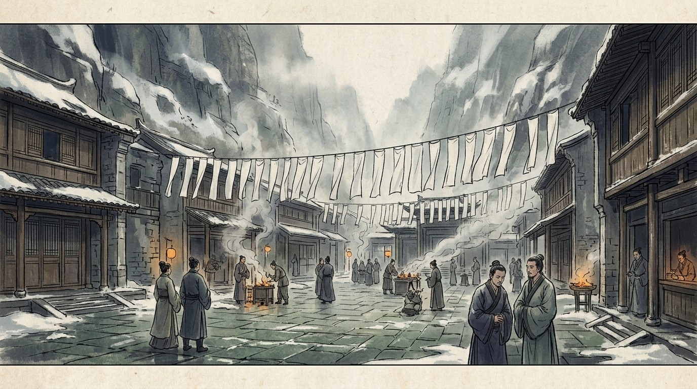

# 第 120 章：名山重整・雲津新約與舊案昭雪

[← 上一章](ch0119.md) ｜ [本卷目錄](00_intro.md) ｜ [下一章 →](ch0121.md)

*章首插畫：第 120 章 名山重整・雲津新約與舊案昭雪*

大劫之後的第七日，雲津峽谷的積雪開始慢慢融化，露出了被雪水沖洗得發亮的青石街道。

萬山廣場上懸掛著數十條素白的招魂幡，空氣裡飄著濃濃的艾草消毒煙霧與祭奠逝者的線香味道。

在經過【跨宗門聯合查核席】連續七個晝夜不眠不休的帳冊交叉比對、倉單核實以及萬寶閣後庫起獲檔案的徹底清點後，三大名山終於在雲津商埠議事廳前聯合頒下了第一道正式善後告示。

劫火雖熄，雲津並沒有迎來惡人盡伏、眾生歡顏的輕快收場。真正落到紙面與磚瓦上的善後，沉重而繁瑣得令人喘不過氣——

首先，涉案的三名長老下場截然不同：

丹鼎宗的**鶴壽長老**在顧玄與白鶴年連日以雪線苔配合三元緩釋法強行保住一息性命後，目前仍被粗鐵鎖鏈鎖在丹鼎隔離鐵室之中等候公審。窗外送進來的苦參湯汁剛換了兩道紗布，隔著半尺厚的鐵柵，裡頭仍不時傳出他喉間拉風箱似的喘息，隨時可能因體內殘留的血毒蝕骨之患衰竭而死。而隔壁不遠處的石囚室裡，失去左臂、修為盡跌的太清執法長老**玄冥**，雖被逼迫交出了部分太清雷符殿過去十年的私下帳冊與「太清雷律」採買簽領存根，卻依舊端著那副冷硬架子隔窗咬死一句：「老夫不過受困天羅、無奈調藥緩症，三十年前舊商盟與五年前黑冰斷谷軍令，一概不知！」至於天工閣的**赤煉長老**——早在問道天台失控當夜便趁亂鑽入萬仞天工山極深處的廢棄地火暗渠逃離了北境三山範圍，至今去向不明。三宗雖聯合對外發出懸賞海捕文書，卻也心知肚明，這等精通機關遁逃術的二階巔峰人物極難在短期內抓回。

其次，三大掌門當眾宣告：即日起全面封停北荒裂谷一切礦脈及方舟母脈採掘，查封並徹底拆除丹鼎宗地底「丙字柒號」秘爐與相關血煉設備，並建立由宋知微、魯長老、簡素真人、雷烈與杜青禾領銜的跨宗門傷亡補償與宗門內部核查機制。

這紙告示最先撫慰到的，是那些在絕望中等了五年、甚至三十年的普通人。

在廣場右側臨時搭起來的平反公布欄前，八荒武山鐵背山主親自代表軍寨將五份加蓋宗門大印的「忠烈歸籍與撫恤憑證」交到了二十九歲的女子韓素以及十幾名走山隊遺屬手裡。「私越禁區擅離職守」的污名被當場塗銷，五年前失蹤的韓林與其餘隊員名姓重新刻進了黑山長城烈士碑，應得的撫恤銀兩與過冬糧米即刻發放。韓素默默接過文書，將哥哥那枚發黑的【北線斥候・乙十七】銅哨仔細包進粗麻布裡，指腹輕輕摩挲過碑上還帶著石粉的新刻名字，半晌沒有說話。站在這場平反儀式最邊緣的燕隼心裡比誰都清楚：一紙公文和一筆撫恤金換不回韓林的命，而大伯燕山留在幽暗裂隙邊上的那面凹陷護心鏡，依舊沒有告訴他大伯如今究竟活在世上哪個角落。

而在廣場另一頭，沈泥替莫三與「雲記」老帳房柯九算遺留在金石府的殘餘家人，接過了由三宗與雲津公所共同見證簽發的**《三十年前舊商盟除名案初步平反文書》**——承認當年「雲記」與部分舊商盟商號遭誣陷剝奪行商資格、名分被篡改一案存在人為私利構陷，即日起恢復「雲記」在九州商道的合法商號名分！

莫三拄著拐杖站在陽光下，枯瘦的手指微微發顫地撫過文書末端那方鮮紅印鑑，老淚縱橫，嘴裡低低念了兩聲柯九算與沈家舊人的名字，卻又很快收起眼淚——他比誰都明白，這張紙不過是撬開三十年前真相的第一道縫隙：完整決策鏈裡究竟還有哪些高高在上的世家或金石商會內堂人物當時簽了字，這張文書上一個名字也還沒填上。

更令沈泥感到一股寒意的，卻是站在議事廳街角對面、幾名正默默打包破爛行李準備離開雲津的熟面孔——

「陶師傅？你這是不在廢丹崖幹了？聽說宗門不是開始查清廢丹補償了嗎？」顧玄剛核對完今日的醫療補給單，走下台階正好看見右手缺了兩根手指的陶生和另外四個面黃肌瘦的丹鼎雜役窯工站在街口等南下馬車。

「補償是有，發了二十枚靈石票打發我們回家養老。」陶生苦笑著搖了搖頭，看了一眼旁邊幾個一直依靠給丙字區與天工私爐拉耐火土、燒製特殊除渣黑炭吃飯的普通工匠家庭，「可顧小大夫，你們把私爐和血精開採徹底封死之後，我們這幾十個手腳都被廢丹毒氣染壞、在外面正經商號根本沒人敢雇用的老苦力，還有靠著往山門運硫磺土和煉渣炭養家糊口的那十幾戶窯工……打昨天起，全沒活兒幹了。工坊熄了火，這條街上少了一半拉碳的車馬，大夥兒總不能抱著你們剛立起來的那塊清白石碑喝西北風過冬吧？」

陶生的話，像一盆冰水直接潑在顧玄與沈泥心頭。

改革不是童話。拆掉一座建立在吃人血液上的黑色供應鏈時，那些原本寄生或被迫依附在這條鏈條最底端討一口飯吃的普通人，往往最先在秩序崩塌的陣痛裡失去生計。

沈泥沉默了足足十息，沒有給陶生畫什麼「以後一定會好起來」的空餅，只從懷裡摸出一張蓋了「泥途商棧」與雲海票號印章的新條子遞了過去：

「陶師傅，西街這幾天剛把萬寶閣名下幾個沒涉案的空倉房拍賣重整。我跟千機院魯長老、章百鍊總匠還有公所羅掌印剛簽下一份試辦條約——過幾天雲津要建一座專門給三宗做合法無毒廢料除毒淨化跟防寒炭再造的集中回收廠，還需要熟手老師傅盯安全規程、管過磅與防毒檢查。工錢比不上當年偷倒紫泥罐的時候多，也得等半個月後開工，但至少乾乾淨淨不用拿命去填石灰坑。你們幾戶要是信得過這張條子，留下來再等半個月。」

陶生怔怔接過那張寫著工錢與防毒裝備配額的紙條，又看了一眼旁邊神情平穩的沈泥，嘴唇囁嚅了半晌，終於用力點了點頭。

當天傍晚，歷經兩日兩夜艱苦的利益拉鋸與制度談判，由沈泥聯合雲海票號顧蘭舟、泥途商棧並代表全埠民間中小商號與公所羅九秤共同起草的**《雲津萬山臨時互市與救濟協約》**，終於在三大名山掌門的聯署蓋印下正式簽訂！

按照這份新協約：

萬寶閣名下挪用的準備金將由其資產清算賠付給受損商號與外門管事（何萬金依律除籍罰沒家產，暫免死罪但終身不得再領行商印信）；萬山商埠公所改組為「三宗與商埠代表共同議事制」，**泥途商棧與數家合規票號首次取得了參與三宗外門大宗採買透明查帳、公開準備金監督以及商事爭議仲裁的正式制度席位**！

走出議事廳大門時，晚霞將整座雲津峽谷染成了一片深沉的暗金。

柳清虛、燕隼、林鐵生、顧玄與莫三早已等在廣場石階下。暮色把石階映得冰涼，沒有人說什麼「已經戰勝名山」的狂話——他們都明白，這份臨時互市協約依然脆弱得很。三大宗門依舊握有絕強的武力與高階傳承，這只是制度改弦的第一步，遠非商幫與仙家平起平坐的終點。

「接下來你們打算怎麼辦？」莫三把拐杖拄在青石縫裡，看著這五個已經徹底褪去稚嫩、卻各自在眼底刻下了風霜與分寸的少年少女。

「把答應別人的善後做完。」顧玄低頭理了理藥囊裡一疊寫滿草藥劑量與麻木症狀的病例草稿，指節上還留著燙傷的水泡舊痕，「那些沒死在毒域裡、被搶救下來的傷患弟子——還有陸師長跟元青師叔——總得有個讓他們自己拿主意、能多活幾年的穩妥方子。」

「長城那邊破了三十丈缺口，巨靈神機的傳動軸也得按不吃血精的新結構徹底大修。」林鐵生摸了摸腰間被爐火燻得烏亮的精鋼卡尺，「再不改掉靠死物卡人命的毛病，下次獸潮來誰去頂那扇鐵門？」

「我也還欠著雷烈將軍跟黑山弟兄一套不靠燃燒臟腑就能站穩防線的輪替操演。」燕隼手腕搭在弓背上，望向北荒依舊灰暗的山脊，「這筆帳，得先把活人穩住，才夠力氣往更北的地方找。」

「而我……」柳清虛抬起頭，遙望北方已經開始隱隱透出一種奇怪沉重壓力的深藍夜空，聲音低得幾乎被暮風吹散，「還要去把藏星秘閣與問道天台這場災難背後所有的星曆錯處收攏起來。剛才在最高層那幾位掌門看我們的眼神裡……我感覺到他們真正忌憚的，並不是我們拆穿了血精買賣，而是我們五個快要踩過這片天地原本絕不許人跨過去的那道禁忌界線了。」

沈泥默默聽完四人的打算，把手伸進懷裡碰了碰那枚微溫的【天門引】與合璧完整的【九城古商盟總契銅版】。暮風刮過雲津峽谷，誰也沒有開口問「跨過去以後會怎樣」，因為帳本翻到這一頁，誰也還看不見下一行寫著什麼。

---

[← 上一章](ch0119.md) ｜ [本卷目錄](00_intro.md) ｜ [下一章 →](ch0121.md)
