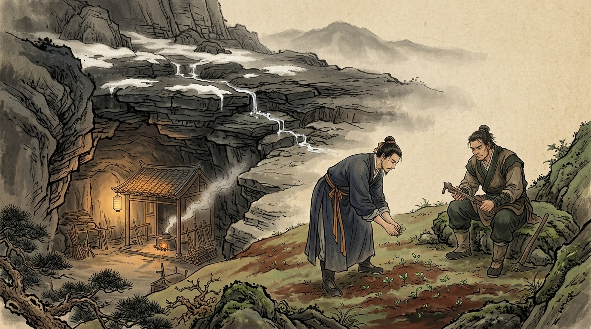
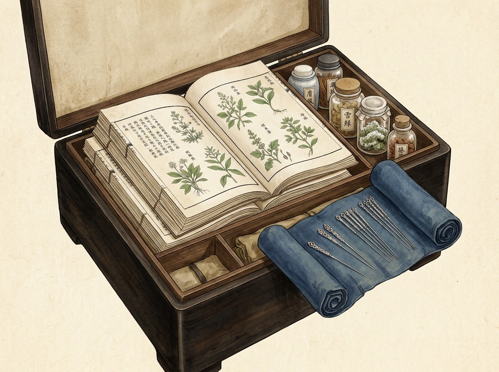

# 第 121 章：百草通玄與天工開物

[← 上一章](ch0120.md) ｜ [本卷目錄](00_intro.md) ｜ [下一章 →](ch0122.md)

*章首插畫：第 121 章 百草通玄與天工開物*

三宗會武的硝煙散盡後，雲津峽谷與三大名山山腰迎來了遲來的早春。積雪在日光下化作無數條清亮的小溪，順著黑石崖壁滴答作響，百草谷陽坡上的泥土裡也悄悄探出了幾點嫩綠的芽尖。

然而對於顧玄與林鐵生來說，戰後的日子並沒有迎來什麼「功成名就、閉關升級」的清閒。恰恰相反，真正的考驗在危機解除之後才真正開始。

丹鼎宗百草谷下方臨時搭起來的戰後醫療隔離區裡，還住著三十多名在問道天台毒域中吸入過晶塵、或是過去半年偷偷服用低配血精延命藥而引發臟腑暗傷的三宗弟子。

這日清晨，一間木棚病房內卻爆發了一陣壓抑的爭執。

「拿走！別把你那碗綠糊糊的草藥湯端過來！」

一名三十多歲、左腕關節已經微微結出一層淡青硬殼的太清外門中年執事縮在木床角落裡，雙眼赤紅地一把打翻了孫聞露手裡的藥碗，嗓音沙啞嘶吼道：「以前執法堂的老爺拿『九轉延命散』給我們吃，說是仙家保命靈丹，結果吃出了一身爛肺；現在換了你們丹鼎宗的新秀，又是拿雪線苔又是拿冷萃湯，說能壓住晶化！誰知道喝下去半年後會不會長出比這更噁心的毒瘤？！老子就算就這麼硬生生變成石頭死在這張床上，也絕不再當你們這些煉丹的試藥活牲口！」

瓷碗碎在石地上，清苦的淡青藥汁濺濕了顧玄的青布鞋面。

「周師叔……」孫聞露蹲下身想撿碎瓷片，臉色難看地抿緊了嘴唇。經過這次劫難，原本就不算寬裕的雪線苔與青河苦參庫存已近枯竭，好不容易從山崖背陰面採集回來一點配好的試劑，卻接連遭到好幾名心灰意冷的傷患強烈抵制。

「別撿了，他不願喝這碗藥，誰也不能硬灌。」

顧玄伸手攔住孫聞露，沒有半點因為好心被砸碗而惱怒，反而異常平靜地拿起一把小掃帚，蹲在床邊一點一點把碎瓷片掃進簸箕裡。他那雙手背與掌心上還留著前些日在石牌坊前看守二十口滾燙藥鍋時被熱氣燙出的水泡焦痕，指縫間盡是洗不淨的苦藥褐漬。

他站起身，用袖角擦了擦手上的藥水，平靜地看著床上那名滿臉戒備的中年執事：「周師叔，我在山南草廬跟葛老頭學採藥那會兒，老頭子總罵一句話——『藥罐子是替人煎的，不是替大夫掙臉面的』。以前宗門只管把丹丸塞進弟子嘴裡，從來不寫清楚裡面摻了什麼毒草、吃下去有多少成指望、又會留下什麼寒氣折騰。你不敢信醫者，是以前那些藥方虧了心。」

顧玄從袖中抽出一本自己這一個月來熬了無數個通宵、在油燈下用炭筆反覆比對這三十多名患者脈象與廢丹崖樣本寫成的手抄草稿——**《三元本草祛道錄》初稿**，輕輕放到木桌邊角，又拿過一塊剛在清涼藥湯裡浸濕擰乾的軟麻布替周執事搭在燙得發緊的手腕外側：

「隔壁石室躺著太清宮的陸觀瀾師長，她那天為了替兩個衛士擋住星煞風暴，半邊經絡全毀、從此再難修行。長老送去的血丹她看都不看一眼，只每天讓醫徒替她換冷敷藥布，一寸一寸記著左肩麻了多少、寒意退了幾分。我這本方子也是一樣——上頭寫得明明白白：雪線苔配苦參冷湯，只能替晶絲還停在皮下三寸、未曾鑽入心肺主脈的人拖慢惡化三到五成；停藥之後若無震波與陽氣幫著剝離，半年內照樣會復發，喝藥期間還會手腳發涼、食慾減退。至於超過五年的老病灶，這碗苦湯無能為力。吃不吃，周師叔找識字的同鄉念過單子自己拿主意——就算你選擇不喝，每天三頓熱粥和這塊浸藥濕布照常送進來，沒人會逼你張嘴。」

說罷，顧玄轉身便與白鶴年一同退出了病房，只留下一室淡淡的苦參藥香。

一連十數日，顧玄走遍百草谷每一個藥圃、重新測算地肺水渠的毒鹼寒熱變化、把白岩醫師從北荒前哨捎回來的最新雪原寒症病例逐一納入試方比對，更不嫌麻煩地將每味草藥的毒性下限、與柳清虛等人「三元互濟」協同介入時的火候時辰節度，盡數寫成連最普通外門雜役都能照單看懂、親手覆驗的簡明條目。

直到春分前夜，當那名最初打翻藥碗的周執事終於在仔細請同鄉念完那整本不隱瞞半點苦痛風險的《三元本草祛道錄》禁忌單後，自己一瘸一拐地走到醫理院門口伸手領了一碗藥湯，而百草谷上游被污染的那條水渠也在葉青枝與顧玄的輪作淨化下重新流出第一捧清冽無毒的泉水時——

顧玄站在藥圃水渠邊，俯下身掬起一捧涼水洗去手上厚厚的藥漬。體內原本在二階九十幾重徘徊不定的藥道生機，在沒有半分雷鳴異象的情況下，悄然與山谷間萬千草木的自然榮枯呼吸徹底合拍，水到渠成地推開了那扇屬於二階大圓滿的門檻！

他知道自己照樣救不回已成死石的人，也填不平這世道砸出來的裂口；只是這一次，他真正接住了葛半仙在草廬教過的那點本分——不拿大夫的體面壓人張嘴，只把藥罐裡煎著什麼草、苦在哪裡、效有幾分，原原本本交到病人手裡。

……

同一時刻，萬仞天工山腹地深處的萬機地窟內，爐火依舊終年不熄。

經過黑山長城那一戰死死頂住城門樑柱的極限負荷後，天工閣鎮山重器【巨靈神機】的胸腔主軸與右肩聯動關節幾乎報廢了半數。過去這一個月，林鐵生幾乎吃住都在地窟的檢修架上，與千機院魯長老、地火鍛兵台總匠章百鍊、女陣匠聞九以及值守匠師季衡一道，對這尊高逾十丈的太古機關進行建閣百年來第一次完全摒棄血精、徹底拆解筋骨承壓結構的深度大修。

這天深夜，最後一根按照【太古不融黑鐵齒輪構件】毫釐不差的弧度重新翻砂鍛造的百煉柔韌玄金副軸，終於在章百鍊親自控溫的地肺烈火下淬煉成形、精準吊裝進了巨靈神機胸腔核心！

然而在最後接駁主控傳令迴路的關頭，地窟裡的氣氛卻突然陷入了僵持。

「鐵生，外圍的水火氣壓機閥已經跟這套新齒輪完全咬合了。」

拿著陣圖紙的聞九擦了一把臉上的黑灰，指著核心操控席位最裡層那七根閃爍著幽冷靈光的太古傀儡引絲，眉頭緊鎖：「可這尊巨靈神機原本並不是設計給普通二階武夫手動拉桿操控的。如果只用機械槓桿傳動，它的反應速度還是比北荒那頭骨龍慢了兩拍。剛才紫霄真人跟玄樞門主派下來的總監察使在公文裡建議……問你願不願意趁著這次修為快破百重關口，用你自己的本命神識當成主陣橋樑，直接『長久鎖入』巨像主軸？只要你點頭，這具神機就能立刻多出三成戰力，你也能一步踏進宗門天工大宗師的門檻！」

「胡鬧！」千機院魯長老還沒等林鐵生開口，自己先把烏木拐杖重重往鋼板上一頓，指著季衡手裡那本歷代檢修事故冊，「前代天工閣有個叫陸明的奇才，五十年前就是信了『以人魂馭神機』的鬼話，把自己的神識接進這東西胸口主陣裡！結果不到三年，整個人半邊腦子被那冰冷的太古巨力反震成了一個只會看齒輪轉動、連自家娘子都不認得的活人偶！」

一直沉默拿著阿鐵精鋼卡尺反覆比對那幾根玄微引絲尺寸的林鐵生，緩緩直起腰板。

他看了一眼面前那尊雄偉精密、彷彿連山嶽都能撼動的太古巨神機，又低頭看了看自己這雙雖然滿是燙傷老繭、卻依然能感受到爐火溫度與阿鐵師父鍛錘重量的凡人之手。

「我不接進去。」林鐵生聲音敦厚平實，卻像一塊砸實進地基的條石，半毫也推不動，「阿鐵師父教我打鐵那天就說過：人使錘子，錘子不能反過來使喚人。把人腦子塞進鐵殼裡當齒輪，那不是天工造物，是把自己改造成零件。」

他隨即展開一整捲這半個月來偷偷在燈下畫出來的圖紙，鋪在油膩的檢修台上：「接線慢兩拍，那就別指望一個人靠腦子硬扛全部反應。咱們把這裡改成一套**『三段式可拆換連桿牽機台』**——左腕接油壓銅管傳回阻力，腳底踏板配兩組精鋼緩衝機簧，平時照樣留三個尋常機括操持席位給普通匠師分攤操作，誰累了隨時拔掉卡榫換下一個人坐上去，絕不把任何一個活人的命死鎖在這堆黑鐵裡面！」

魯長老與章百鍊盯著這套結構巧妙絕倫、既保留了太古極致咬合精度又堅決把「人」從機器裡完整剝離出來的可拆換連桿牽機圖紙，老眼同時亮起一陣熾熱的精光！

三日後，當第一具可拆換連桿牽機台嚴絲合縫地裝進巨靈神機胸腔，林鐵生雙手握住拉桿輕輕一推——那尊十丈高的龐然大物在沒有耗用一錢血精、也沒有綁死任何一條人魂的情況下，竟然流暢沉穩地舉起萬斤左臂向著天工地窟平穩行了一個標準軍禮，誤差不超半厘！

「咔嚓。」

林鐵生胸口深處彷彿有一塊壓了數年的粗鐵原礦被最後一錘徹底震碎。不需要什麼天降神光，這位從黑石鋪打鐵爐房走出的少年匠師，憑著「格物守人」的本心與百工實證，正式邁入了天工物道二階大圓滿之境！

---

*器物圖誌：《三元本草祛道錄》藥匣與銀針*

---

[← 上一章](ch0120.md) ｜ [本卷目錄](00_intro.md) ｜ [下一章 →](ch0122.md)
