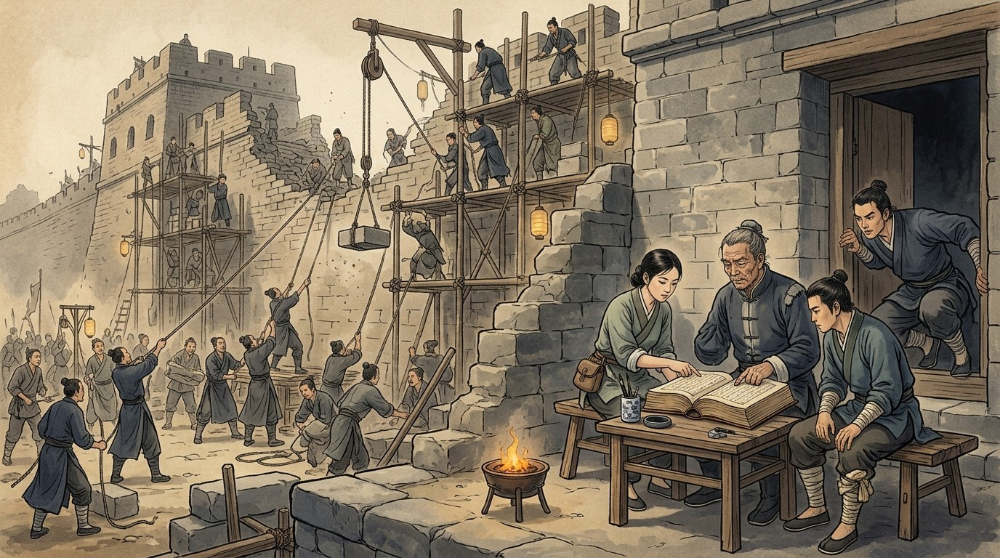

# 第 122 章：八荒不滅與紫微破妄

[← 上一章](ch0121.md) ｜ [本卷目錄](00_intro.md) ｜ [下一章 →](ch0123.md)

*章首插畫：第 122 章 八荒不滅與紫微破妄*

春寒料峭的午後，黑山長城西段那三十丈被冰獄骨龍撞毀的缺口處，早已搭起了高聳的木石鷹架。上百名八荒武山外門弟子與重石縣招募上來的民間石匠正冒著山風合力吊裝新條石，叮叮噹噹的鑿石聲此起彼落。

城樓下方背風處一間新修的石砌平房前，燕隼正蹲在門檻邊，陪著獨臂老將雷烈、右膝仍裹著藥布的岳停山以及養息院女醫官杜青禾，一頁一頁地核對著那本厚得像磚頭一樣的《北荒陣亡與重傷安置名冊》。

「這本冊子，跟五年前走山隊那本不一樣。」阿滿端著幾碗熱氣騰騰的粗糧小米粥走了過來，聲音有些低沉，「裡頭記著的八十七個名字，每一個都有家鄉地址、親人下落、該發多少撫恤糧、還有幾個傷了肺腑和腿筋以後再也拿不動刀槍的漢子，往後是留在養息院當教習還是回雲津擺攤討生活。」

燕隼伸出手指，指腹緩緩抹過名冊第一頁幾個他不久前還見過活生生面孔的巡哨小兵名字，最後目光停在邊角附錄的那張「大伯燕山・黑冰斷谷失聯案備忘頁」上。

「你還記不記得，三個月前剛進黑山營那會兒，我跟岳教頭吵過一架？」燕隼忽然開口，語氣平靜得不像從前那個隨時一點就炸的野狼少年。

岳停山停下喝粥的動作，扯了扯嘴角：「記得。那時你小子覺得老子太保守，打仗老喊撤退太窩囊。」

「後來在遺塚裡看見大伯爬進裂隙那條血痕，又在西門看著這幾十號弟兄跟阿滿姐差點全葬送在狼群嘴裡，我才真正想明白。」燕隼站起身，望向北方那片漸漸化雪、依舊顯得荒涼而深不可測的北荒裂谷，眼神深沉而坦然：

「尋親不是為了拿著仇人的腦袋去祭祖；守住關口也不是靠著把每個武修當成柴火扔進爐子裡燒乾氣血去硬撐。我以前練《煞血霸體訣》，總覺得只要能咬牙把全身力量一口氣全炸出來貫穿敵人咽喉就夠了——可那天要不是有你們輪班換防、要不是有顧玄的沸血湯跟唐校尉的補給箭，老子哪怕有一百條命也早死在城牆底下了。」

這一個月來，燕隼並沒有躲進閉關密室裡去修什麼絕世神功，而是老老實實待在黑山營操場與傷兵養息院裡，配合杜青禾的病理紀錄與岳停山的實戰操演經驗，把自己從荒古戰神遺塚裡領悟出來的那套「長呼吸節律與氣血分段鎖儲法」徹底拆解簡化，結合顧玄提供的溫和降燥草藥配方，寫成了一套不需要依賴任何血精急鎮丸就能大幅降低高強度操練焚腑風險的《黑山分段輪替操典》。

與此同時，他自己右肩那處在冰谷伏擊與長城守衛戰中反覆崩裂拉傷的舊筋骨，也並未因為突破境界而奇蹟般「瞬間完美復原」——每逢變天陰雨，肩胛骨深處依舊會泛起一陣隱隱的痠痛，那是他真實活過這場戰役、沒有藉助任何仙丹奇藥消抹的肉身印記。

「呼——」

傍晚收操時，燕隼獨自走到黑山關最北端那座迎風箭樓上，沒有拉出滿弓射向天際炫耀威風，只是平靜地舉起那張百斤重石鐵胎柘木弓，搭上一支普通鐵箭，隨意朝著三百步外雪脊上一塊剛滑下來的落石穩穩鬆弦。

箭出無聲，凝練到了極點的勁道甚至沒有驚起半片雪花，卻在接觸落石的剎那讓那塊數百斤重的青岩由內而外無聲化作一團均勻細碎的石粉！

全身氣血如大江入海般平靜無波、卻又深沉得深不可測——八荒力道二階大圓滿，成！

……

而在距離黑山長城數百里之外的太清玄天宮雲頂天柱峰上，此刻也正進行著一場沒有硝煙、卻同樣驚心動魄的推演交接。

晨鐘尚未敲響時，周天星律院偏廊那隻小炭火盆旁只坐著兩個人。授業師陸觀瀾半邊左肩仍裹著厚厚的浸藥麻布，臉色白得幾乎與窗外殘雪同色，桌邊只放著一碗放涼了的苦參淡藥湯——自打那日在問道天台東側副陣柱下被星煞反震廢去半邊經絡後，執法堂舊部曾幾次暗中遞來暗紅延命丸，全被她連匣退了出去。

柳清虛站在炭盆側畔，從袖裡取出一面刻著周天星律院印記的【紫銅護身鏡】，雙手捧著輕輕放到木案邊緣：「師長，那天在石牌坊下借的護身鏡，還給您。鏡框東北角被星煞掃出一道細裂。」

陸觀瀾沒有伸手去收，反而用完好的右手輕輕把那面紫銅鏡推回柳清虛掌前。她的聲音有些啞，卻平靜得像已經看開了這半生走錯的路：「留著吧。我這條胳膊以後再也引不動星力了，留一面護身鏡在身邊也不過是個擺設。」

她抬起眼，目光越過柳清虛單薄的肩膀望向敞開門廊外頭雲海深處的蒼穹：「我在星律院教了二十年書，一直以為先賢定下的星曆推步就是這片天本身。到那天雙手按上斷柱才知道，紙上寫得再工整，真要天柱裂開了，連半息也擋不住。我不後悔替那兩個小兵多壓住三十息——只是往後這天柱峰上的眼睛，總得交給敢認錯、也敢往外頭看的人。」

她手指微不可察地顫了一下，輕聲道：「若哪天你走得比天柱峰更遠，替我看看……這片假天外頭，是不是真有不靠吃人就能轉的規矩。」

柳清虛垂眸看了一眼掌心裡那面冰涼帶著裂紋的【紫銅護身鏡】，指節緩緩收緊，將它貼身收入道袍內袋，只極輕極沉地點了點頭：「弟子記下了。」

半個時辰後，周天星律院的大殿內坐滿了幾乎半數以上的太清內外門觀測弟子。

曾經視柳清虛為眼中釘肉中刺的世家弟子沈照塵，此刻正一臉複雜卻極為認真地站在大黑板右側，拿著算籌逐一核對著柳清虛這一個月來在觀測哨整理出來的上千組冬春交界星候實測底錄。旁邊的桌案邊，陸觀瀾靜靜旁聽，身側坐著手持原始星圖檔案的余守拙老吏與掌院宋知微。

「按照《太清正統星曆》舊本推演，今日夜間亥時三刻，天柱峰北坡應出現一次東南向乾燥平流風。」沈照塵報完舊曆推步之數後，低頭看了一眼旁邊那份用紅筆密密麻麻寫著錯漏註記的新冊，忍不住皺眉抬頭，「可清虛師兄你這份《逆星歲差實測補遺》，上面寫的卻是『西北寒流倒灌十居其七，其餘三成極可能受半山尚未散盡的餘煞牽動而偏離舊數』……既然連你自己都算不準那三成，那你這套新星曆跟舊本比起來，又怎麼敢說是『絕對正確的真理』？」

這話問得極為尖銳，也是許多習慣了尋找一個「全知全能標準答案」的法修心底最深的困惑。

站在黑板正前方的柳清虛，左手兩根指頭雖然還留著些微不太影響書寫的輕微麻木舊感，目光卻清澈而疏離，宛如天柱峰頂一汪不結冰的寒潭。

他沒有急著替自己辯白，只是轉過身，當著滿屋子太清弟子與宋知微掌院的面，拿起那支沾著白粉筆灰的算棍，在新訂星曆冊頁首行旁重重寫下一行字——**『此錄僅據近三百年北境高寒星候實測而定，倘日後天象有變、實測不符，當依實象改寫，不可執為鐵律』**！

「誰說這是新的真理了？」

柳清虛回過身，嗓音不大，卻讓整座殿堂瞬間靜了下來。他的目光沒有在任何一張臉上久停，反倒微微穿過敞開的北窗，落在那片灰白深遠的天穹隙縫上：「算不盡，本就是常態。太清宮過去三百年犯的最大錯處，就是把先賢留下來觀測風雨星辰的尺子，供成了不許增減一分的鐵律，連實測偏了半分都要拿朱筆硬抹平。」

「頭頂那張二十八宿天羅每三百年撥動一次，背後是誰在拉弦、這片假天究竟罩住多少疆界，我一樣看不透。」他垂眸看著案上那疊記滿誤差與空白的麻紙，神色冷峻而節制，「正因算不盡、看不全，我們才要把每一次算錯的時辰、偏了的星度原原本本留在紙上交給後來人，少讓他們踏進暗溝，而不是把錯處藏進密室暗匣裡粉飾太平。」

話音落定，整座周天星律院寂靜了數息，隨即，一直抿唇不語的掌院宋知微帶頭極輕地鼓了幾下掌；角落裡，陸觀瀾看著那行還飄著粉筆灰的字跡，眼眶微濕卻終於緩緩舒開了眉頭。沈照塵緊鎖的眉頭鬆開，朝著柳清虛鄭重地彎腰稽首一禮，轉身默默拿起炭筆，把剛才對比出來的那兩組乖舛氣流實測一字不改地補寫進了公開觀測欄裡。

就在此時，柳清虛抬起頭，目光穿過敞開的殿門窗櫺，望向高懸在雲海之上那片看起來湛藍晴朗、實則在他的極限神識視野裡卻隱約顯現出無數條冰冷細密幾何交網痕跡的天穹——

當他徹底放下對「完美絕對天道」的最後一絲虛幻執念，誠實承認自己依然渺小且充滿未知之際，那道卡在法道九十九重門檻上許久的無形桎梏悄然碎裂！

神識清澈通明如鏡，直抵凡間法道二階圓滿極境。他看到了假天那張籠罩世界的巨網之上又多出了幾處以往從未看清的隱晦裂縫與調控脈絡——卻也更清醒地明白，光靠此刻這雙站在山巔的眼睛，依然看不透那片網背後究竟藏著何等龐然大物。

---

[← 上一章](ch0121.md) ｜ [本卷目錄](00_intro.md) ｜ [下一章 →](ch0123.md)
