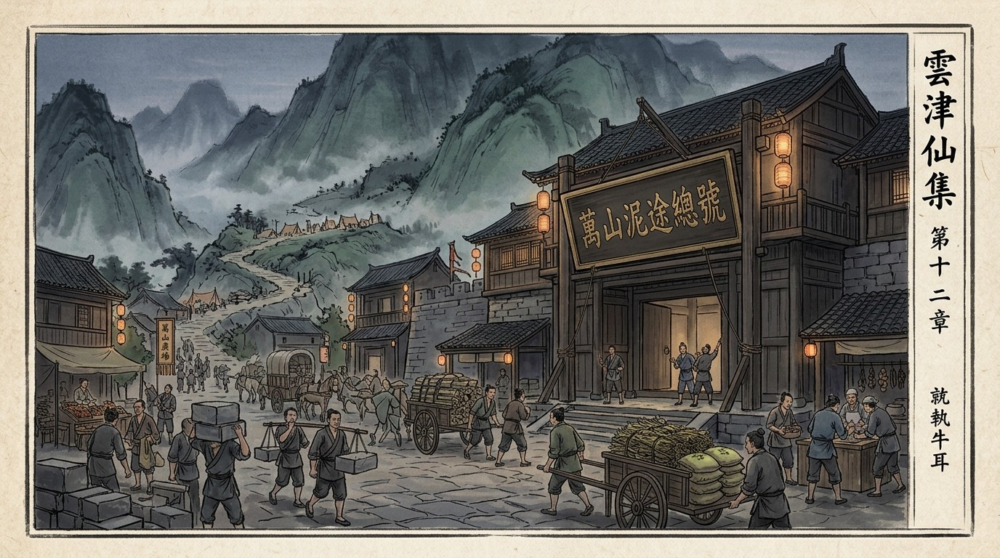

# 第 123 章：萬山執牛耳・不入仙門的極境

[← 上一章](ch0122.md) ｜ [本卷目錄](00_intro.md) ｜ [下一章 →](ch0124.md)

*章首插畫：第 123 章 萬山執牛耳・不入仙門的極境*

如果說三大名山山腰上的戰後重建靠的是藥理、工程與操典，那麼山腳下雲津仙集這兩個月來的劇變，則是一場看不見血跡、卻同樣步步驚心的秩序重塑。

春分過後，萬寶閣的資產清算已經進入尾聲。

原本坐落於雲津萬山廣場最顯眼位置、掛著金字大招牌的「泥途商棧」，如今已經正式換上了一塊氣勢沉穩的烏木燙金新匾——**【萬山泥途總號】**。從黑山長城急需的十萬斤條石、三宗隔離區每天消耗的藥草與石灰，到三十幾戶原本失業窯工的安置轉廠、以及金石府十三州源源不斷北上的春季糧秣與布匹，幾乎十張單子裡頭有七張都要從這座總號的門口經過。

在外人眼裡，年僅十六歲的少女沈泥，已經成了這座萬山商埠名副其實的無冕之王。

這日深夜三更，總號後院那間早已擴建成兩進寬敞青石院落的議事帳房裡卻依然亮著燈火。

剛核對完今日各州匯票清算紀錄的邱禾打著哈欠伸了個懶腰，把一疊蓋滿了紅印的新契約抱進木匣，笑著對坐在書案後面的沈泥道：「東家，這幾個月咱們真是打了一場漂亮仗！前天南邊盤木縣和青河縣的商會大管事寫信來問，下個月這批春茶跟藥草的北上運價是不是由咱們泥途總號統一拍板？還有太清宮新上任的採買管事也偷偷送了話來，說只要咱們肯點頭優先給他們供低價精炭，公所下季度那個靈石票號的免稅特批名額，太清宮願意替咱們全權擔保！」

這是一句聽起來極為誘人、換作任何一個商人做夢都要笑醒的條件。

只要沈泥今晚拿起筆在這幾張條子上簽下字——從明日清晨起，「萬山泥途總號」就能順理成章地接管雲津原本屬於萬寶閣的那套排他定價權、獨占三宗外門最肥美的炭火與藥材配額，成為這座北境萬山商埠裡頭說一不二的商業霸主！

莫三正坐在旁邊的矮榻上擦拭他的舊拐杖，聞言沒有急著發表意見，只抬眼看了一眼靜靜坐在油燈下頭的沈泥。

出乎邱禾的預料，沈泥並沒有接過那支已經蘸滿紅硃砂的毛筆。

她反而靜靜看著眼前這間燈火通明、堆滿了各地契紙與靈石匯票的寬敞帳房，指尖輕輕摩挲著胸口貼身放著的那枚青金古令【萬物行商・天門引】與合璧完整的【九城古商盟總契銅版】。

「邱禾姐，你記不記得咱們剛到雲津第一天去萬寶閣門外看熱鬧的時候，我問過你一句什麼？」沈泥忽然抬起頭問道。

邱禾愣了一下：「你問我，為什麼這條街上二十幾家大大小小的腳行，最後全都只能看何萬金一個人臉色吃飯。」

「因為何萬金握著甲字倉房、握著車馬行七成馬匹、還握著三宗外門那筆獨門配額。」沈泥的聲音在安靜的夜裡顯得異常冷靜，「現在萬寶閣倒了，可這兩個月下來，你們瞧瞧咱們自己手裡的帳本——盤木縣的木材運線押在我這裡，陶師傅那幾十個老窯工靠著我給的回收廠條子吃飯，連太清宮採買管事都開始問我『優先給誰供炭』……」

她把那兩張代表著「獨占特批與統一定價權」的請願條子輕輕推到油燈邊緣，看著紙面在橘黃色的燈光下投出一道陰影：

「如果我今晚簽下這個字，明天起這座雲津仙集裡頭，不就只是把『何姓的萬寶閣』，換成了『沈姓的泥途總號』嗎？哪天我要是心情不好或者為了自己家的利益漲價一成、少發一車炭火，底下那些靠這條路吃飯的商戶和藥農，是不是一樣連句說『不』的本錢都沒有？」

邱禾瞬間啞口無言，站在原地怔了足足五息。連一旁一直默不作聲的莫三，手裡的抹布也微微停頓，那雙歷經三十年風霜的濁眼裡閃過一抹深深的欣慰與震動。

「三十年前我太祖那一輩建起『九城萬物商盟』，在方舟控台刻下『人間總調度使』這五個字的時候，絕對不是為了讓一家商號坐在山腳底下當土皇帝，去卡死全天下買賣人的脖子。」

沈泥深吸一口氣，拿起毛筆卻並未去簽那兩張排他契書，而是當場鋪開一張全新的宣紙，借著顧蘭舟前幾日送來的票號清算章程，一筆一劃地起草了一紙足以震動整座雲津商界的新盟約——**《萬山共治分權與透明互保章程》**！

在這張章程裡，沈泥親手割捨掉了極大一塊已經送到嘴邊的暴利與獨斷權力：

一、萬山泥途總號主動向雲津公所與合規商戶公開主要民生物資（糙米、煤炭、基礎傷藥）的產地採購基準價與倉儲安全備用金實額，接受由八家中小商號代表組成的「聯合查核組」每月一次無預警盤點帳房；

二、將原本被泥途總號一口吃下的盤木運輸、青河藥材與廢料再造業務，按公平抽籤與履約評分機制，主動拆分成六條平行標段，邀請包括穆雪的雪橇行腳隊、顧蘭舟的雲海票號以及六家信譽良好的本地中小商號共同承運並各自保留獨立議價簽約權；

三、凡萬山商埠內任何一家商戶或邊民，無論大小，皆有權持透明帳單拒絕接受任何商號（包括泥途總號在內）的強買強賣或排他附庸條款，違者由公所掌印羅九秤領銜全埠商戶聯手停票制裁！

「東家……這要是發出去，咱們總號每個月少賺的利銀少說得有四成，還得整天被別人派人進帳房翻底冊！」邱禾看著這份幾乎把自家權力砍掉一半的盟約草稿，心疼得直吸冷氣。

「賺少四成，換來的是這座商埠裡有一百家商號都願意替咱們這套公平規矩撐腰。」沈泥放下毛筆，看著草稿上墨跡未乾的條文，眼神清澈而堅定，「萬寶閣倒了，一個獨斷專行的帝國早晚會被下一場雪崩埋掉；唯有讓每一方都有底氣對不公平的買賣說『不』，這份【九城總約】的根基，才真正活了過來。」

翌日午後，當萬山商埠議事廳外貼出這張主動分權與接受公開核查的《萬山共治分權章程》時，全埠上下先是一片難以置信的寂靜，隨後在顧蘭舟與羅九秤帶頭簽署連保印信的那一刻，廳內廳外數百名常年在各大商號夾縫裡討生活的中小行商與腳夫領隊，爆發出了久違而真誠的掌聲！

就在這片人間煙火最熱烈、信任與契約重新咬合運轉的喧囂聲中——

站在議事廳窗邊的沈泥，突然感覺胸口貼身放著的那枚黑鐵【天門引】發出一陣極為溫潤柔和的輕微震動。與柳清虛等人破障時的驚心動魄完全不同，沈泥身上沒有半點仙風道骨的靈氣波動，卻彷彿在這一刻與腳下這座熙熙攘攘的萬丈紅塵、與那條跨越金石十三府直到北境雲海的無形商道契約網絡徹底融為一體。

心神空明，進退有度，不為名利所役，亦不為權勢所縛。

這位自始至終未曾踏入任何一座修真山門一步、從黑石鋪爛泥廢柴房一路爬出來的少女行商，竟憑著一桿算盤、一紙契約與對人心的敬畏克己，在紅塵市井之中實打實地觸及並跨越了屬於人類生命極限的二階大圓滿門檻！

而這座正式由多方共同治理、不再歸屬於單一個人帝國的**【萬山泥途總號】**，也從此刻起，真正成了這片遺忘世界凡間大地上最堅固的一座人間錨點。

---

[← 上一章](ch0122.md) ｜ [本卷目錄](00_intro.md) ｜ [下一章 →](ch0124.md)
