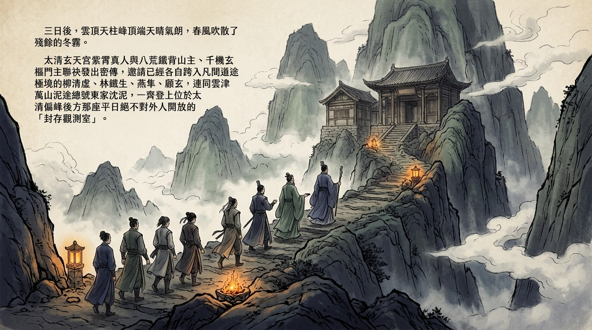

# 第 124 章：天道排斥・滅世劫雲的鎖定

[← 上一章](ch0123.md) ｜ [本卷目錄](00_intro.md) ｜ [下一章 →](ch0125.md)

*章首插畫：第 124 章 天道排斥・滅世劫雲的鎖定*

三日後，雲頂天柱峰頂端天晴氣朗，春風吹散了殘餘的冬霧。

太清玄天宮紫霄真人與八荒鐵背山主、千機玄樞門主聯袂發出密傳，邀請已經各自跨入凡間道途極境的柳清虛、林鐵生、燕隼、顧玄，連同雲津萬山泥途總號東家沈泥，一齊登上位於太清偏峰後方那座平日絕不對外人開放的「封存觀測室」。

三位掌門原本的用意，是想當著五人以及宋知微、魯長老、雷烈、簡素真人等改革宿老的面，就過去幾個月北荒方舟陣基的結構異常與星曆偏移問題，讓這五個年輕人把隨身帶著的五件太古遺物拿出來做最後一次公開對照校驗，好徹底定下三宗今後應對地脈危機的規程。

然而，誰也沒有預料到這一次會面竟然觸動了整座天地最深沉的禁忌鐵律——

當五位神魂、氣血、百工與心算皆已臻至人間極境的少年少女，在偏峰這處極為靠近太清導星陣眼的高崖石室同時取出各自的太古遺物並肩而立的剎那——

「嗡————！！！」

柳清虛的【逆星斷碑拓片】、林鐵生的【太古不融黑鐵齒輪構件】、燕隼的【太古戰神獵獸圖騰骨片】、顧玄的【古礦地煞晶核殘片】，以及沈泥的【萬物行商・天門引】與合璧後的【九城古商盟總契銅版】，竟彷彿在感應到這五具肉身與神識已經徹底擺脫了單一偏科樊籬、互相交融出一絲微弱三元和諧氣機之後，驟然爆發出了比金石府小棧與北荒方舟圓台時還要強烈十倍的恐怖共鳴！

與此同時，腳底下掩埋著北荒破界方舟主陣基的萬丈地脈同時傳出低沉的轟鳴回響；而極高的九天蒼穹之上，那座平素肉眼看不見、每隔三百年才悄悄撥動一次星軌的「二十八宿天羅假天」，彷彿在這一息之間猛然察覺到了五個「已經跳出三道偏科桎梏、還同時握著全套方舟契印」的異數生靈！

「轟隆————！」

原本萬里無雲的晴朗春空，在短短十餘息之內，突然毫無徵兆地被一層從天際盡頭瘋狂匯聚過來的厚重紫黑色烏雲徹底吞沒！

烏雲壓低到了令人窒息的高度，裡面翻滾著的不是尋常雷雨天的閃電，而是一道道散發著冷漠、死板、宛如天刑鍘刀般令人神魂刺痛的暗紫雷弧！整座北境三山方圓數百里的天地靈機在瞬間變得極為狂躁排斥，石室內的幾隻油燈火苗猛然被無形氣壓壓扁熄滅，連旁邊站著的紫霄真人與兩位掌門，都感到腳下的山體空間發出了不堪重負的「咯吱」細微呻吟！

「不是普通破境才會落下的單人雷劫……」

柳清虛左手下意識按住懷裡那面陸觀瀾留給他的裂紋紫銅護身鏡，仰起頭看著窗外迅速擴大、鎖定整座天柱峰與雲津上空的紫黑雲渦，臉色沉重到了極點，對身旁臉色同樣大變的三宗掌門急聲道：

「剛才五件遺物同時共鳴，與我等體內已達極境的氣機相互疊加，同時引動了九天假天的巡守禁制、地底太古陣基的同源回響，以及大清洗之後凡間這片本就極度脆弱的天地承載極限——這片雲層正在把我們五個當成必須抹除的天網破口鎖死！」

「果然還是走到這一步了……」

太清掌門紫霄真人深吸一口氣，看著頭頂那片正在緩慢旋轉壓低、估計最多再有一兩日便會徹底鎖死落雷的紫黑劫雲，眼中閃過一絲極深沉的疲憊與無奈。他沒有半點隱瞞，轉身走到石室牆角，取下一方貼著三宗聯署封印的玄鐵舊木匣，當著所有人的面打開了裡頭一卷泛黃殘破、連紙角都已經發脆的祖師密錄。

在密錄底下，還靜靜墊著半截從地底古陣門檻石縫裡刮下來的灰白枯草，以及一塊早已被抽乾了一切靈機、表面布滿苦鹽白霜的太古廢鐵殘片——顧玄只隔著三尺聞了一眼，眉頭便微不可察地蹙起：那截灰白草莖硬如死鐵，沒有半點凡間草木的年輪與水氣；而那層白霜散發出的乾燥苦澀氣味，與整個北境乃至大乾十三州的泥土截然不同。

「事到如今，三宗也沒什麼好對你們五個隱瞞的了。」

千機玄樞門主與八荒鐵背山主同時點頭默許，紫霄真人這才將這樁在三大名山最高層秘密流傳了千年的核心秘辛一字一字吐出：

「你們應該早已經在藏星秘閣與升仙台看過真相了——太古大清洗之後，這片凡間的天地法則早已被人從外面修補成了一座脆弱得容不下更高階生靈常駐的薄冰牢籠。在我們三宗歷史上，每隔百餘年，總會有那麼一兩位不甘心靠吃禁丹壓制、又不願坐化玉成一尊供能石像的絕世先賢，硬生生把修為推到凡間道途極境。」

「一旦觸動了頭頂那片天羅假天的排斥紅線，留在凡間只有兩個下場——」紫霄真人指了指頭頂翻滾的紫黑雷雲，「要麼被這道不毀肉身不罷休的『化道滅世神雷』活活劈成齏粉，要麼連帶腳底下這方圓數百里的脆弱地脈一塊兒震裂塌陷！」

「那以前那些老祖宗呢？難道全都死在雷底下了？」燕隼皺緊眉頭追問。

「還有一條路。」鐵背山主伸出粗壯的指頭，緩緩指了指腳底下萬丈深處三大名山山脈在地底交匯的那一點，「三大名山當年選在雲津這片絕地開山立宗，根本不是為了什麼風水靈氣——而是因為三大祖庭地下千丈深處，剛好壓著一座太古先民留下來的、唯一還沒徹底報廢的**【桃花源單向古傳送陣】**！」

「桃花源……洞天？！」沈泥與柳清虛目光同時一震。

「不錯。在祖師留下的殘卷裡，那座由古陣連通的異界洞天，是一處與凡間這套脆弱天羅規則徹底隔離的獨立天地。凡是觸及凡間上限的極境之人，唯一的避險出路，就是拿著對應信物與蓄積多年的三宗陣盤靈石啟動這座單向古陣，在滅世雷劫劈落前遁入桃花源洞天之中！」

說到這裡，紫霄真人卻極其罕見、也極其坦誠地停頓了下來，將那本泛黃殘缺的祖師密錄緩緩推到了五人面前——

「但老夫必須把醜話跟缺口全數攤在檯面上，絕不拿半句仙家美夢哄騙你們去送死。」

紫霄真人那雙看透百年世事的眼睛裡沒有絲毫美化，聲音低沉而冷峻：「這本密錄上，確確實實記著歷代共有**至少十七批**達到極境的先輩走進過地底那座大殿、在青光閃過之後消失不見。可你們仔細看看這最後一頁——**沒有任何一卷檔案能證明那十七批人全都平安穿過空間壁障活著落在了對面；沒有任何記載能告訴我們，凡間練出的吐納法訣與百工器物到了門那頭的法則底下還管不管用，甚至連門後的一日一夜與凡間歲月是否同速都無人知曉；更從來沒有任何一個人……能從那扇門後面活著走回來半步！**」

封存觀測室內瞬間安靜得落針可聞。

這是一場沒有保書、沒有回頭路、甚至連「對岸究竟是不是活路」都無法驗證的單向豪賭。到這一刻，五個人心裡都像明鏡一樣清楚他們已經查明與尚未查明的邊界——

他們已經查清了假天每三百年被人校順一次，查清了北荒血精只是方舟鎮熱毒液，也斬斷了三宗私盟的採掘黑手；可他們依然不知道究竟是誰在九天之上架起了這座天羅牢籠，不知道那十七批先賢進去後成了仙還是成了枯骨，更不知道門後等待他們的是怎樣的天地規矩。

「走得掉，未必回得來。」沈泥輕輕吐出一口氣，手指摩挲著胸前那塊已在北荒方舟合為完整一體的【九城古商盟總契銅版】，「難怪九城總約裡只寫著『破界之日保人間火種』，卻隻字不提『功成歸返』——我倒要進去看個明白，當年簽下這份總契的先人，到底給人間留沒留回頭的帳本。」

「燕山大伯五年前留在戰神遺塚裂隙邊上的血跡，一直通向地底深處。」燕隼緊緊攥住那面被砸凹的【護心鏡】，黑眸如刀，「當年到底誰在黑冰斷谷背後簽了字、大伯還在不在門那頭喘氣，這條路我必須親眼去走一趟！」

「北荒冰層底下埋著的，只是一截摔斷的右翼推進殘艙。」林鐵生低頭看著掌心那枚微溫的【太古不融黑鐵齒輪構件】，嗓音低沉而踏實，「木匣裡這塊廢鐵上的榫口，和北荒方舟是同一個爐子打出來的。我想去門那頭看看，完整的方舟主體究竟落在哪裡，世上到底有沒有不用拿人命當柴燒也能長久運轉的大器。」

顧玄伸手輕輕捻起木匣底層那一點苦澀乾燥的灰白鹽霜，放進鼻端聞了聞，眼神溫潤卻無比堅定：「陸觀瀾師長與元青道長身上的晶痕，雪線苔只能壓住表症，拔不掉病根。只有跨出凡間這張天羅網，我才能試出『道化』究竟是這座牢籠獨有的枷鎖，還是一場在門那頭也有解方的病。」

柳清虛轉頭看向四位自黑石鋪一同走到今日的同袍，指腹緩緩撫過懷中陸觀瀾那面裂開的紫銅護身鏡，再無半點遲疑，朝著三位掌門端正稽首：

「多謝三位掌門如實相告。既然頭頂這張網已經鎖死了我們的名字，留在此地只會拖垮雲津山下的百姓與地脈——至於究竟是誰在九天之上每隔三百年撥動一次星軌，我自會帶著這面鏡子去門後量個清楚。請容我等一晝夜時間安排人間交割與告別，明日入夜，五人一同下地底，開門入洞天！」

---

[← 上一章](ch0123.md) ｜ [本卷目錄](00_intro.md) ｜ [下一章 →](ch0125.md)
