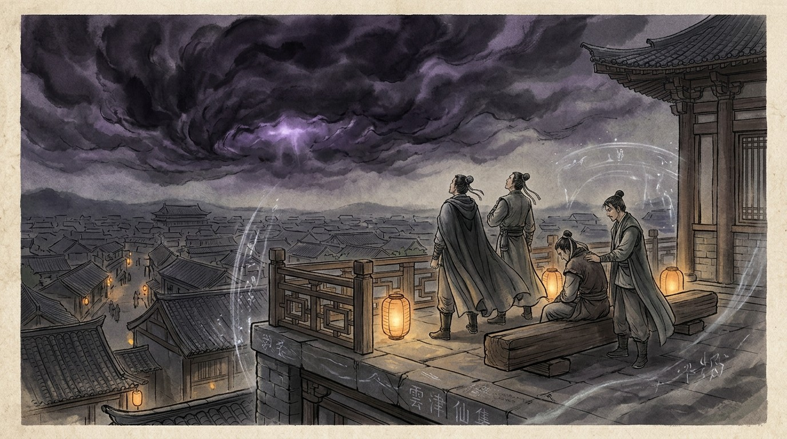

# 第 125 章：泥途託付・莫三與故人們的守望

[← 上一章](ch0124.md) ｜ [本卷目錄](00_intro.md) ｜ [下一章 →](ch0126.md)

*章首插畫：第 125 章 泥途託付・莫三與故人們的守望*

距離頭頂那片紫黑色排斥劫雲徹底蓄滿力量壓頂而下，只剩最後一晝夜。

為了不引起雲津仙集數萬商戶與百姓無謂的恐慌逃難，三宗掌門在封存觀測室周圍布下了臨時隔音與遮蔽氣機的法陣，暫時幫五人多爭取到了這最後十二個時辰的人間安頓時間。

這一日的萬山泥途總號議事廳內，門窗緊閉，卻坐滿了所有與這條商路性命攸關的人——公所掌印羅九秤、雲海票號女掌櫃顧蘭舟、總號管事邱禾、雪橇行腳隊女領隊穆雪、金石商會蘇凝霜特地派駐北境的總商隊代表林掌櫃、帶著十幾家中小商號聯署印章的議事代表，以及代表八荒北線防務出席的獨臂老將雷烈與拄著棗木拐杖的老乞丐莫三。

沒有悲壯的生離死別演講，沈泥坐在主位上，神色平靜地將一整套厚厚實實、早已用細麻線裝訂成冊的《萬山泥途總號多方共治分權交接總錄》推上桌面。

「我要隨清虛他們進北境祖庭地底的古陣避劫，這趟走後，什麼時候能回來、甚至能不能回來，誰也說不準。」

沈泥開口極其直白，沒有用「暫時遠行」或者「一定很快凱旋」去哄騙任何一個留下來扛責任的人，「所以我今天當著羅掌印和各位代表的面，把萬山泥途總號的底帳與治理權當場拆開交割——絕不交給任何單一一個代理人握在手裡！」

她翻開第一頁，一筆一劃念出早已核對完畢的分權方案：

「第一，總號日常營運、倉儲盤點及《共治分權章程》的執行，由邱禾管事與顧蘭舟掌櫃聯合『八家合作商戶議事代表』共同投票決定，任何超過一萬靈石票的銀錢調度必須三方會簽，無人能獨自挪動總號儲備金；」

「第二，連接南方金石府十三州與黑石鋪的貨運線，仍由蘇大小姐派來的金石商隊代表全權接手對接，確保青河藥材與烈礬炭窯等六縣老實農工的活路不斷；」

「第三，雷烈將軍與八荒武山不插手商棧任何定價與帳務，僅負責北境雪原與雲津商道的軍事清道與安全協調；」

「第四，」沈泥轉過頭，看著坐在右首一直低頭緊攥著棗木拐杖的莫三，聲音柔和了許多，「莫三叔您留在總號當見證人，替我看著那張三十年前的平反文書，盯緊以後三宗查核席有沒有偷工減料——要是哪天這群人又想偷偷回頭再挖地煞血精，您就領著這八家商戶和羅掌印一起拍桌子掀他們的帳房！」

羅九秤與顧蘭舟神色肅穆地接過交割印鑑與帳冊副本，鄭重蓋上各自印章。這座不是靠個人血統或神通撐起來的商業樞紐，終於完成了真正意義上的分權共管交接。

交割完畢，眾人陸續帶著責任各自散去準備應急物資。空蕩蕩的偏廳裡，只剩下莫三還坐在那隻熟悉的炭火盆旁邊，一言不發地拿一隻缺了口的小粗陶壺煮著從黑石鋪帶來的粗炒秋茶。

「東家……外頭驛丞剛送到的一包加急南邊家書。」

臨出門前，邱禾紅著眼眶將一個厚實的浸油麻布驛袋輕輕放在桌上，隨後反手帶上了木門。

五位少年圍坐到炭盆邊，拆開這封跨越了千餘里山河與風雪、趕在最後一刻抵達的家書包裹。

最上面是一封蓋著金石商會紫金雙龍印的厚信，出自**蘇凝霜**親筆。信中不僅交代虎跳峽條石便道今春已跑通了三百輛重車、黑石鋪的民用青石已賣進府城修繕城牆，更在夾頁裡以密字寫明了她正在金石府掀起的另一場硬仗——她已憑北荒傳回的「玄木」轉帳線索，正式聯合文承敬與陳鎮山向金石商會內堂三老發難，追查三十年前在清洗「雲記」密約上簽字畫押的府城宿老真名，同時派商隊暗哨全面盯死萬仞山西麓通往南境的私礦舊道，一旦逃犯**赤煉**敢潛回南方接頭，必叫他無處藏身！信袋裡還附了一枚一分為二的「紫金雙龍對牌」副牌，信末力透紙背：*『泥丫頭與諸君莫把我當作只會在後方守路的弱女子。人間這半邊爛帳與赤煉的尾巴，我蘇凝霜替你們追到底；待雙龍合牌之日，咱們兩界對帳！』*

沈泥將那半枚紫金雙龍對牌鄭重收進貼身內袋，眼底泛起一抹真正的敬意。

緊接著是來自黑石鋪四位師長的信物——**老鐵匠阿鐵**託人代筆寫了歪歪扭扭的三行字，說近來又替鎮上打了三口新鐵鍋，特意叮囑林鐵生：*『錘子是硬的，人是活的，別在山裡面把自己活成一根沒溫度的死鐵柱。』* **瘋郎中葛半仙**字跡狂放如鬼畫符，塞進來三小包曬得乾透的新收野菊花種與一撮防蟲草灰，嘴硬地罵了一句：*『小崽子到了什麼見鬼的仙家地方也別忘了吃飯睡覺，死不了就給老頭子留口氣寫張方子回來。』* **趙老獵**則由魯大山代寫了短短一句口信：*『虎跳峽外頭這半年沒再出過獸災，大荒裡狼群平靜得很。活著比什麼都金貴，找不到你大伯也別拿命往死坑裡填。』* 而夾在信袋最底層的，是一截枯瘦老松枝上摘下來的無字乾松葉，上面纏著半截洗淨的細麻繩——沒有署名，卻有一股讓柳清虛鼻尖微酸的破落道觀冷松香氣。那是**枯木老道**從未遠去的無聲守望。

「走之前……我們先上半山靜心小院看一眼陸師長，再去黑山營見韓素姑娘與阿滿姐一面吧。」顧玄輕輕收好野菊花種子，提起剛剛謄抄裝訂完畢的一卷《三元本草祛道錄》初稿，看向柳清虛與燕隼。

半個時辰後，太清山腰的靜心小院內，藥氣微苦。

左肩纏著厚厚藥布、半邊經絡已被晶化寒氣凍傷的**陸觀瀾**靠坐在竹榻上。當柳清虛雙手捧出那面在毒域中裂開一道細紋的「周天星律院紫銅護身鏡」欲歸還師長時，陸觀瀾卻用僅能活動的右手輕輕推了回去。

「留著吧，清虛。」陸觀瀾蒼白的面容上沒有半點自怨自艾，反而透著掙脫枷鎖後的清朗，「我在星律院算了三十年官修星曆，到頭來連自己師兄是怎麼變成升仙台石像的都不敢深問。這面鏡子跟了我半輩子，如今裂了一道縫，正好拿去照照門後面那片沒有假天遮攔的真星軌。」

顧玄則將那冊親手寫滿雪線苔冷萃比例與十八條禁忌的《三元本草祛道錄》放在她榻邊的木几上，低聲道：「陸師長，孫師姐和白先生會照著這本冊子替您和元青道長按旬溫養。弟子此去洞天，定會查明道化晶斑在天羅之外的根源，絕不讓這門醫案停在半路。」

從山腰下來時，黃昏暮色已漫過黑山營校場。韓素與阿滿早已等在營門石階旁。

韓素只遞給燕隼一隻用厚羊毛縫好的新護腕，平靜而認真地說了一句：「這是我替互助會幾十戶家屬一針一線縫的。進了那扇門之後，活著記好每一條見過的路；找得著你大伯，就帶個信出來；找不著……也別為了我們這些等著的人把自己的命搭進去。」

燕隼接過沉甸甸的護腕緊緊繫在左腕上，也沒有給出什麼「三年必歸、定尋大伯回來」的虛假承諾，只鄭重抱拳：「去把大伯和當年的真相找個水落石出，是我進去要做的事；能不能成、能不能活著走回這道門，我不敢替老天爺打包票——但我絕不讓這雙眼睛白白跨過這道門檻。」

當夜二更，萬山泥途總號後院再次安靜下來。

莫三雙手微微有些發抖，將最後兩碗熱氣騰騰的黑石鋪粗炒秋茶放到沈泥與自己面前。自打三十年前那場一夜之間令雲記家破人亡的血色風暴之後，這是這位在泥塗裡裝瘋賣傻熬了半輩子的老瘸子，第二次親眼看著自己視如親女的唯一親人，即將踏進一條不知是生是死、甚至可能這輩子再也見不到面的未知單向門。

「丫頭……」莫三低著頭吹著碗裡的茶末，沙啞得幾乎聽不清的嗓音裡帶著壓抑不住的恐懼與顫抖，「當年老子把『天門引』死死藏在爛泥裡三十年，總算盼到你查清了『雲記』兩個字……可真到了這一晚，我這老骨頭卻突然有點後悔當年不該把這塊破鐵牌塞到你手裡。」

老人一邊說著，一邊從懷裡摸出一塊早已磨得烏黑發亮、背面刻著半朵殘雲暗記的舊棗木茶牌，雙手用力一掰，「咔」地順著陳年暗紋掰成了兩半，將刻著「雲」字的一半死死按進沈泥掌心，另一半則拴在了自己腰間的酒葫蘆繩上。

「門那頭連天道都不一樣，誰知道外頭過一年，裡頭是過一天還是過十年？」莫三紅著眼眶盯著她，「帶著這半塊雲記茶牌！別管裡頭有什麼通天富貴，你給老頭子記住，人間還有一壺茶在等你對牌！」

沈泥緊緊握住那半塊帶著老人體溫與茶香的棗木牌，又摸了摸自己行囊——為了把更多耐寒草種、備用精鋼卡榫和乾淨炭筆帶進門後，她傍晚特意把自己那兩套體面的錦緞東家衣裳全留在了櫃子裡，只換回了最經磨的粗布厚棉襖。

「莫三叔，如果沒有天門引，我也只會一輩子縮在黑石鋪後巷的柴房裡，等哪天山塌了或者官爺不高興了，悄無聲息地凍死在溝裡。」

沈泥抬起眸子，在溫暖的燭火下露出一個清亮而無比認真的微笑：「我們立一個三十年的約吧——不吹牛說三年五年一定打通什麼雙向神門。只要我這口氣還在門那頭活著，三十年之內，我一定想盡辦法拆掉頭上這座堵死人的破牢籠，帶著這半塊茶牌和帳本回來見您。在我們回來之前，泥途總號那壺老茶，您可得替我好好看住火候。」

「三十年……老頭子這條命就算只剩半口氣，也撐著這把老骨頭在這張門檻邊上等你們！」莫三仰頭一口喝乾碗裡微苦回甘的滾燙粗茶，重重擦了一把渾濁的老眼，再也沒說半句軟話，拎起棗木拐杖轉身便拉開後門，「走吧！外頭天黑路冷，再磨蹭天亮就要被頭頂那些紫黑雷火劈碎屋頂了！這條人間路，我替你們看著門！」

沒有回頭，沒有眼淚。五位少年整理好各自早已分裝妥當的乾燥口糧、醫療藥物、全套測量與鍛造工具、弓矢以及那批編號完整的證物副本，悄然踏出雲津萬山泥途總號，在夜色掩護下匯合宋知微、魯長老與雷烈，朝著三大名山祖庭地底深處最後那座通道邁步而去！

---

[← 上一章](ch0124.md) ｜ [本卷目錄](00_intro.md) ｜ [下一章 →](ch0126.md)
