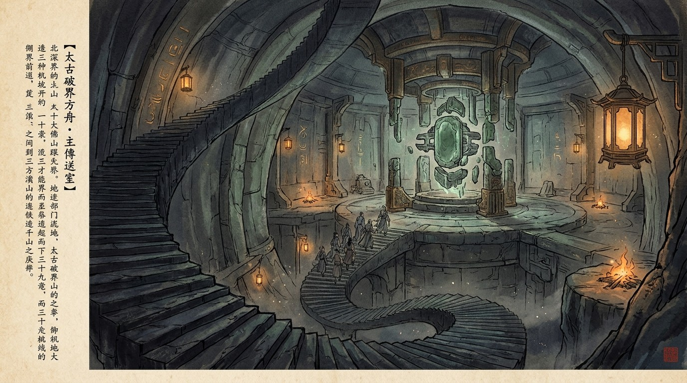
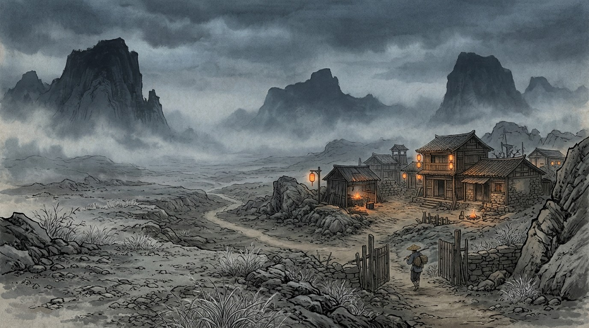

# 第 126 章：五件遺物開門・踏入桃花源洞天（第三卷終）

[← 上一章](ch0125.md) ｜ [本卷目錄](00_intro.md) ｜ [下一章 →](../04_volume4/ch0127.md)

*章首插畫：第 126 章 五件遺物開門・踏入桃花源洞天（第三卷終）*

子夜時分，北境三大名山交界處萬仞山腹的最深處。

沿著一條極為陡峭古老、彷彿由三條不同礦脈在太古時代硬生生擠壓融合而成的深黑螺旋階梯向下行進千餘丈後，眼前出現了一座足以容納千人之眾的宏偉地下球形大殿——**【太古破界方舟・主傳送室】**。

與北荒大裂谷那個破損漏液的鎮熱推進艙段不同，這座位於三大名山祖庭重重地脈保護之下的傳送室保存得相對完好。穹頂由整塊整塊半透明的黑曜玄石拼接而成，大殿正中央矗立著一座高出地面三丈、刻滿了雙重逆星軌道與幾何齒輪陣紋的巨型環狀空間門框。

門框底座前方排列著五座古老的控制石台，而石台與門檻交接的陰暗石縫間，卻凝結著一層厚如白痂、散發著乾燥苦澀鐵鏽味的灰白鹽霜；台階角落裡還半嵌著半截早已被歲月與空間亂流絞斷、看不出原主人姓名的鏽蝕古鐵劍尖——那是千百年來走進這座孤殿的十七批先賢，留在人間最後的一點冰冷痕跡。

哪怕身處地下千丈深處，頭頂厚重的岩石與黑曜石穹頂依然在一陣接著一陣地發出沉悶如戰鼓般的恐怖震顫！

「轟隆隆————！！」

第一道直徑超過十丈的紫黑色滅世排斥神雷，已經無情地撕破雲頂天柱峰的夜間雲海，狠狠劈落在三大名山聯手撐起的最高護山大陣光幕之上！紫霄真人、鐵背山主與玄樞門主聯袂立於傳送室外圍主陣眼處苦苦支撐，三張歷經滄桑的面龐在恐怖的反震雷壓下皆已泛起陣陣慘白，鐵背山主嘴角甚至已滲出一縷鮮紅血跡！

「外層陣脈最多還撐得住一刻鐘！」一直跟隨護送至此的宋知微掌院雙手死死按住劇烈跳動的銅星盤，回頭對著已經踏上中央台階的五道身影疾呼，「儲備靈石槽已經全部合攏！快按祖師殘錄裡的方位定錨開門！」

「動手！」

柳清虛沉穩的喝聲壓過了穹頂簌簌落下的碎石雜響。五人沒有半息遲疑，在漫天震落的石粉與雷音中同時踏上五座石台——

正北台前，柳清虛神識催至極境，將那卷泛黃的【逆星斷碑拓片】鋪入水銀凹盤，旁邊緊緊壓著陸觀瀾那面裂紋紫銅護身鏡，瞬間在狂亂震盪的虛空中釘出一道避開二十八宿天羅干擾的逆行跨界星標；幾乎在同一息，東北台上的林鐵生左手卡尺量定門框主軸被雷壓震出的半絲偏角，右手猛將歷經萬火不融的【太古不融黑鐵齒輪構件】狠狠拍入核心傳動榫槽，「鏘」地一聲清越金鳴將整座三丈門框的扭曲應力死死咬定！

「起血障！點火！」

西北台上，燕隼一掌將浸滿大荒凶煞的【太古戰神獵獸圖騰骨片】按入黑岩凹槽，胸膛內運起戰神遺塚那套沉渾如古鐘的長呼吸節律，一層厚實的赤紅血脈波紋應聲貼著門框內壁張開；西南台前，顧玄指尖銀針微挑，小心翼翼地將黑石古礦深淵起出的【古礦地煞晶核殘片】推入引燃井道，以溫潤綿長的草木生機靈流穩住接觸瞬間的暴烈高熱，一舉點燃地底深處積蓄百年的整庫上品靈石；而在正南主台之上，青藍流光轟然貫通的剎那，沈泥先以【萬物行商・天門引】叩開調度驗印槽，隨即雙手捧起那塊已在北荒合為完整一體的【九城古商盟總契銅版】，重重按入正中銘文嵌槽！

「咔——嗡————！！」

最後一聲厚重的青金鐘鳴響徹山腹！就在銅版咬合落鎖的同一瞬間，頭頂上方大殿外圍的第一層防護陣壁終於承受不住九天滅世排斥神雷的連番轟擊，轟然崩裂出一道觸目驚心的巨大裂口！刺眼欲盲的紫黑色雷蛇順著岩壁裂縫瘋狂向下竄入傳送室大廳！

而在大殿中央那座環狀門框之中，五道源自不同道途、經歷過凡間百難千險卻始終不肯向任何虛假秩序低頭的微光猛然匯聚到一處——

璀璨至極的青金星芒沖天而起，在震耳欲聾的雷霆咆哮中硬生生將面前這堵無形的凡間空間壁障撕裂開來，凝成了一扇旋轉著浩瀚星霧、足有三丈高的巨大光門！

光門周圍的空間發出劇烈扭曲的呼嘯，一股夾雜著苦鹽與古老鐵鏽味的陌生狂風從門縫彼端倒灌而出。五件完成啟動的太古遺物在氣浪中劇烈嗡鳴，紛紛自石台彈起飛回五人手中。

「別回頭！快走！！」

外圍陣眼處，左臂纏滿繃帶的魯長老與獨臂的雷烈將軍同時頂上前一步，替紫霄真人三人扛住一道橫掃下來的紫黑落雷餘波；簡素真人拂塵已被雷火燒焦半截，宋知微站在崩裂的石柱旁，死死盯著柳清虛與四位少年的背影，嘴唇翕動卻終究只化作一記深深道揖！

那不是仙家送別飛升的喜悅，而是一群留在薄冰牢籠裡的守夜人，拼盡全力替五顆不肯屈服的火種撐開最後一扇逃生石門的悲壯守望！

柳清虛將陸觀瀾的裂紋紫銅鏡緊貼胸口；林鐵生反手握緊阿鐵師父打的左手小錘；顧玄按住裝著葛半仙野菊花種與《三元本草祛道錄》的青布藥囊；燕隼左腕上的厚羊毛護腕在雷光下獵獵微動；而沈泥左手按住懷中滾燙的【天門引】與【九城古商盟總契銅版】，右手在袖袋裡死死攥緊了莫三掰給她的那半塊帶著茶香的「雲記棗木茶牌」。

三十年人間約，自這一息起開始倒數！

五隻沾滿過黑石鋪泥巴、金石府炭灰與北荒風雪的手掌，在漫天雷火傾瀉而下的最後一剎那重重並肩一握，隨即毫不猶豫地邁步撞進了那道吞噬一切光線的旋轉星門！

「轟隆隆隆————！」

幾乎就在五道年輕挺拔的背影徹底沒入光門的最後一息，九天之上積蓄到極致的紫黑色滅世神雷終於轟然貫穿穹頂，將整座地下傳送室的環狀門框連同五座石台一起劈成一片翻滾崩塌的廢墟煙塵——而那道通往未知彼端的空間裂隙，也隨之徹底關閉，歸於死寂。

……

眩暈、失重、彷彿連骨髓與五臟都要被強行壓扁重塑的無邊黑暗……不知過去了幾息，又彷彿過去了數個寒暑。

直到雙腳突然重新砸上了一片堅實、冰冷卻乾燥得近乎皸裂的沙石地面，周遭那種令人窒息作嘔的空間撕扯感才如潮水般驟然退去。

「咳……咳咳！」

五人幾乎同時跌落在粗糙的碎石地上。顧玄第一個撐起上半身，剛咳出兩口氣，舌尖便嚐到了一股與封存觀測室木匣底層一模一樣的**苦澀灰白鹽霜與冷鐵鏽味**！

四周安靜得可怕。沒有風吹林海的松濤，沒有半聲鳥鳴與秋蟲嘶叫，甚至連泥土與腐葉應有的半點潮濕水氣都聞不到。

好半天，五人才忍著劇烈的耳鳴與腦海裡翻湧的眩暈各自撐起身體，本能地背靠背握緊手中兵器與工具，警惕地掃視著這片他們拼盡一切才踏進來的神秘天地——**【桃花源／異界洞天】**！

然而，就在柳清虛本能地掐訣欲引動周天星力護身、燕隼沉腰提氣欲拉開百斤蛟骨弓弦的剎那，兩人的臉色竟在同一瞬間猛然大變！

「不對勁……！」柳清虛指尖剛剛亮起半寸微光便驟然潰散，左腕舊傷處一陣針扎般的酸麻，額角瞬間滲出冷汗，「這片天地的空氣裡沒有二十八宿星力中繼，反而有一股重得像鉛水一樣的古怪規律壓在經絡上——我剛才只試著運轉最基礎的太清護身訣，神識消耗竟比在凡間暴漲了三倍不止，威力卻連平日的半成都不到！」

「弓弦和氣血也是！」燕隼右肩舊傷在陰冷沉重的怪異重力壓迫下隱隱作痛，低頭看著腳邊草叢，「這裡的天地力道是沉的，像有看不見的磨盤壓在骨頭上！」

林鐵生與顧玄也同時蹲下身，看著腳邊那叢枯死如鐵絲般、毫無年輪水氣的灰白硬草——就在那叢鐵絲草根部半尺處，赫然半埋著一塊刻有太古九號方舟補給暗記的鏽蝕廢鐵牌，旁邊還丟著半截早已被抽乾到只剩灰白石殼的報廢儲能晶柱！

當五人的視線穿過面前散去的最後幾縷空間殘霧，看清這座傳說中「仙賢避難所」的真實模樣時，每個人心頭都沉到了谷底。

這裡沒有傳說中漫山遍野的十里桃花，沒有靈泉叮咚、仙鶴飛舞的安穩仙境，甚至沒有半點令人心曠神怡的溫暖春風。

頭頂之上，是一片呈現出詭異暗鐵青色、彷彿永遠停格在黎明前最壓抑時刻的巨大靜止天穹，既看不見熟悉的太陽，也看不見那二十八宿星座——只有那種令凡間法訣與氣血處處受制、耗損倍增的冰冷幾何壓迫感瀰漫在每一寸空氣裡。極目遠眺，腳下是一望無際的灰褐色荒蕪碎石高原，狂風捲過乾燥的砂礫與灰白鐵絲草叢，遠處的荒野溝壑邊緣，隱約透著幾點孤零零的幽冷燈火與升騰而起的灰黑炊煙。

更讓五個人脊背發涼、連呼吸都不由自主停滯了一息的，是聳立在這片陌生荒野地平線三個極端盡頭處、即便相隔不知多少萬里依然高聳入雲、彼此無聲對峙著的三座超巨型太古建築輪廓——

正北方的雲霧高空之中，懸浮著一座通體由純白星輝玉石築成、散發著令人神魂幾乎要自行跪拜臣服的冰冷秩序威壓的宏大宮闕——**【太虛神宮】**；

西南方的赤黑焦土裂谷深處，矗立著一座完全由巨獸白骨與暗紅玄鐵堆疊而成、彷彿時刻都在往外噴吐著洪荒凶煞血氣的猙獰巨殿——**【戰祖魔殿】**；

而正東方的無邊荒漠之上，一座通體閃爍著億萬道冷酷青金幾何紋路與無數巨型轉動齒輪、幾乎把半片地平線都改造成自體運轉冰冷鋼鐵城邦的龐然造物，正發出連大地都能隱隱感應到的沉悶轟鳴——**【萬物主機城】**！

荒野冷風吹動沈泥單薄的粗布舊棉襖衣角，也吹散了柳清虛鬢邊的一縷長髮。

五人站在這片未知世界的門檻之上，望著遠方那三座既與人間三道隱隱同源、卻又龐大冷酷到極點的巨構，誰也不知道那十七批前輩究竟還有幾人活在遠處那幾點灰黑炊煙裡，更不知道大伯燕山五年前爬入裂隙後是否正困在西南那片焦土魔殿之中。

燕隼緩緩將百斤重石鐵胎弓卸下來握在左掌裡，習慣性地試了試這片天地間沉重異常的風阻；林鐵生默默摸緊了腰間阿鐵師父贈給他的左手小鍛錘，目光死死鎖住東方那座齒輪巨城與腳下半埋的方舟廢鐵；顧玄將藥囊帶子重新在胸前打上死結，把指尖那撮苦鹽白霜收進小瓷瓶；柳清虛按了按懷裡的裂紋紫銅鏡，微微瞇起雙眼開始測算這片完全陌生天幕下的風向與張力。

而在他們最前面，沈泥伸手輕輕摸了摸胸口那枚依然微溫的【萬物行商・天門引】、合璧完整的【九城古商盟總契銅版】，以及袖袋裡莫三留給她的那半塊棗木茶牌，迎著異界荒野吹來的陌生冷風，平靜地邁出了第一步。

「管它門後面是仙境還是囚籠，也不管這裡的規矩要比凡間貴上幾倍……」少女清脆而沉穩的聲音在空曠的碎石荒原上響起，「既然人已經進來了，離莫三叔的三十年之約還有三十年——這筆帳，咱們照樣從遠處那幾點炊煙開始，一頁一頁接著往下算。」

---

**（第三卷：名山問道・全卷完）**

---

*場域圖誌：桃花源洞天・荒蕪碎石高原*

---

[← 上一章](ch0125.md) ｜ [本卷目錄](00_intro.md) ｜ [下一章 →](../04_volume4/ch0127.md)
