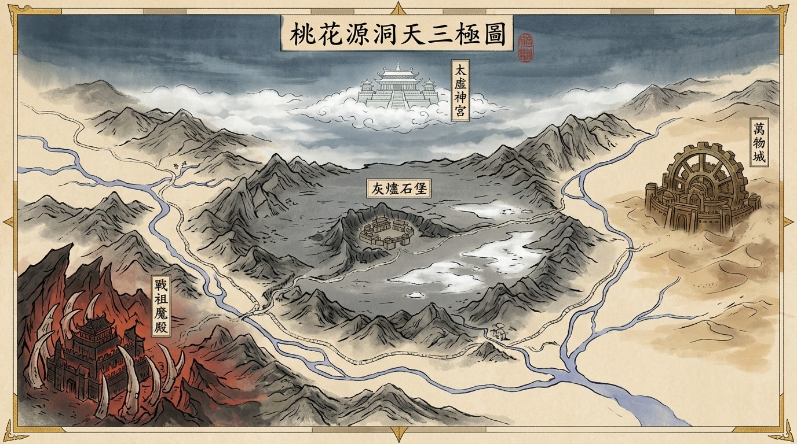

# 第四卷：洞天避難・異界問真

> 灰燼石堡、三極大校準抗爭與微光信標遙連雲津（第 127–170 章）

*桃花源洞天・三極暨灰燼邊緣圖*

## 本卷目錄

- [第 127 章：黑夜荒原與灰燼炊煙](ch0127.md)
- [第 128 章：失靈的舊招與三倍代價](ch0128.md)
- [第 129 章：殘晶黑市與天門引微光](ch0129.md)
- [第 130 章：邊緣醫棚與首例「律令排異症」](ch0130.md)
- [第 131 章：幾何向量與第一道順勢契機](ch0131.md)
- [第 132 章：鍛造活榫接口與防寒爐](ch0132.md)
- [第 133 章：裂谷邊緣的鷹記刻痕](ch0133.md)
- [第 134 章：第一封死契與分兵三極決議](ch0134.md)
- [第 135 章：白玉接天階與鹽晶黑帳](ch0135.md)
- [第 136 章：玉化晶核與銅匣之債](ch0136.md)
- [第 137 章：萬物外環與九級公差車軸](ch0137.md)
- [第 138 章：破匣三芯與方舟九號艙](ch0138.md)
- [第 139 章：赤炎重力場與截息卸力](ch0139.md)
- [第 140 章：焦疤獨眼與暗倉血樣](ch0140.md)
- [第 141 章：三極緩衝方與灰白藥斑](ch0141.md)
- [第 142 章：沈泥與九城封存總庫](ch0142.md)
- [第 143 章：人族火種配額補正總帳](ch0143.md)
- [第 144 章：九十日大校準倒數合攏](ch0144.md)
- [第 145 章：外環二十四站與無影聯絡網](ch0145.md)
- [第 146 章：耐火羊皮與《三極互助密約》](ch0146.md)
- [第 147 章：三號廢渣道的「赤火」密箱](ch0147.md)
- [第 148 章：主簿突襲・星鎖全區點名](ch0148.md)
- [第 149 章：偏星一度半・三息護名冊](ch0149.md)
- [第 150 章：鬥獸坑死令與託古夜奔](ch0150.md)
- [第 151 章：破籠救十命與赤煉密牌](ch0151.md)
- [第 152 章：秩序仲裁橋・援引第七條！](ch0152.md)
- [第 153 章：併爐總栓與戰前十日鍛備](ch0153.md)
- [第 154 章：校準前夜・黑石老酒與暗銀天幕](ch0154.md)
- [第 155 章：子夜鐘落・外環二十四站大停工](ch0155.md)
- [第 156 章：鹽晶斷供與戰祖部落拒徵](ch0156.md)
- [第 157 章：白玉階前攤偽帳・嚴平身敗名裂](ch0157.md)
- [第 158 章：偏殿十二針與晶塔活核真相](ch0158.md)
- [第 159 章：戰祖巨骨哨卡與狂潮壓境](ch0159.md)
- [第 160 章：三十座緩衝爐與藥煙護民](ch0160.md)
- [第 161 章：零死亡守關與五年血債合券](ch0161.md)
- [第 162 章：地底導流井・三息帶壓活榫換栓](ch0162.md)
- [第 163 章：仲裁橋大對質・平權配重總案](ch0163.md)
- [第 164 章：百年平權契書與歸墟深碑警報](ch0164.md)
- [第 165 章：微光共鳴站・三百斤的門票](ch0165.md)
- [第 166 章：半斤家書・寫給三十年之約](ch0166.md)
- [第 167 章：雲津茶館裡的三十息星火](ch0167.md)
- [第 168 章：遺民的去留抉擇](ch0168.md)
- [第 169 章：五人三元初試 —— 「法力物非不能合，是舊器難載新道」](ch0169.md)
- [第 170 章：歸墟古淵之召喚與第四卷終](ch0170.md)
