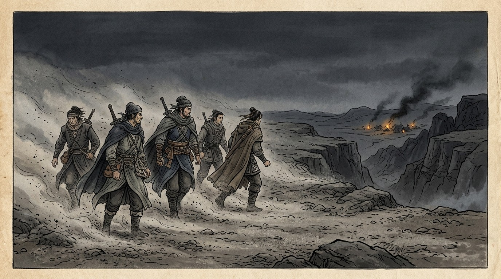
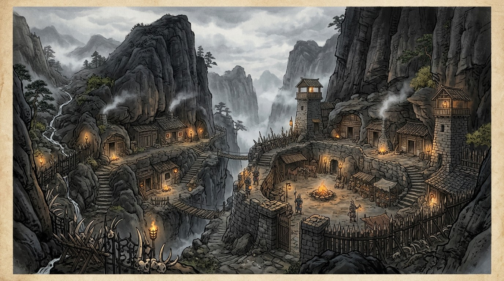

# 第 127 章：黑夜荒原與灰燼炊煙

[← 上一章](../03_volume3/ch0126.md) ｜ [本卷目錄](00_intro.md) ｜ [下一章 →](ch0128.md)

*章首插畫：第 127 章 黑夜荒原與灰燼炊煙*

寒風如鈍鐵刮過碎石高原，捲起乾燥得沒有半絲水氣的灰白砂礫，打在粗布棉襖與護腕上發出細密沙沙響聲。

五道身影自崩塌歸寂的傳送落點一路向北偏東摸索。頭頂那片暗鐵青色的天穹始終停格在黎明前最壓抑的灰暗裡，不見日星挪移，也無夜風與晨露的分別，唯有遠處溝壑盡頭那幾點孤零零、彷彿隨時會被風扯滅的昏黃燈火與淡淡灰黑煙氣，成為荒原上唯一的坐標。

「腳下石脈越來越深了。」林鐵生蹲下身，將左手那只小鐵鍛錘輕敲在地面發黑的玄武岩棱脊上，聽出底下傳來空洞沉悶的回音，隨即壓低嗓音道，「這帶岩石被古時人工開鑿過溝壑，那些煙火多半藏在避風地縫裡。」

柳清虛緊了緊領口，胸前貼肉藏著陸觀瀾給的裂紋紫銅鏡，目光謹慎地掃過上方黑沉沉的岩崖。進入此界後，周身空間始終像裹著一層粘滯沉重的鉛紗，連吐納都格外費勁。顧玄跟在隊伍中段，將藥囊背帶勒緊，替方才試射折損右肩勁力的燕隼塞了一小撮溫熱止痛的薑末含在舌底；走在最前頭的沈泥則一隻手按在腰側竹帳匣上，另一隻手輕輕摩挲著懷中依然微溫的【萬物行商・天門引】。

沿著一道半塌的碎石斜坡轉過兩道玄武岩風道，一股濃烈的苦苔燃煙味與陳年焦油氣終於混著熱氣撲面而來。

坡底嵌著一座半埋於山壁與黑石裂縫之間的簡陋聚落——幾堵用黑泥和碎岩壘成的矮牆外面架著削尖的灰白巨獸肋骨作拒馬，矮牆內側露出幾座低矮圓頂石窯，窯門外僅懸著兩盞用動物脂油點燃的防風鐵燈。這便是荒原邊緣的無名流放聚落：**【灰燼石堡】**。

「站住！什麼人？！」

沙啞戒備的喝聲從矮牆缺口後方響起。石牆陰影裡閃出一名披著厚重灰氈、左袖管空蕩蕩別在腰帶上的獨臂老人，右手端著一柄烏黑沉重的短嘴鐵弩，身後還跟著兩個手握生鏽長矛、滿臉凍瘡與塵灰的年輕漢子。老人那雙陷在深皺紋裡的渾濁眼睛在昏黃油燈下飛快掃過五人——

當他看清這五個風塵僕僕的少年身上竟然背著全套打鐵鍛具、藥囊、百斤硬弓與完好無損的行商帳匣，而不是像歷代那些「飛升老爺」般衣衫襤褸、赤手空拳跌進荒原時，老人臉色非但沒有半分驚喜，反而「刷」地一下變得慘白！

「哪個天殺的放你們帶成套家當滾進來的？！」

稱為**戚老頭（戚守灰）**的獨臂老守衛猛地抬起僅存的右手，一巴掌將牆口兩盞晃動的防風油燈全數拍熄，同時箭步衝上前死死按住林鐵生腰間隱隱透出太古黑鐵冷輝的包袱皮，喉嚨裡壓著近乎嘶啞的低吼：「收起你們身上的鐵器與法氣波動！想在天亮前被正東與正北那群巡檢機隼記上名冊當料子拆掉，也別拖累我們石堡幾十口老小的命——要活命，就全部跟老朽鑽進地窯！」

黑暗驟然籠罩溝壑，只餘地縫底下透出的一線暗紅窯火餘燼。

五人互相交換了一道極短的眼神。燕隼右手已扣上弓弦，沈泥卻輕輕抬手按住他小臂，對戚老頭平靜拱手道：「老丈息怒。我們剛從祖庭古陣落腳，不知此間禁忌，絕無連累鄉鄰之意。借宿一晚的規矩與花費，照石堡的帳算。」

戚老頭盯著這個不過十幾歲卻連呼吸都沒有半分慌亂的姑娘看了兩息，冷哼一聲，轉身掀開厚重的焦油草簾：「規矩？這鬼地方沒人要你們凡間的銀錠。跟進來再說。」

順著十幾級潮濕冰冷的石階鑽入地下岩窯，空氣裡瀰漫著劣質炭灰、乾苦苔與老人身上濃重的陳舊藥膏氣味。石窯極窄，牆角堆著幾十枚大小不一的木牌與幾截已經灰白裂開、表層還箍著細銅圈的廢棄儲能晶柱。四名披著破羊皮的老弱婦孺縮在窯角昏暗油燈旁，望見外來者的眼神裡沒有崇敬，只有麻木與深深的提防。

「你們說自己是循祖庭《祖師密錄》開門上來的？」戚老頭從角落捧出一隻發黑的陶罐，裡頭只有半罐帶著苦鹹味的溫鹽水，擱在石桌上，冷冷盯著柳清虛與顧玄，「那你們大抵以為這道光門後面是靈泉仙鶴、長生不老的桃花源吧？」

柳清虛沉默接過陶碗，指腹觸及粗糙冰冷的陶壁，想起北境千丈雲梯上那些神情狂熱卻毫不知情的同門，緩緩搖了搖頭：「在踏入光門前，我們就知道凡間天羅是假。只是沒想到，此界比預想還要荒涼。」

「荒涼？」窯角一名雙耳幾乎失聰的老嫗忽然乾笑起來，聲音像兩塊乾木頭摩擦，「何止荒涼！自打老朽太爺那一輩算起，算上你們，祖庭錄上寫得明明白白、共十七批破境入界的前輩……你們可知那些飛升天驕後來都去了哪？」

顧玄心頭一沉：「還請前輩明言。」

戚老頭伸出缺了半截無名指的粗糙左手，往北方雲霧、西南焦土與正東齒輪巨城三個方向依次點了點：「頭三年耗盡隨身靈石丹藥、不懂此間規矩硬拚死在荒原上的，佔了三成；撐不下去、被正北太虛高塔拿一碗『洗塵漿』騙上台階抽乾神識凝成玉石晶核的，佔了三成；骨頭硬的被抓進西南戰祖獵營去跟裂谷荒獸拚命換活路；剩下帶著神兵法寶不肯交的，全被正東萬物主機城當成無主料子拖進拆解爐——十七批前輩，三百多年來，沒有一個活著走出過這座牢籠半步。」

石窯內死一般安靜，只有窯心那截將熄未熄的次級儲能晶柱偶爾爆出一點微弱的「噼啪」火星。

沈泥靜靜聽完，沒有急著表態，只從行囊裡摸出半兩碎銀與兩根從雲津帶來的防風火摺，輕輕推到石桌中央：「老丈，銀錁你們不要，我們不強塞。這兩根火摺能頂十日夜火種，算我們五人今晚在石堡借宿與這罐溫水的押資。天明之後若堡裡有修牆、巡夜或看診的雜活，我們照工換糧，絕不白住。」

戚老頭盯著那兩根做工精良、能抗濕風的雲津火摺看了半晌，這才伸手收起火摺、把碎銀推回給沈泥，語氣依舊生硬卻少了一分殺氣：「火摺收下了。今晚誰也不許點燈，更別運功露出一丁點靈氣光影。天塌下來，先熬過頭一夜再說。」

五人各自靠著冰冷的玄武岩壁坐下。暗黑地窯裡，沈泥在袖底無聲摸過懷中的天門引與半塊棗木茶牌——這確實不是仙境，而是另一座更嚴酷、連燈火都得按帳算的人間邊陲。

---

*場域圖誌：灰燼石堡・玄武岩守夜寨*

---

[← 上一章](../03_volume3/ch0126.md) ｜ [本卷目錄](00_intro.md) ｜ [下一章 →](ch0128.md)
