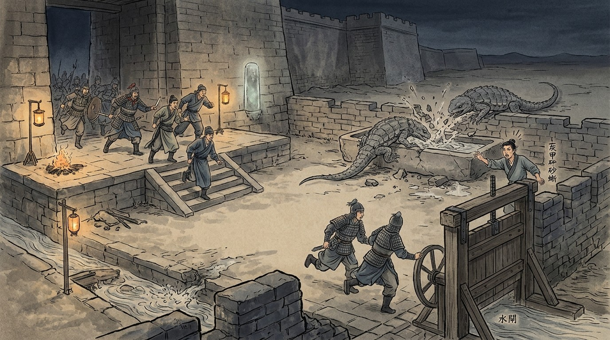

# 第 128 章：失靈的舊招與三倍代價

[← 上一章](ch0127.md) ｜ [本卷目錄](00_intro.md) ｜ [下一章 →](ch0129.md)

*章首插畫：第 128 章 失靈的舊招與三倍代價*

石堡的地底無日出可言，眾人全憑牆角那半截儲能晶柱漸漸黯淡的餘溫，判知外頭大約過了一個夜辰。

剛過丑時末，外頭矮牆方向突然傳來一聲急促的石槽碎裂聲，緊接著是守夜年輕漢子的驚叫：「不好！兩頭灰甲砂蜥摸上西側蓄水石槽了！快關水閘！」

地窯草簾應聲被掀開。燕隼幾乎在驚呼響起的同一息已經提弓跨出石階，柳清虛、林鐵生與顧玄緊隨其後。

只見灰霧瀰漫的石堡外牆邊，兩頭體長近丈、背披厚重灰褐鈣質甲殼的異界砂蜥正用滿口鋸齒死死啃咬著石堡唯一一口收集凝霜水的花崗岩蓄水槽，腥臭的淡黃酸涎正沿著裂縫不斷滲下！一名年輕守衛提著木叉被其中一頭砂蜥的長尾橫掃出去，重重撞在岩壁上咳出血絲。

「退開！」

燕隼沉腰開弓，脊背大筋繃緊如滿月，體內依舊慣性地催動起在八荒武山與北荒血原磨出的「開弦貫石」剛猛氣血——

「錚！」

鐵胎弓發出沉悶刺耳的嘶鳴，一支精鍛破甲長箭化作烏光破空射出！然而箭矢才離弦不到三丈，燕隼瞳孔卻猛地一縮！

這片天地的空氣彷彿瞬間化作了千斤重的水銀泥沼。箭身上附著的剛猛氣血竟在飛掠途中被一層無所不在的空間幾何張力生生碾散了七成，原本足以洞穿鐵甲的一箭，撞在砂蜥頸側灰甲上竟只發出「噹」的一聲悶響、迸出一串火星，連三寸鱗縫都沒釘進去，箭桿反倒當場崩斷！更可怕的是，那股未能順暢貫穿出去的氣血勁力在無形阻尼下猛地倒灌回弦，狠狠震在燕隼右肩舊傷處，令他虎口崩裂、喉頭一甜！

另一頭受驚的砂蜥甩尾噴出大蓬濃稠酸霧撲面而來！

「閃開！起護陣！」柳清虛雙指急掐太清護身法印，試圖依循舊法引動周遭天地靈氣結起一面水波清風幕隔絕酸液。

可指訣才剛結成，他整個人便劇烈一晃！此間壓根沒有二十八宿星律中繼，強行驅使太清法術就像拿勺子往干涸鐵井裡硬挖水脈——神識海瞬間如開閘瀉洪般暴跌三倍！短短不到三息，他額角青筋暴突、冷汗順著臉頰直淌，眼前結出的那道清風幕卻薄得像一張隨時會破的桑皮紙，只勉強擋下四成酸霧便「啵」地一聲徹底碎裂！

「糊塗！老朽昨天說的話你們全當耳邊風了？！」

千鈞一髮之際，戚老頭領著兩名石堡老獵從側面土溝猛衝出來，手中不運半點靈氣、只靠純粹的精鐵長叉和塗滿防酸礦泥的硬木盾牌狠狠架住砂蜥下顎！「用眼睛看骨縫，別往天上借氣！射它左眼下那片沒鈣化的軟膜！」

燕隼強忍右肩撕裂般的劇痛與喉間腥甜，迅速收斂起外放的氣血爆發，改回黑石鋪少年時最原始、不帶半點神通華彩的純粹獵手眼力——屏息、壓腕、抓準砂蜥抬首吞氣的半瞬停頓，將手裡最後一支備用粗鐵箭貼著長叉縫隙猛然擲射而出！

「噗嗤！」

沒有半點光影異象，實打實的鐵鏃卻精準釘入砂蜥左眼軟膜半尺深，徹底挑斷顱骨神經！另一頭砂蜥見同伴倒地，嘶鳴著扭頭竄入岩縫黑暗之中。

眾人狼狽地把倒塌的石槽用粗木楔暫時頂住，這才退回地窯。柳清虛靠著石柱大口喘氣，臉色蒼白如紙，從藥囊裡摸出一粒凡間帶來的養神丸塞進嘴裡，半晌才壓住太陽穴針扎般的抽痛；燕隼則緊咬著布條，任由顧玄替他重新敷藥包紮滲血的右肩與虎口。

失聰老嫗盯著地上那半截崩斷的箭桿，語氣冷得像井底石板：「見識到了？在凡間你們是萬中無一的俊傑，在這片天穹底下，你們引以為傲的『靈氣存量』全都是負累。用老法子發一招，神識氣血多燒三倍，打出去的勁力還折掉大半。你們以為為什麼那些名門長老一進來不出半年就死絕？不是沒本事，是越強越捨不得丟掉舊法，自己把自己活活燒乾了！」

顧玄一邊替受傷的年輕守衛清洗酸液灼傷，一邊蹲下身仔細檢視拖進牆角的砂蜥屍體，眉頭卻越鎖越緊。他用骨刀挑開砂蜥胃囊，裡頭居然混著幾塊被強行啃碎的礦鹽硬塊與焦黑獸骨——正常情況下，這種怯懦的食腐蜥蜴根本不敢離開鹽礫深溝跑到有人煙的石堡來。

「戚老丈，」顧玄用布巾擦淨骨刀，抬眼問道，「這帶的荒獸往年也常這樣冒險來啃石堡蓄水槽嗎？」

戚老頭哼了一聲，提著鐵叉去補水溝裂縫：「往年哪敢靠這麼近？也就這半個月不知怎麼的，荒野裡的雜獸跟發了瘋似的往外跑，搞得連我們挑水的溝口都不得安生。」

窯洞一時無人作聲。沈泥卻默默取過竹簡，在最上頭記下了第一筆冰冷的實證：**「入界第一日：凡間舊招能耗增至三倍、威力不及五成；柳清虛耗損養神丹一粒，燕隼損毀破甲箭兩支且右肩舊傷復發；石堡水線損毀、外圍獸群異動。」**

真正的生存考題，從今天這一碗帶著鐵鏽味的冷鹽水才正式開始。

---

[← 上一章](ch0127.md) ｜ [本卷目錄](00_intro.md) ｜ [下一章 →](ch0129.md)
