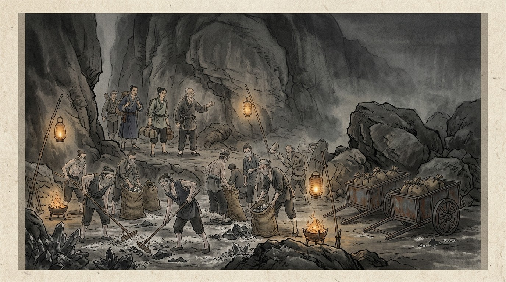

# 第 129 章：殘晶黑市與天門引微光

[← 上一章](ch0128.md) ｜ [本卷目錄](00_intro.md) ｜ [下一章 →](ch0130.md)

*章首插畫：第 129 章 殘晶黑市與天門引微光*

歇過一個時辰，戚老頭領著沈泥與林鐵生鑽出石堡東側一道僅容一人側身的岩縫，往谷底方向行了三里，來到一處被巨大玄武岩塊半遮掩的低窪鹽礫坑——這便是石堡遺民賴以續命的**【星塵鹽田與殘晶黑市】**。

說是黑市，其實連像樣的帳篷都沒有，只有十幾名臉上蒙著厚布、皮膚因長期接觸鹽霧而泛著灰白乾裂的鹽工，正用木耙將曬場上析出的粗鹽晶一鏟一鏟裝進麻袋。場子邊角停著兩輛全鐵鑄造、散發著焦油與鐵鏽氣的雙輪板車，一名穿著青金邊緣短襖、腰間掛著銅牌的小吏正拿著鐵尺逐袋查點成色，態度冷淡得像在驗收死物。

那人是正東【萬物主機城】外環派出來跑腿收鹽的牙人。

「老戚，你們灰燼石堡這季一共四百二十斤粗鹽晶，按今日新例，先預扣三成充『外環戰備折抵』，實算兩百九十四斤。」牙人連頭也沒抬，用鐵筆在木板上劃了兩道深痕，隨即指了指板車後頭幾截表層裂紋密布的灰白圓柱，「舊制十斤粗鹽換一柱下等報廢蓄能石匣；今兒起改例——三十斤換一柱。愛換不換，後頭還排著三個聚落等著呢。」

「三十斤換一柱？！」戚老頭獨臂猛地攥緊鹽袋麻繩，胸口劇烈起伏，「一柱報廢石匣裡頭只剩三日餘溫！上個月十斤還能換一柱，你們還要預扣三成戰備折抵？全堡五十幾張嘴過冬的窯火全靠它燒水熬藥，你們這是逼著大夥兒活活凍死在溝裡！」

「嫌貴？嫌貴你們自己去東邊大城外環求稽核司主事陳大人批正額啊！」牙人嗤笑一聲，用鐵尺敲了敲腰間銅牌，「人家大城裡最近連外環爐膛都在拼命屯料修補，誰有空理你們這群沒入離艦名冊的野人？」

「等一等。」

一道平靜卻不容置疑的少女嗓音從戚老頭身側響起。沈泥一步踏前，沒有與牙人爭吵「仁義道德」，反而極其專業地抽出手邊兩張隨身帶來的竹算籌與行商核價單，眼神像一把冰冷的鐵尺直接釘在對方手裡的交割木板上：

「這位管事，我幫老丈查一下你們的貨帳。第一，你們這兩車拉出來的根本不是外環核銷過的『乙等餘輝柱』，銅箍上還殘留著三號廢料槽敲掉的返工鑿痕——這種灰渣堵芯的廢柱，在主機城外環原本是當垃圾免費倒進荒漠的；第二，上個月十斤鹽晶換一柱，這個月憑空暴漲三倍變成三十斤，再加上『預扣三成戰備折抵』，等同七成暴利抽成。若這是主機城統一調價，木板上為何連稽核司的騎縫火印都沒有，只蓋了一枚急匆匆的『臨時調撥』私戳？」

牙人握著鐵筆的手猛地一頓，臉色陰晴不定地打量著面前這個穿著舊粗布棉襖、說話卻老辣得像雲津老賬房的小姑娘：「哪……哪來的野丫頭？少在這裡胡說八道！上頭這個月確實下了急令要各處預扣鹽晶和回收廢晶柱，我只是照章跑腿，多扣下來的成數也是要繳進外環暗庫交差的……」

話說到一半，牙人自覺失言，連忙閉嘴揮手把兩截最差的報廢蓄能石匣往地上一扔：「少囉嗦！今天最多給你們算二十五斤一柱，預扣的三成半錢也不能少！過了這時辰老子封車回城，你們連半柱廢匣也拿不著！」

「我們換。」沈泥看了一眼臉色鐵青卻又無可奈何的戚老頭，乾脆地解下背囊裡僅存的兩匹雲津防潮細布與一小塊精製臘封，「用這兩匹不透風的細布抵補兩成急差，另換兩截報廢石匣先救傷員過夜。字據寫明白，下個月交割時憑此單對帳。」

牙人抓起細布摸了摸那種洞天根本織不出的柔韌厚實布料，眼睛微亮，這才哼了一聲在木牌上畫押走人。

回程路上，戚老頭抱著那兩截冰冷沉重的報廢蓄能石匣，長嘆一聲：「小丫頭，你算帳是比老朽狠辣十倍……可這群啃人骨頭的東西有的是靠山，揭穿一次又有什麼用？往後這三成預扣若真是上面大城要的，石堡開春前照樣得斷火。」

「不是揭穿給他看，是算給我們自己看。」沈泥指尖輕敲著那張剛畫押的臨時木牌，眼底透出銳利的冷光，「如果只是貪墨私吞，不會連『外環急著屯料』這種話都脫口而出。主機城那邊一定有什麼限期的急差正在趕工，才會突然對底層鹽晶與晶柱加徵。」

回到地窯時，沈泥剛把領回來的一小包鹽晶與墊桌腳用的陳舊鐵塊放在石桌上準備清點，懷中一直貼身收著的【萬物行商・天門引】與【九城古商盟總契銅版】突然同時發出一陣沉穩微熱的震顫！

一旁的林鐵生眼尖，連忙蹲身把那塊一直被遺民拿來墊歪桌腳、沾滿油垢的巴掌大鏽鐵片抽了出來，用袖口狠狠揩去黑灰——鐵片背面赫然蝕刻著一個半磨平的青金輪輻徽記，以及幾個模糊的太古篆字：**『九號離艦・外圍四號補給營・配給鐵牌』**！

沈泥與林鐵生對視一眼，同時心頭一震。

「這不是隨機搭出來的野村……」沈泥輕輕將天門引貼上那塊鏽蝕鐵牌，指尖傳來一絲幾乎微不可察的舊約共鳴，「灰燼石堡腳底下這片碎石高原，在太古時代根本就是『九號方舟』離地前的外圍補給營地！難怪這裡流傳下來的木牌規矩，和雲記舊帳的計量法一模一樣！」

當天夜裡，沈泥在竹簡第二頁記下新帳：**「貼出雲津防潮細布兩匹墊補赤字，領回報廢蓄能石匣兩截；查明萬物外環無預警預扣三成鹽晶、回購價驟跌七成之急徵異常；確認石堡前身為太古方舟補給營。」**

---

[← 上一章](ch0128.md) ｜ [本卷目錄](00_intro.md) ｜ [下一章 →](ch0130.md)
