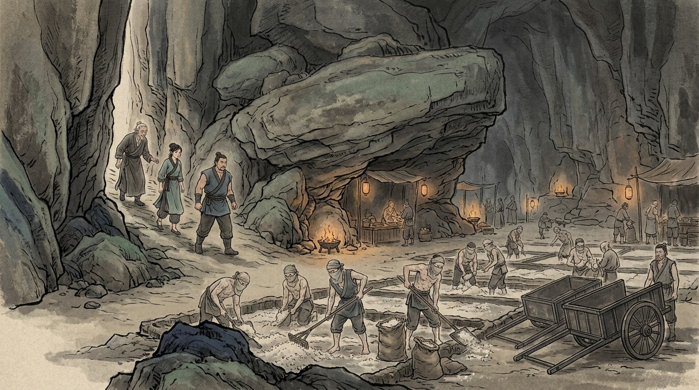
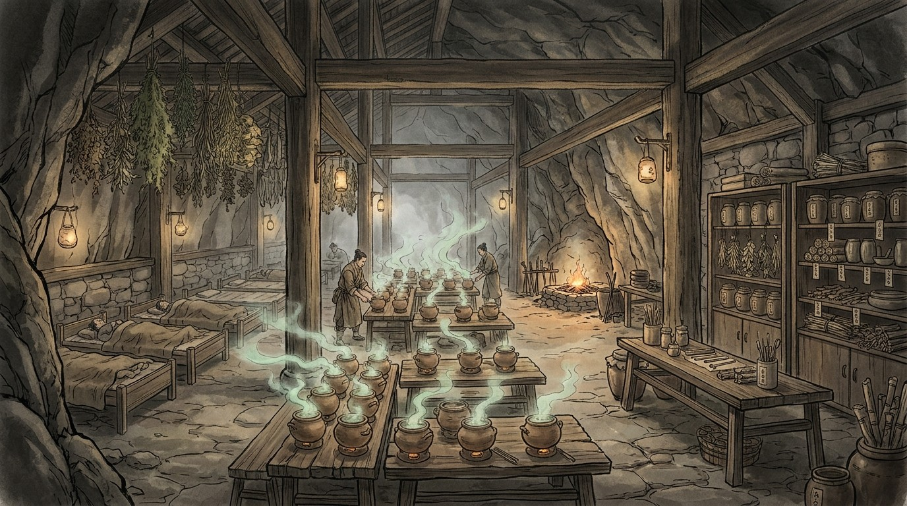

# 第 130 章：邊緣醫棚與首例「律令排異症」

[← 上一章](ch0129.md) ｜ [本卷目錄](00_intro.md) ｜ [下一章 →](ch0131.md)

*章首插畫：第 130 章 邊緣醫棚與首例「律令排異症」*

當沈泥與林鐵生隨戚老頭前往谷底鹽礫坑查帳時，顧玄卻沒有歇在地窯裡，而是背起藥箱跟著石堡內一名提著銅油燈的老婆婆，穿過西側一道低矮塌頂的石窯門，走進了專收重傷與異變鹽夫的**【邊緣礦棚・排異緩衝醫站】**。

醫棚裡沒有藥鋪該有的艾草與當歸清香，一掀開厚麻布簾，撲面而來的卻是濃苦的野苦苔汁氣、礦灰粉味，以及一絲極淡、像冷鐵擦過玻璃般的晶塵腥氣。棚內四張矮木榻上躺著三名呻吟不止的採鹽工，最裡側那張鋪著破羊皮的石榻上，則靜靜躺著一位雙目已經徹底失明、連氣息聽起來都像兩塊碎瓷互相摩擦的枯瘦老人。

正在灶台前蹲著看火煎藥的，是一位二十出頭的石堡遺民女子**蘇青竹**。她粗布圍裙上沾滿深綠苦苔汁漬，聽到腳步聲回過頭來，眼神雖因連日熬夜而透著疲憊，卻意外地冷靜沉穩。

「老丈，這三位剛才又按老法子灌了一碗熱薑參湯，可左肩那塊硬稜不但沒消，反倒往鎖骨裡又長了半寸！」蘇青竹擦了擦額角細汗，目光落在顧玄背上的黑石與金石雙紋藥囊上，微微一頓，「您是新進來的醫者？」

「叫我顧玄便好。」顧玄沒有寒暄，徑直走到最裡側那張矮木榻前。

掀開覆蓋在老人身上的粗麻布，哪怕在金石杏林醫館見過無數地煞毒肺疽與腐骨爛瘡的顧玄，呼吸依舊不由得一滯——

那名老鹽夫的右半邊身軀還是血肉凡胎，皮膚乾癟蠟黃；可從左肩往下直到半邊肋骨，皮下卻浮出一道道半透明、泛著冷玉光澤的僵硬晶稜！顧玄伸手搭上老人未晶化的右手脈門，指尖傳來的脈搏冰冷遲滯；可當他的手指輕輕貼上老人鎖骨下方那處硬稜時，觸感竟硬如打磨過的冷玉石板，脈象非但沒有半點發炎燥熱，反倒透出一股死寂、冰涼、卻又帶著規整幾何切面的異樣震顫！

「別再灌任何溫補湯藥了。」顧玄眉頭緊鎖，伸手攔住旁邊正準備端起熱參湯碗的學徒，「這不是寒邪入骨，也不是凡間的地煞火毒。」

「顧大夫看得出來？」蘇青竹眼睛一亮，連忙從牆角暗格抱出一疊厚厚發黃、邊緣都已磨起毛邊的獸皮病例簿遞給顧玄，「這是石堡三百年來歷代醫者留下的手抄本。那位老人並不是普通鹽工——他的曾祖父，是三百年前從太清門踏入洞天的先輩。當年先輩在太虛附近沾染過無名晶塵，後代雖生在石堡、未曾修習功法，身上卻還是代代拖著這種怪病，只要一吹到風道飄來的細晶粉，骨肉就會一寸一寸『長成石頭』。」

顧玄一頁一頁快速翻過發黃的獸皮病例簿。上頭用炭筆與鏽紅礦墨記滿了三百年來幾十名患者的發病經過：有人試過放血，流出來的血珠在半息內凝成細沙；有人依凡間太清舊法灌下補氣活血的溫熱湯劑，結果靈氣藥力一入體，反而像給結晶添了柴薪般催發玉稜暴漲，不到三日便封死心肺而亡！

「原來如此……這根本不是毒，而是**【律令排異症】**。」顧玄合上病例簿，語氣沉重卻條理分明，「太虛星律與洞天底層的空間規則本就帶有一種強制同化的晶格張力。活人血肉裡只要夾帶了極微的異律晶塵，再用凡間溫補藥湯或靈氣去催動氣血，就等於幫著異界規則把骨肉當成基座一寸寸『釘死』。」

蘇青竹咬著下唇低聲問：「那……石堡存著的幾味烈性去毒藥草全沒用嗎？連那位老丈也沒有辦法救回來了？」

顧玄沉默了片刻，重新蹲回石榻前，仔細檢查老人已徹底失去彈性、連指節都開始泛出玻璃光澤的左臂，隨即誠實地搖了搖頭：

「已經徹底玉化固結的骨肉，不要亂切，也別妄想靠幾劑猛藥逆轉——那只會讓他痛死在榻上。」他打開藥箱，取出在金石帶來的細礦灰粉罐與醫棚外採來的野苦苔，親手搗成冰涼濃稠的深綠藥泥，「但還沒晶化的右側身軀與剛沾塵的另外三名鹽工，還有辦法拖住。立刻停掉一切熱湯溫補，改用這味**『苦苔冷敷配合細礦灰粉』**外敷降溫、隔絕空氣裡的飄浮晶塵，先把惡化速度壓下來。」

蘇青竹毫不猶豫，立刻接過木杵幫著將苦苔藥泥均勻敷上幾名鹽夫發燙起稜的肩頸。果然不到半盞茶工夫，原本疼得渾身抽搐、呼吸如鋸木般的年輕鹽工漸漸止住了顫抖，鎖骨邊緣那層隱隱發亮的微晶紅暈也肉眼可見地退暗下去。

蘇青竹長長吐出一口氣，眼裡第一次對這群剛跌入洞天的年輕外鄉人浮現出真正的敬重：「有效……真的壓住了！可這種冷敷只能隔塵拖延，若遇上大校準前夕風沙暴起，石堡裡五十多口人怎麼可能一輩子裹在礦灰裡不動？」

「拖延是為了爭取時間。」顧玄將沾滿苦苔汁液的雙手在冷水盆裡洗淨，目光望向洞外蒼白暗沉的碎石荒原，心中已落下第一道清晰的醫療邊界與追查方向，「單靠石堡邊緣的苦苔，配不出真正中和排異的緩衝方。要對症立藥，我們必須集齊正北太虛的晶屑、正東萬物的廢槽浸液，還有西南戰祖荒原那頭的異獸血樣——只有把三極極端的病源樣本擺在同一張案上比對，才有可能試出救命的針藥。」

他取過炭筆，在病例簿空白頁寫下進界後第一條醫案實錄：

**「初診確認『律令排異症』：異於凡間火毒與地煞病，忌溫補，唯冷苦苔配礦灰可隔塵緩化；已石化者不可強療，須待三極樣本齊備再試緩衝之方。」**

---

*場域圖誌：邊緣礦棚・排異緩衝醫站*

---

[← 上一章](ch0129.md) ｜ [本卷目錄](00_intro.md) ｜ [下一章 →](ch0131.md)
