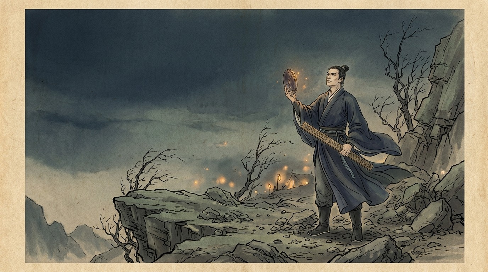

# 第 131 章：幾何向量與第一道順勢契機

[← 上一章](ch0130.md) ｜ [本卷目錄](00_intro.md) ｜ [下一章 →](ch0132.md)

*章首插畫：第 131 章 幾何向量與第一道順勢契機*

顧玄與蘇青竹蹲在醫棚角落熬煮試藥苦苔湯的同時，連續三個夜辰在舊法推演上受挫、連佈三個聚靈小陣都被這方天地空間張力強行絞散的**柳清虛**，並沒有留在溫熱狹窄的地窯裡抱怨天道不公，也沒有再拿自己那點在雲頂算作驕傲的靈石去硬填無底洞。

趁著窯門更換換氣草簾的間隙，這名一路沉靜寡言的太清弟子換上粗麻舊衫，獨自提著師尊陸觀瀾臨別贈予的那面已經多出一道微裂的紫銅護身鏡，外加從戚老頭庫房壓箱底借來的一柄據說祖上傳下、尺面密密麻麻刻著古怪細紋卻無人看得懂來歷的太古測量銅尺，踩著鬆脆玄武岩碎石，一步步走上了灰燼石堡西北側那道受風最烈、光禿禿毫無半寸遮蔽的**【玄武岩風蝕高台】**。

洞天之內沒有日出，沒有月落，更無四季星辰流轉。

柳清虛仰起臉望向頭頂，穹頂永遠只有一塊沉重凝固、宛如千年未擦拭過的鑄鐵般暗鐵青色死寂天幕——任憑他把當年入太清玄天宮第一夜背得滾瓜爛熟的《周天星斗歸一訣》默念十遍、運轉神識向上探出三十丈，上空除了黏滯重壓的電離氣息外，竟然完全找不到半分能供凡間星盤中繼借力的「周天二十八宿星軌」！

這感覺，就像是一個自幼看慣羅盤水星走海路的舵手，一覺醒來被丟進了一片連天頂都沒有北極星的黑鐵大鍋底下，手裡原本指點山川的星圖成了一張徹底失效的廢紙。

「既然天上壓根沒有可供借法的星網，這片空氣裡壓得我們寸步難行、能耗暴漲三倍的黏滯感，究竟是從哪裡生出來的死物？」

高台上冷風如刀，捲起乾燥粗礪的黑砂拍得人臉頰生疼。柳清虛沒有再試圖撐起靈力護罩硬擋風沙——昨夜硬撐三息耗去三成心神的教訓已經夠疼了。他乾脆直接屈膝盤腿，最後更不顧衣袍染塵地貼著地面趴伏在冰冷粗糙、猶如磨石般的玄武岩大石板上。他從懷裡掏出最後一小塊從雲津帶來的上等松煙墨錠，就著石坑角落積存的一點含鹽冷凝水慢慢研濃，手裡握緊一支截短削尖的細竹筆，竟將右耳死死貼緊在那柄平放於岩石表面的測量銅尺冰涼尺身之上！

這是一個太清嫡傳弟子十年修道以來從未做過的事——不再昂首向天上虛無縹緲的仙途求法，反而像他早年在雲津宣道司摘星台核對曆書原件、又或在六縣農田丈量渠溝水平時那般，低下頭、伏下身去，一寸一寸死死盯住貼著岩石表面半寸高飛掠而過的乾燥灰白砂塵軌跡，以及這柄太古銅尺貼地時傳進耳膜深處、細微到常人根本無從察覺的極高頻顫鳴！

一個時辰過去了，兩個時辰過去了……直到寒氣徹底透進膝蓋骨縫裡，鼻息呵出的白霧在眉毛上凝成細霜。

柳清虛卻一動未動。在常人眼裡亂吹一氣的荒原枯風與碎石砂塵，在他那雙逐漸摒除了凡間星路慣性執念的眼睛裡，終於一點一滴拆解出了底層的真相——那些極細微的灰白砂塵在貼地無風轉角處並不是隨意亂飄的，而是嚴嚴實實沿著地面石縫上方一道道肉眼看不見、像極了太極八卦重疊微細蛛網的固定空間折線悄然滑動！每一處岩石稜角的電離阻力、每一次地底傳上來的悶微震動，都會讓銅尺不同刻度發出一聲輕重微異的「嗡」音。

他屏住呼吸，不藉任何法力，單憑松煙墨與竹筆，一筆一劃將這些砂塵流向的偏折夾角、距離與銅尺共振對應的刻度，密密麻麻、毫釐不差地直接刻畫在身前那塊寬大的黑色青石板之上——這正是「知微」初階最笨拙卻也最扎實的立基功夫。

畫到第二個夜辰丑時末，整個石堡與荒原安靜得只剩下風蝕孔洞發出的低鳴。柳清虛為了校準前夜畫下的基準線與今夜實測流向是否吻合，重新拿細竹筆疊上一道對照線。

然而就在最後兩條交點落筆的那一息——柳清虛握著細竹筆、指節凍得發紫的右手猛然僵在了半空之中！

「這不對……差了整整半厘！！」

他臉色微變，立刻從胸前抓出那面裂紋紫銅護身鏡貼近地面石板反覆覆驗對照。前一夜與今夜同一條風蝕溝壑、同一塊含鐵玄武岩稜角上空，風速雖然絲毫不差，可那幾道貼地砂塵自然拐彎的空間偏折角，竟然全部朝同一個方向整整上移了半厘！起初他還懷疑是自己趴得久了眼花手抖，可連換三處不同石槽、測足六次銅尺震頻後，得出來的差值竟然分毫不差全指向同一個讓人背脊發涼的結論——

**這片號稱永恆靜止的洞天底層空間振動頻率，正在每夜子丑之間極為規律地微幅上飄！**

在沒有日夜交替、沒有四季春冬變換的死寂洞天裡，大地與空間的基礎頻率絕不可能無緣無故每日向上微飄！除非……在看不見的地平線極遠處，某幾座龐大得足以撼動整座洞天根基的太古造物，正在暗地裡緩慢加壓預熱，一步步把整張世界大網拉向某個臨界點！

柳清虛此時還完全不知這意味著三個月後的「百年大校準」，心中更不敢妄作定論，只神色極謹慎地掏出懷裡磨鐵小刀，將這組「每夜子丑微幅上飄差值」一筆一劃暗暗刻進紫銅護身鏡背面的邊框凹槽裡，作為日後呈交五人匯算的關鍵暗樁。

恰就在他剛剛收起小刀、準備伸展一下僵麻雙腿的剎那——

崖口外方圓百丈一直停滯的乾燥寒風，忽然毫無徵兆地如一頭蓄勢撲殺的冰原惡狼般捲起滿地尖銳黑砂，呼嘯著朝高台正前方這名瘦削書生撲面狂砸而來！

若是擱在前天剛進界那會兒，柳清虛的身體一定會遵循太清十年煉成的護體本能，強催三倍神識耗損、往身前堆起一道厚實華麗卻極其吃力的水波靈氣牆硬扛到底，代價就是事後腦門劇痛喘氣半個時辰。

可這一回，他坐在冷風口前卻連肩背都沒有繃緊半分。一絲溫熱鼻血因為剛才長時間死扣心算幾何曲線已經悄悄從鼻翼滲出嘴角，這名年輕星修卻渾然未覺，那雙原本因乏力顯得疲憊的眸子在狂沙撲臉前的萬分之一息裡，驟然亮起了一道近乎絕對空明澄澈的清光——

他徹徹底底放棄了往頭頂天空召喚絲毫靈氣中繼的舊習慣，只是借著剛在青石板上畫透的那整張地氣張力切線大圖，輕輕抬起右手食指與中指，對準腳邊那片正在飛掠而起的砂塵自然滑動方向之間最微妙的那條斜向張力交叉點——如撥古琴最細那一根絲弦般，極輕、極穩地「微撥」了一分！

「嗡——」

高台上沒有驚天動地的五彩靈光炸響，沒有半聲術法喝令，更沒有神識海彷彿被破桶抽空一般的撕裂反噬劇痛！

那道本該夾著碎石生生砸爛柳清虛眉骨的狂暴寒風，在距離少年鼻子前兩尺開外，竟然就像是猛地撞上一道本來就斜嵌在空間裡的無形滑道般，順勢被輕巧撥開了三寸縫隙！緊接著借著風勢本身動能，這股狂流沿著他指尖引出來的張力斜線在柳清虛身前無聲捲起，瞬間自動流轉成了一面穩定得不可思議、厚度足有一尺半、連一粒細砂都鑽不進來的無色護氣障！

而剛才這記「微撥」所消耗的神識與靈力……竟然連他以往硬抗舊法的十分之一都不到！

「成了？！清虛……你剛才只動用了不到一成神識就擋死那陣陰風？！」

一道壓抑不住驚喜的嗓音從後方避風石坡底傳了上來。原來是極不放心他連熬幾夜昏倒在風口的顧玄，拎著兩壺溫熱草茶與藥包一直在下頭守望防備。此刻這位向來冷靜的丹鼎少年看著高台上那面安靜抵住狂沙卻半點靈光都不外洩的透明氣障，眼睛都亮了一圈。

柳清虛極輕地揮指散去餘力，讓氣流重新回歸荒原，隨即緩緩吐出一口濁氣，接過顧玄遞上來的粗麻帕子擦去鼻下血跡。連續幾天幾夜通宵伏地運算，讓他的眼白佈滿血絲、左手關節在寒風下也隱隱有些刺骨抽痛；可當這名一向有些文弱執拗的青年低頭重新凝視掌中那柄微微震顫的太古測量銅尺時，心底最後一絲因為修為跌落凡塵而生的迷惘與惶恐卻已徹底煙消雲散。

他終於親手摸著了這座洞天破局的第一把活門鑰匙——**不靠無底洞般往裡頭硬灌靈氣去撞那面鐵壁，而是先俯下身去讀懂天地原本運轉的幾何紋路（知微），再順著紋路與壓差用最小的代價借力撬動（順勢）**！

這道在玄武岩寒風裡用鼻血與墨錠畫出來的**【無星向量牽引】**法門，不僅救回了法道一脈在這片禁絕天地裡的第一口呼吸，也替接下來對抗太虛那座高不可攀的白玉天羅埋下了最致命的伏筆。

---

[← 上一章](ch0130.md) ｜ [本卷目錄](00_intro.md) ｜ [下一章 →](ch0132.md)
