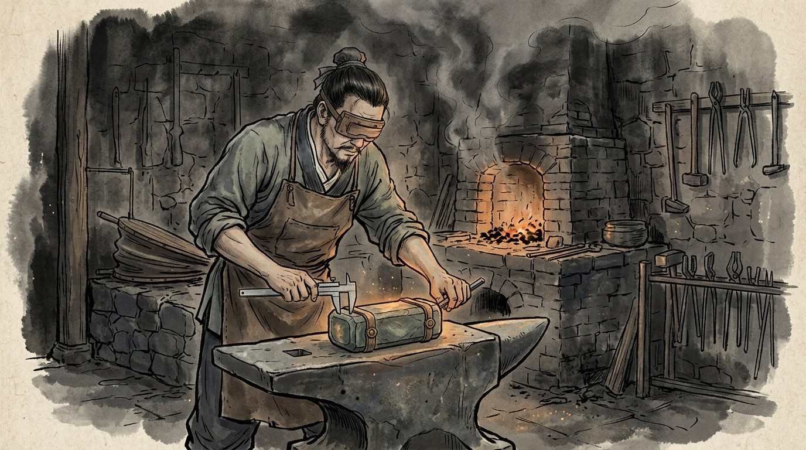
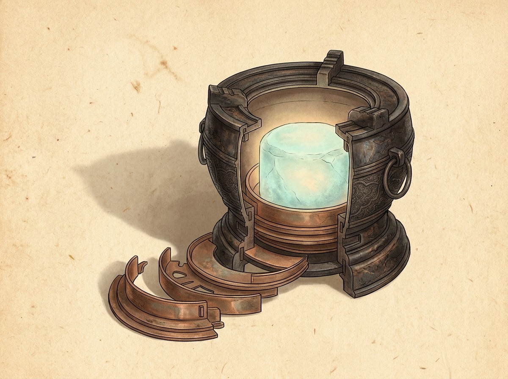

# 第 132 章：鍛造活榫接口與防寒爐

[← 上一章](ch0131.md) ｜ [本卷目錄](00_intro.md) ｜ [下一章 →](ch0133.md)

*章首插畫：第 132 章 鍛造活榫接口與防寒爐*

幾乎就在柳清虛從那片風蝕高台帶回「知微順勢」之道法的同一日，灰燼石堡最靠外緣的半露天矮石窯角落裡，也整天整夜傳出一陣陣清脆、厚重、極富節奏感的「叮、當、哢嚓」打鐵與敲鑿聲。

那是整座洞天裡極難聽見的實打實金鐵生機。

半截半人高的黑玄武岩粗石砧前，**林鐵生**正弓起寬闊厚實的背脊，鼻梁上架著那副一路跟著他走出黑石鋪與天工閣、鏡片早被火星燻出幾道微黃焦痕的防火星木框眼罩。在他面前石砧凹槽裡，靜靜架著沈泥前日從鹽晶黑市裡拿半塊備用精鐵坯換回來的「殘品」——一截原本已經燒盡最後一絲餘輝、裡頭鹽灰結塊得像水泥石磚、被黑市牙人當廢品扔進渣堆的萬物報廢蓄能石匣。

「小師傅真別白費那份好氣力啦！」

蹲在一旁抽著乾燥苦苔葉捲煙的戚老頭，連同石堡裡頭另外兩名幹了一輩子修補雜活、手上少著幾根指頭的老工匠，望著鐵砧上那截死硬石匣直搖頭嘆氣：「那可是萬物主機城外環作坊鑄出來的『一口死封銅匣』！裡頭全用防倒拆的死牙銅鎖扣死死咬著，等裡面那塊下等鹽晶芯燒完三日、灰渣結成死塊，這整個匣子就是塊連錘子都砸不開的廢鐵疙瘩——你要拿大錘硬砸，裏頭殘餘鹽晶內膽跟銅殼就一起震裂成渣，連廢銅都賣不出半斤價！石堡過冬只能再湊三十斤粗鹽，去跟那些吸血黑市牙人換新的！」

「不是敲不開，更不是造這東西的先祖手藝糙。」

林鐵生頭也沒抬，左手穩穩握著當年阿鐵師父留給他的那把烏亮精鋼分寸卡尺，右手提著極細窄的一把平口小鐵鑿，將眼罩推近三寸貼近石匣底部的銅封縫細細打量，嘴裡一邊淡淡應道：「天底下哪有鐵匠打鎖卻不留退刀縫的？這東西根本就是造它或者改圖的人，故意不讓用它的人自己拆開清灰——你們看這處內沿的退刀斜槽。」

他拿分寸卡尺尖端照著銅箍內壁一道肉眼幾乎無法辨識的微細偏心卡槽輕輕一點，「原本萬物主機的標準活榫模子，只要在鑄造時把這道斜牙的退縮餘量故意減掉兩毫，冷卻後外箍銅牙就會死死咬死內膽。他們不是做不出能重複清灰換芯的暖爐，而是故意鎖死這兩毫差距，好逼著你們每燒三天就得重買一隻整匣，把石堡這輩子賺的每一兩鹽晶永遠抽乾淨！」

話音剛落，林鐵生右手腕順著昨晚替柳清虛一起推敲出來的應力方向巧勁一壓，左手平口小鐵鑿順著卡尺頂住的那道偏心退牙溝「咔」地一聲往內斜挑三分——

「啪嗒！！」

在兩名老修補匠瞪圓的眼神注視下，那道號稱全石堡拿大鐵鎚砸都砸不開的死封青銅外箍，竟然如同聽話的機括門閂般完完整整地朝兩側彈開了兩半！裡頭一截已經燒成灰白板結狀的廢鹽晶內膽連帶完整無損的耐火隔熱陶芯，乾乾淨淨露在了空氣之中！

「這……這真是……連半點毛刺都沒傷著內膽就打開了？！」一名老工匠手裡的木煙斗差點掉在石地上，蹲上前摸著那枚完好彈開的雙向銅扣半晌說不出半句話來。

林鐵生沒有趁勢顯擺什麼天工閣高深陣紋，更沒學那些名門煉器師把好好一隻生活暖爐刻滿既耗靈石又難修補的聚靈花陣。他心裡比誰都清楚：在這座連飯都要論兩算、連一斤高純鹽晶都要冒死去黑市換的地方，越玄乎的法器越死得快，唯有**「好找料、誰都能修、壞了三兩錘就能接回去」**的樸實活榫器具，才救得了幾百口活人過冬！

整整一個白晝加半個黑夜，石窯火光映著少年額頭淋漓的汗水。林鐵生翻出石堡廢鐵堆裡積灰多年的破鐵皮、邊角熟鐵塊，外加自己行囊裡壓箱底帶自雲津天工閣的三分之一張上品退火熟銅箔，一次又一次在簡易泥爐裡拉動破風箱反覆摺疊鍛打、放在粗磨刀石上頂著兩倍半重力一絲一毫校修公差——

沒有天工閣那種自動控溫的寒水淬火大槽，每一次高強度連打三十錘後，熱浪與洞天空間壓差就讓這名少年雙手虎口滲血、必須按著師父交代的笨法子強行停爐熄風，苦苦靜坐等待兩個時辰讓滾燙鐵砧與坯體自然退火散熱。可即便進度慢了一倍、磨刀石被生生磨凹下去兩指深，林鐵生嘴角始終掛著一抹自從踏入這座冰冷異界以來最踏實平靜的笑意——比起當年在雲頂擂台打贏一百場拿來看熱鬧的傀儡比試，眼下這個滿手灰燙泡的時刻，才讓他覺得自己真的接住了阿鐵師父那座鐵鋪的衣缽。

半日之後，當整整三套造型古樸粗實、外表看不出半點靈光卻嚴絲合縫的全新**【可拆卸換芯暖爐】**終於徹底組裝落定時，半個石堡的婦孺老少都默默圍到了窯口邊。

這三座暖爐的底座全部被林鐵生改造成了統一標準的「雙向活榫接口」與可抽拉側門——只要裡頭鹽晶芯燒鈍結渣，莫說是石堡裡的手藝老匠，就連一個十來歲的半大娃子或獨臂老人，也能一手輕鬆拔開兩枚防卡死平頭鐵插銷、抽出廢灰匣倒掉死渣，再往耐火芯筒裡添上一撮黑市換來的最便宜低等粗鹽粉重新按卡回槽，「哢噠」一聲鎖緊，便能再度穩穩續燒三日三夜！

僅此一個「不封死、可拆換、分散應力」的活榫改動，便把原本動輒廢棄整隻匣殼的熱源消耗成本生生砍掉了七成以上！

當第一座換芯暖爐被送進石堡最潮濕陰冷的地下老人窯裡，隨著石堡小娃自己動手按下活榫鎖扣，爐口「呼」地穩定騰起一團清澈柔和的淡青暖火、滿屋子原本凍得嘴唇發紫縮成一團的十幾個老人與孩子第一次伸出手烤到那股既不嗆鼻黑煙、也不往外掉灰渣的實打實暖意時——

整個冰冷的地窯裡頭先是一陣極深的安靜，隨即一名幾歲大的孩子輕輕「啊」了一聲把凍僵的小手湊近了三寸。

林鐵生靜靜坐在窯門旁的矮石墩上，拿水瓢舀起半瓢冰水「滋滋」澆在自己剛剛磨破起泡又結痂的雙手虎口之上，旁邊擺著兩塊被生鐵磨出深槽的粗糙灰磨石。

一直抱著獨臂站在暗處冷眼旁觀的**戚老頭（戚守灰）**，死死盯著那枚不起眼卻讓人能把這條命多活過幾個寒冬的小小雙向活榫鐵插銷沉默了許久。半晌，這名把整個灰燼石堡四百八十七口性命扛在肩頭上、對所有外來者防備到骨子裡的老人忽然一聲不響地轉過身，獨自走到石窯最深處陰影裡，伸出僅存的左手在一塊看似平平無奇的牆磚上摸索了兩下，用力摳出磚塊後頭一個積滿塵灰的暗格！

「拿去吧。」獨臂老人把一捲泛黃、邊緣幾乎已經發脆碎裂的暗紅舊羊皮卷走回來，「咚」地重重拍放在林鐵生面前那座尚有餘溫的鐵砧上。

沙啞如砂石摩擦的嗓音裡，頭一次少了那種拒人於千里之外的防賊戒備，多了一分真正把整堡活口身家交託出去的沉重託付：

「這張破羊皮，是老朽太爺那一輩用兩條硬生生被機隼鋸斷的腿換回來的家底——上頭清清楚楚標著灰燼石堡外頭三條太虛機隼避檢舊鹽道、正東萬物廢渣荒漠的無主落腳縫隙，還有西南戰祖赤黑焦土那邊隔多久會換崗的巡邏盲點……你們這五個從下界摸進來的年輕娃娃，不像以往那十六批只會昂著頭唸仙經吹大氣的飛升老爺，是真的把袖子挽起來、肯蹲進灰泥裡跟我們一起活出個人樣的好後生！」

一直在旁留意著每個細節的沈泥立刻走上前，小心翼翼接過並展開那捲沉重得彷彿還沾著血泥的暗紅羊皮卷，同時順手在腰間炭帳上極工整地補錄入這次試鍛所消耗的三分之一熟銅箔、兩塊磨刀石與一罐鹽水的精準公差支出。

憑藉這三座看來平平無奇卻顛覆了洞天「一次性消耗壓榨」規律的可拆卸換芯暖爐，五個年輕人終於不再只是在石堡角落借宿避風的過客，而在這座荒蕪冷酷的異界牢籠裡，真正替自己掙下了第一塊屬於活人的立足錨點與最關鍵的荒原交通圖譜。

---

*器物圖誌：可拆卸換芯暖爐*

---

[← 上一章](ch0131.md) ｜ [本卷目錄](00_intro.md) ｜ [下一章 →](ch0133.md)
