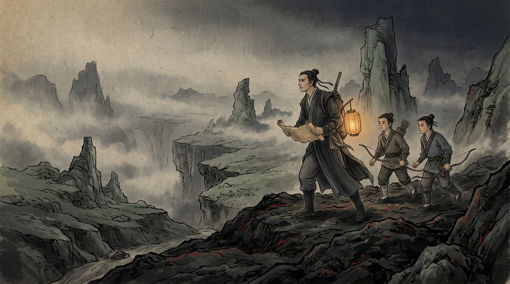

# 第 133 章：裂谷邊緣的鷹記刻痕

[← 上一章](ch0132.md) ｜ [本卷目錄](00_intro.md) ｜ [下一章 →](ch0134.md)

*章首插畫：第 133 章 裂谷邊緣的鷹記刻痕*

拿到戚老頭那張珍貴的舊鹽道羊皮圖後，燕隼沒有一刻耽擱，立即帶上石堡裡最熟悉西南地形的兩名年輕獵手，趁著荒原灰霧最濃的時刻沿著玄武岩風蝕溝潛向西南十里外的**【赤黑焦土獵界邊坡】**。

越靠近西南邊界，空氣裡的溫度就越是怪異——腳下的玄武岩逐漸變成泛著暗紅鐵鏽光的焦黑火山岩，每踩一步都像有看不見的重錘在往下輕輕拽著膝蓋；空氣裡飄浮著淡淡的硫磺血氣與焦糊骨味。

剛伏低身子爬上一道焦土岩脊，燕隼便敏銳地皺起了眉頭。

「不對勁……」他反手按住身旁兩名年輕獵手的肩膀，壓低聲音指向下方三里外的淺谷，「你們看谷底。」

只見原本應該老實窩在深谷石窟裡的幾群「灰甲砂蜥」與低階「焦岩野犬」，此刻竟像躲避大火般成群結隊地朝東北邊緣慌亂遷徙；而在更遠方赤黑裂谷的濃霧深處，正隱隱傳來陣陣沉悶急促的戰祖骨號聲與鞭撻厲喝！

「媽的，戰祖魔殿外營那群督戰狗官這半個月不知道抽了什麼瘋，」身旁一名叫石柱的年輕獵手咬牙低聲咒罵，「本來一季只要我們外圍邊寨繳十頭荒獸肉骨，最近半個月骨號天天響，聽說監軍在營裡硬把獸心核的死期配額又往上加了三成！逼得外營那些可憐獵奴天天往深谷裡趕獸，才把這些雜獸嚇得滿荒原亂竄！」

「加徵三成心核……」燕隼心頭猛地一跳，想起臨出門前沈泥提過的萬物外環鹽晶預扣三成與清虛測到的夜間頻率上飄——難道三座互不相干的太古巨構，最近同時都在急著屯料？

他強迫自己先按捺住滿腹疑竇，趁著巡邏骨旗剛轉過遠方岩角的空檔，打個手勢示意兩名獵手原地掩護，自己像一頭無聲的灰豹般貼著滾燙焦岩滑進下方一道背風的赤黑石縫裡，準備記下這段獵道重力場脈動的節奏。

就在他伸出左掌撐住石縫內側一塊凸起的陰影岩石時，指腹忽然觸到一道極其銳利、與周遭天然風化完全不同的凹陷棱角！

燕隼呼吸驟然一窒！

他飛快從腰間摸出火折照亮那處背陰的赤岩底面，用指尖輕輕拂去積了薄薄一層的黑灰——三道極其熟悉、連收腕轉折的鈍角弧度都與自己左手一模一樣的獵戶刻痕，赫然映入眼簾：

**「左撇收腕・雙羽隱括」**——那是黑石鋪燕家獵戶祖傳的極密尋蹤暗記！刻記極深、尾筆微挑，代表「人尚存、已往西南深營去，切勿輕進」！

燕隼渾身肌肉瞬間繃緊，指節因為死死按在岩石上而微微發顫！他連忙抽出小刀，小心翼翼地挑出刻痕最深處嵌著的幾粒風化細砂與焦灰，對照石堡外牆岩石的年均蝕刻厚度一比——

「最多……三至五年！」

壓抑了整整一年多的念頭在胸膛裡轟然炸響！五年前在北荒黑冰斷谷失蹤的大伯**燕山**，真的還活著！他不但穿過裂隙活著落進了這座洞天，而且就在這三五年內，曾親自走到過這道焦土邊界！

「哥……燕哥！遠處巡邏骨旗掉頭回來了！快撤！」

後方放哨的石柱壓著嗓子焦急揮手。遠方焦土迷霧裡，兩名騎著無毛骨蜥的戰祖探哨已經嗅到了異常生人味，正舉著長矛朝這邊緩緩逼近！

燕隼雙眼赤紅地盯著西南方濃霧深處那座隱約可見白骨輪廓的【戰祖魔殿】，右手下意識就想摸向背後的蛟骨弓——但他視線一低，看見了石柱和另一名年輕獵手緊張發白的臉，耳邊頓時響起了清虛在北荒、莫三在雲津、沈泥在石堡地窖反覆說過的話。

他猛地咬緊牙關，扯下一塊帶蠟紙的布巾飛快拓印下那三道鷹記刻痕揣進懷裡，隨即低喝一聲「跟我從西側凹溝退！」便帶頭躍下岩坡。

退走途中，三頭嗅味撲上來的赤蜥攔住了去路。燕隼為掩護兩名石堡年輕獵手先行撤進盲點岩縫，強行連開短弓射殺頭蜥——代價是隨身最後三支精羽箭徹底折毀，右肩舊傷在重力場反彈下再次隱隱作痛。直到確定所有人安然翻過玄武岩脊，他這才緊攥著懷裡那張滾燙的鷹記拓印，一路疾奔返堡。

---

[← 上一章](ch0132.md) ｜ [本卷目錄](00_intro.md) ｜ [下一章 →](ch0134.md)
