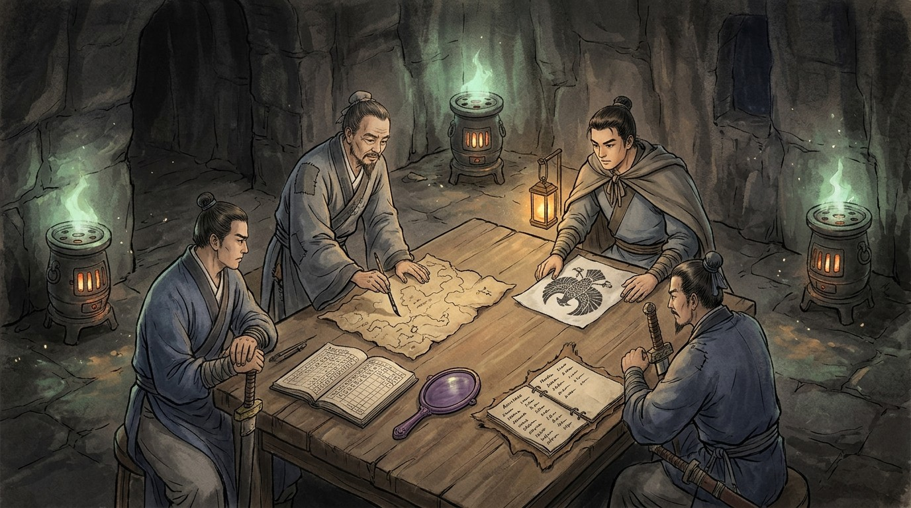

# 第 134 章：第一封死契與分兵三極決議

[← 上一章](ch0133.md) ｜ [本卷目錄](00_intro.md) ｜ [下一章 →](ch0135.md)

*章首插畫：第 134 章 第一封死契與分兵三極決議*

灰燼石堡地下最深處的石案室裡，三座可拆卸換芯暖爐靜靜燒著穩定的淡青微光，把潮濕陰冷的玄武岩壁烤出一圈難得的暖意。

木桌上攤開著戚老頭給的羊皮鹽道圖、沈泥的炭筆核價總帳、柳清虛背面刻著數值的紫銅鏡、顧玄抄錄的獸皮病例簿，以及燕隼剛從焦土邊緣拓回來的那張「左撇收腕・雙羽隱括」鷹記拓印。

「大伯還活著，就在西南那座魔殿外圍的獵道裡！」燕隼一拳重重砸在石桌邊緣，聲音壓得極低卻透著一股壓不住的灼熱，「給我兩天備好粗鐵重箭，我一個人循這道獵痕摸進去——摸清他在哪個獵營，能帶出來就帶，帶不出來我也得當面問個明白！」

「你帶什麼進去？帶你剛折斷的那三支箭，還是帶你那條還沒養好筋膜的右肩？」

林鐵生頭一次沒順著兄弟的性子，直接把一塊廢鐵墩往桌上一放，臉色沉靜得可怕：「別說戰祖魔殿裡頭有什麼骨座戰兵，光是你連人家獵營囚籠是用什麼榫卯鎖芯、外圍重力場隔幾息衰減都還沒摸清，你這叫送人頭！今天要是沒有石堡那兩個年輕獵手替你望風，你連怎麼躲回玄武岩溝都難說！」

「鐵生說得對。」顧玄替燕隼換了一副乾淨繃帶，語氣冷靜得近乎冷酷，「而且現在不光是你大伯一件事。你帶回來的戰祖心核加徵三成，加上沈泥在黑市查到的鹽晶預扣三成、以及清虛測出的底層幾何頻率每夜上飄——這三座巨構一定有哪裡出了大事！五個人全部押上西南救人，就算救出你大伯，石堡的排異病照樣沒藥方，萬物那邊的鹽晶欠帳照樣凍死全堡。」

燕隼胸膛劇烈起伏，死死盯著桌面上那張鷹記拓印半晌，終究慢慢鬆開攥緊的拳頭。經歷過雲頂會武與北荒生死的少年，早已不再是當年那個只會憑一腔熱血往林子裡硬衝的黑石鋪獵娃。

「好。」燕隼啞著嗓子抬起頭，目光掃過四位從黑石鋪一路並肩走到異界盡頭的同伴，「不單幹，不分心。但分兵之後，西南這條線必須歸我——誰也不許攔我查燕山。」

「無人攔你，我們是去替你把後背墊起來。」

沈泥站起身，雙手並指按在泛黃羊皮地圖中心，以雲津商會總號掌櫃的冷靜條理當場敲定五子入界後的第一封死契：**「分兵三極・互為後盾・絕不孤軍送死」**——

一、**顧玄**與醫女**蘇青竹**留鎮灰燼石堡醫棚，負責穩住換芯暖爐與石堡補給線，並匯總即將從三極帶回的異質樣本，研製【律令排異症】緩衝藥方；

二、**林鐵生**憑藉「可拆換活榫」手藝與戚老頭的舊鹽道盲點圖，隨黑市修補散工混入正東**【萬物主機城】**外環廢料回收場，既換取正經公差試工牌與焊料，也必須核清那塊「九號離艦補給營」舊鐵牌的來龍去脈；

三、**柳清虛**換上粗麻短衫，混入石堡定期向正北**【太虛神宮】**運送導流鹽晶的苦力搬運隊，貼近白玉階座觀測星位誤差，查清那組「每夜頻率微幅上飄」與昔年太清先祖失蹤的真相；

四、**燕隼**按住急躁，只帶一名經驗豐富、認得山路的石堡老獵沿西南舊鹽道潛至戰祖外圍獵界，一邊摸清重力衰減節拍，一邊暗中查探**燕山**下落與心核加徵的內情；

五、**沈泥**自己坐鎮灰燼石堡中樞，統籌三極情報、鹽晶欠帳與黑市反制籌碼，並循【天門引】的微弱指引，追查藏在萬物主機城外圍那座屬於【九城商盟】的封存遺址。

「還有一條總規矩，」沈泥看向四人，一字一頓敲在石案上，「每隔十個夜辰，不論三極那頭有多大收穫或多大危機，必須透過鹽道暗哨回堡對帳一次！誰若斷訊超過三日，其餘四人寧可捨棄手中線索也得聯手去撈——我們五個是從凡間一起跳進來的，這筆帳，一個都不能少。」

「成交。」林鐵生第一個把手掌按在羊皮地圖上。

「算我一個。」顧玄、柳清虛與燕隼的手掌隨即一隻疊一隻重重壓了上去。

入界大約一個半月後，站穩了灰燼石堡第一座腳跟的五道身影各自背好修補妥當的行囊與工具，在暗鐵青色靜止天穹下分作四路走出溝壑——第四卷真正的三極暗戰，就此揭開序幕。

---

[← 上一章](ch0133.md) ｜ [本卷目錄](00_intro.md) ｜ [下一章 →](ch0135.md)
