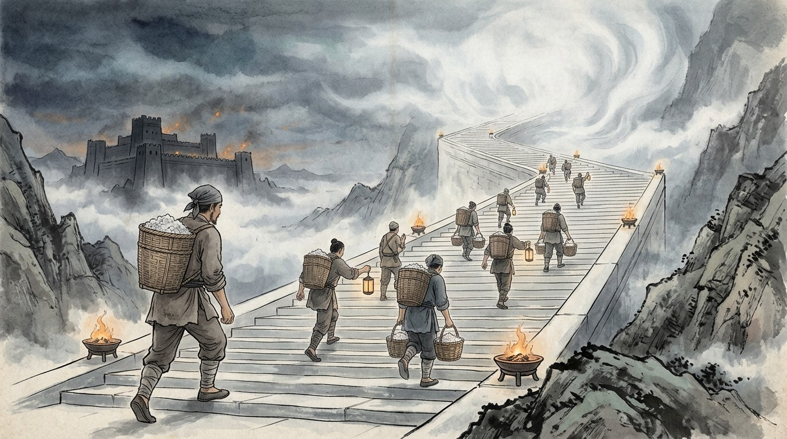

# 第 135 章：白玉接天階與鹽晶黑帳

[← 上一章](ch0134.md) ｜ [本卷目錄](00_intro.md) ｜ [下一章 →](ch0136.md)

*章首插畫：第 135 章 白玉接天階與鹽晶黑帳*

出灰燼石堡往北三十里，天幕不再是玄武岩縫那種鐵青沉鬱的死色，而是被一片冷得刺骨的素白輝光罩住。

柳清虛把灰布頭巾往下壓了兩分，雙手穩穩託著一隻半人高的柳木鹽晶背筐，踩在寬達十丈、直插雲霧的「白玉接天階」上。身前後共有十一名石堡苦力與外階雜役，每人背上都負著四十斤灰白色的導流粗鹽晶，腳步踩在冷硬潔淨的白玉階面上，連半粒灰塵都不敢抖落。

這便是太虛神宮的外門。

在凡間雲頂之上，多少太清弟子夢寐以求的「白玉登仙階」，真站到腳底下來，柳清虛才聽見白玉石縫裡頭不斷傳來細如蚊蚋的嗡鳴——整座萬階石梯底下全都嵌著密密麻麻的引流銅管與儲能晶柱，每當苦力踏過一階，鞋底那點微弱的凡胎血氣竟就被石磚悄悄抽走一絲。

「低頭，步子別亂。」前頭領隊的石堡老雜役壓低嗓音叮囑了一句，「上頭主簿今日親自點數，少一錢斤兩，這個月全堡的配給鹽晶就得扣三成。」

柳清虛微微頷首，垂眸斂去眼底一閃而過的星紋推演微光，肩頭卻刻意做出吃力的模樣微駝三分。這一個多月裡他早測出洞天的阻尼規律——越是急著運轉雲津舊道法，經脈耗損越快三倍；反倒像現在這般把呼吸貼在足底石縫脈動上，只以玄武岩風道領悟的那點「無星向量牽引」護住肺腑，體力竟然省下大半。

行到階頂白玉坊旁，兩名身穿素銀滾邊道袍的太虛外階執事正冷著臉核對秤盤。而在廊簷陰影裡負手而立的，卻是一名面皮白淨、留著三縷整齊短鬚的中年文士——太虛執律閣主簿**嚴平**。

只見一名外階雜役的竹筐秤下來輕了二兩，那雜役當場雙膝一軟跪在玉階上連聲告饒：「回主簿大人，路過寒風嶺時冰霜融了水氣，並非小的敢偷刮……」

嚴平連眼皮都未抬一下，只用手中玉尺輕輕點了點青銅算盤：

「損耗便是損耗。寒風嶺冰潮入帳，按例從本旬石堡鹽晶額度裡折價加罰十斤，外加這名雜役的『玉化晶核補替順位』往前挪三位。」

那雜役聽見「順位前挪」四字，整張臉頓時血色盡褪，連磕頭都不敢用力。旁邊隊列裡的幾名外階年輕修士亦是脊背發僵，卻無一人敢出聲。

柳清虛不動聲色地走上前放下木筐。就在銅秤落定、嚴平垂眸翻動名冊的一瞬，柳清虛的指尖借著扶正筐緣的動作，輕輕擦過嚴平腰間掛著的那只紫銅私印袋，同時眼角餘光已將桌上兩本帳冊瞄得一清二楚——

一本擺在明處給天羅星盤核數的「損耗總冊」，另一本壓在官袖底下的小楷摺頁，上面赫然記著「撥轉西隅觀星私台延壽晶粉七十四斤」的字樣！

主簿嚴平嘴上天天掛著「零誤差維護天羅秩序」，背地裡卻借寒風損耗之名，將原本該給外階苦力與石堡邊民的保命鹽晶剋扣下來，私補進自家私設的觀星養壽小陣裡。

交割完畢，搬運隊被趕到側廊石亭歇腳喘氣。正當柳清虛佯裝揉捏酸麻膝蓋、暗中在袖底以指甲刻記方才所見帳目數字時，一道袖口沾滿石墨粉與銅鏽的灰影悄無聲息靠到亭柱旁。

來人鬚髮微霜，眉宇間卻透著長期對著銅尺星盤算數留下的執拗疲態，腰牌上刻著「校星觀測院・衡真」。

「你方才上階時，第九十七階到第一百零三階的步幅一寸未差。」衡真道人盯著地面青磚，聲音壓得幾乎與山風融成一片，「尋常苦力背著四十斤鹽晶走到那處，必定要歪肩換氣。石堡幾時來了你這號懂九宮定步的搬運夫？」

柳清虛心頭微緊，手中捏著一塊碎石灰岩不露聲色，面上卻露出三分愚直的苦笑：「道長看走眼了，小的以前在黑市幫藥商推獨輪車，這條北道石階平得緊，步子踩穩了省腳力罷了。」

衡真道人冷笑一聲，忽然從袖管裡極快地遞過半截刻著細密刻痕的殘破竹尺——尺身上寫的竟不是太虛本門的星文，而是失傳數百年的雲津古算「天元減半拍」記法！

「這東西，我三十年前在太清前輩留下的封存雜物堆裡翻出來的。」衡真轉過半邊臉，渾濁卻銳利的雙眼直鎖柳清虛，「你們從星門外頭進來的人，不用裝得那麼像苦力。想活著查清楚上頭這座神宮究竟是怎麼運轉的，亥時初刻別急著下階，到白玉坊西側那間堆廢銅鏡的觀測偏房來。」

說罷，不等柳清虛答話，衡真道人已抱起一疊廢棄星圖轉身沒入白玉長廊的霧靄深處。柳清虛低頭摩挲著掌心那半截殘竹尺上的古算筆鋒，確認確與太清祖師殿古籍一脈相承，這才緩緩吐出一口白霧。

看來太虛神宮並非鐵板一塊；在這片看似冰冷無瑕的白玉階座之下，早有熬了數百年的異見之火在石縫裡暗自滾燙。

---

*場域圖誌：太虛神宮・白玉接天階與校準偏殿*

---

[← 上一章](ch0134.md) ｜ [本卷目錄](00_intro.md) ｜ [下一章 →](ch0136.md)
