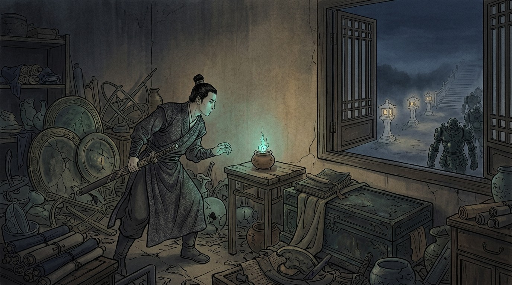
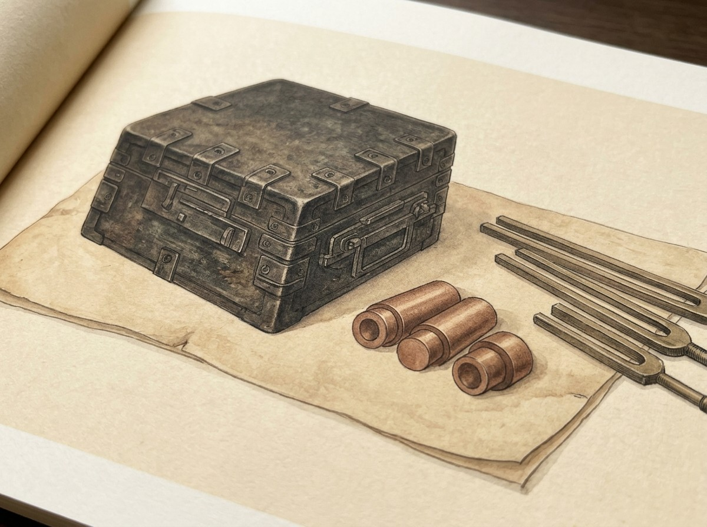

# 第 136 章：玉化晶核與銅匣之債

[← 上一章](ch0135.md) ｜ [本卷目錄](00_intro.md) ｜ [下一章 →](ch0137.md)

*章首插畫：第 136 章 玉化晶核與銅匣之債*

亥時將至，白玉接天階上萬盞素白石燈依次減去七成亮度，只留下一條僅容兩人並肩通行的幽暗小徑。

柳清虛避開巡夜銅偶固定的轉角間隙，悄無聲息地閃進白玉坊西側那座堆滿龜裂銅鏡與廢棄測星架的偏房。裡頭沒點油燈，僅憑桌心一小撮浸泡過鹽晶屑的冷焰火種發出淡青色微光。

衡真道人正伏在一張積滿銅綠的案幾前，面前擺著一隻六寸見方、周身布滿細密暗榫而無半點鑰孔的烏銅小匣，以及三大卷發黃起毛的牛皮觀測實錄。

「門關緊。」衡真聽見腳步聲也沒回頭，只指了指案對面的木墩，「先看看這個，免得你們外頭來的弟子還拿太虛神宮當什麼飛升聖地。」

柳清虛掀開最上頭那卷牛皮紙，眉頭頓時深鎖。紙上密密麻麻畫著三百年一輪的曲線圖——每經歷一個甲子，太虛頂端那座支撐整座洞天的「天羅星盤」就會衰減將近五分之一拍的穩度；越接近三百年大限，衰減越是陡峭。

「衰減了怎麼辦？」柳清虛沉聲問道。

「補。」衡真伸出一根沾著黑灰的食指，重重戳在畫卷末尾一行硃砂小註上，「補天羅耗損，最省事的料子既不是黑鐵也不是尋常鹽晶——而是**將修煉到五六十甲子、體內法則半玉化的高階外門修士送進高塔底座，讓其身軀徹底異律晶化，化作替死壓陣的『玉化晶核』**。」

偏房內一時靜得只剩石燈鹽芯劈啪作響的微音。

「白晝裡嚴平威脅那個雜役『順位前挪』，說的便是這個？」柳清虛指節微微發白，「太清歷代所謂『功德圓滿、拔宅飛升』的先輩……」

「一半是死在萬物外環的毒氣濾網與戰祖獸口裡，另一半修得太好、反而夠格被太虛請上白玉頂階的人——全成了那座高塔裡會喘氣的壓陣石樁。」衡真嘴角泛起一絲冰涼至極的自嘲，「我做了九十年觀測士，算得越多越明白一件事：洞天根本不在創造新法，它只是一隻不斷漏水的破木桶，每隔三百年就得把桶底下最結實的那塊木頭拆下來填裂縫。」

柳清虛沉默許久，伸手去摸桌上那只鎖死的烏銅小匣：「這些實錄若交給我帶回灰燼石堡，我們能與萬物外環的高手併帳核對。可這只匣子為何鎖著？」

「這裡頭封著我三十年偷抄的原始讀數鐵片，只有用萬物主機外環特制的『冷鍛音叉』配合特定頻率敲擊九個暗節才能無損掀蓋；硬砸只會觸發裡頭的腐晶強酸把鐵片溶成泥。」衡真抬起渾濁雙眼盯著柳清虛，「實錄與銅匣你先拿走。但我也不是無條件賣命——我這座私設的小觀測台裡，壓著三枚從主塔換下來的舊調頻栓，裡頭早積滿異律毒素。半年內若不補交**三枚萬物匠師新鍛的無毒穩壓銅芯**，下次主殿大檢，我便得因為『私藏損件』被當場送去補塔位。」

「三枚穩壓銅芯。」柳清虛一字一句記在心底，「我同門有位極擅九級公差冶鍛的匠師正潛在萬物外環，這筆銅匣債，我替你接下來。」

話音未落，廊外忽然掠過一道微弱卻凌厲的星盤掃描銀光！

「不好，執律閣今晚加巡了！」衡真反應極快，反手一掌拍滅鹽晶冷火，一把將柳清虛推進牆角堆放廢銅鏡的木架夾縫，「守夜人只點查星盤讀數，切記收斂所有內息——」

「來不及完全收住了，」柳清虛低喝一聲，右眼卻猛地睜圓！就在那道半透明的掃描星光刺破窗紙、直直掃向桌面那幾卷尚未收起的牛皮實錄之際，柳清虛強行催動方才從衡真殘尺裡悟通的古算「無星低耗導引」，硬生生憑著左眼直視星光軌跡，反向計算出銅鏡堆折疊陰影的臨界斜角，伸手在萬分之一息內把牛皮紙順著死角往桌底一扯！

銀光擦著柳清虛左眼睫毛一閃而過，照在空蕩蕩的桌面銅鏡上，只映出幾道雜亂的陳年碎光。

足足過了十息，廊外踏步聲遠去。

衡真長出一口氣，轉身正要道謝，卻見黑暗裡柳清虛一手捂著左眼半跪在地，指縫間正滲出一行帶著淡藍微光的冷淚——方才那一瞬間強行逆推天羅星束折射角，代價幾乎是立刻落在了眼底深處。

「你的左眼……」衡真臉色一沉，急忙摸出半塊清涼的寒玉按在他眉骨上。

「不打緊，還能視物。」柳清虛緩緩放下手掌，左眼瞳孔深處從此落下一圈揮之不去的淡青色雪盲殘影，連帶著右手食指在冷汗裡微微抽顫了一下，卻仍極穩地從桌面撿起那只烏銅小匣與拓印本貼身收好，「只是以後夜裡看東西怕是要重影半分。替我記著那三枚銅芯——十夜後，這匣裡的帳一定響給主殿聽。」

---

*器物圖誌：太虛鎖死烏銅讀數匣與穩壓銅芯*

---

[← 上一章](ch0135.md) ｜ [本卷目錄](00_intro.md) ｜ [下一章 →](ch0137.md)
