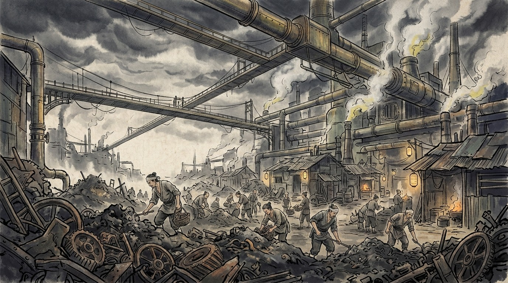

# 第 137 章：萬物外環與九級公差車軸

[← 上一章](ch0136.md) ｜ [本卷目錄](00_intro.md) ｜ [下一章 →](ch0138.md)

*章首插畫：第 137 章 萬物外環與九級公差車軸*

灰燼石堡往東行過三十餘里鹽鹼風蝕帶，天地驟然換了一副截然不同的面孔。

高空上壓著無數條縱橫交錯的巨型黑鐵導管與懸空棧橋，一縷縷帶著硫磺味與鐵粉氣的白霧從百丈高處的排氣巨口噴薄而出，把整座「萬物主機城」的外環罩在永不散去的銅鐵轟鳴裡。此地不見仙風道骨的白玉階，滿眼皆是鏽跡斑斑的廢料山、軋齒滾輪與彎著腰在熔渣堆裡撿拾可用銅件的凡人外環工役。

林鐵生換上一身滿是油垢的粗布圍裙，肩上扛著那柄跟了自己十多年的凡間烏沉短鍛錘，隨著戚老頭畫的鹽道盲點窄橋悄然擠進外環第三維修站外的試工隊列。

工棚前方坐著個右臂只剩半截、卻裝著一隻精密黑鐵機械假手的禿頂老人——外環資格最老的老工役頭子**齊老匠師**。在他身旁站著幾名身著灰鐵制式短褂、臉上毫無表情的城內巡檢小吏。

「新來的石堡雜工？」齊老匠師甚至沒看林鐵生的臉，只隨手抓起腳邊一根被高溫壓扭得像麻花一樣的「導流雙頭銅車軸」，咚地砸在試工鐵砧上，「天黑前把它的同心度磨修回八級公差以內，能轉得動三號濾塵風輪，就發你一塊正式乙等工牌與十斤焊條；車壞了，直接跟那堆廢料一起倒進西邊酸洗槽。」

隊列後面幾個同樣來試工的外環流民看得倒抽一口冷氣——那種陳年高熱變形的異界合金銅軸，在缺乏城內高階水銀磨床的情況下，單靠手工冷鍛與粗銼要壓回八級公差，簡直是天方夜譚。

林鐵生卻半句廢話也無。他蹲下身，左掌五指輕貼上冰涼的銅軸，指腹一寸寸摩挲過上面被氣壓扭斷的結晶紋理。在凡間天工門千錘百煉出來的「聽音辨材」手藝配合雲頂一戰的精密工學底子，此刻在洞天高壓環境下反而愈發沉穩如鐵。

他先不去砸最彎的那處軸頸，而是挑了三枚不同口徑的退火銅箍套進微裂處，改用自備的「兩段式分段退火敲擊法」——短錘每一次落下皆控制在半力之內，借著洞天三倍空間阻尼把多餘震波吃進鐵砧，竟硬生生在不開高溫大爐的情況下，把變形的軸心一點一點推回原本的圓弧。

日頭將沉時，整座工棚四週不知何時已靜悄悄圍了一圈外環老匠師。當齊老匠師親自拿著精密銅卡尺卡上軸心兩頭、用力轉動三圈，聽見軸承傳來幾乎無聲的滑順微響時，他那張多年不動聲色的老臉終於猛地跳了一下。

「九級公差以上……甚至比城內二號車間壓出來的還少半道抖紋！」齊老匠師伸手壓住銅卡尺，壓低聲音看向林鐵生，「小夥子，你師承哪家祖師門下？大荒天工門的老輩？」

「混口飯吃的鐵匠罷了。」林鐵生掏出粗布擦乾額頭上的黑油汗漬，「不過，老丈若看這軸還算順手，小人倒還想多求一塊『甲等庫房借工牌』與三兩純度最高的『無毒穩壓冷銅』。」

「胃口倒不小，可巧——」

齊老匠師剛要壓低聲音接話，外環長廊那頭突然響起整齊刺耳的鐵靴踏石聲。六名面無表情的鐵甲護衛簇擁著一名手持墨玉簡板、袖口繡著雙環齒紋的中年官員走進工棚——萬物城外環監察員**陳楷**。

「齊師傅，本日三號維修站的達標率報表呢？」陳楷視線在破舊工棚裡掃了一圈，目光精準地停在林鐵生剛磨好的那根閃亮銅軸與旁邊一堆尚未銷帳的邊角廢料上，嘴角扯起一絲冰冷的公事公辦，「上頭剛頒了《戰備前無主材料清零條例》。從明日起，凡未註冊入庫的邊角銅料、廢鐵軸與未具名試工匠籍，一律視作非法餘料就地熔毀充公。」

工棚裡七八名沒來得及掛正籍的流民頓時面無人色。

齊老匠師面色不動，乾瘦手指極自然地將林鐵生剛修完的銅軸往三號風輪架裡頭一卡，轉頭拱手笑道：「陳大人明鑑，這根軸已掛在三號風輪正冊維修單上，這是新編入冊的九級備工『鐵三』，手續樣樣齊全，絕無半分無主材料可讓大人費心。」

陳楷眯眼打量了林鐵生兩眼，在墨玉簡板上劃了一道冰冷的記號，留下一句「最好莫讓我抓到私藏越界廢件，大校準前城內容不下閒人」，方才帶著鐵衛揚長而去。

直等那群灰鐵背影消失在白霧管廊深處，齊老匠師才臉色難看地一把扯過林鐵生退進裏頭那間充作工具儲藏室的窄窯：

「看見沒？距離全界大校準越近，陳楷這條看門狗就咬得越死！這不是例行查帳——是主殿有人想趁『無主清零』把外環這幾百號沒註冊籍貫的黑工與暗線一次抹乾淨！」

林鐵生神色一凜，隨即反手從懷裡摸出那只託暗哨連夜從北方送來的太虛鎖死烏銅小匣，重重放在齊老匠師鐵砧之上：

「那我們更該搶在他們抹帳前把底冊撬開！齊老丈，北邊來的兄弟託我替您鍛三枚無毒穩壓銅芯消災——條件是您得先把這只太古讀數匣無損打開，再帶我去一趟離這最近的方舟檔案廊！」

---

[← 上一章](ch0136.md) ｜ [本卷目錄](00_intro.md) ｜ [下一章 →](ch0138.md)
