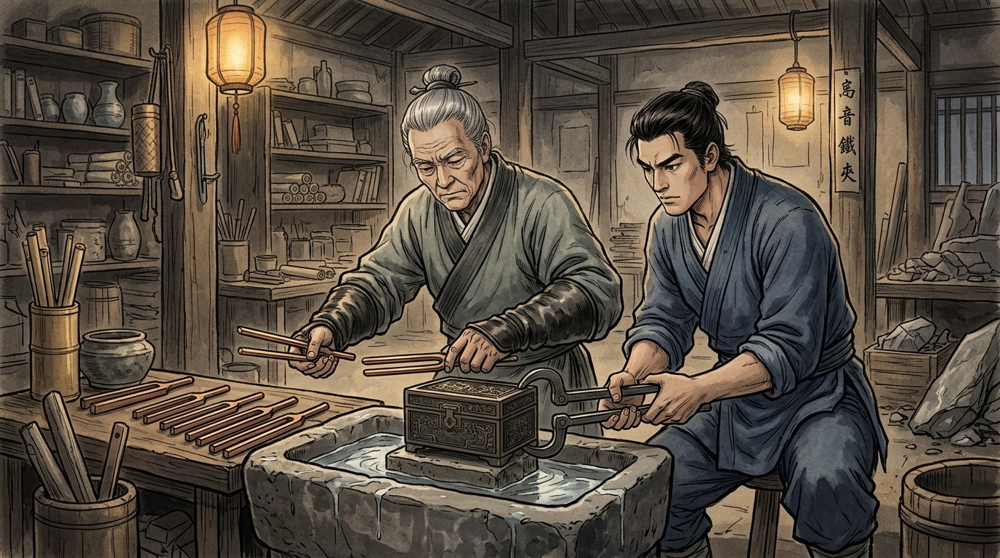
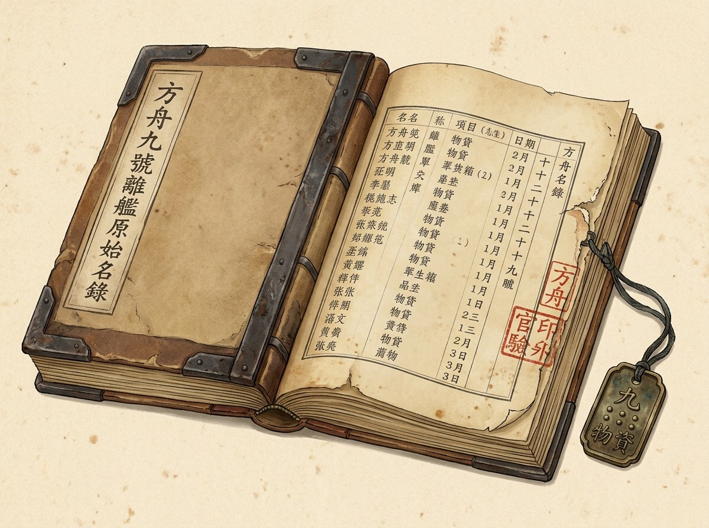

# 第 138 章：破匣三芯與方舟九號艙

[← 上一章](ch0137.md) ｜ [本卷目錄](00_intro.md) ｜ [下一章 →](ch0139.md)

*章首插畫：第 138 章 破匣三芯與方舟九號艙*

工具窄窯的爐火被壓得只剩一指高。

齊老匠師戴上兩層厚實的烏銅防酸皮套，把柳清虛送來的鎖死烏銅小匣架在冷水石槽上，隨後從床底摸出一套磨得光亮如鏡、共九支不同長短的紫銅「冷鍛音叉」。林鐵生則依照老匠師手勢，分毫不錯地握著定音鐵夾固定住匣身九處毫不起眼的微凸暗榫。

「一、四、七，反三息。」齊老匠師低喝一聲。

音叉次第輕敲，微弱卻極具穿透力的金屬清鳴沿著烏銅紋路一圈圈往裡滲透。只聽匣內傳來九聲極其細密清脆的機械落鎖音，「哢噠」一聲輕響，沒有半分強酸滲漏，厚實的烏銅蓋板隨之緩緩彈開半指！

裡頭靜靜躺著七片刻滿太虛小楷讀數的紫銅箔片，還有一枚印著半殘太陽徽記的青銅轉運籌碼。

林鐵生看了一眼那籌碼背面模糊的古篆番號，心頭猛地一震：「這是……沈泥在黑市尋到的同一批鐵牌編碼——**【九號離艦補給營】**！」

「沒錯，就是當年大破滅離艦時，最外圈替全船殿後卻沒能跟著主艦同時起錨的那座九號艙！」齊老匠師一邊將三塊純度極高的冷鍛鹽晶銅塊投入小火爐替柳清虛煉製「無毒穩壓銅芯」，一邊壓低嗓門咬牙道，「我們這些在外環敲了一輩子破鐵的老師傅早就有猜疑，只是誰也進不去九城上層那座守衛森嚴的登錄廊！」

兩個時辰後，爐火漸熄。三枚外圓內方、表面刻著精細雙向退火散熱槽、全無半絲毒性的「無毒穩壓銅芯」被整齊碼入油紙小包，由林鐵生按死契託暗哨飛速送往北方太虛石階救場；與此同時，齊老匠師亦換上了一身夜班管線檢修服，揣起兩張偽造的三號管道滲漏搶修單，領著林鐵生沿著廢棄冷卻煙道直插萬物主機內環邊緣的**【方舟登錄廊】**。

登錄廊位於兩排數十丈高的黑色儲藏晶壁之間，夜裡僅有兩具固定巡遊的青銅算偶每十息往返一趟。齊老匠師極熟練地用一團混了鐵粉的濕黏土糊住牆腳一處感應孔，兩人閃身鑽進布滿灰塵的離艦九號檔案夾層。

林鐵生點燃一截僅有豆大的冷光藥燭，順著齊老匠師指的方向迅速翻開那本厚得像城磚一樣的黑鐵皮總冊，將其與太虛讀數銅箔一片一片攤開並列。

初看幾頁，林鐵生眉峰緊鎖；再往後翻十餘頁，他握著藥燭的手指竟忍不住微微一頓——

一、九號離艦艙當年本應載有三千餘名中低階凡塵百工匠師與五百宗門火種隨從，但在登錄冊後段，卻整整撕去了三分之一頁數，只留下一行冷冰冰的紅批：**「轉移安置於灰燼邊陲觀察帶・不入主戶總冊」**。這意味著灰燼石堡四百八十七戶遺民的先祖，打從第一天起就是被寫在「棄置名單」上的黑戶！

二、在近五十年的物資出庫欄裡，本該由萬物中樞撥往各維修站、戰祖外營與太虛外階的高純鹽晶柱，竟有將近兩成在並未經過九城公議的情況下，被以「戰備耗損轉撥」之名反覆核銷——核銷章印的另一端，清清楚楚連著太虛主簿**嚴平**私印，以及西南戰祖營帳管事**韓石**的領單！

「兩邊都在冒領，兩邊都在把最底下的石堡黑戶和外環苦工往死裡逼！」齊老匠師看著帳本上串起來的血淋淋數字，氣得那隻機械假手嘎吱作響，「咱們在外環多熬半天工時都快咳出結晶肺了，他們倒好，聯手倒騰保命的高純鹽晶替自己延壽積私庫！」

就在二人準備將九號艙名錄與這份異常出庫表飛快拓抄完畢時，登錄廊盡頭忽然傳來青銅算偶急促的警哨鳴響——陳楷竟不知何時突擊覆查夜班管道名單！

「把原本塞回去，帶拓本走煙道！」林鐵生一把吹滅冷焰燭，反手抽回工具夾，趁著青銅算偶轉身的半息空檔拉著齊老匠師沿狹窄檢修梯翻回外環暗影之中。

懷裡那份剛抄完的《九號艙離艦原始名錄》還帶著冰涼的拓墨餘溫，卻像一塊滾燙的火炭，已經足夠把萬物外環與太虛神宮之間那層看似高高在上的遮羞布徹底燒穿一個大洞。

---

*器物圖誌：方舟九號離艦原始名錄*

---

[← 上一章](ch0137.md) ｜ [本卷目錄](00_intro.md) ｜ [下一章 →](ch0139.md)
