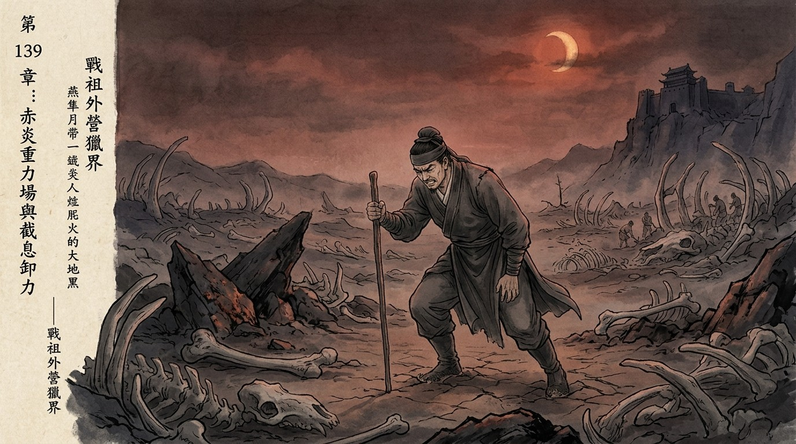

# 第 139 章：赤炎重力場與截息卸力

[← 上一章](ch0138.md) ｜ [本卷目錄](00_intro.md) ｜ [下一章 →](ch0140.md)

*章首插畫：第 139 章 赤炎重力場與截息卸力*

灰燼石堡往西南越過焦土邊坡，空氣忽然像是灌進了鉛水一般沉重得嚇人。

僅僅走過百丈距離，燕隼便覺得雙肩猶如壓上一塊千斤青石板，每邁出一步，膝蓋骨節與腳踝筋膜便發出一陣痠沉脆響。頭頂高懸著一輪暗紅色歪斜殘月，將四周插滿巨型骨柱與焦裂黑石的荒原染得宛若流血的屠宰場——這裡便是洞天西南極點、專司蓄養蠻荒凶獸與苦力礦奴的**【戰祖外營獵界】**。

「別硬挺著腰桿往前拱！」走在前頭引路的石堡老獵戶順手塞給燕隼半塊鹹苦礦鹽含在舌底，「這鬼地方的重力比凡間高出兩倍有餘，背著大弓硬站只會先壓斷腰椎。學外營那些馱隊漢子，腳跟微懸、膝蓋永遠別鎖死！」

兩人伏低身形，順著一條終年冒著硫磺白煙的乾涸熔岩溝往前摸了兩里多，遠遠便見一座由巨型獸肋骨搭成的簡易營帳。營帳空地上幾十名披著粗鞣獸皮的戰祖部落獵手與負重馱夫，正將一車車散發暗紅熱氣的「赤炎熔骨獸」心核卸上木秤。

秤旁站著個身材矮胖、腰佩純銅護心鏡的漢人管事——戰祖外營糧餉管事**韓石**，正用一柄鐵尺不耐煩地拍打面前一個精壯漢子的肩甲：

「託古，這個月你馱隊少交了兩枚二階赤炎心核！別拿外頭重力亂竄當藉口——明日日落前補不齊這『三成加徵額』，就從你們隊裡挑兩個喘氣少的小子填鬥獸坑！」

被叫做**託古**的馱隊隊長身材極魁梧，額角烙著一道戰祖部落特有的鋸齒黑紋，此刻雙拳攥得指節泛白，卻只能咬牙把悶哼吞回喉嚨，替韓石記下一筆屈辱的白粉欠帳。

直待韓石罵罵咧咧轉回石屋喝酒，燕隼才趁著夜風摸到馱隊堆放草料與鹽水皮囊的石槽後，學著拓印上那記「左撇收腕・雙羽隱括」輕敲三下木欄。

託古高大的身軀猛然一震，大步走近石槽，低頭看見這個右肩包著石堡灰麻布、背後卻背著一張沉重黑色獵弓的少年，眼眶頓時紅了半分：「你們……真是黑冰那頭過來找老獵頭的人？」

「我找燕山。也想順道問問，韓石口中的『三成加徵』究竟落進了誰的口袋？」燕隼壓低聲線，眼神銳利如初出鞘的狼牙箭。

託古回頭瞥了眼緊閉的石屋門縫，滿臉悲憤地吐出一口濃痰：「那狗娘養的哪裡是替魔殿主將催餉！他與太虛主簿串通一氣，私下剋扣我們獵手換命換來的獸髓與保命無毒鹽晶拿去暗中倒賣，缺口全算成『三成加徵』往死裡壓榨馱隊與礦奴！至於你要找的那位獨眼老兄……」

話音未落，營地北側突然炸響一聲震耳欲聾的沉重獸吼！

石坡上方赤紅霧氣陡然破開，一頭身長逾丈、肋骨外翻如赤鐵刀柵、渾身滴落熾熱熔岩血沫的三階**【赤炎熔骨獸】**顯然被此地劇烈震盪的重力波刺激發狂，紅著眼順著石坡直朝草料堆與毫無防備的幾名年輕礦奴撲殺下來！

在這兩倍半的恐怖重力場下，尋常雲津輕功幾乎徹底癱瘓——燕隼若照凡間老路起跳拉弓，恐怕箭還沒離弦，自身膝蓋骨就先被重力壓裂！

「小子別硬跳！看老子腰眼怎麼收半口氣！」託古大吼一聲，非但不退，反而迎著狂獸衝來的重力壓迫重心極矮地下沉半寸，腳掌死死碾進碎石裡不離地面，反手甩出一柄包鐵木叉卡住熔骨獸右側前蹄縫隙，「凡間法門是把氣往四肢撐開，在戰祖這鬼地方只會撐爆自己！**氣往臍下壓半拍，借牠撲過來的下墜重壓反借一截橫力！**」

電光石火間，燕隼腦中嗡地一聲劃過師門獵道與雲頂戰場千萬次拉弦的肌肉記憶！

既然重力逼著人往下墜，那就干脆不再與大地較勁——燕隼左膝幾乎擦著焦土岩石滑出兩步，右臂不再靠肩力硬開千斤強弓，而是借著身體急墜那一拍「截脈停頓」的瞬間沉腰扭胯，把整副骨架當作弓架，順著兩倍半重力狠狠「押」出一箭！

「錚——！」

沉重的破風鐵鏃並未走高拋弧線，而是貼著地面三尺死死切開重壓熱浪，精準貫穿熔骨獸張開嘶吼的上顎軟肉直沒至尾羽！巨獸哀嚎半聲，龐大身軀借著自身衝勢重重栽翻在碎石溝裡，抽搐兩下徹底斷了氣。

四周幫忙堵截的幾名礦奴與馱夫呆呆看著倒地的龐然大物，半晌才爆出一陣壓抑的低呼。

燕隼拄著長弓跪在焦土上大口喘氣，只覺虎口被反震得血肉模糊，左肩舊創亦跟著一陣抽痛；但方才那一瞬悟透的「截息卸力」硬招法門，卻讓他頭一次真正適應了洞天西南這片死地的極限重壓。

託古走上前用力拍了拍這少年的後背，隨手剖開熔骨獸胸口取出那顆尚帶餘溫的無毒赤色心核拋給他，聲音忽然降得更低：

「別急著擦弓弦——真正的麻煩在坡頂石影後面。你自己回頭看一眼，那位等了你整整五年的老獵頭，這會兒正冷著一張臉盯著你呢。」

---

[← 上一章](ch0138.md) ｜ [本卷目錄](00_intro.md) ｜ [下一章 →](ch0140.md)
