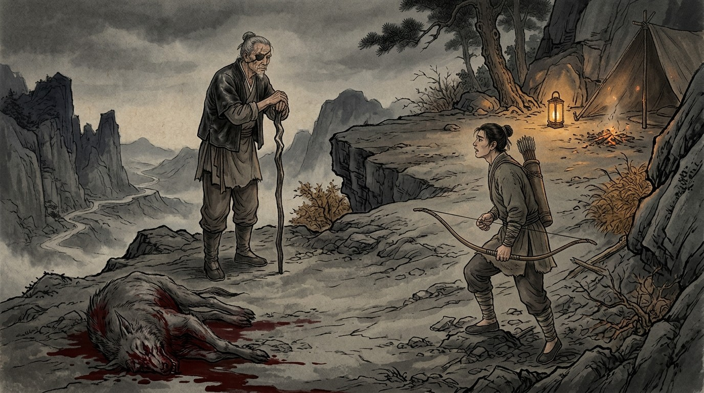

# 第 140 章：焦疤獨眼與暗倉血樣

[← 上一章](ch0139.md) ｜ [本卷目錄](00_intro.md) ｜ [下一章 →](ch0141.md)

*章首插畫：第 140 章 焦疤獨眼與暗倉血樣*

殘紅月光與裂谷底層透上來的赤炎反光交錯，斜斜切過獸欄高大的陰影，把石坡上一排風化焦黑的骨樁拉得像是一截截歪斜的墓碑。

血泊還在焦土石縫裡冒著刺鼻的硫磺熱氣。剛被兩箭截息穿貫喉核的熔骨獸抽搐了最後兩下，沉重的骨甲貼地發出一聲悶響，再也沒了動靜。而在高處那道背風岩稜上，一個披著焦黑牛皮短襖、左眼罩著一塊粗糙炭鞣硬皮的精瘦老人，正拄著根磨得烏黑發亮的獸骨矛，一言不發地俯瞰著坡底那道還沒收弓的年輕背影。

老人右眉梢一直連到顴骨處，橫亙著一道當年黑冰斷谷破陣留下的深長箭疤，在紅火暗影裡顯得格外冷峻。風裡吹來陳舊的獸油與血腥味，混著他身邊石縫透出的一股灼人地熱。

燕隼拿著硬鐵弓的五指一緊，喉嚨裡像是卡進一塊燙人的焦炭。剛才在重力衰減半拍之間精準連射、連骨甲厚達三寸的熔岩荒獸都能硬生生截息貫穿的少年，此刻踩著碎渣一步步走上石坡，鞋底卻像是黏在岩面上一般沉重，每走兩步便忍不住攥緊拳頭又鬆開，聲音壓得發抖：

「……大伯。」

**燕山**沒有立刻點頭，更沒上來拍這姪兒的肩膀。這位在戰祖獵道與赤炎坑道裡硬生生熬了整整五個寒暑的老獵頭，只拿那隻僅餘的右眼，像在山裡驗收新人第一次進林子打回來的皮貨般，從頭到腳把燕隼冷冷掃視了三遍——看他為適應兩倍半重力而重新綁緊的粗筋硬鐵弓、看他剛才連射三箭裂開滲血的虎口、再看到他右腕皮甲袖口下露出的那一小截熟悉的黑石鋪陳年鹿皮護腕——

半晌，燕山才極輕地從鼻孔裡哼出一聲，骨矛往地上一點：

「左腕還是壓得太死。五年前臨出黑石鋪前教你的『鬆弦藏指、借腰卸勁』忘了七成，若不是託古在欄邊咳嗽半聲提醒你抓準重力轉弱那半拍，剛才那頭畜生臨死甩過來的鐵尾巴，至少能掃斷你三根肋骨。」

嘴上罵得毫不留情，燕山卻反手解下腰間掛著的一隻裝滿冷草灰與止血草末的舊牛皮囊，準確地拋進燕隼懷裡。牛皮囊邊緣已經磨得起毛，繩結打法依舊是黑石鋪獵戶專用的單手活扣。

一老一小就這麼背對著營帳火光坐在冰涼粗糙的玄武岩坎上，中間只隔著兩步遠近。五年前在凡間北荒黑冰斷谷那一戰後，金石商隊與護衛斥候失散半數，人人都當他們早成了裂谷裡一撮凍土；誰能想到再見面，竟是在連日月星辰都不曾挪動的異界焦土邊緣。

「黑石鋪的老獵戶還安好？你爹墳頭那塊青石碑，春天時有沒有讓後生幫著墊土立穩？」燕山盯著遠處赤炎谷底滾動的岩漿暗紅反光，語氣平靜得像在問今年冬雪早不早。

「都安好。爹的墳前年清明我和鐵生一起添過新土，碑石也墊了三層碎石防陷。」燕隼捏著那隻還殘留體溫的草灰皮囊，鼻根發酸卻硬壓著沒落半滴淚，低聲快速接道，「雲津那頭……莫三、羅掌櫃，還有丹鼎和天工閣的人，也都沒忘了當年在斷谷失蹤的那幾十條性命。這回入界的不止我一人，是當年在黑石鋪一起長大的五個弟兄——沈泥掌帳、林鐵生打鐵、柳清虛算星路、顧玄行醫。我們在東北邊的灰燼石堡站穩了腳，大夥兒一起發過毒誓，非把你撈回去見爹娘碑不可。」

燕山聞言手指微微一頓，卻隨即又把這點極短的鬆動斂進深眼窩裡。

「今夜託古替我們盯著外圍換哨，」燕隼往前壓低身子，把聲音縮到只有兩尺內聽得見，「韓石這幾天忙著盤點加徵的心核，帳前只留了兩個醉醺醺的鐵衛。只要趁後半夜鹽車出營的時候混進貨堆——」

「混個屁！」燕山頭一次冷下臉厲聲打斷，手裡獸骨矛往岩石上一頓，震得碎渣四濺，「這鬼地方救不了誰的菩薩心腸，也不養只顧自家親戚的小家子氣！你真當我這五年是為了等一個姪兒摸進來替我摘鎖鏈，好讓我拍拍屁股一走了之？」

燕隼胸口一窒。

燕山轉過那張被焦炭與風砂刻滿深紋的半邊臉，獨眼在火光與暗影交界處冷得像一塊剛從冰河撈起來的玄鐵：「往東一百步，那座天天冒黑煙的鐵柵地坑裡，還鎖著九個當年跟我一塊摔進黑冰斷谷的凡間礦奴與斥候！還有十幾個被這鬼地方折斷腿腳、天天背鹽晶粉啃到肺爛的邊境苦力。韓石這條老狗嘴上喊著戰祖榮耀，實則是把他們當成湊心核定額的活牲口！我今夜要是只顧著自己一家血脈跟著你摸黑跑回石堡，明早太陽……明早他媽的算鐘一響，韓石點不出人頭湊虧空，第一個拿去填熔骨獸嘴巴的就是坑裡那九條命！」

燕隼死死咬住下唇，嘴裡湧上一股鐵鏽腥甜，終究不再作聲。他這才徹底看清——大伯左眼罩底下的不是逃兵的苟活，而是用五年歲月替那九條命硬生生扛住的一堵人肉門栓。

「再說了，想真正搬走這座壓在頭頂的大山，靠你一把新打的鐵弓跟我一條快廢掉的老胳膊，就算把韓石暗殺在帳子裡，明天魔殿上頭照樣會再派第二個姓韓、姓李的監軍來。」燕山緩緩舒開緊繃的肩背，從貼肉內襖縫裡摸出一張極薄、摺得整整齊齊、邊緣已經被汗水浸得發硬的鞣製鼠皮紙，塞進燕隼掌心。

「這是什麼？」

「韓石的命脈。」燕山聲音壓得只剩風聲大小，「這狗娘養的近三年拼命借『戰祖備戰・心核加徵三成』的名頭往下頭榨油水，可魔殿金庫裡根本沒見著幾斤像樣的貨。他與正北太虛那幾個官僚暗中勾結，把每次從邊境扣下來的高純度導流鹽晶粉改寫成『耗損廢灰』，根本沒送進前線鍛爐，而是偷藏在**【萬物城外三號廢鹽倉】**地底夾層！」

燕山點了點鼠皮紙背面的細小炭筆字跡，那上面竟密密麻麻標著四十七組奇特的符號與人名：「託古借著跑馱隊，替我偷偷留了這五年戰祖外營每一批輪換礦奴的【換防血樣名錄】。最近幾個月，韓石拿摻了劣質重金屬粉的假晶核充數發給底層苦工，好幾個漢子用完沒半月就渾身潰爛發硬。上頭記清了哪幾號房的人中毒最淺、哪批粉是從哪個號口領出來的，比對起來一條都不差。」

「我明白了！」燕隼將鼠皮紙貼肉收好，眼神瞬間透出沈泥教過他的那種冷靜算計，「萬物那邊的鹽晶暗流、太虛那邊的假晶核耗材，再加上韓石私藏的三號廢鹽倉——三極之間的爛帳全在這張紙上串成一條線了！」

燕山抬手重重按了一下姪兒不再發抖的右肩，掌心粗糙得像老松樹皮，力道卻穩得讓燕隼腰脊瞬間直起來。這位獨眼老獵頭的目光深沉得像一口見不到底的古井：

「把這張血樣名錄跟三號暗倉的座標先帶回灰燼石堡，原封不動交給那個替你們看病的丹鼎大夫與你那會算帳的同伴核對！記住老子一句話——沒算準萬物、太虛、戰祖三方一起因為虧空卡殼、顧此失彼的那個良機前，你不許再單槍匹馬往鬥獸坑裡摸，更不許為了救我一個人打草驚蛇！」

他嘴角極難得地動了動，透出一股黑石鋪老獵戶面對雪崩時特有的悍氣：「我燕山這五年在熔骨獸嘴邊都咬著牙活下來了——再多等個三兩旬，把坑裡那九個弟兄連根帶鍋端出來，老子還等得起！」

「三兩旬，一言為定！」

燕隼不再多作無用的兒女態，深深看了孤身立在焦岩陰影裡的大伯一眼，左手壓住懷中那張染著汗漬與陳年獸油的血樣座標圖，對著老獵頭單膝重重一拜。起身時，他趁著裂谷深處地熱潮汐恰好迎來又一次半拍間隙、周身重力微弱一輕的瞬間，足尖點在一塊突出的玄武岩稜上，順著託古暗中開出的馱隊貨道影跡貼地滑行，數息之間便如一隻收攏羽翼的夜隼般徹底融入西南焦土無邊的暗夜裡。

石坡上方，直到姪兒那道既熟悉又比五年前硬朗太多的背影徹底消失在黑石縫盡頭，燕山才緩緩轉回身。他拄著那根被千百次血戰磨亮的獸骨矛，望向營地中央那座鐵柵森嚴、正隱約傳出幾聲壓抑咳嗽的幽深地坑，獨眼裡悄然閃過一抹五年來未曾有過的暖意，隨即化為更沉、更冷的決心。

「再忍忍，老伙計們。」他極輕地吐出半口帶著硫磺味的白氣，獨自邁步走回巡夜火堆的陰影之中。

---

[← 上一章](ch0139.md) ｜ [本卷目錄](00_intro.md) ｜ [下一章 →](ch0141.md)
