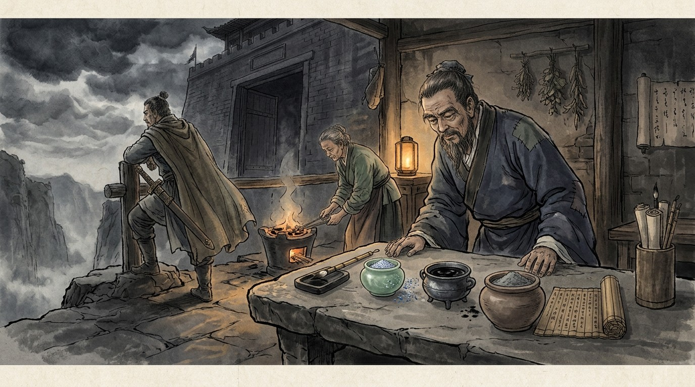
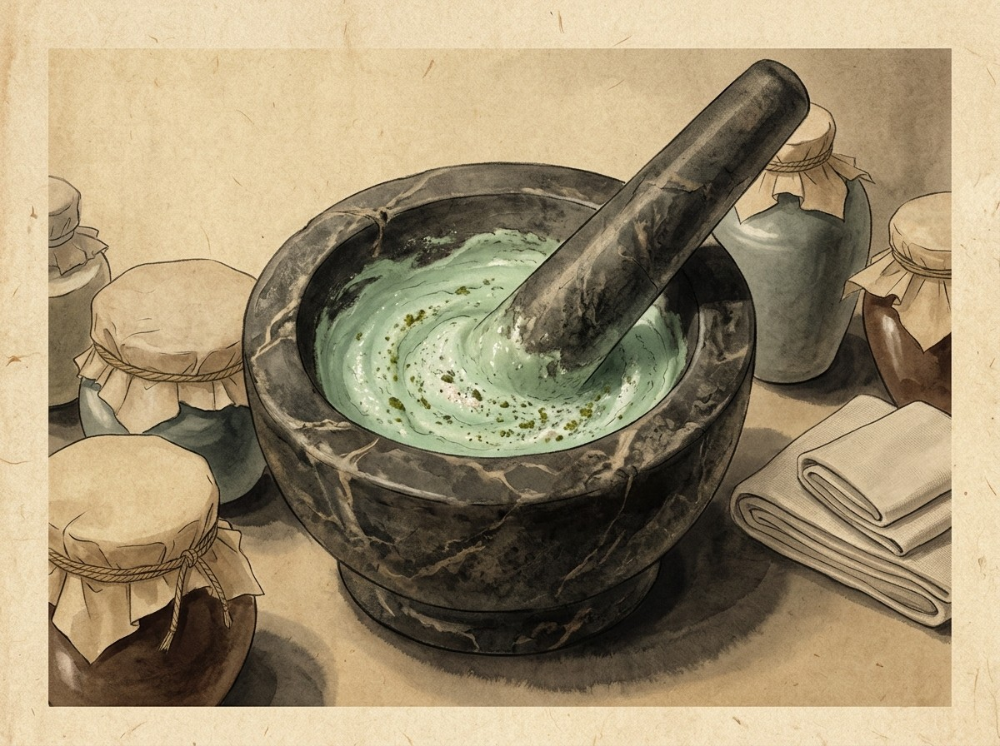

# 第 141 章：三極緩衝方與灰白藥斑

[← 上一章](ch0140.md) ｜ [本卷目錄](00_intro.md) ｜ [下一章 →](ch0142.md)

*章首插畫：第 141 章 三極緩衝方與灰白藥斑*

灰燼石堡邊緣緩衝醫站的爐火，已整整三天兩夜未曾熄滅。

石案中央擺著三隻截然不同的小小陶罐：來自太虛白玉階的微藍星屑晶粉、出自萬物外環濾塵筒的細黑金屬氣霧凝水、以及燕隼冒死從戰祖外營帶回來的無毒熔骨獸髓冷灰與三號廢鹽倉血樣名錄。

顧玄將那套從凡間帶入洞天的《三元本草》珍稀藥匣徹底打開——原本還剩大半格的北荒雪苔、七葉冷蓮、避瘴寒精與丹鼎特煉的中和藥引，此刻一味一味全被碾進厚石臼裡。蘇青竹則在一旁緊盯著銀針在三罐樣本混合液裡的色澤變化，眉間緊鎖連氣都不敢大喘一口。

「還是不行！」蘇青竹失聲低呼，「太虛晶粉與萬物鐵霧混進苦苔礦灰之後確實不傷血肉，可只要碰到戰祖那點熔骨獸髓灰，藥膏就會立刻凝結成死塊，根本抹不進病患破裂的皮脈裡！」

「那是因為少了能承住兩倍半高熱壓力的活引，而且沒有經過人脈溫養過篩。」

顧玄神色平靜得出奇，甚至沒多猶豫半息，左手直接伸進隨身藥囊挑出一束銀亮灸針，捲起自己右臂粗布袖管便要往腕間太淵、內關兩穴落針！

「顧玄你瘋了？！」蘇青竹一把抓住他手腕，聲音都在抖，「三極異律混在一起連石臼都蝕出小坑，拿你自己經脈當過篩藥引，一旦反噬進心脈連救都救不回來！」

「這裡不是丹鼎山谷，沒有九轉煉丹爐給我們試錯八十次。」顧玄輕輕撥開醫女發抖的手指，目光掃過醫棚牆邊正忍痛咬著布條卻怕驚擾大夫的十二個鹽晶工人，「這幾天外頭排異症惡化的鹽夫一天多過一天。若連我都不知道這服藥下去是冷是燙、經脈過第幾關會刺痛，這本《三極排異急救草錄》怎麼敢往病人身上扎？」

說罷，他再不遲疑，左手銀針精準刺入自身兩處要穴以極微弱的「三元生息」引動氣機，右手穩穩挑起一丸混了三極樣本與最後幾兩《三元本草》珍藥揉成的灰綠藥泥，緩緩貼敷在早已用藥水刮開一小口試驗創面的左手掌心上！

「嘶——！」

藥泥入膚的頭三息，彷彿燒紅的細砂順著皮下毛細血脈往骨縫裡鑽。顧玄額頭冷汗如豆粒般瞬間滾落，牙關緊咬得嘎吱作響，左手掌心肉眼可見地泛起一圈詭異的淡青微晶斑點；直待蘇青竹死死盯著沙漏喊出「第五息」，顧玄才強行運轉柳清虛交給他的「逆向脈衝阻斷法」，硬生生在極痛中逼出一縷帶有鹽晶鐵味的灰霧！

「記下來！」顧玄喘息著，聲音啞得幾乎裂開，「熔骨獸髓灰減為三分之一……先以冷鹽水浸泡三息去燥氣，再併入萬物鐵霧凝水與苦苔礦灰……敷後第四息必有刺骨寒痛，切忌運功抗拒，反倒要鬆開手太陰肺經！」

蘇青竹含著眼淚飛快提筆照錄，立刻依新配比重新熬出第一鍋熱氣滾滾、卻奇異散發著清新苦苔草香的「緩衝爐霧藥膏」。

半個時辰後，一名小腿早已晶化潰爛得露出灰白硬殼的年輕鹽夫在敷上新膏藥並配合兩針冷敷定穴後，原本痙攣抽搐的雙腿竟然肉眼可見地停止了硬直，皮膚邊緣泛出難得的紅潤血氣。

醫棚裡頓時響起幾名家屬壓抑的哽咽謝聲。

顧玄靠在石壁上緩緩吐出一口濁氣。低頭看自己藥匣——從雲津一路帶來、足可支撐大宗派數十載救命的《三元本草》珍稀存藥已耗去大半；再攤開雙掌，方才親身試藥過篩處，竟從此在雙手掌心正中央烙下了一片永遠洗不淨、按之微硬如冷灰的**灰白色晶化灰斑**。

蘇青竹蹲下身替他仔細綁上乾淨麻布，忍不住低聲道：「你的手以後怕是要比尋常人怕冷怕熱許多，再也沒法輕易行那種細微入微的三元金針渡穴了。」

「能換住全堡幾百號人不再變成會喘氣的石頭樁子，這點斑算個極便宜的買賣。」顧玄淡淡笑了一笑，隨手把燕隼帶回來的三號廢鹽倉血樣名錄擱在剛寫完的《三極排異急救草錄》正本上，「不過青竹，燕山傳回來的這個數字你看見沒有——近五年邊界外圍的晶化重患並不是天災，一大半是被假心核粉和冒領後摻雜的劣質鹽晶硬生生毒出來的。這份藥方只能保一時之命，真想救活所有人，還得看沈泥在萬物九城那頭的殺手鐧能不能撬得開那扇萬年死門。」

---

*器物圖誌：三極排異緩衝藥膏與藥杵*

---

[← 上一章](ch0140.md) ｜ [本卷目錄](00_intro.md) ｜ [下一章 →](ch0142.md)
