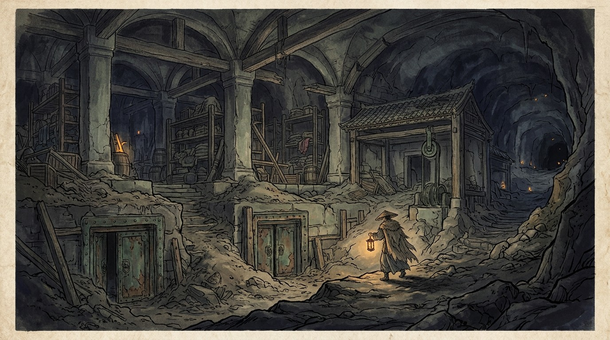

# 第 142 章：沈泥與九城封存總庫

[← 上一章](ch0141.md) ｜ [本卷目錄](00_intro.md) ｜ [下一章 →](ch0143.md)

*章首插畫：第 142 章 沈泥與九城封存總庫*

萬物主機外環最東南角、緊挨著一片被高溫熔渣層半埋的古舊石基之下，藏著連監察員陳楷巡邏銅表都不願輕易踏足的廢墟區域。

在三界秩序還未徹底定型的大破滅初期，這座方舟原本曾設有一處由人間商賈與工匠共治的糧餉分撥樞紐——**【九城商盟聯席廢棄總庫】**。後來九城火種散落、高塔與魔殿分庭抗禮，這座僅憑舊時代「商道密碼與血脈玉引」開啟的地下樞紐便被人為剪斷了對外銅脈，荒廢成一座堆滿鏽蝕貨架的冰冷鐵穴。

然而在沈泥掌心裡，那只自大荒雲海便一路隨行、由沈家先祖「沈雲妮」所留的**【天門引】**殘匣卻在此刻微微發燙，匣面裂紋正指向三丈厚黑鐵閥門右側一處佈滿鐵鏽的小小凹槽。

「前頭就是總庫內門了。斷網三百年，裡頭就算有備用儲能晶柱多半也乾透了，裡頭只剩三息可亮。」一同摸黑潛下來的齊老匠師替沈泥撬開卡死的外部齒輪鎖，隨手塞給他兩卷剛剛抄錄完整的《九號離艦艙人丁備註底冊》，「你要辦的究竟是什麼買賣？我老頭子修了一輩子方舟管線，沒見過誰拿著太古舊船票還想跟主機帳本討價還價的。」

「不討價還價，齊老丈。」沈泥換上一身乾淨體面的深青棉袍，把烏木算盤與墨匣小心夾在左肋下，臉上是雲津商會總帳房臨盤大算前特有的平靜冷峻，「他們既敢說我灰燼石堡四百八十七號活人『不在名冊、視作無主雜料清零』，我就翻出比他們現行條例還早立下八百年的老東家契約，把這筆糊塗帳一筆一筆硬釘回正冊上去！」

兩人推開沉重如山的厚鐵閘門。

門內是一座圓形穹頂地窖。中央孤零零立著一座通體暗銀、表面卻刻滿密密麻麻細篆古文的六稜石碑；石碑四周空無一物，唯獨地上刻著九座已然黯淡無光的城邦徽印，其中最角落那枚「雲津・九城通寶印」正好缺了一個缺口。

沈泥邁步上前，毫不猶豫將【天門引】古玉卡進缺口，同時將隨身攜帶的沈雲妮古篆總約印泥、戚老頭給的灰燼石堡初代遺民名錄、林鐵生拓來的方舟九號艙名錄整齊拍上銀碑基座銅槽！

「哢——！」

沉寂了不知多少個甲子的地底暗槽猛然竄起一道清冽無比的純白冷光！銀碑內部竟傳來一陣遠古銅輪空轉的沉厚低鳴，整面碑身浮現出密密麻麻如星河倒懸般的古篆光影——

【核驗通過：原初九城商盟特約見證印信・總約締結人：沈雲妮・第九條補充權限：凡遭星艦遺漏或孤島流徙之凡間工役遺族，憑初始火種聯席證明與實地戶籍清冊，得重開臨時登記埠，受「第七條基礎人種火種保全條款」同等庇護！】

「只夠撐一炷香不到，這座離線銀碑剩下的儲能晶柱馬上就會燒乾！」齊老匠師望著碑頂飛快明滅的殘光急喊一聲，「小沈，石堡足足有四百八十七戶、上千條活口名諱！一筆一筆往銅槽光幕上寫，十個人手都抄不完！」

沈泥卻早已立定在銀碑正前方，左手托著紫檀算盤，右手夾起三支蘸滿特調導電銀粉墨的狼毫短筆：

「誰說要一筆一筆慢慢謄？我入界前夜就把石堡全部口述史跟名冊按『戶號—血脈—工種—配給額』拆成二十八組密碼算珠表了——戚老頭給的木牌編碼，正好全對得上九號艙的古篆偏旁！」

話音方落，沈泥雙目微闔，三支銀粉筆如飛鳥點水般同時落上銀碑銅槽感應面！

算盤珠子在昏暗地窖裡炸開如急雨般的脆響：「清冊第一甲，灰燼一寨百二十三口，按九號艙農桑鐵匠籍補入……第二乙，鹽道苦工九十六口，補入……」

每撥動七排算珠、點落三筆銀墨，孤碑上便有一整片灰白名諱由虛化實亮起穩定的淡銀銘文！石窖內沒有刀光劍影，只有一個凡人帳房先生在與古老機械死限賽跑的瘋狂算數聲，直將那三百年未見天日的死寂鐵壁震得隱隱發燙。

---

[← 上一章](ch0141.md) ｜ [本卷目錄](00_intro.md) ｜ [下一章 →](ch0143.md)
