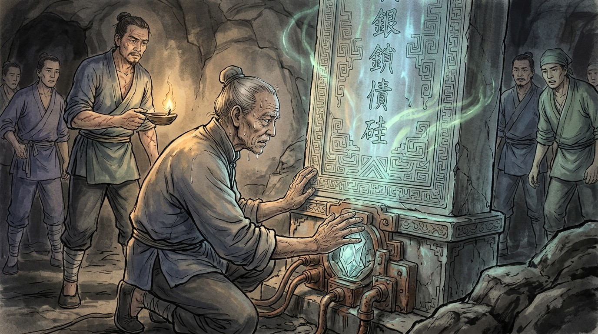
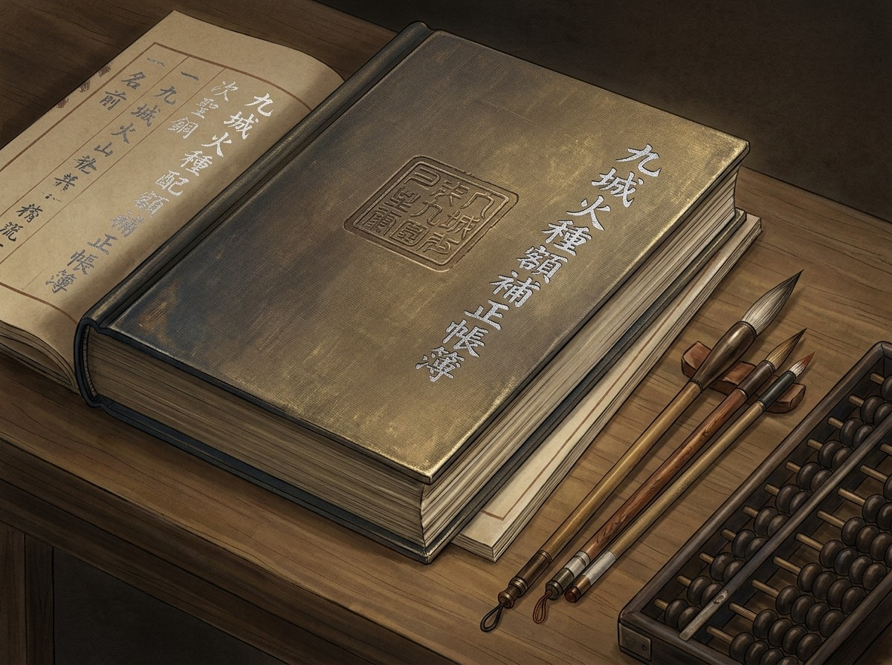

# 第 143 章：人族火種配額補正總帳

[← 上一章](ch0142.md) ｜ [本卷目錄](00_intro.md) ｜ [下一章 →](ch0144.md)

*章首插畫：第 143 章 人族火種配額補正總帳*

地窖深處的空氣冷得像浸過冰鹽水，那股在萬物外環飄了百年的陳舊機油味裡，此刻還混進一陣越來越濃的焦枯松煙與銅鏽氣息。

六稜銀碑表面的純白冷光正以肉眼可見的速度衰落下去，原本清冽如水波流轉的古篆光幕邊緣，已經開始泛出一圈一圈枯竭前的淡青色顫紋。碑座底下那截原本亮如明燭的百年備用儲能晶柱，「喀啦」一聲又裂開兩道縱橫細紋，碎粉簌簌落在冰涼銅槽之間。

「撐不住半刻鐘了！還差最後三排——石堡最底層那四十七個剛出生的孤兒與傷殘老鹽夫！」

齊老匠師額角冷汗順著深皺紋一路滴進沾滿油泥的領口，右臂那隻冰冷精巧的機械鐵手五指指節「喀嚓」咬死，死死摳住銀碑底部不斷發顫的一對主導引銅接頭。他憑藉在外環檢修老舊方舟管道四十年的手感，強行用左肩抵住震動的碑座基柱，替那截即將徹底崩碎的冷焰晶柱分擔過盛的回流脈壓。接頭縫隙處不時迸出細小刺鼻的青藍火花，將老人左袖燒出幾個焦黑破洞，他卻半步都沒往後縮。

「別鬆銅箍，穩住三息我就收尾！」

沈泥半步未退。他站在銀碑前兩尺之內，微弱冷光照得這位一向清冷從容的青年臉色近乎透明。他的右手食指與中指關節因為連續高速刻寫導電銀粉銀碼，指肚早被銅槽銳利的導槽棱角磨破滲出血絲，混著灰銀色的導電墨汁在手背凝成一道道暗紅銀斑；雙眼被近距離閃爍的高頻碑光刺得酸澀生淚，卻硬是連眨都不敢多眨半下。

左手托著的那把雲津老號紫檀算盤，此刻簡直像在沈泥指尖燒起來一般。每一記算珠清脆急促的撞擊聲，都緊緊卡住銀碑古篆偏旁刷新的那一線韻律——

「第四百八十一，老戚家養孫戚小五，原九號艙木作坊戚姓遺枝，補入！第四百八十四，醫棚前月新出世雙胎兄妹，無父兄在冊，隨母籍入九號艙醫藥雜役帳，補入！」

最後一根蘸墨狼毫的筆鋒幾乎已經磨禿，沈泥順手從袖筒咬出一支新的備用細毫，指尖帶血飛點最後三個結構最繁複的古篆旁註：

「第四百八十七，灰燼守夜老卒戚三——原九號艙外圍斥候編制，戰傷除籍待補，今依第七條實證補歸正冊！」

最後一個「戚」字最後一豎穩穩收筆，筆尖正好卡進銀碑感應槽最末那一道暗金鎖孔——

「轟嗡……！」

整座六稜銀碑驟然靜止半息，隨即自地心深處透出一陣猶如千面古鐘在銅釜裡同時震響的無聲氣浪！碑面四周原本明滅將熄的所有光點猛地合攏為一道極致耀眼的純金與銀白交織洪流，沿著地底埋藏了三百年、鏽死在玄武岩深處的主脈銅管倒衝而上！

那一剎那，四百八十七戶、上千條被洞天史冊刻意撕去三百年的凡塵活口姓名與工種編碼，化作密密麻麻實質般的古篆烙印洪流，硬生生貫穿了方舟底層數十道沉封隔斷，在萬物中樞最底層那塊連稽核主事陳楷也無權隨意塗改的太古總帳深處，強行烙下了一記鐵證如山的歷史補正紀錄！

與此同時，銀碑右側原本嚴絲合縫的銅槽「哢噠」一聲彈開三寸暗匣，吐出一卷重逾七斤、封面以黑鐵箔混青銅絲壓印著古老九城商盟雙環徽記的厚實文書——**《九城火種配額補正帳簿》**。帳冊邊頁猶帶著地底脈衝烤出的餘溫，翻開第一頁，便是方才沈泥用二十八組密碼算珠表強行寫回的四百八十七戶實名總錄。

然而完成這最後一記跨代烙印的瞬間，整座銀碑表面的紋理徹底失去光華。裡頭最後那半截百年儲能晶柱「啪」地徹底碎裂成十幾片毫無靈韻的白灰色死石，最後一絲電弧消散，地窖重新陷入伸手不見五指的死寂漆黑與沉重寒意。

「成了！真讓你小子在斷氣前頭，把石堡幾百號被人當垃圾掃了三百年的『無主黑戶』，原封不動寫回太古總帳裡去了！」齊老匠師激動得連聲音都變了調，鐵手用力拍在沈泥瘦削卻紋絲不動的肩胛骨上，「陳楷那幫坐在白銀桌後頭的算計鬼，這回就算把這間地窖砸了，主機核心的印記也消不……唔！」

老人狂喜的低呼猛地掐斷在喉嚨裡！

他右耳貼近身側那根貫穿外環牆體的主排水冷卻銅管，渾濁卻銳利的老眼瞬間在黑暗裡縮成兩點針芒——

「咯吱、咯吱、咯吱——」

極有規律、絕非血肉之軀所能踏出的沉重鐵足踩擊地磚聲，正沿著東南角那條封死三百年的廢棄檢修通道高速逼近！聲響一組四步、腳尖擦著銅軌微微帶火，顯然是外環稽查司專用的重型封門銅偶！方才銀碑在最後一刻耗盡百年儲能強行衝通萬物主機核心，雖然整個連線脈衝只維持了短短**三息**，卻仍舊像黑夜裡點燃了一把火把，瞬間觸動了陳楷手底下最高一級的異常佔用警報！

「是陳楷那條走狗的巡查銅偶！聽腳步起碼來了八具封門，還帶著兩條探熱銅犬！」齊老匠師臉色陡然沉得像鍋底灰，沒半分猶豫便反手扯下牆角一根臂粗的生鏽換氣鐵槓，「嘎吱」幾聲死死插進那扇三寸厚鑄鐵門的暗銷裡，「小沈，別愣著！帶上總帳正本跟你的紫檀算盤，從西牆腳那條沒蓋死的舊冷卻水槽鑽出去！」

「那條水槽通哪？」沈泥迅速脫下外袍裹緊那卷沉甸甸的《九城火種配額補正帳簿》，手指已扣住那把烏沉短算尺，一步跨到老人身後半步，「要走一起走，那鐵門最多頂銅偶三斧！」

「頂三斧就夠你小子鑽出去百來丈了！」齊老匠師瞪起一雙佈滿血絲的老眼，順手從工裝兜裡撈出一把大號雙頭扳手，狠狠照著自己灰撲撲的外袍前襟砸出兩道黑油裂痕，又抓起地上半把帶鏽鐵屑往自己花白鬍鬚上一抹，「那條廢水槽直通外環最臭、最毒的酸水排污廢溝——裡頭常年飄著洗鹽晶剩下的腐蝕強酸霧氣，陳楷那些金貴銅偶不敢下水怕爛關節！可老頭子我若是也跟著鑽了水溝，明早外環二十四站少了一名帶班大工頭，陳楷不用查帳就能順藤摸瓜封死整條水道！」

沈泥猛地停手：「齊師傅，若陳楷查出這扇鐵門被人從裡面撬過——」

「老頭子我在外環跟管線打了四十年交道，整個萬物外環底層哪一段漏水、哪一根銅閥愛冒煙，全城除了我齊老頭沒第二個人摸得清！」老人一把抓住沈泥領口，那隻平時修最精細鐘表齒輪都穩如磐石的機械鐵手，此刻力大得像鐵鉗一般把年輕掌櫃生生拎起半尺，直接往西牆腳那處只容一人側身爬過的黑洞按過去：

「我手裡拎著公家正牌檢修鎚跟漏水報修牌！他帶著銅偶撞進來，只會看見我蹲在死掉的廢銀碑前面罵娘搶修百年老漏管！快滾！這本帳簿留在你懷裡才叫幾千條人命的護身符，落進他們火盆裡就只是一捆灰！回灰燼石堡告訴小鐵生跟顧大夫，外環那二十四條老兄弟，齊老頭替他們盯著風口——算好日子就來收帳！」

鐵門外隨即傳來一聲撕裂空氣的悶雷巨響！厚實鑄鐵門板在第一記重鎚衝擊下向內凸出半寸，門縫邊的千年灰塵簌簌砸落。

「滾！」齊老匠師起腳正中沈泥屁股，幾乎是半踹半推把人塞進那道散發著刺鼻酸腐氣味的狹窄排水暗槽，順手拽過兩片腐朽鐵板「哐當」一聲蓋死洞口，自己則提著那把沉重雙頭扳手，扯開破鑼嗓子對著快要破開的鐵門狠狠啐了一口濃痰，大聲罵起萬物稽查司克扣維修用油的髒話來。

狹窄漆黑的排水槽裡，腐蝕酸霧嗆得人咽喉火辣辣地發疼，冰涼黏膩的廢液瞬間浸透鞋襪。沈泥咬緊牙關沒發出一丁點回響，最後回頭透過鐵板縫隙望了一眼那個孤身站在黑暗地窖中央、僅憑一把扳手和一張老臉便敢硬扛八具執法銅偶的老工匠，隨即雙手死死護住胸前那卷冰涼卻重逾千鈞的補正總帳，貼著濕滑管壁向西邊漆黑的廢水暗河高速滑遁而去。

---

*器物圖誌：《九城火種配額補正帳簿》*

---

[← 上一章](ch0142.md) ｜ [本卷目錄](00_intro.md) ｜ [下一章 →](ch0144.md)
