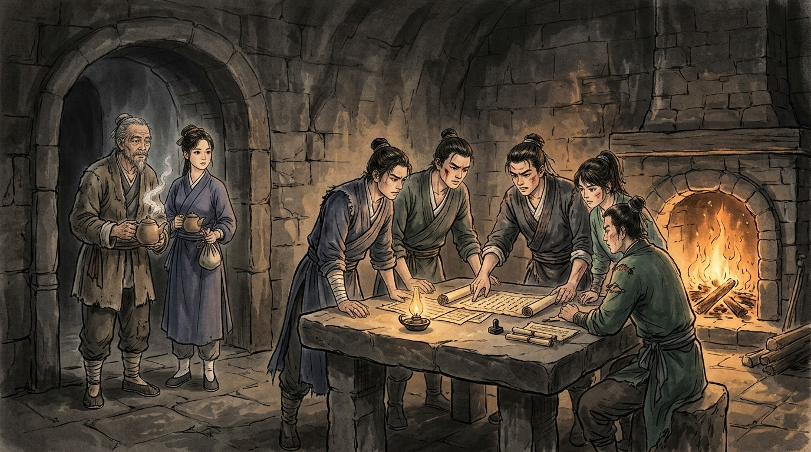

# 第 144 章：九十日大校準倒數合攏

[← 上一章](ch0143.md) ｜ [本卷目錄](00_intro.md) ｜ [下一章 →](ch0145.md)

*章首插畫：第 144 章 九十日大校準倒數合攏*

第十夜子時，灰燼石堡地下石案室的暖爐燒得格外交旺。

五條年輕卻明顯比十天前添了數道風霜與傷痕的身影，終於按著第一封死契一個不少地重新圍坐在同一張厚實石桌四周。守夜老漢戚老頭帶著醫女蘇青竹靜靜站在門側，手裡各端著一壺滾燙的苦苔鹽茶。

「太虛那頭先攤。」柳清虛雖然眉骨處還貼著一塊透著涼氣的草藥布、左眼不時泛起微弱青翳，聲音卻穩重得如同一口古鐘。他將衡真道人託付的牛皮實錄拓本與已被齊老匠師無損打開、取出七片紫銅讀數箔片的烏銅匣推上桌面中央：

「太虛天羅星陣每隔三百年便會因底層衰減而進行一次全域重算；每當誤差超限，上頭執律閣便會以『玉化補位』與『邊緣清零』收割下界與外階。這是最近兩百年每甲子衰減的實測曲線——越往後越斜。」

林鐵生隨即把齊老匠師拿性命替他遮掩換來的《方舟九號離艦原始名錄》副本壓在牛皮紙旁，銅尺「啪」地卡準兩張表尾端：「萬物外環的清零條例已經開始預演，陳楷正忙著把所有沒有主戶籍的黑工清零熔毀；更關鍵的是，九號艙當年遺棄的人數與太虛冒領高純鹽晶、戰祖假帳加徵的缺口，時間點全部鎖在同一個三個月視窗裡！」

「不止是時間點重疊。」燕隼把染著熔骨獸腥氣的《戰祖換防血樣名錄》與三號廢鹽倉座標一併拍在桌上，沉聲補上第三塊碎片，「大伯燕山和託古查清楚了，韓石那頭加徵的三成心核與冒領鹽晶，根本就是在趕著填補三個月內必到的戰備大缺口！連荒原裡的狂獸這幾夜都在不停狂躁撞關。」

顧玄拿出新寫就的《三極排異急救草錄》，翻開那雙掌心正中央烙著灰白晶斑的手掌平靜接過話頭：「還有我這幾天核對的石堡百年病例簿。每逢三百年一次，空氣裡的【異律晶塵】濃度便會陡然飆升四倍——上回發作是兩百九十九年前的最後一季。」

最後所有人的目光齊刷刷落在沈泥身上。

沈泥什麼也沒急著說，只拿出一支磨尖的紫銅籌筆，將太虛的星陣衰減線、萬物外環的清零時限、戰祖的鹽晶截流線、顧玄的晶塵飆升週期，外加玄武岩風道柳清虛先前記下的「每夜頻率微幅上飄」五組數字，一條接一條極準確地畫到同一張方格總算紙上——

五條原本看似毫無關聯的線段一路延伸、傾斜、逼近，最後竟在算紙最右側交會成一個幾乎重合到毫釐不差的尖銳交叉點！

室內的暖爐火光靜靜跳動了一瞬，沒人先開口說話。連一向嗓門洪亮的戚老頭，此刻都握著茶壺柄停在半空，臉上寫滿了無言的震撼與沉重。

「交叉點在這兒，」沈泥用籌筆尖重重戳破那個算紙焦點，聲音低冷卻擲地有聲，「九十日後，戌時三刻至子時正中——**三百年一回的『三界全境大校準』**。」

「屆時太虛神宮會落星掃描全界，抹除一切帳外『冗餘殘料』；萬物中樞會鎖死所有非認證管線並啟動強制清零；而戰祖荒原狂躁失控的獸潮與高壓地熱，亦會同時湧向這條夾在三極邊界的灰燼溝壑——」柳清虛喃喃接上後半句，只覺左眼那圈雪盲殘影在燈影裡陣陣發冷，「我們所在的這座灰燼石堡與裡頭的四百八十七戶遺民，恰恰落在太虛、萬物、戰祖三道清掃火線正交叉的十字死角上！他們不是要搶鹽晶——他們是要趁校準之夜，連人帶城一次抹個乾淨，順手把幾百年的冒領黑帳一火燒光！」

石屋陷入死一般的寂靜。

戚老頭沉默了足足十息，忽地仰頭乾掉自己碗裡那口苦得發澀的鹽茶，抬起枯瘦如鐵的手掌一抹嘴角，臉上反而擠出一抹狠厲至極的狂笑：「老東西們活了三百年，原來是拿這座躲在岩縫裡的破堡子當他們擦屁股抹黑帳的廢渣堆！好啊！九十天——老子守這破寨子守了一輩子，總算等來五個真敢拿命把帳冊拍到天靈蓋上去的小煞星！」

「九十日夠不夠改局？」燕隼雙手按桌站起。

「單憑我們五個打不過三座巨構的任何一隻指頭，」沈泥翻開那卷剛剛拚死從九城總庫帶出的《九城火種配額補正帳簿》，冷靜得像是一塊玄鐵，「但若我們讓萬物外環停下給他們鍛零件的爐火、讓戰祖外營拒交那三成黑帳獸核、讓太虛裡被拿去當晶核耗材的數百名觀測士和我們站在同一邊，最後再把這本蓋了沈雲妮古篆正印的《火種補正總帳》公然拍上【萬物秩序仲裁橋】——」

他環視四位自黑石鋪生死走來的弟兄與醫棚眾人，一字一頓敲定第三幕總綱：

「九十日後的大校準，我們不躲，也不逃！從明日起，分頭編織跨極同盟——這場三百年一次的大算帳，換我們來替全洞天的底層活人敲響這面算盤！」

---

[← 上一章](ch0143.md) ｜ [本卷目錄](00_intro.md) ｜ [下一章 →](ch0145.md)
