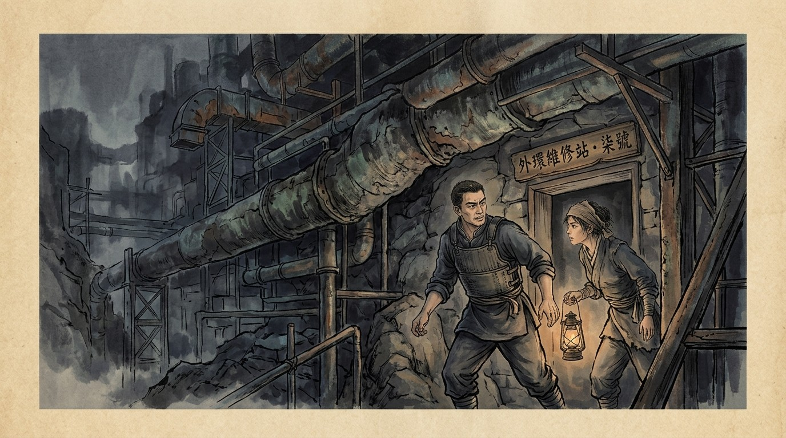

# 第 145 章：外環二十四站與無影聯絡網

[← 上一章](ch0144.md) ｜ [本卷目錄](00_intro.md) ｜ [下一章 →](ch0146.md)

*章首插畫：第 145 章 外環二十四站與無影聯絡網*

距離九十日大校準的最後線頭收攏越近，萬物主機城外環那股壓在底層工匠頭頂上的陰風就越緊——這場反制暗戰，並沒有從旗鼓喧天的白玉高階打響，而是從外環最吵雜、最油膩、也最容易把喘息藏進蒸汽轟鳴裡的三號廢渣管道底下悄然展開。

林鐵生把齊老匠師在九城離線地窖裡如何硬扛下八具執法銅偶、硬是憑一把檢修扳手把稽查司糊弄過去的經過一五一十告知沈泥後，這兩個剛從生死縫裡摸出來的年輕人非但沒有立刻慌著撤回灰燼石堡，反而在外環夜班交接最混亂、主殿管事只顧著低頭盤點高純鹽晶損耗的那半個時辰裡，逆著下班人群，沿著齊老匠師暗暗塞出來的《方舟九號離艦原始名錄》殘片暗號，一頭扎進了萬物外環最深處。

頭頂上是數十丈高、終年噴吐白汽的巨型熱交換鐵塔，腳底板每隔數十息便會隨著中樞主輪的轉動微微發顫，空氣裡濃重得化不開的滾油焦臭與硫化鹽粉味嗆得人胸口發悶。沈泥與林鐵生脫下顯眼的石堡皮襖，換上沾滿機油與鐵鏽灰的粗布工服、扣上邊緣磨得發亮的試工銅牌，像兩條真正混在煤渣裡的老鼠般，逐一摸進隱藏在巨大黑鐵散熱管與儲鹽渣井陰影後方的**二十四座底層維修小站**。

這些在萬物官方測繪圖上甚至不曾單獨標註名字的角落，大多窩在高壓蒸汽管道交叉夾縫底下。裡頭乾活的人，全是這三百年來被主殿高層斥為「無籍雜役」的凡間遺族後裔——有左臂連著肘關節一同被飛輪絞斷、用笨重鑄鐵鉤當手使的老車工，有長年守在酸水洗槽旁咳得整口牙齒泛黃鬆動的中年鹽夫，也有十五六歲便跟著爹娘在八丈高爐縫裡清鐵渣的瘦小半大娃。

寅時初刻，最偏僻的第三維修站濾塵地窖裡，三扇生鏽的換氣鐵門早被從內反栓死。屋心只點了一盞罩了三層黑紗的矮豆油燈，微弱黃光映著牆上一排排磨得發亮卻歪斜陳舊的鐵錘與銅規。十七名從外環各站秘密摸過來的當班工頭緊緊擠在不到兩丈寬的鐵架之間，誰也沒有先坐下。

所有人的目光——帶著常年被壓在底層的木訥、猶疑，以及一絲幾乎不敢相信的灼熱——齊刷刷釘在中間木箱上那卷剛被油布解開、封面壓印著九城舊盟雙環赤金徽記的**《人族火種配額補正帳簿》**上。

「自己看清第一甲到第四乙這幾頁。」沈泥沒有多做任何煽動人心的長篇大論，只伸出依然包著細布條的右手食指，將帳簿攤向油燈光下，「這不是我雲津商會私印的假票，也不是誰編出來哄大夥兒去賣命的空口白話。這是萬物中樞地底離線銀碑在九城火種正印下吐出來的原冊謄本。」

站在最前排、左腿裝著粗笨鐵木義肢的七號冷卻閥站老組長「鐵大鬍子」呼吸忽然變得粗重起來。他蹲下身，把一對被鐵火燻得通紅的老眼幾乎湊到帳頁半尺之內，沾滿厚繭與黑色機油的大手指抖了半天，竟不敢輕易往那泛著冷金屬光澤的紙面上摸。

頁面上密密麻麻壓印著原初九號離艦補給營的原始編制，一行行工種、姓氏、血脈旁註清清楚楚，連三百年前各家先祖在船上修過哪一段冷凝管、打過哪一種標準活榫都寫得分毫不差！

「鐵家……七號艙管閥組鐵大牛之子……」鐵大鬍子唸出那個早在石堡木牌角落快被磨沒的太爺名諱，喉頭猛地發出一聲像破風箱抽氣般的哽咽，「咱們家祖爺爺當年真的跟著九號補給艙落進這鬼地方……三百年來，主殿那些穿白袍的老爺天天拿著《恩賜雜役令》對外喊，說我們是無主無籍、全靠萬物主機慈悲施捨一口冷渣飯吃的黑工……結果老子們的祖宗本來就在最正統的火種正冊上！是他們為了把這批維修苦力當成無主耗材隨便往拆解爐裡丟，硬生生撕掉了原始名錄的後三分之一！」

地窖內頓時響起一片壓抑到極點的粗喘聲，十幾條漢子攥緊了腰間帶來的撬棍與鋼銼，鐵架子被撞得一陣輕顫。

「不僅如此。」沈泥聲音沉冷如冰水澆落，將旁邊攤開的兩張對帳炭紙壓上箱角，指尖順著一條條紅黑夾雜的虧空線索點下去，「稽核主事陳楷近半年之所以抓著《無主材料清零條例》死咬不放，每隔三五日便在各站查封『損耗超標』的舊器具、克扣你們應得的保養鹽粉與休工時，根本不是為了替萬物中樞省半兩銅鐵。」

他將陳楷暗帳裡扣減的數字與太虛嚴平私調的高純鹽晶斤兩並列一處：「大校準只剩不到七十多天！他們把萬物中樞庫房裡該用來保養主機閥門、給二十四站發放安全護具的高純晶柱與耐火焊料，全都暗中改帳倒賣去了太虛與戰祖甚至人間私線！眼下庫存早就虧出一個補不上的大黑洞。等校準夜天羅一降、主機核帳，陳楷拿什麼平掉這筆百年壞帳？就拿你們外環這二十四座『未達自修公差』的底層站點，連同灰燼石堡那幾百號『帳外無籍雜料』一塊在《清零條例》下清零拆光——爐火一燒、灰燼一沖，這本糊塗總帳就徹底死無對證了！」

地下鐵窖靜得能聽見油燈燈芯「噼啪」爆裂的微響。十七張久經蒸汽烘烤與剝削的臉龐在昏黃燈影裡青紅不定，先前那最後一分「多一事不如少一事、忍過這輪大校準再算」的僥倖念頭，在鐵淋淋的算帳面前被砸得粉碎。

「拼了算了！」十二號鹽粉傳送站的年輕哨長紅著眼低吼，「大不了一百多號兄弟抄起大錘，半夜摸進內環把陳楷那間稽核署砸個稀爛！」

「拿大錘去撞城裡那些穿三層黑甲、連長矛都帶電弧的巡防銅衛，那叫送死，不叫還手。」林鐵生這才站起身。他身材比屋裡這群常年幹重活的老師傅還要高出半個頭，肩背在連日打鐵後厚實得像一堵黑石牆。他隨手從木箱旁邊掀開一塊麻布，露出砧板上擺著的整整一排大小不一、卻每一枚都泛著冷冽青灰光澤的精巧**「無聲雙向卡簧與可拆換鎖止銅栓」**。

「諸位師傅都是在外環伺候這座巨獸鐵腸子幾十年的老把式，比我這剛入界兩個月的後生仔更清楚——」林鐵生捏起一枚銅栓輕輕一卡，那看似平滑的卡簧兩翼竟無聲彈開半寸，死死咬合在模型鐵軸的九級公差槽裡，「萬物主機城在地面上看起來銅牆鐵壁、不可一世，可它越是要大張旗鼓準備三百年一回的大校準，主輪轉速提得越快、管壓逼得越死，它肚子底下的高壓冷卻閥、鹽晶送粉道與飛輪總樞軸，就越離不開咱們這二十四座連名字都不配寫進主圖的維修小站！城裡那些白銀算偶離了油壺不會動半步——只要在真正動手那一刻，二十四站同時按咱們換好的活榫暗槽反轉卡死冷卻閘門、十二處鹽晶寮同步切斷供粉半個時辰，不用流一滴血去撞人家的矛尖，這座不可一世的鋼鐵巨城自己就會在半刻鐘內全線悶死停轉！」

鐵大鬍子盯著砧板上那排按萬物最高公差標準手工敲出來的精良銅栓，兩隻滿是老繭與疤痕的手掌猛地合在一處搓了兩下，眼中爆出久違的光彩：「娘的……手藝不假！這活榫要是反卡在九號閥芯裡，陳楷那幾個連扳手朝哪頭擰都分不清的監察官，找內環大匠來拆也得折騰兩個時辰！」

眾人緊貼著油燈一直商議至四更天交班前最後半刻。為防止走漏半字引來陳楷連坐血洗，這場密會從頭到尾不留一張名單、不寫半行花名冊，只當場定下了連主機偵聽銅筒都判讀不出的**「九宮敲管聯絡法」**——

由林鐵生分三批趕在十日之內，按九級標準公差暗中替二十四站把關鍵副閥的檢修插銷全數換成帶隱蔽反卡槽的「暗記銅栓」；日常面對陳楷手下稽查員點檢時，各站依舊照足規矩交差甚至顯得比平日更恭順百倍，背地裡卻借著「廢渣回填」與「公差損耗」漏洞，一點一滴把本該上繳的備用高純鹽粉、緊固銅楔與耐火石棉往各站死角囤積起來。

一旦灰燼石堡那頭的最終訊號沿著九宮敲管聲敲過二十四處散熱總管，這二十四座沉寂了三百年、被人踩在鞋底的地下小站與鹽晶寮，便會在同一息之內拉下總閘——向這座吃了他們先祖三百年骨血的巨城，正式宣告**大停工**！

---

[← 上一章](ch0144.md) ｜ [本卷目錄](00_intro.md) ｜ [下一章 →](ch0146.md)
