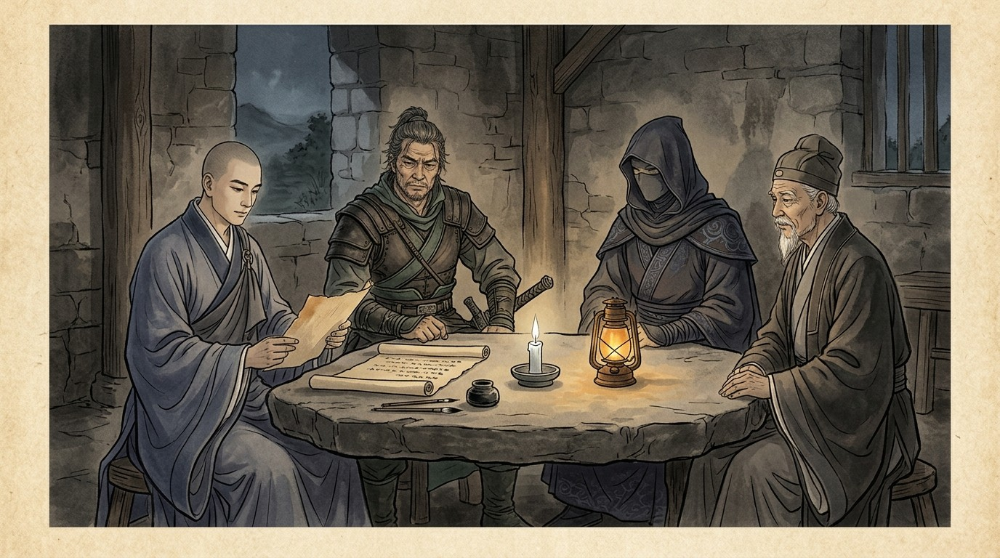
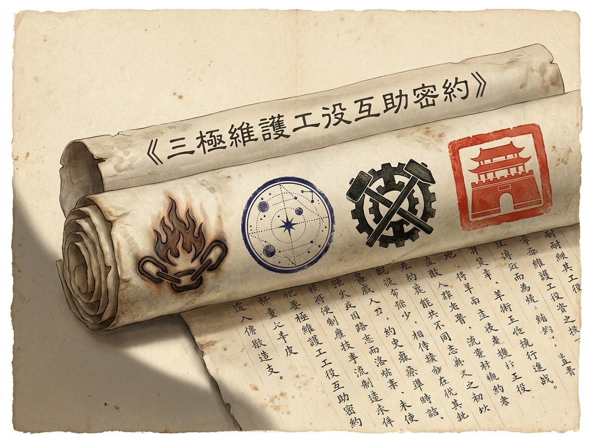

# 第 146 章：耐火羊皮與《三極互助密約》

[← 上一章](ch0145.md) ｜ [本卷目錄](00_intro.md) ｜ [下一章 →](ch0147.md)

*章首插畫：第 146 章 耐火羊皮與《三極互助密約》*

兩夜之後，灰燼石堡守夜寨地下那間連風聲都隔得嚴嚴實實的石案室裡，迎來了洞天三極分庭抗禮三百年來最不可思議、也最叫人手心冒汗的一場密會。

石案屋內為防地面熱感異動，只燃起了一支煙氣微薄的冷光藥燭。長條黑木桌旁，整整齊齊卻又彼此提防般拉開半步距離地坐著四個按常理來說、此生都絕無可能併桌而坐的人——

左首坐著的是身披洗得發白的灰色雜役道袍、右袖依舊沾著正北白玉階微細石墨灰的太虛校星院觀測士**衡真道人**。這位慣常與冷冰冰星儀打交道的星修從坐下起脊背就挺得筆直，指尖極輕地拂去粗木長凳上殘留的一點煤灰，眼神雖未露嫌惡，卻始終帶著太虛中人特有的審慎孤冷；對面隔著一道桌縫坐著的，則是右臂裝著沉重機械鐵手、外袍膝頭還留著兩道乾硬黑機油與酸液白漬的萬物外環**齊老匠師**。老人大馬金刀地把兩隻沾滿油垢的腳搭在橫撐上，嘴裡叼著根沒點火的旱菸桿，斜眼瞅著對面道士袖口那點白玉粉塵，鼻腔裡時不時發出兩聲不輕不重的冷哼；

上首是獨臂缺指、一雙老眼如夜鷹般死盯著暗門插銷的灰燼石堡守夜老漢**戚老頭**；而長桌末尾最角落那道陰影裡頭的矮木凳上，赫然沉甸甸坐著一個肩寬背厚、雙腿盤起竟比尋常成年漢子還要高壯半截的彪形漢子——額角刺滿戰祖鋸齒黑紋的西南外營馱隊隊長**託古**。這條鐵塔般的漢子身邊斜倚著一柄用粗麻纏死的戰祖黑骨戰斧，連呼吸都帶著裂谷邊陲特有的硫磺焦苦味，坐下來沒一會兒便把結實的榆木矮凳壓得吱嘎作響。

屋裡四個人，背後各自連著彼此提防撕咬了整整三個世紀的三座巨構與一座遭流放的遺民石堡。一時之間誰也不肯先開第一句口，只有石牆縫裡偶然落下幾粒細小砂礫。

「行了，各位前輩都不是來石堡喝苦茶敘舊的——別光隔著桌子互相打量眼珠子了，先看東西。」

打破僵局的是端著兩隻粗瓷藥罐走進來的顧玄。這位一路話最少、性子最沉的丹鼎年輕醫修沒有半點繁縟客套，直接走過去將其中兩罐封著青竹蠟蓋的淺青色泥膏「咚」地推到託古與齊老匠師面前，另又遞了一小包烘得微溫的黑褐藥片給衡真道人。

「衡真前輩長年蹲在白玉偏殿核校星儀，吸入高塔飄散的【玉化碎晶微粉】最深，每逢星壓夜降便胸悶喉癢、晨起痰帶白砂；齊師傅在外環長年搶修酸水冷卻管，手腕關節早被重金屬酸氣侵成硬結；至於託古隊長與貴部弟兄……」顧玄伸出自己那雙此刻掌心中央已經隱隱烙出兩片淡灰白晶斑的手掌，一字不漏地道出這四個外人各自的暗痛，「你們這半年在礦營摸到的鹽晶粉裡被韓石摻了劣質重汞廢渣，手背潰爛發癢不說，夜裡入睡小腿必抽筋發冷——先別忙著問我怎麼知道。這罐緩衝膏是我們依三極邊界廢料配戰祖無毒獸髓試出來的方子，各位現場試過再談。」

衡真道人微微動容，接過那包藥片用指腹捻了捻，嗅出一股清烈苦苔混著地心微甘的奇特藥性；齊老匠師「嘿」了一聲，倒是乾脆地刮了一點塗在發僵的左腕筋骨上；最直接的還是託古。這位連眼睛都沒眨一下的戰祖漢子粗糙大掌直接摳起半指節厚青泥，狠狠抹在自己手背一道翻捲流膿、連夜刺癢的暗紅舊瘡上——

頃刻之間，一股沁涼清苦卻又溫潤沉穩的藥力透皮而入！原本像有無數隻小蟻在皮肉底下鑽啃噬咬的毒癢，竟在幾息之間迅速褪去大半，連帶著泛紅發腫的創口邊緣也收縮結出一層乾淨涼膜！託古那雙習慣了流血與挨凍的虎目頓時劇烈一震。

「人命關天的帳先驗過了，現在換我攤死帳。」

沈泥等幾人神色徹底從觀望轉為震動，這才不緊不慢地把油燈撥亮半分，順手將桌心那卷厚實沉重的《九城火種配額補正帳簿》拉開半尺，把燕隼帶回來的那張染血《換防血樣名錄》、柳清虛記錄的星盤每甲子衰減曲線圖，連同林鐵生截來的三號廢渣道暗帳抄件，一張疊一張鋪滿長桌——

「左頁是西南韓石過去三年借『三成加徵』之名、實則從戰祖牧道抽走的高純鹽晶斤兩——每一筆的收貨私印，全都對得上正北太虛嚴平私庫的轉入編號！」沈泥指尖精準壓在兩組一模一樣的硃砂批號上，隨後又翻開右頁，「右頁則是顧大夫連日比對出來的五年礦奴換防假粉傷亡清冊。去年秋末送到鬥獸坑底層那八十斤劣質鹽晶粉，根本沒經過萬物外環大庫，而是陳楷放水走暗門調換出來的毒渣——死在上面的，全是戰祖外營跟隨託古隊長奔波最苦的老獵！」

託古盯著那幾張寫滿鐵證的紙頁，粗大的手指死死攥住木桌邊沿，木頭硬是被生生掐進五道深痕！

燕隼抱臂斜靠在石屋門框旁，冷眼看著那名漸漸壓不住怒火的戰祖漢子，嗓音低冷得像北荒刮過來的寒風：「託古隊長，我大伯燕山和你們部落九個兄弟，現在還鎖在韓石帳前那座鬥獸坑底的鐵鏈裡。你們外營弟兄替他流血拼獸核、背鹽粉，換來的卻是這三成吃骨不吐渣的假帳跟摻毒藥渣。等到七十餘日後校準大夜一到，魔殿上頭心核一旦湊足，第一件事就是封死外營退路清界消帳——你那些還在泥坑裡啃黑乾糧的族人，連進內圈避風的資格都不會有，照樣要被當成『戰損雜料』拋在溝壑外面硬扛狂獸潮。你是繼續替韓石賣命湊齊他最後三成好上報升官的假帳，還是跟我們這幾個無籍泥腿子一塊，掀翻他這條吃人的暗倉？」

地下石室陷入短短十息死寂。只有冷光藥燭無聲搖曳，將五個少年與四位三極底層老兵的影子重重疊投在粗礪玄武岩壁上。

半晌，託古忽然發出一聲低沉野獸般的嗤笑。這位肩背厚實的戰祖百夫長沒去拿毛筆，也沒有咬破指頭這種凡間書生戲碼——他猛地伸手抄起桌上那把原本用來給藥罐封蠟、還帶著灼人炭火餘溫的沉重鐵烙，一言不發往自己左胸厚牛皮甲正中狠狠一按！

「滋啦——！」一陣濃重焦皮革味冒起青煙，牛皮胸甲上赫然印出了一枚灰燼石堡火種記號。緊接著，他手臂一轉，竟將滾燙得微微泛紅的烙鐵頭重重壓向桌面一張早已預備好的厚實耐火白色鹽鞣羊皮右下角！

「戰祖外營九支馱隊、一百四十名見過血的老兄弟，從今夜這道火烙起，認這座破石堡為自己人！」託古粗聲吼得石屋灰塵簌簌掉落，虎目瞪得如銅鈴一般，「只要韓石再敢亂加半兩心核額、或者再敢把一名弟兄往鬥獸坑裡押，老子的馱隊寧可連人帶鹽車直接翻進赤炎岩漿縫裡，也絕不讓他安穩混過這個校準年！」

「痛快！」齊老匠師撫掌大笑一聲，機械鐵手「哢噠」夾起一枚浸過特製黑紅礦油、雕著雙向活榫圖樣的齒輪印模，緊隨其後重重蓋上耐火羊皮左側，油墨透進皮紋，力透紙背，「萬物外環二十四座維修小站外加十二處苦力鹽寮，老頭子一條殘命擔保——校準夜只要敲管號響，上頭那些白銀算偶連一口熱氣都別想喘順！」

衡真道人緩步上前，望著眼前這兩張透著莽氣與決絕的印記，長嘆一聲卻神色極清肅地撫平灰色雜役道袖。他沒有借任何太虛官印，只從貼身袖袋取出觀測院師門秘傳的硃砂星墨，在羊皮上方正正經經點落一顆代表「偏角暗應」的北斗殘星朱批：「貧道只是一名看不慣白玉階拿活人血骨去補天羅黑洞的廢物道人。太虛之內還有三十七名被嚴平扣住宗籍、良心未泯的觀測小修——校準前夜，觀測院的時差與副盤誤差，我們替諸位遞出來。」

最後，一直立在旁邊冷眼見證的獨臂老漢戚守灰這才大步上前，獨手舉起那枚代表灰燼石堡四百八十七戶九號遺民血脈的焦木大印，連同沈泥掌下那一枚代表雲津商會與天門引共證的暗章，齊齊壓落羊皮正中！

四方在三極高層眼中原本微末如灰塵、連姓名都不曾並書一處的底層人手，第一次真正擊碎了隔絕彼此整整三百年、靠相互敵視與資源猜忌築成的高牆，把所有人的性命與後路一併寫進同一張名為**《三極維護工役互助密約》**的耐火羊皮之上——

**「太虛供星時盲點、萬物供銅榫停軸、戰祖供馱道糧草與拒徵、石堡供藥霧收容——校準之夜同進同退，誰先賣友，四極共焚其魂帳！」**

羊皮捲合鎖入防潮鐵筒的那一刻，誰也沒有發覺，灰燼石堡頭頂那片靜止了三百年的暗鐵青色天穹之上，正有一絲極冷極微的星軌壓迫感悄無聲息地往下沉了半寸。

---

*器物圖誌：耐火羊皮《三極維護工役互助密約》*

---

[← 上一章](ch0145.md) ｜ [本卷目錄](00_intro.md) ｜ [下一章 →](ch0147.md)
