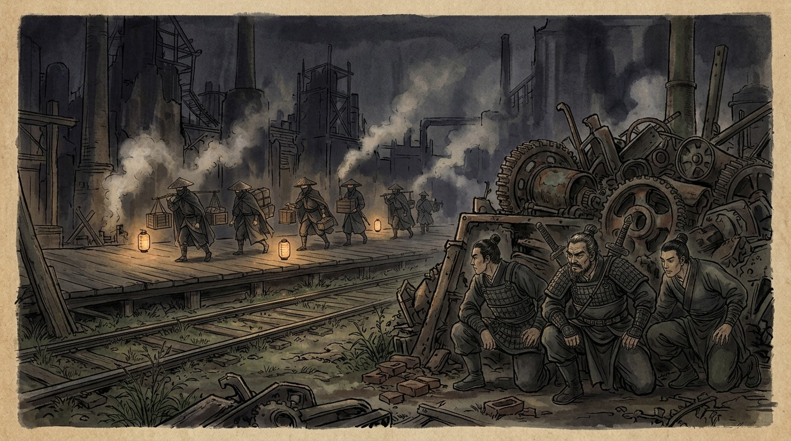

# 第 147 章：三號廢渣道的「赤火」密箱

[← 上一章](ch0146.md) ｜ [本卷目錄](00_intro.md) ｜ [下一章 →](ch0148.md)

*章首插畫：第 147 章 三號廢渣道的「赤火」密箱*

密約締結後的第三夜，萬物外環三號廢渣轉運道冷風呼嘯，四周除了十丈外蒸汽管道間歇噴出的白霧以外漆黑一片。

林鐵生伏在一堆高聳如山的鏽蝕齒輪後頭，身旁半蹲著兩名二十四站調來的精幹小匠。三人的視線死死鎖住前方兩條廢棄軌道交會的平台——按鐵大鬍子連日蹲點摸來的消息，每逢半月最陰晦的子夜三刻，總有一隊沒有打萬物公家編號燈籠的蒙面腳夫從這條死胡同轉運密貨。

「來了。」林鐵生極輕地碰了碰身側同伴肩背。

昏暗裡，一名穿著雲津式樣灰斗篷、卻把腰牌反掛在內衣裡頭的乾瘦漢子領著三名腳夫鬼鬼祟祟推著一輛裹滿黑氈布的四輪鐵車拐進了轉運道。鐵車四角包著消音厚橡木皮，車輪滾過鐵軌幾乎聽不見半點聲音。

林鐵生靜待鐵車恰好經過高處那座懸掛著半截斷樑的吊臂正下方時，右手忽地一揚——早已掛在活榫絞盤上的三隻五十斤重廢鐵墜塊「轟隆」一聲砸落！正正好將鐵車前後退路雙雙封死！

「什麼人？！暗樁？！」那名斗篷漢子反應極快，反手便從袖裡摸出一把閃著紫藍電弧的雲津連弩朝陰影處掃射，足尖一點黑鐵軌就想往管道暗門逃竄。

可這回在洞天低空攔他的，早已不是初入界時還會被空間阻尼扯散步法的青澀弟子！林鐵生根本不跟對方凌空比身法，烏沉短鍛錘趁著重壓猛地一砸地面鐵軌，激起的強橫震波沿著鐵軌比聲音還快地瞬間撞上那名暗線掮客立足的鋼板！

「啊——！」掮客腳踝被鐵軌震波硬生生麻痹半息，整個人往前栽倒。林鐵生箭步上前一記精準擒拿卸掉他左肩肘關節，順手反剪住雙臂壓跪在冰冷鐵渣地上！另外兩名工匠趁勢三兩下按翻其餘腳夫，扯開鐵車上的厚黑氈布。

林鐵生掀開最頂上一只長達三尺的紫檀包鐵密箱，箱蓋暗鎖在鍛錘輕敲兩下後隨即彈開——

裡頭整整齊齊碼著十二根結晶純度高達九成九的上等高純度導流鹽晶柱！而在內蓋夾層裡，竟用凡間鮮紅硃砂蓋著一道林鐵生曾在雲頂與北荒看過無數次的獰惡封印：**兩個交疊燃燒的篆文古印——「赤火」**！

旁邊還壓著半疊沒有來得及銷毀的凡間轉運撥條清單，上面清楚寫著「雲津東南斷崖外轉運棧・赤煉餘部接貨憑單」！

「你替誰跑這條線？這高純鹽晶怎麼送出洞天去？」林鐵生一把拎起那名臉色慘白的掮客衣領，眼神冷得像剛淬過水的黑鐵。

掮客咬破嘴角卻終究怕痛沒敢自盡，戰戰兢兢吐出半截秘辛：「小的只是收錢跑三號暗線的中間人……上頭吩咐把萬物與太虛冒領出來的上等鹽晶粉轉進雲津那頭去……聽主顧嘴裡漏過一兩句，那邊急著要超高純度穩壓晶柱替一位『閉死關的老怪物』修補什麼『赤煉遺陣』！別的……小的真不知道啊！」

林鐵生背脊微微發寒，隨即將這只貼著朱砂「赤火」封印的走私密箱連人帶單一併秘密押送進灰燼石堡外圍禁閉窯，並讓顧玄認筆跡。

原來早在大校準前夕，太虛嚴平、戰祖韓石與雲津當年那支神秘銷聲匿跡的「赤煉門餘孽」早已透過萬物三號廢渣暗道搭起一條偷運血脈——這批人不但想在校準夜抹平底層石堡銷帳，還另在外頭備好一條留給自己的私遁暗門！

---

[← 上一章](ch0146.md) ｜ [本卷目錄](00_intro.md) ｜ [下一章 →](ch0148.md)
