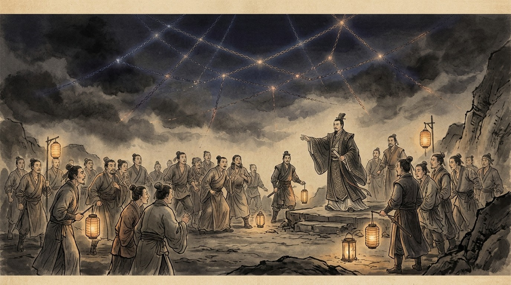

# 第 148 章：主簿突襲・星鎖全區點名

[← 上一章](ch0147.md) ｜ [本卷目錄](00_intro.md) ｜ [下一章 →](ch0149.md)

*章首插畫：第 148 章 主簿突襲・星鎖全區點名*

距離大校準僅餘二十餘日，洞天積累了近三百年的大氣壓迫終於顯露猙獰面目——灰燼邊緣連夜刮起的不再是單純的刺骨礦砂風，而是夾帶著細碎晶塵、讓裸露皮膚如同被微針細細扎刺的乾燥靜電熱浪，空氣裡瀰漫著濃烈的金屬焦味與臭氧腥氣。

正北白玉接天階之巔，太虛執律閣主簿**嚴平**終於再也按捺不住了。

接連兩旬之內，原本在他算盤裡穩如囊中之物的兩條底線接連出事：先是萬物外環的《無主材料清零》多次被齊老匠師帶頭拿公差漏洞頂回去；緊接著，前夜他從私設觀星台悄悄撥出去補人間「赤火」緊要單的那一箱九成九高純鹽晶柱，竟在三號廢渣道連人帶貨人間蒸發，連半個灰燼都沒流回暗棧！

老謀深算的嚴平站在白玉階旁望著南方黑沉沉的玄武岩荒原，握著玉尺的指節捏得發白，立刻敏銳察覺到那片三不管的灰燼石堡底下，絕對已經被人搭出了一條不尋常的地下連通線——甚至很可能有人正握著足以翻掉他多年積弊的實帳！

這日戌時剛過，原本應該要等到大校準當夜才會全面啟用的太虛白玉天羅星盤，毫無預警地提前亮起刺目欲盲的素白冷光！三座巨大的星儀銅環在沒有任何公文預告的情況下逆時針劇烈轉響，把積聚半季的電離靈壓同時向南偏斜壓下！

同一瞬間，灰燼石堡守夜寨最高處岩稜上，那面戚老頭拿廢銅鍋片改造的示警風標薄片猛地發出一聲幾近撕裂金屬的銳響——「嗡——嘎！！」

紅色的警訊火光與從高空雲隙間撕裂下來的冷白星柱一明一暗相撞，瞬間把整片黑漆漆的玄武岩溝壑照得慘白如晝！所有躲在避風石縫裡烤火的鹽夫抬頭望天，只見原本靜止不動的暗青天幕之上，竟有幾道森然的素白巨柱正緩緩掃蕩而來，凡是光柱掠過的碎石灘，枯苔與黑土裡的鹽砂瞬間如同滾水般劇烈跳動起來！

「警報！全堡滅火進地窯！是太虛『星鎖點名』提前下來了！！」

戚老頭從十丈高的瞭望石台連滾帶爬衝進地下石案室，僅存的那條左臂死死拽著銅鈴索把鐵鐘敲得山響，乾枯嗓音都劈了叉：「三百年前那次百年小試點名時，上面只懶洋洋掃過一道虛影微光！這回嚴平那條老毒蛇急了，直接拉了三道主束沿著咱們頭頂死摳，每過一息就把底下沒掛宗門官籍的熱源與靈氣波動往執律玉簡上鎖死一個！被照穿的窯洞，明早天羅直接記作『待焚廢渣點』！」

警報鐘聲如戰鼓般撞在每一層地下玄武岩壁上，原本還算安靜的地下醫棚與石案室立刻爆發出陣陣壓抑卻訓練有素的急動！這一個多月來沈泥與顧玄不知預演過多少回疏散路線，如今事到臨頭竟半點沒有大亂崩潰。

「按乙字號急避順序！老弱與剛施過針的患者先走！」顧玄與醫女蘇青竹第一時間撕下沾濕苦苔藥水的粗布蒙住口鼻，兩人一前一後護著二十來名行動不便的老鹽夫與三個還在襁褓裡不敢出聲的嬰孩，拎起早就按緊要等級分裝妥當的《病例總簿》與木箱緩衝藥罐，飛快退入守夜寨後方那道深達數丈、上方覆蓋著厚重含鉛黑石岩層的廢棄死礦穴。

臨進暗道門前，蘇青竹還忍不住回頭望了一眼正被冷白光線透射得陣陣發麻的頂棚，咬緊銀牙低呼：「顧大夫，若是頂上的暖爐餘熱散不乾淨……」

「我們在暗穴夾層抹了兩指厚的隔熱鹽泥，只要上頭主窯保住不被主束直穿，底下的熱源就露不出去！」顧玄一把拉下石門重閘，轉身按亮一盞掩在袖底的極微藥燈清點人數。

與此同時，守夜寨正中的主石案室裡氣壓已緊繃到極點！

空氣裡的靜電猛烈跳躍，木案上那幾支剛磨好的鐵筆居然微微發顫發出「嗡嗡」微鳴。沈泥立在長桌旁，雙目死死鎖定案幾中央兩件性命攸關的鐵證——那本剛從離線銀碑吐出來、一旦毀掉便再難重寫的《九城火種配額補正帳簿》複製底冊，以及那張還留著託古火烙印痕跡、一旦曝光便會讓三極百餘名底層密約者一夜人頭落地的耐火羊皮《三極互助密約》！

萬一太虛星鎖那道高熱透視主束在幾息之內掃穿這座守夜寨正頂，不單剛立好的《三極互助密約》會被當場烙進太虛執律閣的留影銅版裡，連帶著藏在鹽窯底下四百八十七戶遺民的真實氣息座標與密牢裡那箱「赤火」物證也會在強光下被徹底鎖定——那樣一來，嚴平根本不用等到大校準，明日一早就能名正言順發動三極聯席清剿令，帶著百餘具重型執法銅偶直接踏平灰燼石堡！

「清虛！還有多少時間第一道主束就會壓到守夜寨正頂？！」沈泥雙手飛快把兩份致命文書分別套進隔磁鐵盒與耐火石棉油布包裡塞進牆腳預留的深槽，一邊猛地抬頭急問。

「最多只有十息！甚至可能只剩八息！」

柳清虛早已頂著撲面而來的滾燙電離亂風衝上守夜寨最高處那座搭著黑鐵架台的玄武岩頂稜。高空垂落的強盛太虛星鎖光輝如同白日雪原反射的寒芒，瞬間狠狠刺進這位青衣星修早已受損的左眼！那一圈原本只在陰天隱隱作痛的雪盲青翳，在高頻星光的瘋狂刺激下頓時像被燒紅的細銀針狠狠攪進眼眶深處，豆大的冷汗順著慘白鼻樑滾進嘴角，殷紅血絲悄無聲息地從他左眼角沿著顴骨滑落。

可柳清虛連手都沒有抬起來擦一下血，右手憑著肌肉與神識多年鍛鍊出的本能死死舉著背面刻滿幾何紋路的紫銅鏡與角尺，在風沙狂捲中鎖定高空那三道如利劍般切割暗青夜幕的素白星柱：「第一道主束已經掃過西邊鹽晶黑市廢棚了……正在沿著老鹽道折轉，速度比預估快了兩分，最多十息就會直壓守夜寨主窯正頂！」

「硬撐防護法陣或者在屋裡擺干擾符陣全都沒用！」林鐵生剛剛從外環搶完換芯料回堡，此刻連沾滿鐵鏽的皮圍裙都來不及解，一聲暴喝便扛起兩捆早已按九級公差粗細拉好、原本預留給導流井用的赤銅導線大步搶上岩頂，雙眼亮得駭人地衝著柳清虛吼道，「法陣靈氣一亮，在人家星盤裡就跟黑夜裡點了大紅燈籠一樣直接指路！老四！你在玄武岩風道趴了十幾天測出來的那張大氣切線圖還在不在？！能不能算出來——不用擋死它，只要把那道主束往旁邊撬偏幾分，能不能讓它從石堡主窯頂上擦過去？！」

這一句問到了法道與物道徹底交融的那條破局生死線上！

柳清虛單手按著幾欲炸裂痛楚的左眼，大腦卻冷靜得像北荒萬載不融的玄冰。過去一個多月他在灰燼溝壑日夜挨著風砂記下的每夜頻率微飄、白玉階偷窺到的星盤傾角誤差，此刻在腦海裡電光石火般重組起來！

右手顫抖著卻無比精準地拿紫銅角尺對準高空星光落下來的那一線幾何折射率，他聲音沙啞卻清晰無比地穿透了狂風：「要完全把百丈高空打下來的太虛主束彈開絕無可能！但只要藉此地岩石含鐵磁砂多、這兩日空氣靜電又積到臨界的順勢——在偏西九步七寸那座玄武岩風嘴上拉出『短陣銅網弧光』，同時把高純結晶鹽粉打散成氣霧迎面撞上去！咱們不需要擋它半刻，只需要趁空氣電離瞬間把這道主束的折射角**偏折出一度半、硬生生撐住三息時間**——超過三息，執律閣玉簡上的回波讀數就會被地底高磁雜訊淹沒，自動誤判成普通玄武岩地磁亂流而滑過去！」

「只需要偏折一度半？只需要撐三息？」

石階下方，剛剛放下大鐵鐘的獨臂老漢戚守灰已經拎著兩大桶平時視作整座石堡越冬老命的陳年松脂礦油與半箱精細黑鐵屑大步奔了上來，獨眼中凶光畢露，嘶啞嗓音壓過了高空降臨的星鳴呼嘯：「老子他娘的還以為有多難！快點告訴老子往哪個岩嘴拉銅線、在哪個風眼潑鐵粉！老子這個破寨子四百多號活口守了三百年，還輪不到太虛宮裡那幾個偷賣鹽晶的狗賊在天上拿白光點名單！」

「西崖第三根凸岩！鐵生帶線釘死左脈！顧玄在底下備好濕布防震——我們只有八息！」

四道身影迎著那片即將貫穿大地、足以把一切抹作無主灰燼的森白星柱光幕，逆著狂風一齊撲上了玄武岩頂稜。

---

[← 上一章](ch0147.md) ｜ [本卷目錄](00_intro.md) ｜ [下一章 →](ch0149.md)
