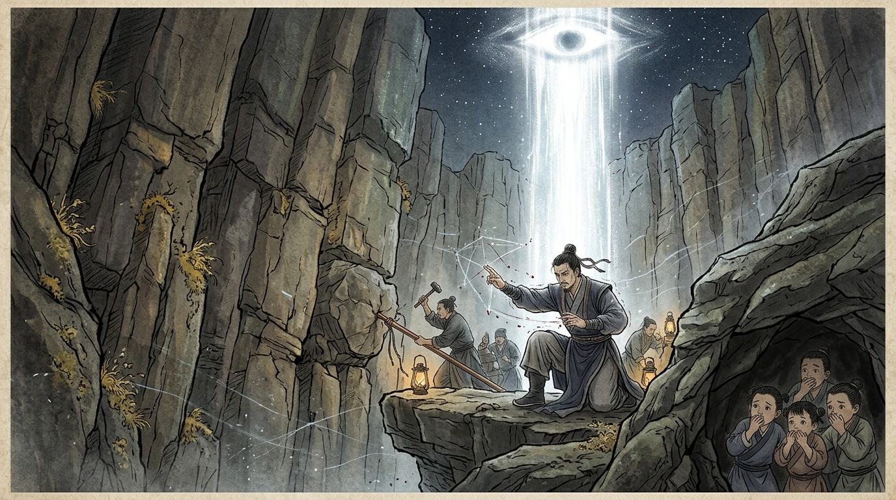

# 第 149 章：偏星一度半・三息護名冊

*卷首插畫：第 149 章：偏星一度半・三息護名冊*

十息倒數只剩最後四息！

天穹之巔垂落的素白星鎖主束宛如天神睜開的冷酷巨眼，將玄武岩峽谷兩側碎石照得雪亮透澈，連石縫裡幾株枯黃苦苔的細毛都一清二楚。空氣裡瀰漫著一股毛髮豎立的極強靜電酥麻感，石堡地下窯洞裡幾名孩童嚇得緊緊摀住嘴巴不敢哭出聲。

「西偏七步！銅線往左崖那塊含鐵玄武岩釘死！」柳清虛強行催動幾乎要將眼底經脈撕裂的推演心法，右手指尖滲血如注地在空氣裡劃出一道無形的幾何張力切線，「鐵生，銅絲接頭必須留三分半虛縫，靠第一波鹽晶地氣自己打火引弧——千萬不能自己用靈氣硬撞！」

林鐵生半句廢話也無！烏沉短錘掄起如半輪烏月，「鏗！鏗！鏗！」三記重錘極其暴力卻分毫不差地把三根特制赤銅地釘狠狠砸進左崖含鐵石脈深處，雙手飛快扯過那兩捆赤銅網繞住戚老頭剛潑上鹽硝礦粉的岩嘴鐵架，最後留出剛好三寸多寬的引弧斷口！

同一時刻，在距離此地三十里外正北白玉接天階偏殿裡，正假裝值夜抄錄星盤誤差的衡真道人看著頭頂星盤突然加速轉向灰燼方向，面色一凜，毫不猶豫從袖管抽出一片萬物工匠才剛剛送來的「無毒穩壓銅芯」，趁著嚴平轉身檢視銅冊的兩息空隙，極陰損卻精準地將銅芯反插進偏殿副盤的三號平衡槽！

遙相呼應的兩地於焉合拍！

太虛天羅主束轟然垂落的最後一息，柳清虛孤身站在岩頂大風之中，強頂著左眼一陣猶如沸水燙過般的刺痛失明感，低喝一聲「動手！」

林鐵生一把拉下總拉閘，沈泥與戚老頭同步拋出兩囊極細高純結晶鹽粉炸入赤銅斷口！

「轟噼——！」

一道刺眼奪目得幾乎蓋過天上星光的藍白色龐大電弧，順著玄武岩風嘴積蓄整夜的大氣張力驟然向上空炸開！半空中無數漂浮鹽霧受電弧引動瞬間化作一面橫亙十餘丈的扭曲光障！

天羅主束正正好撞進那片人為掀起的強電鹽霧裡——被衡真道人暗中撬歪的一分副壓配合地面引弧氣浪一扯，筆直如尺的掃描光柱竟生生在守夜寨主窯正上方九尺處猛地跳動了一下，整整偏折了**一度半**，擦著沈泥屋頂外沿一丈外的荒坡石堆急掠而過！

足足三息過後，主束收回高空雲霧之中。

守夜寨頂棚劇烈焦黑冒起一陣濃重硫煙，幾片充作網骨的赤銅絲徹底熔化成黑紅色銅汁滴落石階；岩頂風口上，柳清虛單膝跪地左手死死捂著流出血水的眉角，右手卻仍穩穩攥著那把已被燒燙的銅尺，緩緩點了點頭：

「偏了……一度六……底下沒留印記。」

遠在三十里外的太虛白玉執律閣內，主簿嚴平盯著銅盤上原本即將鎖定灰燼座標卻突然跳出一團雜亂玄武岩地磁火花的殘像，眉間頓時扭成死結，手裡玉尺重重敲在案幾上：

「好個地磁幹擾……這群躲在石縫裡的螻蟻，竟然真有人算得出天羅掃描角！傳令下去——明日一早把公函發去戰祖外營與萬物稽查署，既然他們裝死不入冊，那就從西南鬥獸坑跟外環開始一處一處清人頭算帳！」
