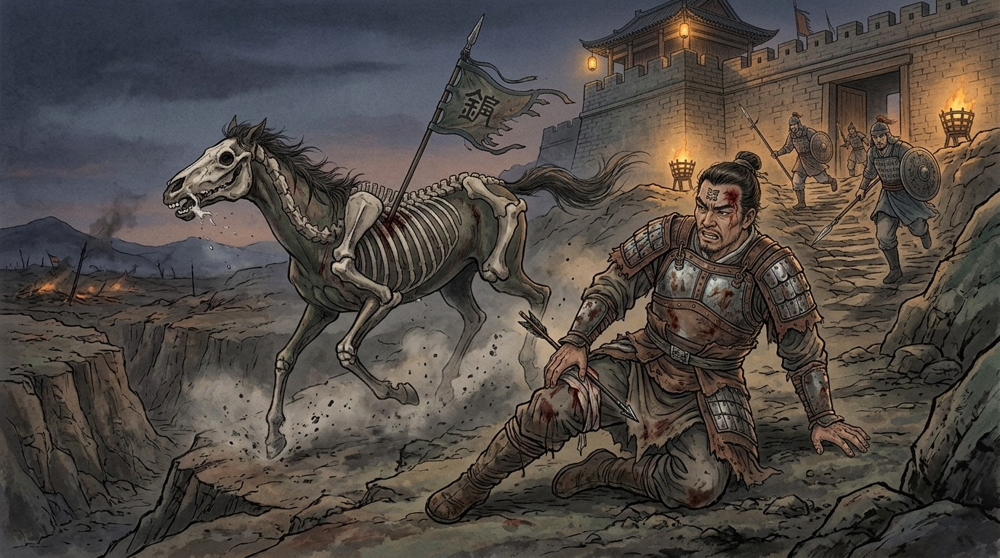

# 第 150 章：鬥獸坑死令與託古夜奔

[← 上一章](ch0149.md) ｜ [本卷目錄](00_intro.md) ｜ [下一章 →](ch0151.md)

*章首插畫：第 150 章 鬥獸坑死令與託古夜奔*

嚴平突檢失手後的第三日黃昏，西南方向原本沉沉壓在裂谷地平線上的暗紅硫雲突然翻湧起一團刺眼煙塵。緊接著，一匹雙肋斜插著紅黑戰祖急令骨旗、口鼻不斷噴出淡黃白沫的兩足狂奔骨馬，竟連減速都不曾減過半步，直衝下焦土陡坡，最後「轟」地一聲連馬帶鞍重重翻倒在灰燼石堡外哨暗溝旁邊！

骨馬摔斷的前腿骨刺穿皮肉，發出兩聲沉悶哀鳴便不動了。從鞍具殘骸裡滾跌出來的不是別人，正是額角鋸齒黑紋全被尖石擦出一道長長血口、左腿外側還死死卡著半截帶倒鉤紫黑毒弩箭簇的戰祖外營馱隊隊長——**託古**。

「敵襲？不……是託古隊長！」

正在北側暗哨擦拭箭羽的燕隼眼神一凝，人已順著岩溝斜坡急滑而下，一把抄住踉蹌撲過來的彪形漢子。託古整條左腿都在劇烈抽搐，發黑的毒血順著牛皮褲管不斷往下滴進灰土，可他那雙磨盤般粗糙的大手卻像鐵箍一樣死死抓住燕隼前襟，胸口扯得像破風箱般喘得上氣不接下氣：

「燕……燕隼小子！別管老子的腿！快去喊你兄弟拿趁手傢伙！出大事了！！」

燕隼心口猛地往下一沉，五指本能地攥緊腰側那柄黑鐵硬弓：「說清楚！是不是韓石動了我大伯？！」

「太虛那個姓嚴的主簿前天吃癟回去後，連夜發了加蓋執律赤印的絕密公函下來！」託古背靠在冰冷玄武岩壁上，一邊從嘴角吐出帶腥味的唾沫，一邊從牙縫裡硬擠出字句，「韓石那條老毒狗收到公函後徹底撕破臉了！他今天一早就拿著執律閣聯名文書封死外營四條出口，逼所有還沒死絕的礦奴跟舊獵頭逐一按手印畫押——要他們全數簽認一份《三年鹽晶配額全數收訖無欠帳單》！」

託古說到這裡，眼眶赤紅得幾乎要滲出血來，猛地揪住自己胸前皮甲一聲嘶吼：

「老獵頭昨晚帶著當年一塊摔進黑冰斷谷的那九個老弟兄，當場踢翻韓石帥帳前面那張鋪著假帳冊的鐵木案，寧可讓監軍親衛當場折斷左手腕骨，也不肯在把全外營底層兄弟賣成偷盜賊的偽單上摁半個指模！結果今天正午，韓石那畜生下了死令——把燕山老哥連同那九個老骨頭全部穿了玄鐵鎖肩重鐐、挑破肩井筋膜鎖進營地北邊最深的**【戰祖鬥獸坑】**！坑外圍足足加派了三十名披兩層鐵骨甲的精銳戰兵與兩隊連弩哨，韓石當眾放話：明日辰時鐘聲一響，就同時拉起四門重閘，把底下餓了整整七天的兩頭三階熔骨狂獸放進坑裡活生生咬死他們，徹底把人連同過去五年的血汗假帳一塊銷個乾淨！！」

「好一個銷帳！！好一群吃人不吐骨頭的王八蛋！！」

剛從石案室趕來接應的林鐵生聽完最後這句，兩步衝到旁邊一塊半人高的玄武岩哨樁前，五指併攏狠狠一拳砸落！「喀嚓」一聲悶響，堅硬如鐵的玄武岩表面竟被這名年輕鐵匠當場震出三道指寬裂紋，碎石簌簌砸落在靴面上！

石堡主窯石門推開，沈泥面色如霜地大步跨出，身後緊跟著眉骨處還貼著白紗藥布、眼神卻銳利如劍的柳清虛，以及拎著全套外科解毒針囊趕來的顧玄。

顧玄搶上前半步單膝跪地，一把剪開託古左腿褲管，看清傷口周圍發紫發黑的箭毒時眉頭一皺，當即取銀針封住大腿兩側血脈，手起刀落從託古肌肉深處撬出那截帶倒鉤的毒弩鐵鏃，隨即敷上厚厚一層綠黑苦苔解毒散：「鐵箭上抹了戰祖用來麻醉荒獸的『腐骨草汁』。再晚半個時辰進堡，這條腿就廢了——今夜你哪兒也不能去，老實待在醫棚。」

「老子不需要去醫棚睡大覺！」託古疼得額頭青筋暴起卻連哼都沒哼半聲，一把扯住準備轉身走的沈泥衣角，「我知道鬥獸坑每一道輪班的暗哨死角！我把昨晚剛摸出來的坑沿布防草圖畫在……」

「畫出來交給我們就夠了。」沈泥俯下身，手指堅定地一根一根分開託古那隻沾滿血泥的大手，隨即轉身面向眾人，聲音不高卻像冰水澆過燒紅烙鐵般冷靜得嚇人，「第一封死契我們怎麼立的？『誰若遇難，其餘四人捨棄一切也要去撈。』燕山大伯用五年命替咱們守住了坑裡那九條老弟兄，還送出《血樣名錄》和三號廢倉座標——今夜無論那座鬥獸坑裡藏著多少重兵狂獸，這個死局我們接了！」

不過半柱香時間，守夜寨地下石案室油燈全亮。託古忍痛在羊皮背面飛快勾勒出鬥獸坑周圍火炬位置、絞盤傳動軸與兩道獸閘門的構造，沈泥拿炭筆在旁邊一條一條算清時間與退路——

「坑壁深十丈、底寬五丈，重力比上面還重兩分，硬衝進去跟二十名重甲戰兵正面拚命絕對陷死。」沈泥點著草圖，有條不紊調兵點將，「第一，顧玄大夫與戚老丈留守石堡！石堡不僅要守緊後路暗道與醫棚老弱，更要連夜熬備雙倍份的止血接骨湯藥、繃帶跟熱鹽水——人從坑裡搶出來個個都帶重傷，沒有穩妥的接應醫棚，救出來也是白救！託古兄弟在醫棚養傷，同時派你馱隊裡最靠得住、認得戰祖暗口令的兩名心腹老馭手給我們當外圍引路與駕車接應！」

「第二，清虛帶三才短劍與測距銅尺隨隊，專門替我們盯死高台換哨三息空檔，壓制外圍視線與計算落點；鐵生帶全套破鎖長撬棍、活榫扳手、烏沉短錘，還有顧玄剛趕製裝罐的四枚強效『暈獸苦苔煙漿』——你的任務只有一個：三息之內無聲卸掉絞盤死栓，讓坑底囚籠鐵閘跟外逃牽索同時鬆扣！」

「第三，燕隼主攻高台弓箭手與壓制韓石親衛！記住，你右肩筋膜傷還未徹底長實，前兩箭務必借地形與截息卸力，別硬催大圓滿弓勁。」

「算我一個！」門邊忽然響起一聲蒼老卻擲地有聲的喝喊。一直守在守夜寨石牆口的那名五十餘歲石堡老獵戶**趙老栓**大步走了出來。這位寡言少語的漢子手裡死死攥著兩柄磨得雪亮、尖端泛著藍汪汪獵毒寒光的雙股老獸叉，「當年黑冰斷谷裡也有我兩個同村兄弟跟著燕山頭兒一起掉進荒原失蹤……這十幾年我守石堡大門天天往西南望。今夜你們幾個後生要去掀戰祖的棺材板，怎能少得了老子這條認得夜路骨溝的老骨頭！」

沈泥深深看了趙老栓一眼，沒說客套的推辭話，只重重點頭，將一袋備用火石與兩隻粗布包好的解毒丸遞到老獵戶手裡：「那今夜進坑斷後與拉索，就有勞趙老叔。」

七道身影——沈泥、林鐵生、柳清虛、燕隼、老獵戶趙老栓，外加託古親自挑出兩名熟悉骨道夜哨口令的心腹老馭手——披上託古馱隊專用的黑褐色耐磨獸皮罩衫，腰間各自壓緊不會在夜風裡反光的黑布纏繞兵刃、鐵楔與藥罐。

這夜，西南天幕上的殘紅月色被從地熱裂縫翻湧上來的黑色硫雲遮了個嚴實，連一星半點天光都漏不下來。空氣又悶又沉，彷彿連老天都在等著一場血戰破開這座牢籠。七條黑影踩著鬆脆的火山灰渣悄無聲息摸過兩處外圍骨塔死角，宛如七頭貼著大地重力潛行的夜豹，直撲那座血腥與硫磺焦臭衝天而起的戰祖鬥獸坑！

---

[← 上一章](ch0149.md) ｜ [本卷目錄](00_intro.md) ｜ [下一章 →](ch0151.md)
