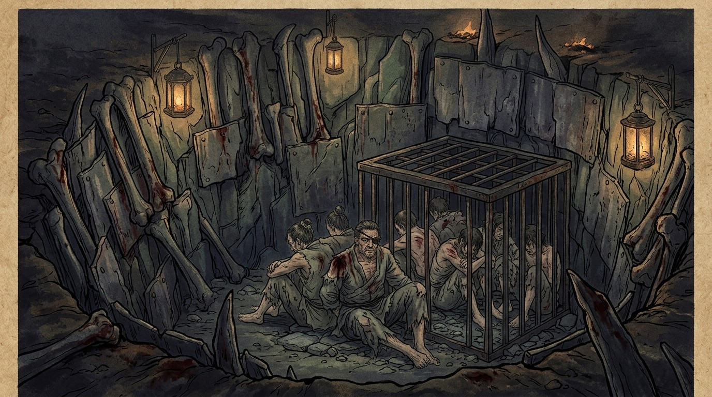

# 第 151 章：破籠救十命與赤煉密牌

[← 上一章](ch0150.md) ｜ [本卷目錄](00_intro.md) ｜ [下一章 →](ch0152.md)

*章首插畫：第 151 章 破籠救十命與赤煉密牌*

戰祖鬥獸坑，如同一口被遠古巨斧強行劈開、倒插進赤黑焦土裡十餘丈深的血色巨碗。

碗壁由層層疊疊沾滿乾涸獸血的黑色遠古巨獸肋骨與厚重玄鐵鋼板斜嵌而成，兩倍半於凡間的可怕重力在碗底凹處沉沉淤積得如水銀般黏滯壓抑。站在坑壁邊緣往下一望，連迎面吹來的硫磺夜風都像是灌了鉛般往下直沉——尋常未經訓練的凡間修士若是失足墜進坑底，恐怕光是要抵抗那股拽人膝蓋發軟的重壓重新站直身子，就得耗掉半條命。

此時坑底西北角那座由兩指粗生鐵條死死焊接而成的矮鐵囚籠裡，十道衣衫襤褸、背脊遍布新舊鞭痕與發黑血痂的身影正緊緊背靠著背坐在冰冷尖銳的碎石堆上。為首一人左眼罩著焦黑硬皮、左肩鎖骨處仍不斷滲出暗紅血絲，卻連半寸脊背都沒有彎下來——正是獨眼老獵頭**燕山**。

在他身旁，九名昔年自雲津八荒營一起隨行、歷經五年折磨卻依然骨頭硬得像黑鐵的舊礦奴與斥候，個個雙唇咬出血印，哪怕手腳都被粗鐵鏈扣著重重拖在地上、唇乾舌燥得連嚥口水都疼，眼裡卻半點沒有向坑上那群持戟戰兵搖尾乞憐的軟骨頭模樣。

坑壁上方兩側鐵梯口各擺了一口兩丈見方的厚重鐵閘門，閘門背後沉沉鐵索拉得死緊，裡頭隱約傳來指甲刮擦石壁的尖銳脆響與兩頭三階熔骨狂獸焦躁低沉的嗜血嘶吼。韓石為了確保明日辰時一開閘這十個人絕無可能生還，今夜不但親自在坑沿高台上點起了八盆熊熊燃燒、火光亮如白晝的獸油大火炬，更派了二十名披掛重骨甲的戰兵與四名連弩手輪番把守兩座控閘絞盤，連一隻飛蟲落進坑邊都看得清清楚楚。

距離地平線泛出暗灰死光，只剩最後一個多時辰。

「丑末已過，再有一盞茶工夫，韓石就會帶親衛親臨高台驗看閘栓。」伏在北側一處冒著熱氣的玄武岩暗風槽裡，燕隼半個身子幾乎緊貼進燙人的黑土，左手穩穩搭上兩支改重含鉛尾羽的穿甲黑鐵重箭，銳利如鷹的眸子穿過火炬烤出的扭曲熱浪，死死釘死高台中央那兩具連著坑底囚籠與獸閘的巨型生鐵絞盤，「鐵生，託古畫的草圖沒錯，兩組大齒輪並在一起，硬砍鎖鏈要好幾十息，太慢！」

「用蠻力砸不斷那種三寸粗的百煉黑鐵柱，但齊師傅早年在萬物外環修過戰祖買去的那批老式絞盤！」林鐵生伏在暗影裡，雙手熟練而無聲地將四截帶螺紋的玄武岩強化鋼管擰成一根長達一丈二尺的組裝重型長槓桿，同時側頭壓低嗓音對身旁柳清虛說道，「那是萬物早期外銷的九齒偏心防滑齒輪，整座齒輪盤全靠頂端那顆黃銅定位死栓卡死齒距！只要咱們先摸上去，把那顆死栓往內斜砸進去半寸，整副千斤鐵齒就會順著兩倍半重力自己脫卡滑開——到時候底下囚籠鐵閘不用砸自己就會往兩邊彈！」

「問題是高台上那兩盞迎風獸油大火炬照著絞盤，四名弩手輪流盯著，沒有死角。」燕隼低聲指出致命破綻。

一直閉目默測風速與哨兵換崗節奏的柳清虛緩緩睜開那隻依舊泛著暗青微光的右眼。他左手食指與拇指輕輕拈起三枚早已在陰溝裡抹了厚厚一層潮濕黑鹽泥的沉重銅錢——洞天兩倍半重壓對別人是束縛，在他這個剛經歷星鎖切線死劫的算師指縫裡，卻是精準計算下墜拋物線的天然砝碼。

柳清虛鼻息幾乎靜止，默數火盆裡火星跳動的間隙與巡邏重甲兵鐵靴踩地的回聲——

「一、二……東北角兩名弩手同時往火盆背側躲熱浪轉身，正西邊那名換哨戰兵剛邁過第三級骨階——就是這三息交叉死角！動手！」

話音未落，柳清虛右腕微不可察地一抖，幾乎沒有帶動半絲靈氣波動，三枚裹滿濕泥的沉重銅錢卻如三顆漆黑流星般貼著重力下壓弧線同時竄出！

「噗！噗！嘶啦——！」

三枚濕泥銅錢精準無誤地依次砸進兩盞主火炬底盤的油脂暗槽與側壁銅鏡之上！滾燙油脂濺了半空被濕泥與鹽砂瞬間悶熄，高台正東與北側頓時陷入一片濃煙滾滾的十丈視覺盲區！

「怎麼回事？！風吹熄火盆了？快點火把！」把守絞盤的兩名戰祖戰兵剛驚愕提戟回頭喝問，兩道貼著大地重力滑衝而來的黑影已經趁著最後兩息煙幕撲上了高台！

「給老子開！！！」

林鐵生一聲暴喝如悶雷炸開，雙臂青筋虯結，將那一丈二尺玄武岩強化長槓桿前端尖楔精準無比地捅進九齒偏心絞盤頂端的死栓凹槽，隨即借著整個身軀順兩倍半重力往下一壓再猛掄烏沉短鍛錘狠狠補上一擊——

「咚！！哢嚓嚓——！！！」

沉重得像山崩般的金鐵崩斷巨響震徹整個鬥獸坑！生鐵絞盤齒箱瞬間朝兩側炸開兩道半尺長刺目火星！伴隨著絞鏈瘋狂倒轉的狂嘯聲，十丈坑底那座死死鎖著燕山十人的三重千斤鐵閘「哐當」齊聲往兩邊猛烈彈開！

幾乎是在鐵閘彈開的同一息，北側岩槽上弓弦連炸三記悶雷！

燕隼右肩舊傷處猛地傳來一陣撕裂劇痛，少年卻連眉頭都沒有皺半下，截息卸力之法運到極致，三支含鉛穿甲重箭如黑色閃電般掃過混亂高台！前兩箭精準無比地先後釘穿兩名正欲強行扳下狂獸放閘拉環的戰兵右腕，生生把兩人連腕帶袖釘死在鐵柱上；第三箭更帶著刺耳破空尖嘯直取剛剛衣衫不整推門衝出石屋指揮台的監軍**韓石**咽喉！

「該死！！有劫獄的雜碎！！放獸！快拿備用斧砍斷閘索——把兩號餓瘋的狂獸給我放進坑裡連這群刺客一塊咬成肉泥！！」

韓石嚇得魂飛魄散，危急關頭本能一偏頭，重箭擦著他左肩鎖骨甲縫「鐺」地削飛一塊肩甲並帶出一道深長血槽！這陰毒監軍捂著噴血肩頭連滾帶爬縮回石門後頭瘋狂嘶吼！

兩名躲在石屋暗處的韓石心腹親衛聽令立刻揮起大斧砍斷最後一道備用保險麻索！「轟隆」兩聲，左右兩道關押狂獸的厚重鐵閘門猛地往上拉開！

兩頭體長近兩丈、脊背生滿鋸齒白骨與暗紅熔岩斑紋的三階熔骨狂獸發出一聲震耳欲聾的咆哮，腥臭狂風撲面而來，四蹄蹬碎地磚便要朝剛掙脫鐵籠的燕山十人飛撲下坑！

「早替你們這對畜生備好醒酒湯了！」

站在高台邊緣的林鐵生反手扯開腰間塞著木塞的兩大口黑陶罐，使出全身氣力照準獸閘口半空狠狠對撞摔下！「砰！嘩啦——！」兩罐顧玄連夜熬製的高濃度「暈獸苦苔煙漿」正正好炸裂在兩頭衝出閘口的熔骨狂獸鼻梁正前方三尺處！

濃烈刺鼻得連百步外都眼淚直流的黃黑色苦煙頓時吞沒整條東側獸道！兩頭嗅覺原本極其靈敏的嗜血狂獸首當其衝吸入大量辛辣迷煙，剎那間鼻腔灼痛如火、視覺與平衡感盡數失序！牠們非但沒往坑底撲過去，反而發瘋似地紅著雙眼調轉碩大頭顱，一頭撞翻身旁舉火把的親衛，狂吼著朝韓石逃竄的石屋那邊瘋狂追撞踏踩起來！

「這邊！老獵戶把牽索拋下去了！抓住繩結往上拉！」沈泥與兩名託古老馭手已經將事先打死活扣的四條粗大浸油麻索順著西側坑壁垂落到底！

「一個都不能漏！老趙跟我架住大伯跟陳老哥先上！」

燕隼飛身踏著坑壁凸出的巨獸肋骨猛滑下去半截，左手拉弓擋下斜刺裡射來的一排流矢，右手卻硬生生抓住剛衝出籠門、雙腕鮮血淋漓的獨眼老獵頭燕山！九名被打斷筋脈卻拼了命互相架扶的八荒舊斥候死死攥住粗麻繩，靠上方林鐵生與沈泥發力生生往坑口拉拽！

然而韓石手底下那支二十名重甲親衛豈肯甘心放走人質？混亂僅僅持續了十幾息，一名體壯如熊、手持沉重骨柄大鐵鎚的戰祖親衛隊長已經帶著八名親衛繞過發瘋狂獸的火線，頂著煙霧狂吼著直接衝殺上西側牽索口！

「攔住他！繩子正吊著兩名重傷的兄弟，一斧就能全砍斷！！」柳清虛手裡三才短劍斜劈削斷一支飛箭，厲聲急喊！

「滾開！」林鐵生剛才為了甩投煙罐並扯繩拉人，半個身子還吊在絞盤架外；反倒是離親衛隊長最近的燕隼沒半絲遲疑，腳底猛蹬岩石反撲上坑沿，竟不顧對方那柄重逾百斤的骨柄鐵鎚狂砸下來，強行以左臂弓背架住半截鎚柄替後頭拉繩的柳清虛與傷員擋死去路！

「咚——！」

兩倍半重力加諸於重錘之上何等狂暴！硬鐵弓發出一聲瀕臨折斷的哀鳴，餘勁透弓背狠狠撞在燕隼左側胸肋之間！「哢嚓」兩聲清晰得令人頭皮發麻的骨裂脆響在火光裡瞬間炸開，少年喉頭一甜噴出一大口鮮血，整個人被震飛撞在石柱上，左肋瞬間傳來撕心裂肺的劇痛！

可就趁這爭搶出來的短短兩息破綻，燕隼忍著左肋骨裂倒地不起的劇痛，右手照舊穩穩貼地甩出最後一記回馬袖箭——「噗」地精準沒入那名親衛隊長舉鎚欲劈的右眼眶！緊接著林鐵生趕回上台，一記短鍛錘迎面轟碎對方頭盔，將這尊巨漢直接砸翻摔進坑裡！

「繩索上的人全數齊了！十個全上來了！快撤回接應車隊！」沈泥一把架起單臂撐地喘息、嘴角不斷溢血的燕隼，回頭清點十道滿身血泥卻依舊活著喘氣的漢子，「趙老叔！快跟上——韓石大隊從南營殺過來了！」

三十丈外火把如龍，至少五六十名戰祖主力甲士正嚎叫著圍攏過來，密集的黑鐵重弩箭雨已經開始罩向西側石坡出口！

然而跑在最後掩護撤退的灰燼石堡老獵戶**趙老栓**，回頭看了一眼前面背著兩名斷腿傷員、根本跑不快半步的隊伍，又摸了摸自己那條三年前被寒獸咬跛、跑不到百步就劇烈發抖的右腿，那張刻滿溝壑的老臉上卻忽然露出一個平靜得近乎解脫的笑。

「老子本來就活夠本了，你們幾個好不容易才把九號艙的火種找回來，這條腿拖不得你們後腿……」趙老栓沒有回頭看沈泥，反而借著一塊巨大風化骨門陰影驟然停步轉身，獨自一人卡死了後方僅容兩人通過的狹窄峽谷口！

「趙老叔！！別犯傻——回來！！」燕隼捂著斷裂抽痛的左肋撕心裂肺地大吼，掙扎著想回身去搶。

「滾蛋！！替老子把燕山頭兒跟俺那兩位老鄰居的骨灰名牌帶回石堡正冊就夠了！！」

老獵戶趙老栓嘶啞的怒吼最後一次劈開火雨！他雙手同時揮起那兩柄淬滿劇毒的雙股老獸叉，像一頭堵死洞口的年邁山豬般死死釘在骨門通道正中，迎面迎向十幾把雪亮骨刀與弩箭！一記毒叉貫穿了最先撲上來的那名追兵咽喉，緊接著兩根黑鐵長矛同時穿透了他單薄的胸膛——就在臨死閉眼的最後一息，這個守了灰燼石堡半輩子大門的老漢硬是憑最後一口血氣伸手狠狠拉斷了頭頂支撐腐朽獸骨棚架的最後一道粗麻絞索！

「轟隆隆隆——！！」

數萬斤腐敗巨骨與鬆動焦岩轟然塌落，瞬間把整條狹窄骨道徹底堵死成了十丈高的碎石絕壁，硬生生替前方的眾人搶出了撤離進託古接應草車的最後半刻生機！

半個時辰後，八輛蒙著厚重苦苔草墊、輪軸包過布條的暗道馱車，甩脫身後被塌方與迷煙阻斷視線的戰祖追兵，沿著焦土盲點一路悄無聲息駛回灰燼石堡外圈秘密接應地窯。

顧玄與醫女蘇青竹早就守在點滿冷焰燈的搶救石棚裡。十名獲救的八荒礦奴雖然肩傷血腫、瘦得皮包骨頭，竟一個不少全部活著喘氣！醫女眼眶通紅地替傷員一一清洗毒傷上藥，顧玄則跪在石榻前冷著臉一吋一吋摸過燕隼左側烏青腫脹得駭人的肋部，最後咬牙切齒卻又穩如磐石地用夾板與藥浸長布死死勒緊：

「兩根肋骨骨裂！再偏進半寸就刺進肺葉裡——以後一個月不許拉弓超過五石力道，聽見沒有？！」

燕隼臉色慘白如紙，卻死死攥著剛剛從沈泥手裡接過來的那半截染血斷叉木柄——那是撤出骨門時從崩塌邊緣撿回來的趙老栓遺物。他沒有吭半聲痛，只對著西南方深深閉上雙眼點了點頭。

不遠處的石榻上，剛讓顧玄替他重新接回肩胛碎骨、纏滿白布的獨眼老獵頭**燕山**同樣一聲未吭地熬過了沒有麻藥的刮毒剜肉。等包紮剛一落定，這位硬漢甚至沒顧得上喝一口水，反而喘著粗氣讓燕隼與沈泥單獨靠過來，一隻顫抖卻依舊有力的手從貼身被鮮血浸透的裡衣夾層縫隙裡，掏出一塊只剩半邊、邊緣已經被火燒融了一小角的焦黑烏鐵密牌。

「趙老兄的血……不能白灑在這鬼地方。」燕山聲音沙啞得像兩塊粗砂石互相摩擦，將那半塊烏鐵密牌拍在兩人面前的木箱上。

沈泥眼神驟然緊縮——密牌正面雖被磨去大半，背角陰刻著一組「雲津官造・丙寅年軍需丙柒」的編號，而在編號最頂端，竟用極隱晦的陰刻手法砸出一道與前夜從萬物三號廢渣道攔回來的走私箱內層一模一樣的符號——**兩個交疊燃燒的雙火篆紋「赤火」**！

「這是我五年前帶金石走山隊、連同坑裡這九個弟兄一齊掉進北荒黑冰斷谷前夜……」燕山盯著那半枚跨越五年歲月卻依然冰冷沉重的密牌，那隻僅餘的右眼裡燃起冰冷得彷彿要燒穿整片石壁的仇恨，「當年替我們開大庫、點驗封箱備料的雲津後勤軍需官，在起行前兩個時辰硬塞給我的所謂『防偽封箱領牌』！那時候我就懷疑黑冰斷谷外陣好好的怎麼會半夜自己無端塌方、連護陣玉盤都同時失靈……如今把這半塊五年前的舊軍需牌跟你們從萬物攔回來的赤火走私箱放在一塊，你們看清沒有？！」

地窖內幾盞油燈的火苗似乎齊齊跳動了一瞬。

「當年設局把幾十號凡間老兄弟連同我燕山一塊騙進斷谷、賣進這座死洞天裡的凡間內鬼，和如今洞天裡跟嚴平、韓石暗通款曲私倒鹽晶的這夥『赤煉』餘黨——**從頭到尾，都是同一張帳本上的同一夥鬼！**」

沈泥緩緩伸出修長卻帶著細繭的雙手，把這兩件來自截然不同極點、卻跨越五年生死重新合榫到一處的鐵證並排擺在石桌正中央，手指壓在桌面上一字不發，消瘦背脊卻直得如同即將出鞘的萬仞長劍：

這本橫跨凡間雲津與洞天三極、甚至沾著剛剛逝去的趙老栓鮮血的新仇舊債，今夜終於徹底對上了最後一顆死扣。

天快亮了，也該有人替他們走上明面去敲響這面大鐘了。

---

[← 上一章](ch0150.md) ｜ [本卷目錄](00_intro.md) ｜ [下一章 →](ch0152.md)
