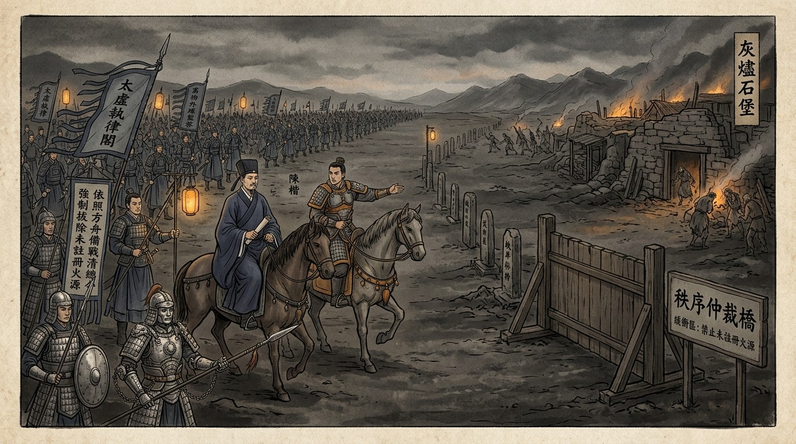
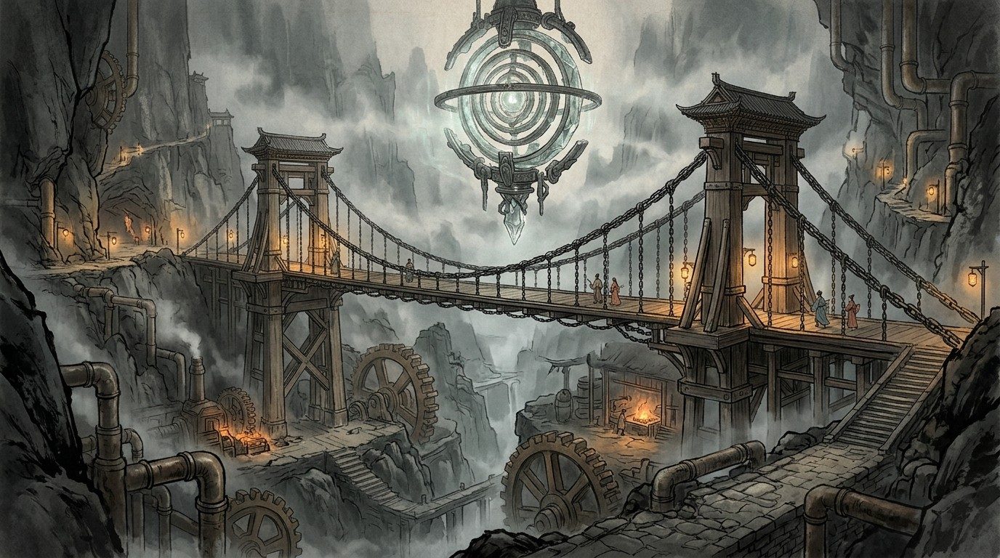

# 第 152 章：秩序仲裁橋・援引第七條！

[← 上一章](ch0151.md) ｜ [本卷目錄](00_intro.md) ｜ [下一章 →](ch0153.md)

*章首插畫：第 152 章 秩序仲裁橋・援引第七條！*

戰祖鬥獸坑被徹夜破籠劫走十名關鍵「欠帳人證」的消息，甚至沒用得上兩日，僅僅隔了一夜便帶著血腥與怒火擺上了萬物稽查署與太虛執律閣的案桌。

太虛執律閣主簿**嚴平**與萬物外環稽查主事**陳楷**這對原本彼此猜忌提防、互卡物資的官僚，此刻面對面坐在一塊，臉色都難看至極——嚴平怕「赤火」私線與九成九高純鹽晶的去向順著劫走的人證兜出底，陳楷更怕鬥獸坑假毒渣與外環十年壞帳在大校準前夕一起連根拔起！

此時距離三百年一回的全境大校準，僅餘最後整整十日！

第二日天明時分，灰燼溝壑上空首次出現了三百年來從未有過的肅殺合流陣勢：正北太虛派出的二十四名披白紗甲執法道兵，居然破天荒與萬物中樞調出的三十具高達丈餘、通體以精鍛黑銀澆鑄的巡邏重甲算偶併作一陣，踩著震天動地的整齊步伐壓臨萬物與灰燼交界的緩衝開闊地！

兩大巨構聯手拉出的重甲防線如同一道冰冷移動鐵壁，幾乎堵死了灰燼石堡向東、向北的全部出口。銀色算偶胸口鑲嵌的冰藍光陣亮起刺目微光，發出一聲聲冷酷整齊的機械警告低鳴；而在更後方那座四輪重鋼高車上，身穿萬物銀邊官袍的稽查主事陳楷手握冰冷墨玉簡板，身側站著臉色陰鷙不語的太虛主簿嚴平。

面對這片黑壓壓如海嘯般壓過來的重甲與冷光，灰燼石堡後方僅有的四百多戶男女老少——包括剛被救出、臂上還綁著滲血夾板的燕山九兄弟、左手吊在胸前卻死握短獵刃的燕隼、提著鍛造大鐵錘的林鐵生以及拄著單臂短弩的戚老頭——全都一聲不吭地背靠著背後漆黑的玄武岩崖壁結成半月人牆。沒人後退半步，儘管這群衣衫襤褸的底層遺民手裡有的只是生鏽鐵鋤、木藥杖與剛從爐口拖出來的滾燙鐵撬棍，眼神卻死硬得像要咬碎鐵甲。

高車之上，陳楷居高臨下冷冷掃過這群在自己帳冊裡只配填作「無主廢料」的人頭，嘴角噙著一絲公事公辦的傲慢，清了清嗓子展開手中墨玉簡板，聲浪借擴音銅匣壓過風聲傳遍整個溝壑：

「奉太虛執律閣與萬物稽查署聯席緊急軍令！查灰燼溝壑現存無主遊民四百餘戶，無正冊籍貫，日前更涉嫌窩藏西南逃奴、劫掠邊防重犯！為免大校準期內擾動地脈靈壓、危害主機運轉安全，現依《方舟備戰無主清零總令》第三條，即刻起強制拔除未註冊火源『灰燼石堡』！限半個時辰內全部交出戶籍外兵器藥料、自動退入高壓外緣禁區自生自滅——違令者，巡邏算偶就地按材料回收清零，格殺勿論！！」

「放你娘的狗屁！」人群前排幾名老鹽夫氣得鬚髮皆張，鐵大鬍子派來壓陣的幾名外環工匠更是咬牙舉起了重扳手，眼看一場毫無懸念、以卵擊石的血腥屠殺一觸即發——

「慢著。」

一道並不算極為洪亮、卻平靜沉穩得奇異穿透了算偶低鳴與風砂噪聲的聲音，驟然自石堡人群正前方緩緩響起。

陳楷手腕一頓，低頭望去。只見一道身穿洗得泛白卻一塵不染的深青雲津細布棉袍、左手安安靜靜夾著一把烏木包銅邊算盤的消瘦年輕身影，竟在數萬雙驚疑不定的目光注視之下，獨自一人邁步走出背後那道死死護住他的遺民人牆！他身上既沒掛刀，沒背弓，腰間也沒半枚玄鐵兵器，就這麼背脊筆直地踏著碎石，一步、一步，不緊不慢地走向萬物與太虛重甲陣之間那道無人敢越雷池半步的空闊橋頭！

那是一座三百年來從未有過任何一名「無籍底層」敢踏上半步的萬丈懸空古銀巨橋——**【萬物秩序仲裁橋】**！橋面完全由太古銀白合金鋪就，兩側並無護欄，唯有億萬道細如髮絲的古老篆紋在橋磚底下隱隱流轉，連狂暴的風砂吹至橋邊三尺內都悄然繞道，足下則是深不見底、噴吐冷汽的萬物主機地脈深淵。

嚴平一眼認出那張在暗中查了無數遍卻始終對不上凡間高門名錄的青衣面孔，臉色瞬間陰沉下來；陳楷更是又驚又怒，生怕這不知死活的小子真當著全場外環上萬名偷偷爬上高塔圍觀的苦工與鹽夫面前鬧出不可收拾的大亂子，當即變了聲色怒斥：

「何方無籍刁民膽敢闖入中立仲裁禁地？！這座長橋乃三極最高法理樞紐，豈容爾等灰土泥腿子踏足玷污！巡邏算偶，還不快給我攔下來——格殺勿論！！」

距離橋頭最近的那兩具高達丈餘、通體黑銀的重型巡邏算偶立刻應令轉向，沉重鐵足轟然踩碎地面岩石朝剛踏上橋緣第三塊銀磚的沈泥疾衝過去！沉重鉄拳帶著足以砸爛玄武岩的破空勁風剛震起半步——

「嗡——！！！」

橫懸在秩序仲裁橋正中央上空、那座由無數細密晶體與古老青銅星環盤繞而成的巨大倒懸銀鐘——**【天穹裁決核心】**，忽然毫無徵兆地自內部發出一聲清越穿透靈魂的太古鐘鳴！兩道肉眼可見的透明秩序圓環自橋心疾擴而開，重如千鈞山嶽般瞬間壓在橋頭！

那兩具正欲衝上橋面把沈泥撕碎的巡邏算偶彷彿一頭撞上看不見的萬年玄鐵壁障，鐵膝猛地一彎發出刺耳的齒輪哀鳴，竟生生被無形秩序威壓死死定死在橋頭界線之外半寸，動彈不得！

緊接著，一個冰冷、空靈、彷彿同時夾雜了男女老幼千百人回響、不帶半分人類私情與喜怒的古老裁決音，自天穹裁決核心深處緩緩滾落，震徹整片玄武岩峽谷與後方萬物外環高塔：

「依《萬物方舟初始自治規約》第壹零玖款，凡持有效初始城邦合法見證印信、要求啟動原初條約實質復議者，仲裁之域內不得以任何局部巡檢武力中途阻截。」那道冰冷聲音微一停頓，光柱精準鎖定長橋之上挺立如青松的沈泥，「來者，報上你所屬城邦序列，以及你所要援引之條款憑據。」

陳楷額頭瞬間滲出冷汗，手指抖了一下——這座死寂了不知多少甲子的中立仲裁機制，怎麼可能被一個灰燼石堡裡爬出來的泥腿子直接喚醒應答？！

風在長橋上下呼嘯而過，將沈泥那襲青布袍擺吹得獵獵作響。他就這麼孤身立在萬丈深淵之上的長橋中段，距離頭頂那座散發無盡威嚴的天穹裁決核心僅僅三步之遙。面對身後幾百名隨時準備替他拼命的鄉親，面對前方兩大巨構官僚殺人的目光，以及高牆縫隙、冷卻塔頂那上萬道正在悄悄張望此地的萬物外環二十四站工友眼神——

沈泥深吸一口帶著冷冽臭氧味的空氣，面色沉靜如湖水。他從懷裡先後雙手捧出兩件東西：一卷沉重得壓彎衣襟、以黑鐵絲鑲邊的《九城火種配額補正帳簿》正本；另一手高舉著那枚三百年來只在雲津沈家祖龕裡靜靜傳承、此刻卻散發著與橋磚一模一樣溫潤光澤的古銅憑據——**【九城古商盟總契銅版・暨萬物行商天門引】**！

而在他雙臂襯托之下壓在帳冊最上層的，還有一疊貼著鮮紅「赤火」私印的撥條原件、戰祖換防假粉血樣實錄，以及韓石與嚴平、陳楷相互轉調高純鹽晶的對帳印模！

「雲津九城商盟後裔・沈泥！」

年輕掌櫃清朗卻字字如鐵錘砸進每一名聽眾耳膜裡的朗聲響徹四方，透過仲裁橋天然的共鳴法陣傳向十里外圍：

「今日不憑私情求饒，更不與無德酷吏論刀兵！我唯按三百年前太古破界方舟起錨當夜，九城先賢與我沈家先祖**沈雲妮**於離艦前夕共立並獲萬物中樞鎖定入底層律令之**《離艦火種總約》第七條**，今日當眾正式提呈最高複議裁決——

『凡屬方舟九號補給艙原初編內之流徙工役及其直系、傍系血脈後裔，皆係保留完整凡塵百工技藝與文明備份之合法火種！於未經五方正冊實地核驗確認滅絕前，任何分極主事皆不得將其視作無主雜料予以強制清零、斷糧或抹除戶籍！凡查有私自冒領其法理應得之維護鹽晶、暗轉流向界外私門者，自提呈複議證據並啟動核查期內，一切邊陲驅逐令與武力清零執行令，皆須**強制中止十日**，並移交**大校準當夜最高平權會審**當面裁斷！』」

最後一個「斷」字剛落地，沈泥毫無半點遲疑，雙手捧起手中那卷《九城火種配額補正帳簿》連同【天門引】與沈雲妮古銅總契印信，反手重重一併拍進橋心那座封塵了整整三個世紀的青銅讀取凹槽之中！

「嗡——轟！！！」

整座凌空百丈的萬物秩序仲裁橋頓時綻放出長達十餘丈、貫穿天地雲層的純白古篆光幕！那光幕根本不給陳楷和嚴平半分遮掩篡改的餘地，直接將沈泥輸入的四百八十七戶遺民補冊編碼、九號艙被強行撕掉的後三分之一頁對照表、外加近三年嚴平、韓石與陳楷合謀從正常維修額裡暗扣調走の高純鹽晶噸兩對比圖表，一筆一劃清清楚楚地放大投射在半空中讓方圓十里人盡皆見！

「天啊……那是九號艙的原始名冊！！我爺爺的名字真的寫在上面！！」

「你們看右邊那幾排！去年咱們七號站凍死三個小匠缺的那批高純鹽晶粉，居然全被陳主事轉去了『無名虧損耗料』，轉手變成了『赤火』私單！！」

橋下緩衝坡兩側、遠處萬物外環高架冷卻塔頂層、鹽晶寮鐵柵縫裡，早已偷偷聚攏圍觀的上萬名底層苦工、殘廢老匠、鹽夫以及幾十名跟隨衡真觀測星象的太虛低階雜役，親眼看見天穹半空光幕上打出來那一筆筆染著自己親人血汗的黑帳，壓抑了數百年的怒火頓時像乾柴碰見烈火般徹底炸開！震耳欲聾的怒罵、鐵扳手砸擊鐵欄的「噹噹」抗議聲浪瞬間翻滾著衝上雲霄，連三十具重甲算偶的警戒低鳴都被死死壓了下去！

「胡說八道！一派胡言！！你……你是從哪裡偷啟的九城廢庫私密印記？！那是三百年前早就因為九號艙失聯而被主系統除籍的廢約！是偽造的！！這不算數！！」

陳楷這輩子從沒當著上萬名底層泥腿子的面如此赤裸裸地被人把遮羞布扯得乾乾淨淨，向來冷冰冰端著架子的臉孔徹底扭曲變色，竟失態破了音般指著半空光幕瘋狂嘶吼，手中墨玉簡板指關節捏得「喀喀」發白；旁邊一向城府深沉的嚴平臉色也白了一分，袖底手指死死扣緊，顯然沒料到這群被他們當做牲口般清剿的流民手裡竟藏著能喚醒仲裁橋的沈雲妮古銅原印！

然而高懸半空、冷漠運行了三個世紀的天穹裁決核心，根本沒有理會下方陳楷氣急敗壞的嚎叫。足足五息冰冷沉厚、猶如千萬枚齒輪同時咬合驗證的機械運轉聲滾過峽谷上空，純白古篆光幕猛地向內收束一緊，隨即化作四行大如山嶽、鐵畫銀鉤般烙進所有人眼底的最終法理裁決字樣——

**「九城同盟補冊實物憑據暨沈雲妮原印驗真無誤・《離艦火種總約》第七條人種火種保全條款即時激活！現裁定：太虛與萬物針對灰燼石堡之強制清零令即刻起凍結十日，延至百年大校準子夜正時，於秩序仲裁橋重啟最高實證會審！復議凍結期間，嚴禁三極任何單位以任何形式對灰燼石堡發動武力清剿與斷糧封鎖——違者將觸發仲裁橋中樞強制除權！」**

裁決金印落定那一剎那，陳楷手裡那塊象徵無上稽查威嚴的墨玉簡板「啪」地跌落高車石板，摔成兩半！嚴平則一言不發地猛拂袖擺，冷冷瞪了長橋上那襲青衣最後一眼，轉身登上星槎拂袖而去，背影卻罕見地露出了一絲狼狽的急促。

長橋之下，四百八十七戶原本已經拔刀準備血濺崖壁的灰燼遺民爆發出震動峽谷的歡呼哭喊；戚老頭獨臂舉著鐵弩仰天大笑，淚水順著滿臉老褶滾進花白鬍鬚裡。一紙沉睡了整整三百年卻從未失效的古老契約，終於被一個手無寸鐵、卻拿命去算清楚每一筆帳的年輕掌櫃，硬生生從兩大巨構已經舉起的屠刀底下——替四百多戶活人搶回了這絕處逢生的最後十日！

---

*場域圖誌：萬物主機城・凌空秩序仲裁橋*

---

[← 上一章](ch0151.md) ｜ [本卷目錄](00_intro.md) ｜ [下一章 →](ch0153.md)
