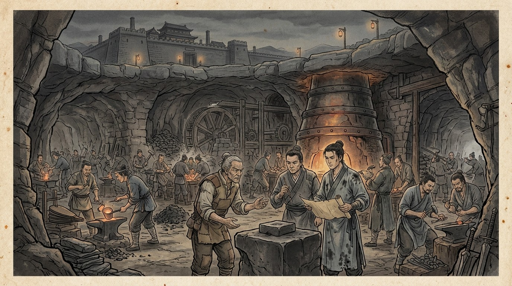
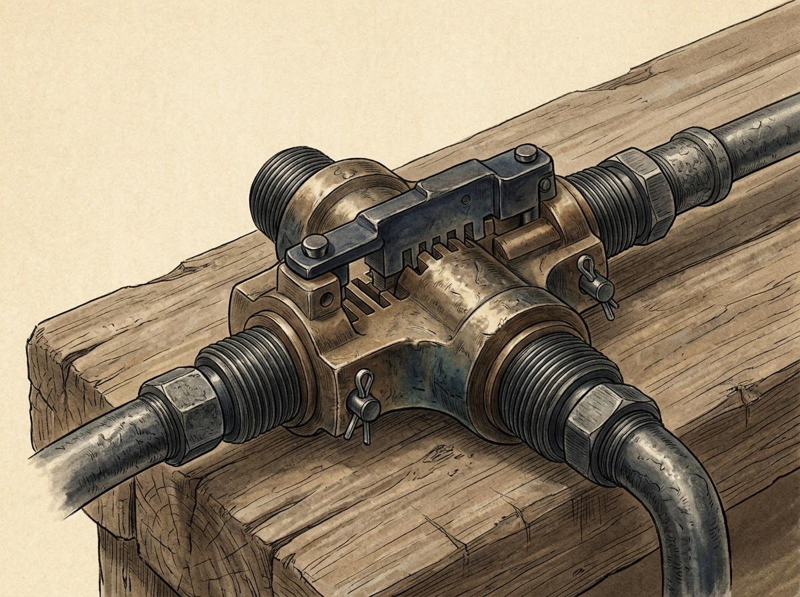

# 第 153 章：併爐總栓與戰前十日鍛備

[← 上一章](ch0152.md) ｜ [本卷目錄](00_intro.md) ｜ [下一章 →](ch0154.md)

*章首插畫：第 153 章 併爐總栓與戰前十日鍛備*

靠一紙沈家先祖印信生生從兩大巨構屠刀底下搶出這寶貴的十日停戰凍結期，灰燼石堡非但沒有半分鬆懈慶功，反倒在沈泥與戚老頭的極密統籌下，即刻於當夜子時轉入了最高級別的靜默戰備！

整座堡壘所有不關緊要的地面石窯炊煙一律按死熄火，通風井道口全數加掛三層浸過冷鹽水的厚濕苦苔簾幕——為的就是防止太虛高塔上的偵察星儀從空氣熱紋裡推算出地下正藏著什麼大動作。全堡十二名還能揮得動大錘的鐵匠、倖存老獵戶，外加齊老匠師藉著《互助密約》連夜從萬物外環秘密調進溝壑的八名高階頂尖師傅，全都擠進了石堡最深處那座兩面皆是天然實心玄武岩壁、隔熱最嚴的熔鐵深窟裡。

熊熊翻湧的紫青色高溫爐火把幽暗石壁照得發燙發紅，滾熱火浪映得**林鐵生**赤裸的古銅色上身汗珠如雨般一路滾進黑棉工褲腰帶。他肩膀與胸口還留著前幾夜修管線時被高壓蒸汽燎出的紫紅燙疤，可兩條手臂揮起鍛錘的節奏卻連半絲遲滯也沒有。

在這九天時間裡，這名黑石鋪年輕鐵匠幾乎連完整的兩刻鐘安穩覺都沒合過眼。他把齊老匠師冒死從廢料深庫裡逐批拆偷出來的六大箱上等航星耐壓合金銅，連同石堡幾十年攢下來的全部高純玄武岩結晶細粉，按七比三的精準火候比例全數投進高溫併爐；兩柄一大一小的烏沉鍛錘如同雙輪交替般反覆摺疊鍛打、退火回淬同一件從未有人在洞天敢動手去造的核心大器——**【三元高壓活榫分流總栓】**！

這枚總栓重逾八十三斤，由九枚彼此嚴絲合縫卻又能單向受壓自動微張的紫銅雙向散熱閥芯層層嵌合而成。哪怕只差一絲半毫的公差、或是焊縫裡夾進半粒氣泡，校準之夜一旦接上萬物井高壓，整具總栓就會像炸彈一樣從內部崩碎！

「校準子夜鐘聲一旦敲響，萬物中樞的三組主加壓閥會在極短時間內把平常三倍半以上的狂暴地熱高壓液流同時衝進地底總管。」林鐵生緊咬著一塊浸過淡鹽水的麻布條吸去額頭混著黑鐵灰與汗水、險些糊住眼睛的鹹流，左掌戴著厚重石棉鐵手套，右手則拿著齊老匠師壓箱底的九級測微銅規，極其小心地一分一寸校驗著總栓內壁每一個環扣的半絲分毫間隙，聲音在呼呼風箱聲裡沉冷如石：

「咱們沒有城內中樞的合法停機權，就算外環二十四站按暗號停了外圍供水與送粉，主機核心的儲備餘壓照樣會沿著地脈炸穿灰燼石堡底座！所以留給我的視窗，只有高壓衝破備用閥之前的**短短三息**——必須由我親自下潛到萬物城底最深、熱氣能把活人肺腑燙熟的**【地底導流井】**，在不切斷總壓的情況下，硬生生把萬物原本那枚焊死的『強制收割總閥』敲脫，同時把這具自製的活榫總栓帶壓擰進去咬死卡槽，順勢把這股足以掀翻整座石堡的狂暴主壓，轉引向城外東南那條已經乾涸了萬年的萬丈死礦坑！」

「鐵生兄弟，高溫高壓下連青銅都會發軟變形，老頭子當年手底下有個老師傅只是在洩漏邊緣擦過去一寸，整條胳膊當場熟透捲成黑炭！」一旁滿頭花白亂髮的萬物老師傅一邊抹汗，一邊看著林鐵生雙手那密密麻麻幾乎沒有一寸好皮的燙泡與老繭，聲音不由發緊。

「正因如此，外頭這層『雙向活榫退火銅箍』才要打足九道應力溝槽。」林鐵生沒有抬頭，又拿起一把細銼在第三道環口輕輕磨去半分毛刺，「死鎖閥靠硬抗遲早炸井，活榫借著壓力自己把內瓣撐緊鎖死——齊師傅幫我調過九級應力比了，這具總栓不吃死勁，吃的就是這股要炸井的狂暴壓差。」

而在爐火熱浪滾不到的石窟另一側陰涼矮桌上，擺著一盞罩了鐵罩防閃的微光油燈。**柳清虛**披著一件舊棉袍安靜盤膝坐在一塊墊高矮凳上，身上還殘留著那夜抗衡星鎖留下的陰冷滯氣。他左眼前方早已落定一片幾乎看不清精細刻度、隱隱發白刺痛的雪盲霧翳，握著細磨石的右手亦因神識長期超負荷透支而微微細顫不止。

可就是靠這雙微微發顫、指尖關節結出暗繭的手，柳清虛憑著心算與齒頰之間咬住的那根銅規作支點，將整整九天時間全都壓在了十二根比繡花針粗不了多少、通體以玄鐵混入高純無毒太虛鹽晶細粉鍍層的「高純導引分流銅針」之上。每磨完一根，他便要對著沈泥從太虛弄來的銅鏡背刻度反覆試偏角，哪怕有一分半毫重心誤差，便立刻折斷重鑄。因為他比誰都清楚——校準當夜殺進太虛偏殿卡槽的那一下，沒有第二次重插的機會，這十二根細針就是用來替他與衡真道人把那道毀天滅地的天羅主束生生掰歪**一度半**的唯一活扣！

同一時間，距離石堡三十里開外的西南赤黑焦土咽喉口——**【戰祖巨骨哨卡】**一線同樣叮噹聲整夜不絕。

左肋死死勒著三層浸藥寬木夾板的**燕隼**雖然被顧玄死令不許開重弓超過半數力道，卻依舊忍著呼吸間刺骨的痛楚，與剛剛癒合幾分的大伯**燕山**、九名脫困回營便主動放棄回堡安歇、執意再上火線的八荒舊斥候，外加託古從各部落馱隊偷偷抽調出來的三十名不畏強權的悍勇壯漢一併堵在峽谷最窄的咽喉門前。

幾十名漢子日夜不眠，在狂風與硫煙裡硬生生伐光了周邊兩座山坡的萬年硬化枯骨木與黑鐵礦樁，順著峽谷兩側斜坡趕建起兩道呈現「入」字反斜角度排列的巨大楔木減衝牆！每一面楔木斜牆背後，全都照著燕隼連日演算出來的「重力截息卸力」走勢，深埋進十數條浸過防乾獸油、柔韌得足以拉住狂奔巨獸的長條粗獸筋索。

「單憑我們這四十幾個瘸腿斷骨的老伙計與獵手，去硬扛校準夜受到地脈刺激瘋狂暴走的千頭三階獸潮，純屬以卵擊石。」燕山獨眼死死盯緊峽谷咽喉前方那片寬不過二十丈的必經衝殺道，手上那根漆黑發亮的獸骨長矛重重往地上楔定最後一顆深埋三尺的界樁，「可畜生沖起來是不拐彎的！只要頭陣那十幾頭鐵甲熔骨狂獸撞上這面角度精準的反斜楔木牆、順著埋在土裡的彈力獸筋滑歪半步摔進東邊那條百丈無底黑溝，後面整條獸潮在兩倍半重力慣性下收不住蹄子，就會自己把後隊擠進深淵裡去！咱們要做的，不是殺光這群畜生——是替後面的老弱守住這道關卡，讓一頭畜生也別踩進石堡一寸！」

而在石堡後方最潮濕安靜的藥棚暗穴裡，**顧玄**與醫女**蘇青竹**幾乎徹底拆空了當年自雲津萬山堂與丹鼎宗帶進洞天的最後三隻珍稀紫檀藥匣。

百餘年積攢下來的上品安神香母、解毒草根、九號艙醫藥秘錄留下的幾味絕版礦粉，此刻連一分半兩都沒留作退路，全被兩人按精確比例搗成泥、揉成餅、壓入厚實藥漿。整整三十座肚子飽滿、頂部加裝了雙層極細過濾苦鹽棉紗的大口黑陶泥「緩衝藥爐」，已被石堡青壯小夥悄悄扛上並安放在全堡周遭三十處正對風口的上風凹槽裡。只要校準夜異律晶塵與酸毒狂風一到，點燃底炭，三十道無毒卻能瞬間中和游離毒晶的清涼藥煙就會連成一道罩住全堡上千活口的厚實青霧屏障。

封好最後一號藥爐的密封泥蓋時，顧玄撐在木箱邊低頭咳了兩聲。蘇青竹正巧遞過一碗熱水，目光無意掃過他攤在膝頭休息的雙掌——那原本清瘦修長、在雲津拿金針穩如神工的醫者掌心正中央，此刻竟已被接連幾十日反覆研磨試驗三極毒晶樣本，徹底浸蝕出了兩塊深嵌進肌理裡、再也洗不乾淨的灰白色結晶硬斑。

蘇青竹手指一僵，水碗差點晃出半口。顧玄卻神色如常地合攏雙掌接過水碗一飲而盡，只淡淡一笑：「比起坑裡丟掉老命的趙老叔，還有清虛那隻快看不見東西的左眼，掌心多兩塊老繭算不得什麼——能保住明日那上千條肺葉別全結晶爛掉，這副方子就值回本錢了。」

九個晝夜，就在這叮噹不斷的打鐵聲、楔木砸地聲、研藥碾槽的「沙沙」聲與無聲的暗流急奔之中飛快磨盡。

距離那道每三百年才緩緩壓落一回、旨在把所有帳外活物連骨帶肉抹作飛灰的歷史鍘刀落下，只剩最後一個沒有太陽升起的漫長黑夜。

---

*器物圖誌：三元高壓活榫分流總栓*

---

[← 上一章](ch0152.md) ｜ [本卷目錄](00_intro.md) ｜ [下一章 →](ch0154.md)
