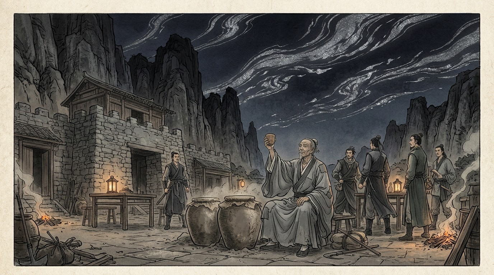

# 第 154 章：校準前夜・黑石老酒與暗銀天幕

[← 上一章](ch0153.md) ｜ [本卷目錄](00_intro.md) ｜ [下一章 →](ch0155.md)

*章首插畫：第 154 章 校準前夜・黑石老酒與暗銀天幕*

大校準前夜，戌時將半。

原本三百年間永恆停格於死鐵青色、既無星辰移位也不見晨昏交替的玄武岩峽谷天幕，今夜竟罕見地褪去那層令人壓抑的鐵灰，轉而在高空極深處泛起一層令人寒毛倒豎的暗銀死光！彷彿頭頂穹廬背後正有億萬片冷硬細碎的銀箔在無聲互相摩擦滾動，連雲層裂隙裡透出的氣壓都帶著股即將崩裂的凜冽靜電腥氣。

整個世界靜得異常詭異——連往常一刻不停刮過岩縫、敲打粗布簾幕的乾燥砂礫風聲此刻都徹底停歇了，空氣裡細小的礦塵竟受強磁牽引般半懸在離地三尺的半空中一動不動。取而代之的，是眾人靴底底下那片黑沉沉的大地，每隔整整十息便會自最深處傳來一記輕微、卻沉重得宛如太古巨獸心臟跳動的悶顫：

「咚……咚……咚……」

那是正北太虛天羅晶塔、正東萬物中樞主輪、與西南戰祖地熱裂谷這三座太古巨構，在沉睡與壓榨整整一個三百年甲子輪迴後，同時進入最後同步調頻蓄勢的恐怖徵兆。每一記震動落地，都在提醒這座洞天裡每一個角落的所有活人——清算的總時辰已經到嘴邊了。

然而就在這死氣沉沉、足可讓常人腿軟絕望的壓迫時刻，灰燼石堡守夜寨外的小空地中央，並沒有任何哭天搶地的恐慌。反倒因為地面暖爐按規矩熄火、僅在地下與岩縫透出些許冷光燭影，顯得格外沉靜安寧。

守夜老漢戚守灰喘著氣，自己親手推開兩口埋在最冷玄武岩地窖深處、不知積了多少年灰塵與蛛網的黑釉寬肚大酒甕！泥封「啪」地一聲敲碎拍開，一股久違的、醇厚辛辣卻透著五穀甘甜的酒香頓時蓋過了空氣裡刺鼻的金屬硫氣——裡面盛著的，竟然是幾十年前某批凡間前輩從雲津帶入洞天、一直小心翼翼藏在石縫裡捨不得喝上最後一口的黑石鋪陳年老濁酒！

五名自雲津一路並肩走到異界深處、此刻各自背負著全堡四百多戶身家性命的年輕同伴並未穿戴任何花哨法袍或沉重鎧甲，每個人都只換上一身最利落耐磨的緊身粗布短打，袖口與褲管緊緊紮進皮綁腿裡。而在這看似尋常的短打腰間或背後，卻各自穩穩壓著三個時辰後決定洞天千百人性命歸屬的那一件核心器物——

**沈泥**左胸貼肉處，那卷《九城火種配額補正帳簿》連同《三極互助密約》耐火羊皮、以及「赤火」私單全數緊緊裹進了特縫的雙層防潮油布貼身囊裡；腰側依舊掛著那把陪他走出黑石鋪、敲過雲津各大商號櫃檯的舊紫檀算盤。今夜他沒有兵刃護身，唯一要上陣去打的是一場不能算錯半顆珠子的孤身死戰；

**林鐵生**拍了拍斜背在後背那只特鍛黑鐵方匣——裡面靜靜躺著剛剛開刃涼透、還散發著航星銅香的八十三斤「三元高壓活榫分流總栓」。為了扛住待會地底導流井近乎要把人烤成焦炭的高溫酸汽，他小臂與雙肩正一圈一圈仔細纏緊浸透了冷鹽泥漿的厚石棉麻布，指節上原本還沒長平的燙疤在布條底下硬得像老樹皮；

**柳清虛**輕輕闔上那隻在暗銀微光下依然傳來隱隱脹痛的左眼，借著最後一點清靜調勻已經略顯淺促的呼吸。他右袖夾層裡面，十二枚親手精磨、鍍著無毒太虛鹽晶粉的高純導引銅針安靜地排作一排，緊貼著前夜衡真道人託密信使送出來的那枚接應信物玉片——哪怕左腕指節仍在微微發顫，那隻握過無數次紫銅角尺的右手卻被一條緊固皮護腕勒得穩如磐石；

**燕隼**緊了緊纏過左肋骨裂傷處的兩層藥浸寬綁帶，咬牙壓住深吸氣時肋骨縫傳來的一陣抽痛，有條不紊地檢查著手邊剛改配了含鉛重尾羽的五十支黑鐵穿甲重箭，每支箭桿都已經抹上最新調配的耐高溫防塵油脂。在他身後兩步遠，獨眼老獵頭**燕山**默默倚著那根磨亮如黑玉的長骨矛站定，一隻獨眼靜靜望著西南赤黑方向，一句多餘叮嚀也沒有，只把一壺自己喝了半輩子的濃苦草茶往姪兒水囊裡倒滿一半；

而最後方的藥架邊上，**顧玄**雙掌平穩地貼在最後一隻裝滿《三極緩衝藥泥》的密封大瓦罐旁，指縫底下兩片早已與血肉長在一處的淡灰白晶斑在暗銀天色裡微微泛涼。身旁醫女**蘇青竹**一言不發地低著頭，拿細麻布帶替這名這兩日幾乎沒閉過眼的醫修仔仔細細勒緊右腕最後一道保護繃帶，抬起頭時眼眶雖還有些許紅腫，眼神卻亮得沒有半絲懼色，只對著顧玄極輕地一點頭。

「本來按你們凡間老話的規矩，這種關頭出征，老頭子怎麼也該說幾句『祝諸位小友旗開得勝、凱旋大吉』的體面場面話。」

寂靜的玄武岩空地上，獨臂老漢**戚守灰**走上前來，枯瘦如鐵爪般的唯一左臂穩穩舉起一隻邊沿崩了兩個小缺口的粗陶大酒碗。碗裡那層渾濁透黃的陳年老酒水面輕輕晃動，正正倒映著頭頂高天那層漸漸泛白刺眼的可怖暗銀天幕。老人那雙守了這座無名破寨一輩子的渾濁老眼逐一掃過面前五個少年、燕山九兄弟、還有站在暗道口拎著扳手準備秘密摸回外環的二十四站工友代表：

「可老頭子我在這不見天日的岩石縫裡熬了一甲子，早就不信什麼畫在黃紙上的吉利話能頂半碗熱粥！今天這碗放了三十年的老酒，第一口，敬過去三百多年來死在這條縫裡頭、連塊姓名骨牌都沒能留回凡間的十七批前輩祖師，也敬前兩天為了讓咱們活著爬出來、把老命墊在西南骨門口的趙老栓！第二口——就敬明日這個時辰天亮之後，還直著脊梁站在這塊石頭地上大口喘氣的每一個活人！」

「敬前輩！敬趙老叔！敬每一個站著的活人！」

「噹！噹！噹！」

數十隻粗礪厚實的陶碗在暗銀微光底下重重碰撞在一處！沒有半分矯揉造作的惜別哽咽，陳年老濁酒潑濺進腳下乾裂了幾百年的玄武岩黑灰裡，居然發出了一聲輕微卻熾熱滾燙的「嗤」響！

眾人同時仰頭將那口辣得眼角發熱、卻一路滾燙燒進冰涼肺腑的老酒一飲而盡，隨即「啪」地一聲將空碗重重倒扣在身後石案上，沒有再多回頭看一眼這座讓他們喘過第一口氣的灰燼破堡，五路人馬、十餘隊死士在暗夜裡同時無聲起身，大步朝著早已算死座標的五個截然不同的黑暗方位決絕散開——

正東萬物外環二十四座維修站與十二鹽晶寮；
正北太虛白玉接天階偏殿與觀測院；
西南戰祖赤黑峽谷巨骨哨卡；
灰燼石堡周邊三十座上風口緩衝藥爐暨萬物深處高溫地底導流井；
以及萬物中樞萬丈高空之上那座即將決定數百戶人家百年命運的秩序仲裁長橋！

頭頂地脈深處傳來的悶雷震顫已經縮短到了每七息一次。距離這座囚禁了十七代先賢的異界孤島三百年大校準全面落槌的**子夜正中**，僅餘最後不到三個時辰！

---

[← 上一章](ch0153.md) ｜ [本卷目錄](00_intro.md) ｜ [下一章 →](ch0155.md)
