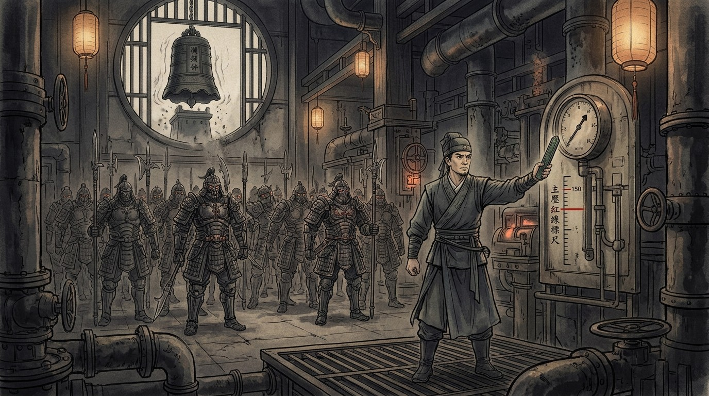

# 第 155 章：子夜鐘落・外環二十四站大停工

[← 上一章](ch0154.md) ｜ [本卷目錄](00_intro.md) ｜ [下一章 →](ch0156.md)

*章首插畫：第 155 章 子夜鐘落・外環二十四站大停工*

子夜正刻的鐘聲尚未真正敲響，萬物主機城上層那座高達百丈、終年被蒸汽白霧遮住頂端的青銅調頻巨鐘，已經先一步發出沉悶得彷彿從地心滾出來的預熱轟鳴——

「嗡……嗡……嗡……」

每一記無聲氣浪向下壓過，便震得整個外環高達數十丈的鏽鐵廢料山簌簌往下掉黑灰與碎鏽片，連頭頂密密麻麻交叉的輸送銅管都跟著發出「嘎吱、嘎吱」令人牙酸的金屬呻吟聲。空氣裡濃重的硫化鹽味與過熱潤滑油氣味幾乎凝成實質，大校準最後一道齒輪咬合已經進入無法回頭的倒數！

此刻，外環最深處、緊貼著主冷卻河道的第三維修站主閥門室裡，火把與冷焰礦燈同時照得一片慘白。萬物外環稽查主事**陳楷**換上了一身繡著白銀齒輪徽記的硬挺官服，身後緊跟著整整十六具步伐整齊劃一、胸口冰藍聚壓孔閃著寒光、手裡提著重型電擊長戟的重甲巡邏算偶大步踏入！

他甚至沒多看一眼屋裡正滿手黑油蹲在壓力表旁喘氣的那十幾名老工匠，手裡那塊剛剛換發的新墨玉簡板冷冷抬起，尖端直指牆上那支已漸漸爬向赤紅警戒線的主壓標尺，聲色俱厲地宣讀緊急指令：

「奉萬物中樞最高調度令！百年大校準已至最後半個時辰！自此刻起，外環全部二十四座基礎維修站即刻轉入一級強制無償備戰輪值——三號至十八號主冷卻總閥限兩息內滿載全開！各站倉庫內凡尚餘之緊急備用高純鹽晶柱、備用銅芯與石棉墊片，限三息之內全數無條件撥入中樞蓄能池填補壓差！若有遲疑怠工、或私藏材料不交者，不再經稽查司複審，一律照《備戰無主清零總令》以蓄意破壞方舟主機論處——就地除籍、沒收工牌、打入拆解爐！」

話音方落，不等屋內眾工匠開口半句，陳楷身後那名一向狐假虎威的年輕書吏便已趾高氣昂地踏前兩步，伸出戴著乾淨白絲手套的手指直接抓向牆上主冷卻總閥旁那枚貼著封條的緊急強啟拉環！

可他那隻潔白指尖才剛碰到微溫的拉環鐵圈外緣一寸——

「當啷——！！」

一聲震得石壁灰土簌簌落下的沉重金鐵砸地巨響，驀地在昏暗閥門室角落轟然炸開！

一直低頭縮在陰影工作檯旁擦拭扳手、身上還披著滿是油泥破洞灰工裝的**齊老匠師**，不知何時已經直起那副微駝卻硬得像生鐵打就的瘦削脊梁，直接把手中那柄重逾二十斤的大號烏鐵雙頭扳手橫摔在腳邊鐵板上！老人那隻冰冷精巧、指關節剛剛抹過潤滑黑油的機械鐵手，已經搶先一步穩穩扣死了第三維修站最核心的九宮主閘總栓。

書吏嚇得猛地縮回手退了兩步。陳楷瞳孔一緊，冷笑道：「齊老頭，前幾天在廢銀碑下頭你還能拿搶修漏管糊弄本官——今晚這等關頭，莫非你也想把這條殘命墊進去？」

「陳大人，話可不能這麼講。這外環的螺絲老頭子我擰了四十年，修過的高壓管線比你讀過的公文紙還多。」齊老匠師緩緩抬起那張佈滿黑油與皺紋的臉，渾濁老眼裡頭沒有半點前些日子裝出來的唯唯諾諾，反而亮得像剛從火爐夾出來的白熾鐵胚，「老夫這把年紀什麼大風大浪沒見過，偏就認一個死理——**沒料、沒油、沒留活命墊片的爐子，誰強開誰自己下井去扛爆缸！**」

齊老匠師說著，機械鐵指照著陳楷背後那面貼滿灰塵的鑄鐵法規銅銘牌重重一敲，字正腔圓地唸出一條早在一甲子前就被萬物高層刻意沉封進底層文檔、卻從未被仲裁核心正式廢止的古條例：

「據九城商盟與《萬物方舟初始百工護命總章》第十四條明文規定——『凡底層輸壓站點實存安全墊片與高純穩壓鹽晶庫存低於總額三成紅線、且中樞主事連續三季未補足合法維修耗材帳目者，各站當值工頭有權為了防止爆管連累整條船體地基，即刻啟動**【安全鎖閥避險停機】**！在安全庫存與欠帳核實補足之前，任何行政官不得強令違規滿載啟閥！』」

「放肆！！你一個連籍貫都找不到頁面的無籍雜役工頭，也敢拿三百年前的死紙頭在這裡跟中樞講章程？！」陳楷被當面頂得顏面無光，氣極反笑地厲聲喝令，「我看你是被那幾個灰燼石堡來的流民灌了迷魂湯！來人——算偶一隊全部壓上！給我強行打斷這老狗的鐵手，把第三站主閘門拉開！！」

十六具重甲巡邏算偶同時發出一陣低沉齊整的伺服蜂鳴，沉重鐵靴踩踏地面震得粉塵跳躍，距離最近的四具算偶雙臂電擊長戟已同時泛起刺耳藍白火花，眼看下一息便要壓向孤身站在總閥前的齊老匠師——

然而就在這千鈞一髮之際，面對撲面壓來的鐵甲殺氣，齊老匠師嘴角竟扯出一個冷冽得嚇人的笑容。

「小子們，聽鐘——**動手！！**」

老工匠枯瘦左手抄起腳邊烏鐵扳手，依著這幾天早就約好的「九宮敲管聯絡法」，照著頭頂貫穿整座外環的總排水冷卻銅管極有節律地狂敲出「咚！咚咚！咚！」三長一短四記清脆震音！與此同時，他右手那隻機械鐵手猛力向下一扯，直接拉下三號站九宮主鎖銅環，順勢把林鐵生這半個月裡冒險按九級標準公差替他們偷偷鍛好的那枚**「偏心雙向活榫卡簧」**「哢噠」一聲狠狠卡死在主軸偏心槽裡面！

那一聲金屬咬合的脆響剛落——

如同在平靜死水塘裡投進了一塊滾燙烙鐵！整個綿延十餘里、由二十四座大大小小散熱、增壓、減震與鹽粉輸送分站緊密交織成的萬物外環地底深處，幾乎在短短三息之內，同時響起了宛如山崩海嘯般連綿不斷、此起彼伏的沉悶落鎖與停機卡軸巨響——

「哢噠——轟！！！」

一號總排汽站，主閥閉鎖停軸！
五號高壓壓縮站，二十名鹽水洗槽工拉斷傳動皮帶！
七號冷卻閥站裡，一條左腿裝著鐵木義肢的老組長「鐵大鬍子」怒吼一聲，帶著身後三十名渾身黑油、雙眼赤紅的老工匠與小徒弟，齊心合力直接把兩根三指粗的淬火實心黑鐵撬棍橫插進還在緩慢預熱轉動的主飛輪大齒縫裡！「嘎吱——鏘！！！」火花四濺之間，十丈巨輪生生被硬卡死在原處！

十二號站、十九號站、二十四號站……

凡是以齊老匠師為首、以《方舟九號離艦原始名錄》找回自己太爺名諱並透過無影聯絡網結盟的數百名外環工役，此刻竟然沒有一人猶豫退縮、更沒有一人跑去向稽查司告密！二十四座維護站點分秒不差同時拉下了安全鎖死總閘！

霎時間，頭頂上原本正準備狂暴提速向萬物中樞蓄能池抽送冷卻水壓與鹽晶潤滑粉的數百條巨型主導銅管，同時發出一陣彷彿猛獸被死死掐住咽喉般的撕裂尖嘯空轉聲！緊接著，三號站牆壁上那排代表系統主壓的紫銅指針在「嗡嗡」哀鳴裡急遽暴跌，一息之間從高壓綠區一路狂掉到底部的赤紅死區！

更令陳楷徹底魂飛魄散的是——連帶著他身後那十六具原本不可一世、仰賴外環穩壓接頭在背後暗中持續補壓的重甲巡邏算偶，在主冷卻壓與地底補充流同時斷裂的第三息裡，膝蓋與腰腹銅接縫處同時「噗噗」冒出幾縷滾燙洩壓白煙！緊接著「哐當、哐當」接連十二具當場腿軟熄火，像十二堆廢鐵疙瘩般死死僵死在冰冷油膩的地磚之上，連手裡長戟上的電光都「滋啦」一聲滅了個乾淨！

原本準備衝過去搶抓齊老匠師的那一具算偶，鐵手甚至就停在老人鼻子前面不到兩尺的地方徹底鎖死不動！

「這……這怎麼可能……你們……你們這群沒有戶籍、連生計都得靠主殿施捨的死老頭瘋了嗎？！！」

陳楷不可置信地跌退兩步撞在冰冷管壁上，看著停擺熄火的半數算偶與牆面上亮起整整二十四排刺眼猩紅警示燈號的外環總控盤，聲音發尖發抖地嘶喊起來，「外環停機超過半刻鐘，這會拖垮主機前段百年大校準總進度的！！主機中樞與太虛上頭震怒下來，會把你們這幾百個賤民全部……」

「全部清零？照大人您抽屜裡鎖著的那本原定清單，橫豎今晚鐘一敲完，我們外環二十四站不也一樣全都在被當作『工效不達標無主雜料』抹掉投進拆解爐的名單裡嗎？！」

一聲沉雄如破鐘的嘲弄笑罵自門口暗影裡炸響！拄著鐵木義肢、肩膀還搭著一根兩尺長精鋼大撬棍的**鐵大鬍子**一步大步踏進閥門室。在他身後昏暗廊道裡，密密麻麻站出了上百名滿手黑油煤灰、臉上掛著燙傷舊疤卻緊攥著大號鍛錘、閥門扳手與鋼銼的底層苦工與鹽夫，一雙雙常年受盡壓榨的眼睛在紅燈照映下亮得像黑夜裡的狼群！

齊老匠師不緊不慢地撿回自己那柄烏鐵扳手扛上左肩，看著已經面無人色的陳楷淡淡補了一句：

「陳大人，想讓外環這二十四顆小螺絲釘重新鬆卡轉軸其實也不難——先依著《離艦總約》與方才仲裁橋的規矩，把這三百年來剋扣外環與灰燼石堡的那幾萬斤高純鹽晶黑帳還清，再拿正經公文重新入冊再說吧。」

---

[← 上一章](ch0154.md) ｜ [本卷目錄](00_intro.md) ｜ [下一章 →](ch0156.md)
