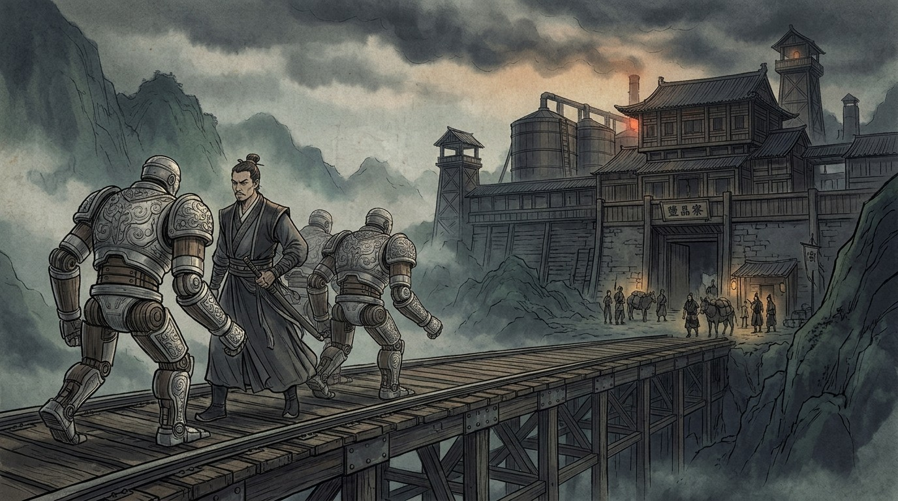

# 第 156 章：鹽晶斷供與戰祖部落拒徵

[← 上一章](ch0155.md) ｜ [本卷目錄](00_intro.md) ｜ [下一章 →](ch0157.md)

*章首插畫：第 156 章 鹽晶斷供與戰祖部落拒徵*

萬物外環停工的警示紅光剛透過通風巨管衝上中層雲霧，監察員陳楷立刻抓狂般改道，親自帶著剩餘尚能行動的四具備用銀偶沿著高架鐵道飛奔向東南方最大的補給倉——【萬物外緣鹽晶寮與黑市轉運樞紐】。

既然二十四座維修站工匠敢集體鎖閘拒調，他索性繞過工役，直接調用原本預留給西南戰祖馱隊護送進來的那批高純度應急鹽晶柱，強行塞進主機蓄能塔頂替工時！

然而等陳楷一路殺到鹽晶寮交割場時，看到的卻是一片令他渾身血液幾乎凝固的死寂畫面——

十幾座高大得像小山般的鹽晶濾槽全數熄了爐火，往日裡彎腰挑擔、連頭都不敢抬的鹽夫此刻竟全部停在空地上，沒有一個人手裡碰著鹽鏟；幾輛原本應當套好骨馬、裝滿三成加徵心核與高純鹽晶準備上橋的戰祖大車，竟橫七豎八地停在石坪邊緣，車輪全都卸下了木楔！

「託古！」陳楷眼見戰祖馱隊隊長就雙手抱胸大馬金刀地坐在最高那車鹽晶正前方，當即強壓怒火亮出一紙蓋著太虛主簿與萬物調度印的急徵符令，「大校準已至臨界，中樞急缺二十萬斤純晶穩壓！依三極備戰公約，你們西南馱隊立刻裝車拉貨上主坡！延誤軍機者按叛亂就地……」

話還沒唸完，託古忽地「呸」了一聲把嘴裡嚼著的苦草渣吐在陳楷官靴前兩寸！

這名額角烙著鋸齒黑紋的漢子大手往胸口一撕，直接把那張同時烙著託古私印、齊老匠師齒輪油印、衡真道人星墨與戚老頭灰燼印記的耐火羊皮**《三極維護工役互助密約》**拍在車轅之上，粗著大嗓門喊得整片鹽場震天響：

「少拿那張跟韓石那個狗雜種穿同一條褲子印出來的假公文壓老子！我們戰祖馱隊拿族人血汗換來的鹽晶和無毒心核，是用來救活人命的——不是填給你們主殿那幫吸血鬼私蓋觀星小台、再回頭一腳踩死我石堡救命兄弟的！」

「混帳蠻子！你以為憑一幫破車夫跟幾隻沒用的鐵匠就能讓萬物城轉不動？！」陳楷額頭青筋暴起，抬手便要指使四具銀偶強行搶車。

可他剛喝出口，四周原本沉默站著的上百名鹽晶寮鹽夫與二十多名暗中繞過封鎖趕來接應的萬物維修工役忽然齊刷刷邁前兩步——沒有人亮刀槍，有的手裡只拎著沈甸甸的粗鐵鹽鏟，有的扛著截斷車軸的精鋼撬棍，眼神冷靜如死海一般齊齊堵死了高架車道的每一個縫隙。

與此同時，後方萬物中樞主機城內部忽然傳來一連串極沉悶的金屬洩壓震響！

由於外環二十四站冷卻水壓全面鎖死、外加高純鹽晶補給與戰祖馱隊雙雙斷供，萬物中樞原本打算趁大校準一併強行調撥十倍高壓沖洗灰燼石堡外圍「冗餘區域」的調度總表，生生在最緊要的結算時刻卡死在「待補料重試」的紅色警示狀態上，徹底陷入無力單邊發動清零的癱瘓僵局！

陳楷手裡那方象徵至高稽查權柄的墨玉簡板「啪嚓」一聲掉在腳下碎成兩半，看著被群眾死死擋住的去路與背後不斷傳出低頻報警鳴響的宏偉方舟，這輩子頭一次清楚體會到——沒有底下千千萬萬雙沾滿煤灰與鹽鹼的手撐著，哪怕號稱算盡萬物的鋼鐵神城，也連一個齒輪都滾不起來。

---

[← 上一章](ch0155.md) ｜ [本卷目錄](00_intro.md) ｜ [下一章 →](ch0157.md)
