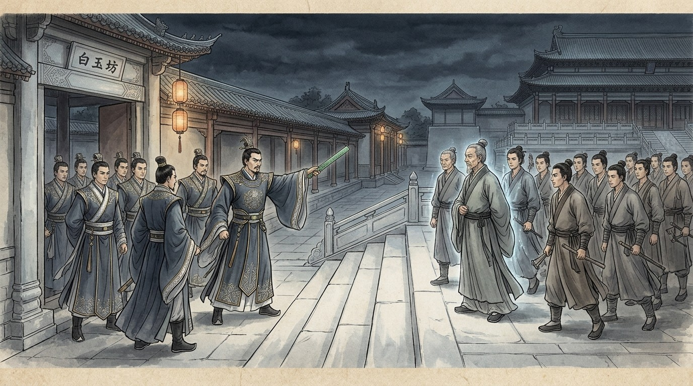

# 第 157 章：白玉階前攤偽帳・嚴平身敗名裂

*卷首插畫：第 157 章：白玉階前攤偽帳・嚴平身敗名裂*

就在萬物外環停工斷供的同一時刻，正北太虛神宮的白玉接天階上，冷冽的素白星光正照得整座白玉殿宇猶如一塊萬年寒冰。

白玉坊通往**【校準偏殿】**的長廊口，執律閣主簿**嚴平**領著八名金線白袍的高階執法弟子攔住了去路，手中玉尺直指走在最前方、身上只披著一件洗得發白的灰色觀測士舊道袍的**衡真道人**，以及跟在老道身後那十二名神色決絕的校星院外階弟子與渾身散發清冷劍意的柳清虛！

「衡真！虧你在觀測院熬了九十年資歷，今夜大校準正值緊要關頭，你不但不按主殿星軌壓陣，竟敢領著石堡外魔潛進校準偏殿！」嚴平厲聲斥道，面皮白淨卻遮不住眼底一絲慌亂，「執法弟子聽令，將這夥勾結下界私改讀數的叛徒鎖起來，即刻送入晶塔底座補換塔位！」

八名高階執法弟子正待拔劍上前，走在衡真身側的柳清虛卻不退反進，左手輕按三才短劍劍格，右手一把從懷裡高高舉起那只已被無損打開的烏銅讀數小匣與三大卷牛皮觀測實錄正本！

「誰要補塔位，先讓接天階底下這兩百名外階觀測士看清楚這幾本實錄裡寫的是誰的帳！」柳清虛聲音清朗如裂冰，穿透夜風直震整座白玉長廊，「諸位太虛同道！你們日夜在寒階苦算星軌，上頭許諾你們『功德圓滿即可拔宅飛升』——可這三百年來的真實讀數鐵片上卻清清楚楚刻著：**天羅每三百年衰減半拍，所謂『飛升』，不過是把修到法則玉化的外階修士生生鎖進高塔底座當壓陣耗材的【玉化晶核】！**」

四周正在各階亭台值守的百餘名太虛外階修士與雜役聞言頓時一片騷動！

「胡說八道！！妖言惑眾！」嚴平臉色慘白如紙，尖聲欲壓過話頭。

「是不是妖言，看看主簿大人您自己這幾十年記的『私台延壽帳』便知！」

衡真道人冷笑一聲，猛地抬袖將一疊厚厚抄錄、並且蓋有嚴平私印袋暗記與萬物「九號艙轉撥單」交叉吻合的對照副本天女散花般拋向階下眾弟子面前！每一張紙片上，都白紙黑字寫滿了嚴平借「寒風嶺損耗」名義剋扣外階鹽晶、轉賣赤火走私箱與替自己私設觀星延壽小陣續命的筆筆髒帳！

一名去年才剛因為「寒階秤輕二兩」而被嚴平強判『補替順位前挪』的年輕修士蹲下身撿起一張副本，看清上頭連自己那十斤被扣鹽晶竟被嚴平寫進私庫延壽清單時，雙眼瞬間血紅如鬼，發瘋般怒吼一聲拔出佩劍指著嚴平：

「老狗賊！！我師兄上個月就是被你借著虧空順位推進高塔不見了人影！原來根本不是什麼補陣天命——是被你拿去換了私房延壽晶粉！！」

「反了！這群賤役全反了！！」嚴平驚恐地倒退兩步，回頭想喚那八名執法弟子護駕。

然而此刻那八名原本聽命於他的執法弟子早已接過飄落在腳邊的鐵證紙頁，個個看得臉色鐵青！其中為首那名資歷最深的老執事緩緩將長劍反手歸鞘，連看都沒再多看嚴平一眼，只朝著衡真道人冷冰冰地拱了拱手：

「執律閣查無實據前，不敢妄動私刑。嚴主簿這筆涉私盜賣鹽晶與偽造塔位順位的重案——我看，還是請他自己進審律暗室跟全院師兄弟慢慢交代清楚！」

數十名憤怒已極的外階弟子頓時湧上前去，三兩下便卸下嚴平手中玉尺與紫銅私印袋，將這名囂張了數十載的執律閣主簿死死扭送進側廊看押。通往校準偏殿與天道晶塔最後一道人為封鎖，轟然洞開！
