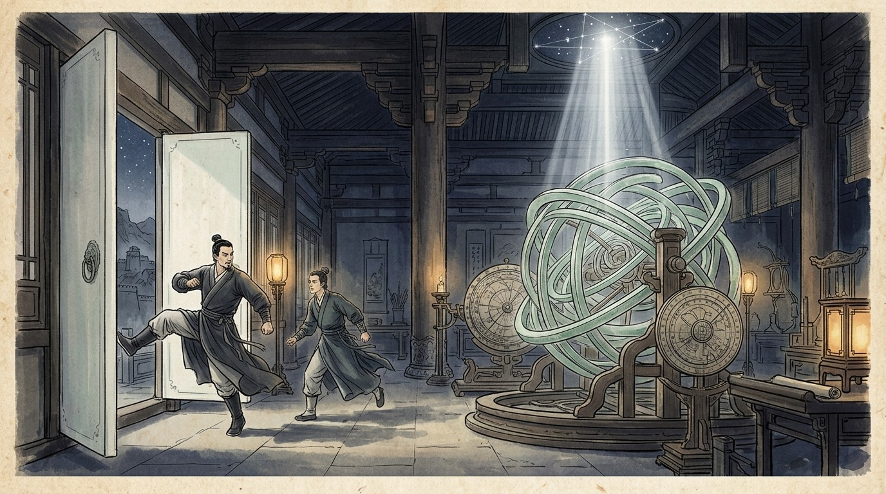

# 第 158 章：偏殿十二針與晶塔活核真相

[← 上一章](ch0157.md) ｜ [本卷目錄](00_intro.md) ｜ [下一章 →](ch0159.md)

*卷首插畫：第 158 章：偏殿十二針與晶塔活核真相*

「還剩不到十息！天羅主軸百年蓄勢已經轉無可轉——快入偏殿！」

衡真道人一腳踹開沉重潔淨的白玉大門，領著柳清虛直撲**【太虛校準偏殿】**正中央那座高達三丈、緩緩旋轉著無數透明玉環的「天羅副盤卡槽」。此刻頂端主星陣投落的素白掃描光束已經凝聚如萬丈實質銀槍，正對準正南方向那條夾在三極之間的灰燼石堡峽谷——下一息一旦正式落下「清零重掃」，整個峽谷裡的岩層連同裡頭四百多號活人都會在三息內被極致規則高溫徹底氣化結晶！

柳清虛不言不語，左手一把撕下眉骨處早已浸透血水的白布，左眼瞳孔裡那圈淡青色雪盲殘影在刺眼星光逼迫下竟陡然張開至極限！

他在凡間太清宮推演星軌十年、又在洞天玄武岩風道迎風枯坐數夜，所有對幾何切線、空間阻尼、以及「無星向量牽引」的造詣，此刻在千鈞一髮之際全部濃縮進雙手夾住的那十二枚鍍晶導引銅針之中！

「一號槽、四號槽、九號槽——不可硬截，必須依著天羅主束自轉的那半拍空隙間隙順勢滑入，讓三組偏心應力自己把光柱頂歪！」

柳清虛咬碎嘴裡一顆預先含住的清心鹽丸強定發顫右手食指，整個人彷彿化作一張拉滿卻毫無氣浪外洩的玄冰長弓——

「著！！」

十二枚細如牛毛、表面鍍有萬物穩壓冷銅的導引針化作三道清冷寒芒，「錚！錚！錚！」先後毫釐無差地同時貫入天羅副盤三個正在高速旋移的微米暗孔之中！

「嘎吱吱吱——嗡！！」

整座潔白無瑕的校準偏殿頓時劇烈震顫起來！太虛頂端垂落的那道毀滅性素白星槍在撞上副盤偏移應力的瞬間猛地迸發出耀眼萬丈藍白火花，原本筆直指鎖灰燼石堡核心石案屋的殺機光束，硬生生被迫在半空生生折彎、向西偏移了整整**一度半**！

狂暴的規則掃描光柱擦著灰燼石堡外十丈無人荒漠直劈而下，將大片玄武岩戈壁一瞬間熔化結晶成閃閃發光的萬丈玻璃長河，卻對避於偏角陰影後的四百八十七名遺民與三十座緩衝藥爐秋毫未犯！

偏殿內幾塊充作承重卡槽的白玉壁磚承受不住反震炸成碎粉。衡真道人抹了一把額角被飛石劃出的鮮血，喘著氣正要拉柳清虛撤出偏殿——卻見這名年輕太清弟子盯著偏殿盡頭一道因方才劇震而被撕裂出半丈寬豁口的白玉高牆，正一步一步極緩慢地朝後頭那個禁止任何外人踏足的禁地**【天道晶塔底部】**走去。

「清虛……不可看！看了會碎道心的！」衡真嗓音沙啞地低喊了一聲卻終究沒敢出手硬攔。

柳清虛走進裂縫深處。眼前沒有萬道霞光，更沒有什麼仙官瑞獸。

直插天穹的巨大水晶高塔最核心底座裡，靜靜懸浮著七具呈半跪祈禱姿態、血肉早已與冰冷水晶脈絡長成一體的蒼老枯骨！最邊緣那具尚還隱約保留著半張人類道袍衣角的身軀，衣襟角落竟然用早就在凡間失傳五百年的雲津太清宮老銀線繡著三個字——那是昔年載於雲頂祖師殿牌位最上頭、號稱「早已破界白日飛升成仙」的第一代老太清祖師道號！

這具歷代雲頂弟子磕了八百年響頭的「飛升祖師」，非但沒長生逍遙，反而和其餘大能一塊被這座破漏洞天當作穩定陣基的活體壓陣石樁，在這暗無天日的晶塔深處生生釘死了數百年、每一日都在被星盤抽吸殘餘生命氣機！

「原來如此……原來這便是祖師飛升的真相……」

柳清虛立在晶壁裂縫前默然良久，並沒有如衡真擔心的那般失控崩潰，反而在左眼極限承壓撕痛後的死寂黑暗裡，一字一句將高塔底座內真實的衰退殘頻紋路死死刻進腦海，隨即緩緩轉過身走回偏殿。

自此一夜之後，柳清虛左眼瞳孔裡那片淡青雪盲翳痕再也無法消散，在強光下視物永遠帶著半分錯位重影，右手食指與無名指亦落下微不可察卻終身伴隨的輕微震顫；但那顆曾被師門虛妄「飛升神話」束縛半生的道心，卻從這一夜徹底破碎重生，化作一把再無任何仙神幻夢能夠動搖的冷徹劍鋒。

---

[← 上一章](ch0157.md) ｜ [本卷目錄](00_intro.md) ｜ [下一章 →](ch0159.md)
