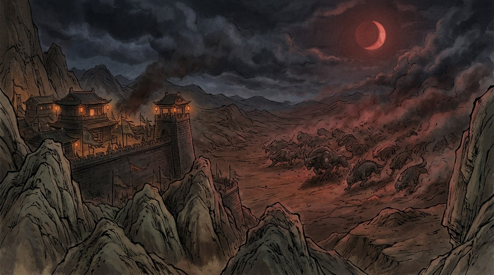
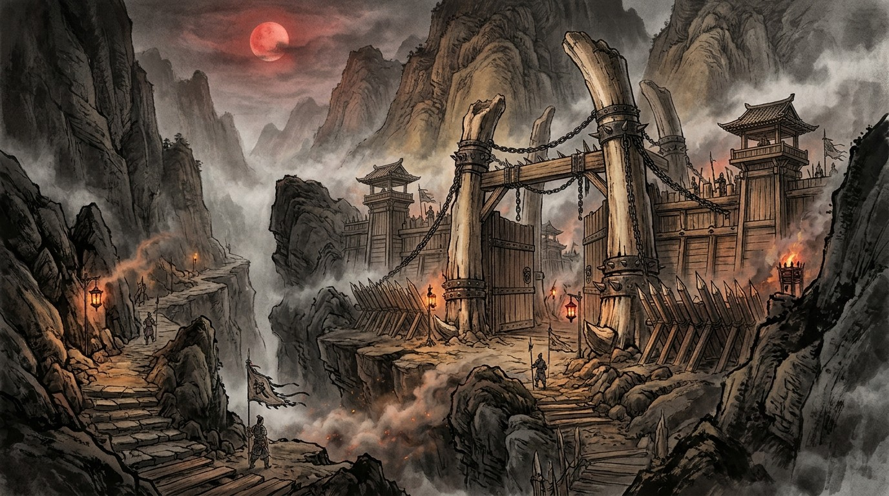

# 第 159 章：戰祖巨骨哨卡與狂潮壓境

[← 上一章](ch0158.md) ｜ [本卷目錄](00_intro.md) ｜ [下一章 →](ch0160.md)

*章首插畫：第 159 章 戰祖巨骨哨卡與狂潮壓境*

同一子夜，就在正北白玉接天階偏殿鐘聲劇震、萬物高壓井底悶雷翻滾的同時，西南方向那片終年冒著焦糊硫氣的赤黑焦土與**【戰祖巨骨哨卡】**上空，早已完全籠罩在一片濃重如血漿、伸手幾乎不見五指的暗紅色翻騰塵雲之中。

這場百年一遇的危機，來得比任何人預想得還要凶暴狂野——太虛星陣在極高處蓄勢引發的強烈大氣靜壓震蕩，外加萬物主機因外環二十四站全面斷水停機導致地脈深處湧動連環熱流擠壓，如同在滾燙地底猛然砸下一枚萬鈞重錘，徹底驚醒並逼瘋了戰祖荒原最深處原本正值冬眠潛伏、數以百計的龐大嗜血獸群！

原本還算安穩的大地，此刻猶如被千名戰鼓手同時捶打一般，發出令人五臟六腑跟著發悶翻湧的連續狂震。石礫在玄武岩坡地上跳起半寸高又落下，連哨卡巨型骨柱上懸著的幾盞防風皮燈都在狂風與地顫裡撲閃明滅。

借著高空暗銀雲層透下來的幾絲赤紅妖異光線往西南荒原遠眺，任何見過凡間千軍萬馬衝鋒的老兵都會瞬間頭皮發麻——只見兩里開外的焦土坡道之上，黑壓壓一大片足有百餘頭雙眼赤紅發狂、鼻孔噴吐熾白熱氣的成年三階熔骨獸，夾雜著十數條全身覆蓋黑鐵鱗甲的裂谷地龍，正沿著這條唯一貫穿兩側絕壁、直撲後方灰燼石堡的咽喉峽谷狂奔踏踩而來！獸群捲起的赤紅沙塵足足遮蔽了半片天幕，連地面都被震得隱隱撕裂！

一旦這條勢不可擋的狂暴獸潮撞穿眼前這道咽喉要衝巨骨哨卡——那麼哪怕顧玄那三十座藥爐撐得過有毒晶塵氣霧、柳清虛與衡真道人成功把太虛毀滅星束撬偏一度半，後方躲在無高牆石窯裡、手裡只有藥杖跟鹽鋤的四百八十七戶石堡婦孺與傷殘老鹽夫，也將在短短三息之內被千斤巨獸活生生踩踏成漫地血肉泥漿！

「大夥兒把綁腿跟護腰全部再緊一扣！手底下的插銷先別鬆手！」

哨卡最窄處僅容六人並排立身的兩側十丈巨型遠古獸骨立柱上方，**燕隼**一襲耐髒黑布勁裝緊緊伏在最高一根弧形橫樑凹槽內，左肋底下依然死死勒著三層滲透藥膏的厚木夾板，每一次深吸氣都在肋縫扯開火辣痛感；可少年那雙比夜晚孤狼還要冷靜銳利的眸子卻半點沒眨，左腳死死勾住骨樑凹痕穩住重心，左手背後那張千錘百煉的黑鐵重弓已被緩緩扣住第一道弦槽。

而在下方不足十丈寬、斜坡朝外微微傾斜的堅實防禦陣地上，獨眼老獵頭**燕山**一把抹去被硫砂燻出來的眼角熱汗，身旁緊挨著傷腿剛打好夾板便執意咬牙上陣撐腰的馱隊隊長**託古**。這兩位身經百戰的老漢身後，緊緊跟著九名剛從鬥獸坑生還的八荒舊斥候、二十多名不肯屈服韓石壓榨的戰祖馱隊硬漢、以及十來位石堡最硬朗的老獵手，總共不過四十來號血肉之軀——人人雙手死死攥著沉重長骨矛、粗木防滑槓以及牽連地底楔木牆的最後一道精鐵暗銷繩索！

「這頭波衝過來的畜生怕是有三十多頭三階鐵甲熔骨獸打頭陣，後面還借著大校準這波兩倍半重力加速壓陣！光是靠體重衝進來，砸都能把咱們這幾十個老骨頭砸進地裡頭！」燕山那隻僅餘的右眼精光暴射，舉起左手磨亮的黑玉骨矛重重往地上楔石狠狠一點，沙啞聲浪硬生生壓過了遠處漸近的悶雷轟響：

「全都給老子聽清楚了！記住這幾天燕小子在岩坡上教給咱們的『借重卸力』新打法！今天不是在雲津平原擺陣對砍，誰也不許拿天靈蓋去跟這幫三千斤重的畜生硬頂角力——放牠們衝進百步，盯緊老子的骨矛尖跟託古的哨響，**放到最後十步再同時掀牆引斜道！！**」

「明白！！！」四十多名漢子齊聲爆喝，喉嚨裡全是硫磺混著血腥的剛硬熱氣。

「轟隆隆隆隆——！！！」

不過短短十幾息功夫，震耳欲聾、彷彿要把人耳膜生生撕破的骨蹄踐踏聲已經狂暴殺至峽谷口！

打頭陣的三頭體型猶如小型移動鐵屋般龐大、肩胛骨縫還淌著滾燙熾白岩漿液的三階熔骨巨獸，率先發出一聲撕裂夜空的嗜血狂吼，四蹄狂蹬著直接撞進了巨骨哨卡前方百步死線！兩倍半洞天重力加持在這幾千斤狂獸高速衝鋒之下，簡直化成了無可匹敵的攻城撞鎚——巨蹄每一次落地，竟直接在堅硬焦土岩板上犁出半尺深、冒著青煙的焦黑壕溝！迎面捲起的灼熱狂風颳得陣地上的火把瞬間全滅，連握著長矛的幾名年輕馱夫都覺站立不穩，虎口被風壓震得發麻！

八十步！五十步！三十步！

底下幾名八荒舊斥候手指死死扣在釋放斜木牆的拉環銅銷上，骨節捏得慘白幾乎要滲出血來；托古額角黑紋全數充血暴起，全身肌肉繃緊如鋼，卻死死忍著沒有提前扯響哨子！

就在那頭最兇猛、身軀最沉重的領頭熔骨巨獸距離第一道預埋楔木斜牆僅剩最後二十步、前蹄已經猛地高高揚起準備一頭撞碎眼前所有障礙的生死剎那——

高懸三丈橫樑頂端的**燕隼**，雙眸頓時冷徹如北荒萬載不融玄冰！

少年忍住左肋斷骨被弓弦拉動震起的鑽心痛楚，左腳狠狠勾死骨樑借取大地垂落重壓，將全身所餘氣機一口氣全部沉壓進丹田與雙臂弓架——不拼遠射連珠，只取過去十日在重力裂谷無數次推演才終於徹底鎖死的那一線無聲極限法門：

**「截息——雙矢破膝！！」**

「嘣——！！！」

沉重得猶如高空驚雷貼地炸開的黑鐵重弓弦響，在千頭狂獸踐踏的轟鳴縫隙裡竟然奇異地穿透了整個戰場！

那兩支加裝了萬物外環高密度合金重鏃的破甲黑箭，根本沒有去徒勞無功地射擊熔骨獸覆蓋三寸厚骨甲與岩漿硬殼的頭顱與胸口心核——而是在燕隼對洞天「兩倍半重力交替半拍」近乎鬼神般的精準判斷下，趁著那頭高大巨獸前蹄離地凌空換步、全身千斤重量恰好處於無處著力的萬分之一息極限失衡點時，雙箭一前一後幾乎貼作一線暴射而出！

「噗哧！哢嚓——！」

第一支重鏃黑箭擦著巨獸離地飛起的厚甲縫隙，毫釐不差地精準沒入並徹底釘穿領頭巨獸右側支撐前腿的關節深處韌帶！緊接著不到半眨眼功夫，第二支借著前箭震破表皮空隙飛至的重箭，順著重力下墜弧度狠狠斬斷了它左後蹄緊繃的護骨大筋膜！

高速奔騰如炮彈的龐然巨獸驟然失去兩側對角支撐，連半點緩衝餘地也沒有！那數千斤無處宣洩的狂暴慣性與洞天兩倍半重壓瞬間失去平衡，頓時拉扯著這頭不可一世的三階獸王發出淒厲長嚎，龐大如屋的身軀竟不可遏止地朝右前方斜斜劇烈傾倒翻滾過去！

「就是此刻——起槓！！！」下方陣地裡，燕山與託古兩聲暴喝同時震破雲霄！

早已經憋足一口死氣的二十名精壯戰祖馱夫與八荒斥候齊吼一聲，同時猛力拉開埋在地下的精鐵暗鎖活扣！「哢噠——嘎吱！！！」第一道原本完全緊貼大地、表面抹滿了三層滑溜熔骨獸脂與黑油的厚實包鐵硬木楔木牆，藉著地底埋設的強韌彈力巨獸筋索反彈之力，瞬間「呼」地向上彈起四十五度斜角！

迎面不偏不倚，正正好從側下方兜住了那頭因為斷腿正失控側傾、帶著千斤衝勢狂摔過來的領頭巨獸王！

宛如一記在鋼鐵與血肉之間打出的萬鈞四兩撥千斤太極卸力巨盤——那座厚實楔木牆背後深埋的三排反斜木樁與獸筋索在巨獸撞上瞬間「嗡」地拉直卸力，居然沒有被當場撞成碎末！反倒是那頭三階狂獸順著斜木牆表面那一層滑得幾乎站不住腳的滾燙熔骨獸油，連滾帶翻地失控斜滑出主道，「轟隆」一聲沿著預先開鑿出的引導碎石坡，嚎叫著凌空翻摔進了峽谷東側那條深達百丈、早已徹底清空的乾涸死礦溝深淵之中！

然而事情還遠沒有完——頭獸栽倒轉向的這半息，緊追在它身後不到兩步遠、已經徹底紅了雙眼進入瘋狂加速狀態的另外三十多頭鐵甲熔骨獸與地龍，在洞天兩倍半沉重慣性下根本連半步都剎不住蹄子！

第二頭狂獸一頭撞上剛被頭獸擦歪過去的厚重滑油楔木牆、又被背後被牽動瞬間彈起來的第二排柔韌獸筋絆索狠狠絆住前腿，同樣發出悲鳴斜翻進東側死溝！第三頭、第四頭……緊接著是後面猶如雪崩般滾滾壓來的整條獸潮洪流，一頭接著一頭互相踐踏衝撞在這條被硬生生掰歪了半寸的斜木卸力通道上！

整條足以踏平小型宗門的百獸狂潮洪流，竟就這麼被燕隼兩支截息破膝重箭與四十名漢子合力掀起的幾面斜坡滑油木牆，在僅餘二十步的峽谷死口硬生生改彎了傾瀉軌道——如同決了堤卻被猛地拐開一道洩洪槽的泥石流一般，鋪天蓋地發出無數聲淒厲震天的嘶吼，密密麻麻轟然倒灌翻摔進了無人且絕無出路的東側百丈死礦黑谷之中！

濃稠刺鼻的塵煙翻湧沖天。高懸橫樑上的燕隼甚至沒敢鬆開已經磨出血泡的弓指——因為透過濃霧與慘叫聲，西南峽谷深處依然傳來更加沉重、更加狂亂的第二波奔騰地顫聲。

真正的血戰守關，才剛剛打掉第一層浪頭！

---

*場域圖誌：戰祖裂谷・玄鐵巨骨哨卡*

---

[← 上一章](ch0158.md) ｜ [本卷目錄](00_intro.md) ｜ [下一章 →](ch0160.md)
