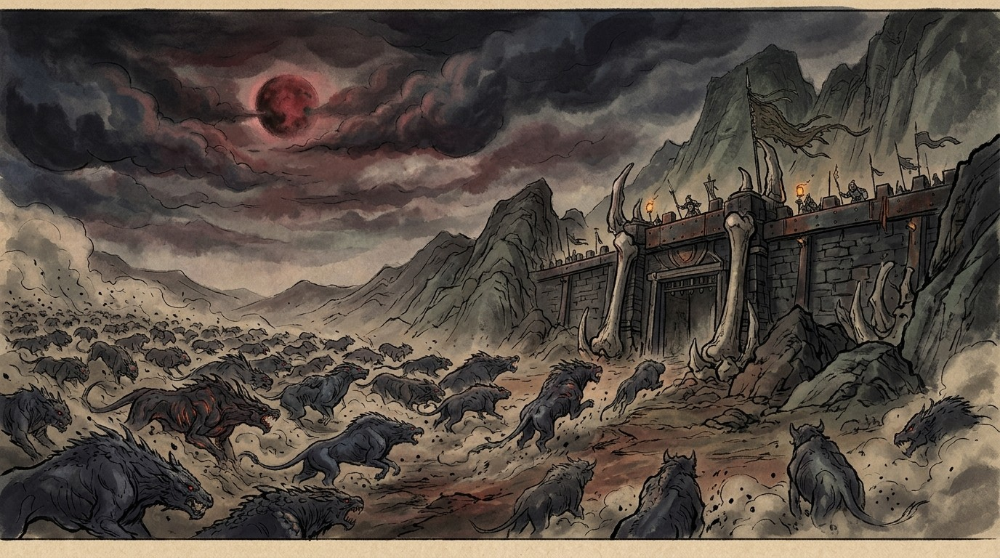

# 第 160 章：三十座緩衝爐與藥煙護民

[← 上一章](ch0159.md) ｜ [本卷目錄](00_intro.md) ｜ [下一章 →](ch0161.md)

*章首插畫：第 160 章 三十座緩衝爐與藥煙護民*

太虛那道素白掃描星束在柳清虛十二枚導引銅針的偏折下擦著灰燼石堡外十丈墜落，將大片玄武岩戈壁一瞬間燒熔成閃閃發光的萬丈玻璃長河！

刺目藍白強光尚未消散，劇烈氣壓反衝捲起的狂暴熱浪便已經夾帶著無數肉眼難辨、卻足以在半刻鐘內把活人肺腑晶化的高密度「排異碎晶塵」，如同暗銀色暴風雪般朝著沒有高牆防護的灰燼石堡壓了過來！

「全堡閉門！老弱全部退入深窯！所有風口凹槽——點爐！！」

站在石堡最高處風蝕岩台上的**顧玄**迎著幾乎將人掀翻的熱風嘶聲大喊。話音未落，他已率先抄起一根裹滿松脂的火把，順手掀開離醫棚最近的一號陶泥大爐鐵蓋，將預先備好的耐燃礦灰與一整包在黑石鋪、金石城和三極荒原一路積攢下來的珍稀藥母狠狠倒進滾燙炭火裡！

「轟——」

沒有嗆鼻黑煙，反倒是一股沉厚濕潤、帶著濃烈苦苔清香與微涼礦粉氣息的淡青色藥煙順著爐壁雙層棉紗濾網滾滾湧出！

「青竹！東線六座風口交給你和阿四！戚老丈，帶能動彈的老哥幾個按住西邊十座爐的風門拉桿，千萬別讓橫風把煙幕吹斷！」顧玄扯下布巾咬在齒間，逆著狂撲而來的滾燙晶塵一路狂奔在三十座依山壁風道錯落排開的陶泥緩衝爐之間。

這是他與蘇青竹拿這幾個月試錯百回、甚至連帶着從凡間帶來的《三元本草》最後幾兩壓箱底藥母全部拆光才拼湊出來的最後防線。每一座爐底都混著苦苔泥、萬物廢槽中和灰與戰祖獸髓炭；只要藥煙濃度能穩穩壓住三成以上，迎面撲來的尖銳異律晶塵就會在接觸人鼻口之前先一步在潮濕藥霧裡凝結沉降成無害的灰白細砂！

「七號爐炭壓太低了！煙上不去！」醫棚東側傳來蘇青竹帶著哭腔的急喊——一陣裹挾著戈壁碎玻璃渣的橫風剛巧掃過東面埡口，竟把七號與八號兩座緩衝爐的泥蓋生生掀飛，裡頭半燃的藥餅帶著火星翻滾出來，刺骨的銀白晶霧眼看就要從這兩丈寬的缺口倒灌進躲著八十多名婦孺與傷員的二號深窯！

顧玄距離那兩座爐口足有七八丈遠，眼見來不及找鐵鉗，竟連半息猶豫也沒有，直接抓起藥箱裡最後兩塊浸過冷苔漿的厚藥布往掌心一裹，迎著滾燙火星撲過去徒手抱起翻倒的紅熱藥餅狠狠塞回爐膛，再用自己雙手死死按住滾燙扭曲的鐵蓋扣環！

「滋啦——！」

透著高溫晶塵的鐵蓋瞬間燒穿了雙層冷苔藥布，滾熱的金屬與混雜在火星裡的劇烈排異微晶順著掌紋狠狠燙進顧玄的皮肉深處！鑽心劇痛直衝天靈蓋，他額角青筋暴突、喉間湧上一口腥甜，雙手卻硬像兩把鐵鉗般半寸也沒鬆開，直到蘇青竹哭著衝上來用兩根粗鐵插銷把爐蓋重新死死楔進岩槽裡！

「顧大夫……你的手！！」蘇青竹看著顧玄攤開的雙掌，聲音頓時哽咽。

只見少年那雙原本用來拿銀針、分毫差錯都不容的修長手掌，此刻掌心皮肉焦紅起泡，更可怖的是數百粒未能完全中和的極細晶塵已然隨高溫烙進了真皮層下，形成一片片洗不掉、刮不去的灰白微晶硬斑。

「別管手，看風口——霧合攏了！」顧玄咬牙用冷水盆胡亂浸了浸冒煙的雙手，抬起頭望向整個灰燼石堡低窪處。

三十座緩衝藥爐的淡青濃霧終於徹底連成一片厚實穩定的半圓穹幕，將整座石堡四百八十七名遺民與傷員嚴嚴實實裹在裡頭；鋪天蓋地的銀白晶塵撞上淡青霧牆，發出一連串細密如春蠶食葉般的「沙沙」聲，隨即乖乖失去活性、化作細灰簌簌落進岩溝，再沒能傷及窯洞裡任何一條人命！

可藥箱裡最後那點從黑石鋪、金石府與雲津一路護持過來的珍稀藥母，也在這一夜的烈火裡徹底燒成了灰燼。

---

[← 上一章](ch0159.md) ｜ [本卷目錄](00_intro.md) ｜ [下一章 →](ch0161.md)
