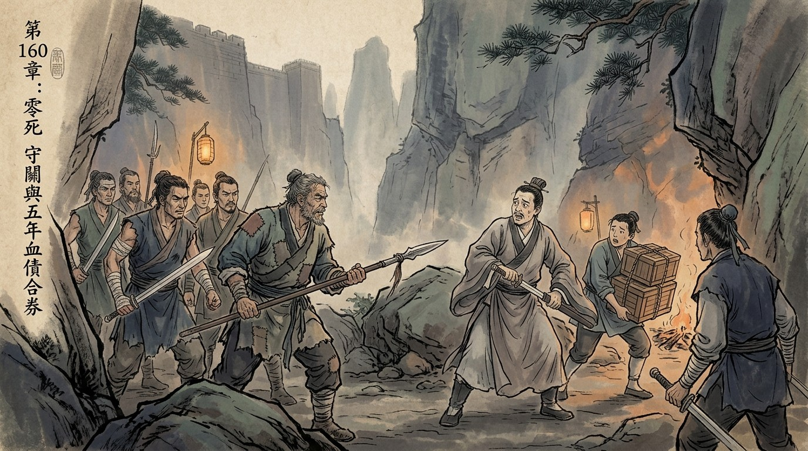

# 第 161 章：零死亡守關與五年血債合券

[← 上一章](ch0160.md) ｜ [本卷目錄](00_intro.md) ｜ [下一章 →](ch0162.md)

*章首插畫：第 161 章 零死亡守關與五年血債合券*

第一波數十頭狂暴熔骨獸順著滑油斜牆被硬生生撥偏、哀嚎著全數摔進東側百丈死礦溝的同一時刻，巨骨哨卡後方通往西側荒坡的亂石影跡裡，卻忽然悄無聲息竄出了幾道拎著包鐵木箱、急著朝無人鹽道方向鑽逃的鬼祟身影——

為首一人身材矮胖、此刻卻嚇得連官帽都跑丟了，手裡死死抱著一隻貼著赤色火漆的鐵皮密匣，身旁僅跟著四名臉色蒼白的親信私兵。這人不是別人，正是見事不妙、既壓不住外營馱隊又眼看校準大勢已去，便想趁著獸潮混亂偷走軍需暗倉裡最後兩箱高純度赤炎心核粉連夜潛逃西境的戰祖管事——**韓石**！

然而韓石才剛繞過一道半塌的黑色玄武岩岔口，前頭黑影裡忽然齊刷刷亮起十幾支綁著浸油破布的松脂火把，瞬間將狹窄亂石溝照得雪亮！

正前方一塊磨盤大黑石上，左腿打著硬木夾板卻仍如鐵塔般坐鎮山口的**託古**咧嘴冷笑，身後整整齊齊立著那九名才剛從鬥獸坑鐵籠裡搶救出來的八荒舊斥候與兩隊護道戰祖馱手。每一張飽經風霜的臉上都沒半點多餘廢話，唯有一雙雙像在黑冰斷谷裡盯住仇敵喉嚨般的死冷眼睛。

「託……託古？！你這條腿都快斷的叛奴，竟然敢私自調隊封鎖西行退路？！」韓石嚇得兩條腿肚猛地一軟，差點把懷裡那只鐵皮匣摔進灰裡，隨即拔出腰間飾金佩刀色厲內荏地尖叫起來，「你瘋了嗎？！攔截本監軍官差視同叛營，信不信明日大典一過，你整個託古部落的糧食與無毒鹽水配額全部……」

「全部停發？還是像前年冬天那樣，給我們發幾袋摻了重汞毒渣的假鹽晶粉？！」

託古沒等韓石再多吐半句官話，大嘴裡「呸」地吐出帶血絲的唾沫，單腿用力撐地借著洞天重力往前猛撲一步，手裡那柄重逾三十斤的粗鐵鍛錘如烏雲壓頂般轟然砸落！「噹——！」一聲震耳脆響，韓石手裡那柄金鞘佩刀瞬間被砸彎飛出三丈外，連著虎口崩裂鮮血直冒！

不等韓石另外四名私兵舉矛反抗，九名滿腔血恨的八荒舊斥候早已經如餓狼撲食般欺身而上，三兩下便把四名私兵連兵器帶臂膀壓跪在焦土上。託古大手一伸像拎一隻偷吃臘肉的肥碩旱獺般一把揪住韓石後頸，單臂輕鬆把這矮胖監軍拎離地面半尺，再「咚」地重重摔進碎石堆裡砸得他兩眼翻白：

「老子的族人光去年一年，就被你用摻毒假鹽粉坑得渾身潰爛流膿活活死了七個弟兄！前兩天還把燕山老哥和這九位從黑冰斷谷熬下來的漢子鎖進鬥獸坑喂畜生！這會兒火燒屁股想挾貨跑路？哪有這麼便宜的帳！」

託古踩住韓石慘叫的胸口，大手朝後頭一揮：「九兄弟！拿浸過鹽水的雙股牛筋索把這隻吸血臭蟲給老子像捆肥豬一樣捆死上木樁！等天一亮哨卡這邊站穩了腳，直接連人帶那兩箱心核粉一併押上萬物仲裁橋——當著全洞天三極活口的面，替咱們九支馱隊跟鬥獸坑裡被他折磨死的兄弟對帳！！」

就在託古押著這條戰祖大魚回撤接應哨卡的同時，戰祖巨骨哨卡最前方那道不足十丈寬的咽喉骨門，正迎來整個子夜最慘烈、也最令人窒息的生死煎熬！

地底岩漿與太虛餘震引起的躁動並未隨第一波獸潮翻下死溝而平息。短短一炷香不到，伴隨著遠處大地更加沉悶狂暴的連續轟鳴，第二波規模更大、夾雜著七八頭背生尖刺黑甲、連骨縫裡都在滲出高熱熔漿的壯年裂谷地龍與狂暴熔骨獸群再次狂吼壓境！緊接著半刻之後，第三波受驚發狂的殘暴獸群更借著先前屍體與碎木墊平的半截坑緣，發瘋似地沿著裂縫死命往上衝撞！

在這整整半個時辰的血火死守搏殺裡，沒有半點凡間奇蹟光環從天而降，更沒有那種一劍橫掃百丈、瀟灑無傷退敵的戲文橋段——

有的，只是高懸橫樑凹槽上的**燕隼**將一雙磨破流血、早就結不出新繭的拉弦手指一遍遍咬牙重新套上弓弦！

每一記「截息破膝」的發勁，都在兩倍半恐怖重力與箭桿反震之下一次次狠狠撕扯著這名少年先前被骨鎚砸裂的左肋骨與早就超限崩裂的右臂筋膜！冷汗混著鼻血一滴滴落進下方滾燙石土，燕隼甚至記不清自己射斷了第幾根備用弓弦、換過幾壺箭筒——他唯獨死死咬碎舌尖維持雙眸最後一絲清明，在每次獸群蹄印凌空換步的萬分之一息節拍裡精準放箭，哪怕打歪一頭狂獸的前蹄步頻，就能替下方陣地省下兩條性命！

下方十步斜牆後方，同樣已是修羅場般的死扛——

「頂住！！右邊那根楔木頂樁滑脫兩分了！鐵木楔給我遞過來！！」

獨眼老獵頭**燕山**渾身濺滿發黑滾燙的獸血與煤灰，僅餘的右眼死死盯緊面前幾乎被瘋狂獸潮頂得吱嘎變形的第二道卸力斜木牆！他左手死攥一根已經被撞出裂紋的長骨矛死命頂住一頭卡在牆縫裡掙扎的鐵鱗地龍咽喉，右手順勢抓起最後一根包鐵備用楔木，跟身旁兩名同樣滿臉血污的戰祖漢子一齊用肩膀與血肉之軀死死抗住快要彈開的卡榫！

三十多名來自戰祖各部馱隊與灰燼石堡的底層漢子，在整整半個時辰裡沒有人退後半步——前面漢子手臂震脫臼了，後排弟兄立刻補上位置輪換卡榫；楔木牆的滑油被獸群磨乾了，兩名石堡少年竟然敢冒著被巨蹄踢碎腦袋的危險，貼著牆根往斜板潑灑最後兩桶融化冷卻膏！每個人都在用最笨拙、最踏實、卻也最要命的血肉配合死死扳住這半寸卸力防線！

直到天邊那層詭異壓抑的暗銀光芒終於慢慢褪散，一線久違卻微弱的黎明灰白光影艱難地透出西南黑雲縫隙之時——

最後一頭右膝中了燕隼一記絕殺重箭、徹底失去力道的成年鐵鱗地龍發出一聲不甘嘶吼，龐大沉重的身軀順著被血液與油脂浸得透滑的楔木斜牆猛地滑轉半圈，「轟隆隆」一路翻滾跌落進東側那條早就填滿獸屍的百丈死礦黑溝之中！

整條西南赤黑峽谷驟然沉靜下來。耳邊除了呼呼刮過巨骨門縫的乾燥冷風，以及死溝底層幾百丈深處傳來幾聲微弱垂死獸鳴之外，再沒有半頭狂獸能夠衝上哨卡後方半步！

戰後清點這條百步防線：兩道厚達一尺的硬木卸力牆已經斷裂大半，巨型遠古獸骨立柱表面裂出了數條怵目驚心的深痕，地面更是鋪了一層半尺厚的焦黑碎肉與折斷鐵箭頭；然而三十幾名並肩死守這道生門整夜的戰士之中，除了燕隼左肋再度滲血、右臂筋膜徹底崩裂無力抬起，以及五名漢子手臂骨裂砸傷之外——竟然無一人戰死當場，硬生生在這座吃人的戰祖荒原三百年防禦史上，寫下了絕無僅有的**「零死亡守關退狂潮」**戰績！

哨卡後方殘破的玄武岩柱旁，已經連弓弦都拉不開半寸的**燕隼**拄著那柄邊緣微微發熱變形、弓背也多出兩道細紋的黑鐵弓滑坐下來，大口大口喘著帶著濃重硫磺味的粗氣。

一雙沾滿乾涸黑血卻無比穩健的粗糙老手走了過來。**燕山**蹲下身，一聲不吭地替姪兒解開左肋滲出暗紅血印的綁帶，動作雖重卻極熟練地將最後半罐苦苔止血粉狠狠撒在少年左肋擦傷與右肩臂徹底崩裂的血口之上，重新用乾淨麻布死死勒緊。

包紮完最後一道繩結，這位在洞天苦熬了五年的老獵頭並沒有如尋常長輩那般誇讚姪兒今晚射得多準，反而緩緩轉開了臉，那隻僅餘的右眼靜靜望向東方天際那片正在逐漸從暗銀退成淡灰的荒原盡頭——那是通往灰燼石堡、也是通往萬物仲裁長橋的方向。

半晌，燕山低頭伸手探進自己貼身舊皮甲最裡層、那塊貼著心口縫死多年的小牛皮暗袋裡，將前夜曾經拿出看過的那半塊焦黑缺角、刻著「雲津官造・赤煉軍需轉運簽字」的烏鐵密牌，連同一張昨晚剛剛連夜讓韓石親筆摁印寫就、並由託古親自押手印作證的《韓石與赤火走私供狀實錄》折成方塊，一併穩穩塞進了燕隼那隻沾滿黑灰卻依舊抓緊不放的左手掌心。

「大伯？」燕隼微怔，忍著痛抬頭看向這位從見面第一夜起就半步不肯離身的長輩，「等仲裁橋那邊拿過自治契書……你不跟我們一塊回灰燼石堡安頓下來，準備日後想法子尋路回雲津嗎？」

「回？」燕山嘴角扯出一個極苦、卻又異常坦然平靜的笑，枯瘦手掌重重按住姪兒手背上那半塊冷鐵牌，「我這條左眼跟半條命早就留在大裂谷外營這片石頭裡頭了。今天這把老骨頭能和九個老弟兄一起把韓石那條毒蟲揪出來，已經算對得起黑冰斷谷死去的幾十條冤魂。接下來的戰祖外營沒有管事，託古腿上有傷、部落人心剛定，總得有個見過世面的老獵頭留下來幫著礦奴跟石堡打通這條平權互市鹽道，比我一個瞎眼老頭跟回石堡吃閑飯有用百倍！」

他緩緩站起身，握緊手上那根陪伴五年的黑色獸骨矛，背對著東方漸亮的灰白天光俯視著這名已經長成能夠獨當一面的年輕獵手，聲音低沉卻字字如鐵：

「當年暗中動手腳、把我們幾十號人騙進黑冰斷谷賣進這座死地裡的凡間後勤官印記，外加你們在萬物外環攔下來的赤火箱與韓石親筆供狀，眼下整條死線的證據鏈全都在你們五兄弟手裡了。答應大伯最後一件事——這趟先把洞天這邊四百多戶跟外營弟兄的生路安頓穩妥；日後不管是五年還是十年，只要你們五個真找到了能穿回人間雲津的路……」

老獵頭停頓半息，獨眼裡猛地閃過一道五年未滅的凜冽寒芒：

「替我，替趙老栓，也替那晚坑底熬到今日的九個弟兄，把這半塊焦黑鐵密牌——**親手拍回當年在上頭簽下自己名字的那張老狗臉上去！！**」

天色微明。燕隼沒有說任何多餘的保證，只緊緊反手握死掌心裡那半塊仍帶著大伯滾燙體溫與五年血仇的烏鐵密牌，忍住全身劇痛鄭重垂首，沉聲應下了一個比性命還要沉重百倍的「諾」字。

---

[← 上一章](ch0160.md) ｜ [本卷目錄](00_intro.md) ｜ [下一章 →](ch0162.md)
