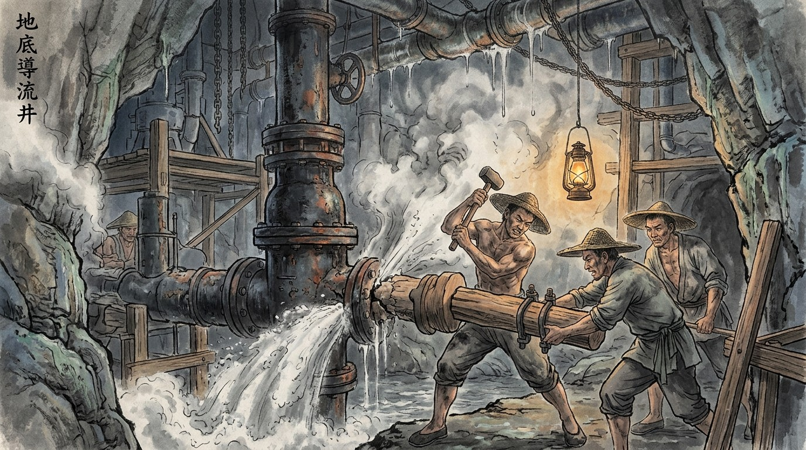

# 第 162 章：地底導流井・三息帶壓活榫換栓

*卷首插畫：第 162 章：地底導流井・三息帶壓活榫換栓*

而幾乎在顧玄護住地上人群的同一時刻，萬物主機城最底部、深埋在地殼下近百丈的**【地底導流井】**深處，正承受著三百年來最狂暴恐怖的一場高壓折磨！

儘管外環二十四站已經強制罷工鎖閥，但來自整座方舟大校準累積下來的三倍餘壓依舊不得不沿著僅剩的幾條地底主排水導管狂暴向下傾瀉！一旦位於導流井三叉口的舊式玄鐵分流栓在這波狂壓衝擊下炸裂——非但萬物外環地基會被滾燙鹽氣噴塌，這股失控熱流更會沿著岩脈縫隙在十息內掀翻半個灰燼石堡！

高溫蒸汽密佈、能見度不及三尺的狹窄井壁鐵梯上，**林鐵生**渾身早已濕透得彷彿剛從滾水鍋裡撈出來。他肩背緊頂著那座重達數十斤的銅鑄「三元高壓活榫分流總栓」，左手死死摳住燙得足以燙熟生肉的垂直扶梯，一步一喘地摸到了三叉主導管接頭旁。

「媽的……管壁都在顫……」林鐵生透過濕布巾吸進一口帶著強烈鐵鏽與沸水氣的滾熱空氣，盯緊眼前那枚正在高壓氣流裡嘶嘶狂吼、外圈螺牙已經滲出刺目火星與白霧的舊總栓。

依照師門傳統與常理，這種主壓力管道要換新閥門必須先關掉中樞主閘洩壓半日才能動手——可今日沒有人會替他關閘！他唯一能借用的，只有萬物主機每過數十息因二十四站罷工產生的那一瞬脈衝回縮、勉強跌回兩倍安全壓力的短短**三息間隙**！

「一……二……回壓了！！」

林鐵生雙眼瞪如銅鈴，根本不給自己半點猶豫退路！右手緊攥那柄陪自己打過黑石鐵鋪、雲頂擂台與外環車床的烏沉短鍛錘，借著身體順重力猛墜之勢狂暴揮出三錘——

「鐺！鐺！轟啪——！！」

生鐵舊栓應聲被生生打飛半截！一道夾帶著足以切開精鋼板的高溫狂暴鹽汽驟然自管口狂噴而出，半股失偏的高溫氣浪擦著林鐵生來不及閃躲的右肩與小臂狠狠掠過，瞬間將他那層浸濕防燙厚麻衫連同皮肉扯開一片深可見骨的焦紅灼傷！

痛得幾乎眼前一黑的少年牙關咬出鮮血，竟半聲哀嚎也無！藉著那道狂噴瞬間產生的三息反作用回抽吸力，他左手發瘋般抱起胸前早已抹好耐高溫石墨油膏的「三元高壓活榫分流總栓」，對準那口正在嘶嘶咆哮的黑鐵主螺口狠狠往前一頂一擰——

「進去啊——給我咬死！！！」

「哢、哢噠……轟隆——！！」

精準至九級公差、連牙口角都按兩倍半重力壓縮餘量預先打過微調的活榫暗齒，在狂暴熱浪當中竟不可思議地嚴絲合縫咬死進了母槽正中央！隨後林鐵生用盡全身最後一絲力氣猛力砸落鎖定插銷！

井室內那股足以掀翻整座城池的尖銳嘯叫聲驟然降了九成，狂暴奔湧的高壓主氣流順著新設的分流旁道「轟隆隆」一聲巨響全數拐進早早預留給死礦坑的萬丈深壑之中！

導流井重歸低沉穩定的嗡鳴。

林鐵生整個人徹底脫力，雙手發軟地沿著滾燙濕滑的鐵壁順著管架滑坐下來，右臂袖口早已化作焦黑碎布與血痂貼在肉上，背脊更是燙出一整片觸目驚心的紫紅水泡；然少年看著面前穩定輸出零洩漏的全新總栓，竟咧開滿嘴焦黑灰土的牙齒無聲笑了起來——師父當年在黑石鋪說過，真正頂尖的鐵匠鍛的從不是漂亮花劍，而是關鍵時刻頂得住萬鈞狂壓的實打實鐵骨頭！
