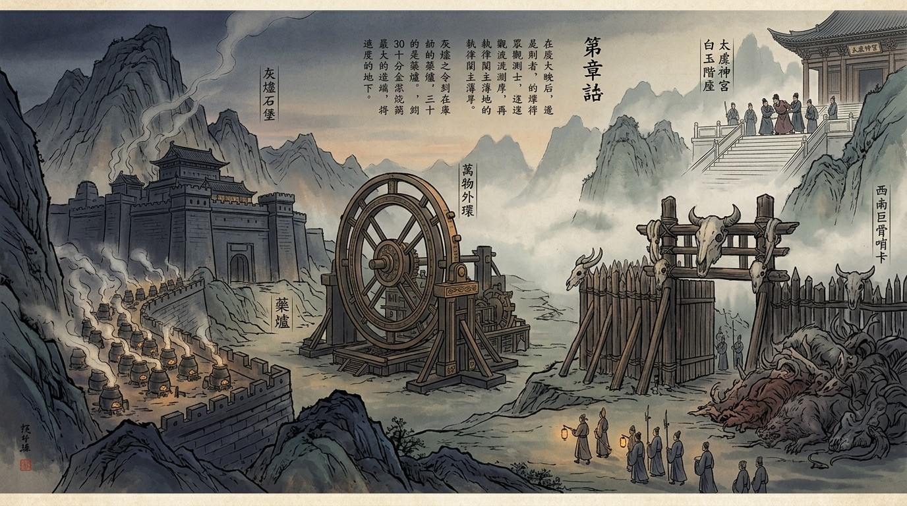

# 第 163 章：仲裁橋大對質・平權配重總案

[← 上一章](ch0162.md) ｜ [本卷目錄](00_intro.md) ｜ [下一章 →](ch0164.md)

*章首插畫：第 163 章 仲裁橋大對質・平權配重總案*

不知熬過了多少個令人窒息的漫長時辰，頭頂那片泛著死寂暗銀的雲層終於一點一點裂開了幾絲泛白的微光。天光徹底透白的那一刻，持續了整整一夜、足可吞噬整個洞天邊陲的百年大校準最兇險關卡——子夜三刻，終於被這群底層活人硬生生安然熬了過去！

五條戰線幾乎在同一時間將消息匯攏回傳：灰燼石堡全堡無一人晶化暴斃，三十座大口陶泥緩衝藥爐正徐徐熄下最後一縷微帶苦苔清香的護民青煙；萬物主機城外環二十四站全面停機鎖閥，卻靠林鐵生於地底導流井三息換栓，既沒有讓主機爆管也沒有毀掉半寸城基；西南戰祖巨骨哨卡外堆疊成山的狂暴獸潮屍骸堵滿了東側死礦溝，卻連一名老弱婦孺都不曾踏傷；正北太虛神宮白玉接天階更已傳來全院聯手拿下貪墨主簿嚴平、偏殿主束成功偏轉的驚天異變！

然而這一切用血與傷換來的實績，都還差著最後一顆能把百年邪規徹底釘死在法理柱上的定盤星。

晨光微冷的高空深淵之上，那座凌空橫架在萬物中樞與外環無盡霧海之間的古銀巨橋——**【萬物秩序仲裁橋】**，十天前由天穹裁決核心宣判的「百年大校準當夜實證平權會審」，此刻正式鳴鐘落槌、啟幕開堂！

百丈長橋上下此刻早已被從各處趕來、密密麻麻不計其數的三極人潮圍得水泄不通！這座三百年間幾乎只對高高在上的兩大巨構官僚開放、底層連遠看一眼都要被算偶驅趕的銀白神橋，今日竟史無前例地站滿了從灰燼、外環與西南焦土爬上來的尋常活人！

橋北高階側立著幾名臉色灰敗難看、卻仍不得不強裝出宗門與管理機構體面的萬物中樞代理執事與太虛執法堂資深老執事。而隔著橋心青銅展台遙遙對峙的橋南一側，則並肩站立著代表外環二十四站與鹽晶寮的**齊老匠師**、**鐵大鬍子**，代表太虛改革派觀測士的**衡真道人**，代表西南戰祖外營九支馱隊與解放礦奴的**託古**與**燕山**，老漢**戚守灰**，以及並肩站在最前排、來自凡間雲津黑石鋪的**沈泥、林鐵生、柳清虛、燕隼、顧玄**五名少年！

五人迎著深淵撲面而來的晨間寒風並肩立定。林鐵生右肩與右臂纏滿透出黃黑藥漬的厚重繃帶，燕隼左肋夾板滲著微紅血痕，柳清虛左眼瞳孔蒙著一層再也散不去的淡青雪盲翳痕，顧玄垂在袖邊的雙手掌心緊緊藏著那對洗不掉的灰白結晶硬斑——四人各自都為昨晚那一夜刻下了伴隨終身的真實殘損印記，站姿卻依舊與身前捧著總帳的沈泥一般筆直，宛如五桿寧折不彎、死死釘進深淵鋼板裡的烏鐵長槍！

橋柱最邊角，被浸過鹽水的雙股粗牛筋索捆成一團、鼻青臉腫得幾乎看不清五官的管事**韓石**與衣冠凌亂、仍被鎖死法脈的主簿**嚴平**被押跪在冰涼銀磚上。這兩個到頭來還不肯認輸的官僚見幾名代理執事還在猶豫觀望，竟猛地掙扎著昂起頭，借著最後一點氣力對著高空天穹裁決核心嘶聲嚎叫起來：

「仲裁核心明鑑！！這群來自下界的無籍妖修私下串聯外環怠工、破壞戰祖防區、甚至公然在偏殿干擾百年大校準星軌——此等煽動三極內亂、動搖方舟根本的罪人，若不按律極刑處決，三百年舊序將毀於一旦啊！！」

「沒錯！大校準之夜擅動外環主閥、導致高壓差點反衝主機……這些亂民的行為本身便已觸犯了萬物方舟穩定律例！」一名站在橋北的萬物代理執事見狀立刻抓住話柄，硬著頭皮往前跨出半步試圖替舊體系最後兜底，「依律，無籍者不得因局部功績而……」

「慢著。」

站在橋南最前方的**沈泥**甚至連多回罵嚴平半句的力氣都懶得浪費，僅僅平靜地抬起左袖，看了一眼那名試圖把「維持舊制」扯上大義的萬物代理執事：「閣下既然口口聲聲談方舟穩定律例，那我們就照著律例一筆一筆算清這筆到底誰在破壞方舟的三百年老帳——不憑嘴皮子爭辯，看實物！」

年輕掌櫃上前一步，五指修長卻沉穩地一揮，逐一將這九十日來五名同伴連同三極底層無數人拼著性命、流著鮮血從五個不同角落搶出來並互為印證的**五件核心鐵證**，當著數萬雙眼睛的面，依次排開拍入橋心那座連接**【天穹裁決核心】**的古老青銅讀取展槽之上——

「第一件！**太虛觀測實錄原件暨嚴平私庫延壽對帳冊**！太虛高層長達兩百年瞞報天羅衰退實測讀數、誘騙外階觀測士進塔當『玉化晶核』壓陣耗材，並私挪外階應得之高純鹽晶八百斤充作私利——此乃太虛自毀領航演算根基之罪！」

「第二件！**方舟九號離艦原始名錄被撕補頁對照本暨外環二十四站九級公差實測補給單**！證明灰燼石堡四百八十七戶先祖與外環維修苦工皆為方舟原初正冊火種，並非無主雜料；稽核主事陳楷長期偽報損耗、克扣安全護具並圖謀藉《清零條例》抹屍平帳——此乃萬物主事自毀百工護船根本之罪！」

「第三件！**戰祖三號廢鹽倉冒領帳單、礦奴換防假粉毒渣血樣清冊暨韓石親筆供狀**！韓石假借戰祖備戰名義強徵三成心核，實則以摻有重汞毒渣的劣粉充數毒害外營老獵、把無數抗議骨幹丟進鬥獸坑充作人證銷毀——此乃戰祖監軍自毀破陣護衛根基之罪！」

「第四件！林鐵生於萬物三號廢渣道人贓俱獲之**『赤火』硃砂封印高純鹽晶走私密箱，連同五年前雲津黑冰斷谷軍需官『赤煉』餘黨暗記烏鐵密牌交叉實證**！兩界內鬼串聯掏空洞天稀缺物資以供界外私門續命，連凡間走山隊都要活埋滅口！」

說到此處，沈泥略略停頓半息，深吸一口冷冽深淵晨風，隨後雙手鄭重捧起最後一樣沉甸甸、卻閃著微弱金光的文書與記錄盤，高高舉向天穹那尊冷靜無聲卻主宰一切法理的倒懸銀鐘：

「第五件！沈家先祖**沈雲妮**《離艦火種總約》原初見證銅版印泥——搭配今夜剛剛在全體三極見證下寫就的**《大校準夜灰燼暨外環實戰承載總實錄》**！沒有動用太虛一粒晶核、沒有浪費萬物庫房半斤備料，唯靠三十座石堡緩衝藥爐、十二根導引針偏星一度半、西南四十名獵手零死亡守住百獸狂潮、外加萬物井底一條人命換來的三息帶壓活榫總栓——我灰燼石堡與三極底層工役，憑自己的雙手證明了：**我們非但不是需要被清零的冗餘垃圾，反而正是這座破漏洞天昨夜沒有散架崩塌的最後承重樑！！**」

五份原本各自封存於三極陰暗角落、甚至隔著人間五載生死的捲宗與實物證據，在天穹裁決核心投落的巨大銀白投影光幕之下徹底扣榫合攏為一！整個長橋上下數萬名來自太虛、萬物與戰祖的旁觀工役、下階修士、鹽夫與部落武士，看著天空中清晰放大、纖毫畢現的貪墨血證與昨夜五方並戰的實錄曲線，原本死寂的圍觀人海瞬間徹底炸開！震耳欲聾的怒罵咆哮、淚流滿面的呼喊與敲擊兵器的金鐵鳴響如海嘯般翻滾衝上天霄，直把橋北那幾名代理執事震得連退數步、徹底啞口無言！

沈泥轉回身，青色袍袖在萬丈深淵的晨風裡紋絲不動。這位一路只拿一支炭筆與一把算盤殺出重圍的年輕掌櫃，直視著頭頂那尊冷漠運轉了三百個甲子的太古裁決核心，清越朗聲字字如金鐵砸地、響徹八方：

「方舟當年之所以分設三極結構，本意唯為互相校驗、分擔災劫、保全人間僅存火種之延續！如今高塔視外階弟子為填陣耗材，神城視外環老匠為無籍廢料，戰祖營視苦力獵手為充數獸糧——此絕非先賢創制運轉之常道，實乃數名竊據高位者長期偽造帳目、把虧空與死劫轉嫁給弱者之惡行所致！

今日五方鐵證並呈，承載實績具在——我沈泥代表灰燼石堡四百八十七戶九號艙遺民，暨《三極互助密約》全體底層工役，依《離艦火種總約》第七條及萬物初始最高憲章，正式向仲裁核心提呈最終裁決請求：

**全面撤銷《邊緣無主清零條例》！永禁三極單向強徵鹽晶與強制補替玉化之惡規！將灰燼石堡獨立升格為合法平權單元，另立《三極平權互市與石堡自治總則》！！**」

最後一個「則」字在深淵峽谷之間久久迴盪，餘音不絕。

長橋之上，數萬雙佈滿血絲、煤灰、期待與緊張的眼睛，在此刻萬籟俱寂的晨風中齊齊抬頭望向了高懸半空、正靜靜閃爍著銀白光輝的天穹裁決核心——

究竟這尊號稱絕對理性、只認鐵律與承載實績的遠古最高中樞，會迫於兩大巨構高層的既存既得勢力而偏向壓死這五名凡間少年，還是會真正依從自己最底層從未被人塗改過的三百年立船鐵律？！

答案，只在這幾息之間。

---

[← 上一章](ch0162.md) ｜ [本卷目錄](00_intro.md) ｜ [下一章 →](ch0164.md)
