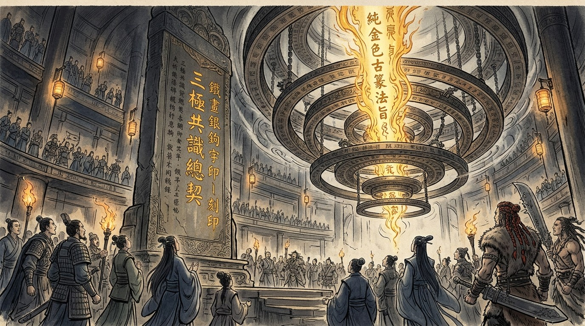

# 第 164 章：百年平權契書與歸墟深碑警報

[← 上一章](ch0163.md) ｜ [本卷目錄](00_intro.md) ｜ [下一章 →](ch0165.md)

*章首插畫：第 164 章 百年平權契書與歸墟深碑警報*

長橋上下數萬名三極底層人手屏住呼吸，仰望頭頂高空那尊懸浮旋轉的古老銀鐘。

足足十息如同一個甲子般漫長。深淵冷風穿過兩側石壁發出嗚嗚聲響，橋北那幾名代理執事甚至已經忍不住微微攥緊袖口等待高層優勢降下。

就在眾人喉頭緊得幾乎咽不出氣的第十一息，高懸橋心之上的**【天穹裁決核心】**那千萬枚互相嵌合急轉的透明晶環轉速忽地同時放慢了一半——緊接著，自核心深處盪出了一陣猶如遠古九城巨鐘齊鳴、震徹天地肺腑的沉厚金屬共振之音！

「嗡——！！！」

一道比此前任何一次都要宏大威嚴、清亮到彷彿連頭頂積壓了三百年的暗青陰霾都一併掃淡幾分的純金色古篆法旨，驟然自仲裁橋正中央直衝天霄！在數萬名萬物外環居民、太虛外階修士與戰祖部落武士震驚狂喜到幾乎失聲的注視之下，字字鐵畫銀鉤般一筆一劃刻印進三極共識總契與橋面天碑之中——

**「核驗五方實證總帳暨大校準實戰穩定承載實績全部達標！依照原初《九城火種協議》暨《離艦火種總約》第七條最高授權序列，現正式裁決：自即日起永久撤銷《邊緣無主清零條例》！無限期凍結太虛強制順位補替玉化令暨戰祖三成強徵附額！嚴平、韓石、陳楷三員主事涉及挪用公器、私改總帳與迫害火種遺族，著由各極內部監察即刻革除一切職權並發配重工贖罪！

自本紀起，核定設立與太虛、萬物、戰祖並立之獨立合法平權單元——【灰燼自治聚落】！特頒《灰燼石堡百年平權自治契書》，准其與三極締結百年等價鹽晶互市停戰條約，享獨立商隊往來暨安全墊線配給之權——違約侵犯者，仲裁系統將自動切斷該極中樞能源授權！！」**

最後一個古篆落定！伴隨著漫天傾瀉而下的最後一道純白銀光芒凝實落地，一方長達二尺、通體由烏金混入航星白銀精密壓鑄而成、四邊鑄滿九城舊盟與三極共同徽記的沉甸甸符印法簡——**《灰燼石堡百年平權自治契書》**——緩緩飄落進橋前那個消瘦年輕掌櫃微顫卻無比沉穩的雙手之間！

短暫的三息死寂過後，整座萬丈凌空仲裁橋南側徹底爆發出幾乎要將深淵雲層一齊掀翻的狂熱哭吼與歡呼聲！

左腿裝著鐵木義肢的鐵大鬍子一把抱住那隻機械鐵手依舊完好無損的齊老匠師，這兩個硬扛過無數蒸汽爆管與稽查銅偶的老工匠當場泣不成聲，拍著對方的後背喊不出完整句子；滿身血污的託古激動得把寬闊胸膛拍得砰砰山響，身後那幫戰祖馱夫紛紛舉起骨斧仰天長嘯；一襲灰袍的衡真道人遠遠朝正北白玉接天階方向整理好衣冠長揖到底，枯槁臉龐上頭一次露出了熬了九十年冤屈後的徹底釋懷與如釋重負；而那位守著半埋玄武岩孤寨熬了一甲子的獨臂老漢**戚守灰**，更是雙眼通紅地狠狠一拳砸在冰冷銀橋石欄上，老淚縱橫地破口大笑：

「三百多年了……三百多年啊！咱們九號艙這四百多號被人撕掉頁數、當成死耗材踩在溝裡不見天日的鬼影子……今兒總算靠著自己手裡拿得出手的傢伙事兒，光明正大站直脊梁骨當一回有籍有姓的人了！！！」

這場三百年未有之變局的中心點上，那五個一路肩並肩、從凡間雲津邊陲黑石鋪那間破落小村泥屋走出來的年輕人互相望了一眼，誰也沒有多說半句慶功的虛話，卻不約而同地在彼此疲憊不堪的眼底看見了一抹從未熄滅過的亮光——

**林鐵生**右肩與整個右臂纏滿透出黃黑藥色的厚實麻紗繃帶，手指還時不時抽痛發抖；**柳清虛**微微側著臉，左眼那片淡青色雪盲霧翳在晨光下如一痕永不退散的薄霜；**顧玄**安靜合攏雙手，把那對為了熬出緩衝方而永久烙進掌心的灰白結晶硬斑斂入袖中；**燕隼**左胸勒著滲血寬木板，左手仍緊緊攥著大伯留下來的那半塊焦黑烏鐵密牌；而居中的**沈泥**，雙手穩穩捧著這卷幾乎是用全城底層兄弟的傷痛與幾百條性命的籌碼才硬生生敲出來的《百年平權自治契書》……

這場仗，五個人誰也沒有僥倖占到半點便宜，每個人都在皮肉、骨血與視線裡留下了這輩子再難抹平的真實傷痛代價；可正因每一分都是拿命與手藝實打實換來的，腳下踩出來的這條活人之路才顯得格外沉實、踏實得誰也踢不翻。

然而人世之間最沉重的帳，往往從來不會讓人安心歇上一口氣。

就在橋上數萬人尚沉浸在百年平權成約的震撼喜悅之中，戚老頭與蘇青竹已經開始招呼傷員準備一同撤回灰燼自治聚落開診善後、清點昨晚耗損藥材時——

「沈泥……等一下！你看核心最底下那塊黑石基座！」

一直沒離開仲裁核心讀取槽三步之外、右眼慣性盯著各種讀數曲線不放的**柳清虛**忽然神色猛地一凝，一把拉住準備轉身收起天門引的沈泥衣袖！

只見在整座仲裁橋已經完成裁決程序、正準備恢復平靜休眠的天穹裁決核心最底盤一角——一塊平日裡通體烏黑無光、連塵埃都彷彿被吸乾的黑曜石基座深碑表面，卻毫無徵兆地閃爍起了一行截然不同於方才平權金印的、冰冷刺骨、彷彿從九幽寒潭底下透出來的幽藍急閃古篆！

那道幽藍光芒極細微，尋常歡呼的人群根本注意不到；可當沈泥、顧玄與林鐵生齊齊順著柳清虛手勢大步搶近兩步定睛望去時，三人的臉色也在短短一息之間迅速降到了冰點！

只見那方深埋於核心最底層、用來監測整個洞天對極外界與深海邊陲地脈應力總感知的黑曜石深碑上，赫然逐字浮現出三行讓幾名剛從生死關爬回來的年輕人瞬間如墜冰窟的緊急警示字樣：

> **【極外域底層監測總碑緊急異動警報】**  
> **受本輪三極百年大校準強烈能量振盪暨萬物導流井深層熱壓切換牽動——極外界深海域「歸墟總閘門」外圍封界結界應力實測鬆動『一分八厘』……閘門深層門隙外未知滲壓較上甲子倍增！預計凡間界與洞天共連危機窗口將大幅提前！請各存活火種聚落即刻進入最高級別備戰狀態，並儘速校核啟動雙向跨界應對信標！】**

「歸墟總閘門……封界結界應力鬆動了……『一分八厘』？！」

方才在導流井裡硬扛三倍半高壓熱流都沒半點皺眉的**林鐵生**，此刻盯著深碑上那串幽藍刺骨的古篆，竟忍不住抱著受傷右臂倒吸了一口透骨冷氣。少年眉頭緊鎖，低聲喃喃道：「奇怪……當年太古先民費這麼大周章打造破界方舟，把凡間與這座洞天層層封鎖隔開，外頭那個叫『歸墟』的地方究竟藏著什麼沒徹底了結的舊患與大門？如今大校準剛勉強穩住裡面，外頭那扇門竟然就已經先開始鬆了一分八厘——裡頭當年造船的那些老前輩，到底還留下多少沒寫進公開契書裡的糊塗總帳？！」

一旁的**顧玄**亦默默緩步走到深碑前兩尺處，原本微鬆的眉宇重新凝起那副醫者面對不知源頭的奇症死兆時的極度冷靜。青年從懷裡抽出剛收起的病例小本輕輕一拍手背：

「這就全把前後的斷線接上頭了——為什麼北荒祖師留下的殘簡語焉不詳、為什麼九城總約死活不許『歸返』卻偏偏在最底層藏著火種備份與離線信標、為什麼洞天每隔三百年就算壓榨全界也要硬撐著大校準保住結構應力……甚至包括凡間雲津近幾年頻頻出現的地煞異動與赤煉那幫瘋子急著偷運高純鹽晶——所有一切的總根源，恐怕都和這扇正在悄悄鬆動的『歸墟大門』以及外頭那筆沒清算乾淨的遠古危機脫不了干係！」

「不僅如此。」柳清虛強壓著左眼翳痕傳來的陣陣陰冷跳痛，借著紫銅鏡背那套太清師門留傳的星曆換算表在心裡飛快對照了一遍洞天與凡間的十二倍時差比率，聲音沉得像一口古井：

「昨晚進偏殿底層見到那些老祖師遺骨旁刻的倒計刻痕時，我只當那是太虛用來嚇唬外人的死數——如今跟這塊黑曜深碑上的鬆動速率並排一算，我終於算清那個時間座標了。若門隙按眼下這個斜率繼續擴張，留給凡間與洞天最後的大限周期……按人間凡界年歲來算，怕是連『十歲象』都剩不全了。」

清晨凜冽高空的山風呼嘯著刮過秩序仲裁橋的銀白欄杆，吹得幾人身上破舊的布袍發出獵獵響聲，竟將剛才奪下百年平權的暖意一下子吹涼了半截。

**沈泥**靜靜站在黑曜深碑前足足沉默了五息。

他低頭看了一眼自己左手掌心剛剛接過來、沉重得猶如四百八十七戶先祖性命重量的《灰燼石堡百年平權自治契書》，隨即又抬起頭，將目光越過深淵白霧瀰漫的盡頭，深深望向那座正散發著無盡未知寒意與幽藍微光的深碑座標。

半晌，這位青衣掌櫃嘴角重新浮起一抹既無懼、又決絕得令人心安的平靜弧度，轉過身望向身旁這四位傷痕累累卻一步未退的同門與兄弟：

「既然知道外頭還壓著一筆我們眼下連底細都還摸不清的更大總帳，那就更不能在這座岩石縫裡原地踏步。」

沈泥穩穩把那方烏金白銀自治契書收進貼身行囊，與那隻雲津棗木茶牌壓在一處，聲音不大，卻清清楚楚地落在每個同伴心坎上：

「石堡與三極的百年喘息我們替大夥兒搶下來了，這本帳第一步已經站穩。接下來最後這段時日——顧大夫帶著蘇醫女繼續徹底穩住堡裡的傷患與藥煙後手，鐵生與齊師傅落實三極平權貨殖並清查萬物底庫裡還剩下什麼當年方舟留下的跨界信標構件！

我們還欠著人間雲津一個準信，莫三、邱禾、蘭舟他們還在雲津老鋪子裡替我們守著攤子……不管這扇正在悄悄鬆動的『歸墟大門』背後到底藏著什麼未解之謎，這一次，我們得活著把字條遞回外頭去——還要憑自己的兩條腿，早晚回到外頭那片天地去親眼看個清清楚楚！」

朝陽雖未升起在這座沒有太陽的異界天穹之上，可在灰燼自治聚落、萬物外環二十四站與遠方太虛白玉階的無數窗縫之間，無數盞點亮新夜的溫暖燈火正一盞接一盞地悄然亮了起來。

一場關於自治與生存的暗戰方才告一段落；而另一道通往故鄉與更高未知謎局的漫長橋樑，正等待著這五名已經脫胎換骨的少年親手搭起第一塊黑鐵磚石。

---

*器物圖誌：《灰燼石堡百年平權自治契書》*

---

[← 上一章](ch0163.md) ｜ [本卷目錄](00_intro.md) ｜ [下一章 →](ch0165.md)
