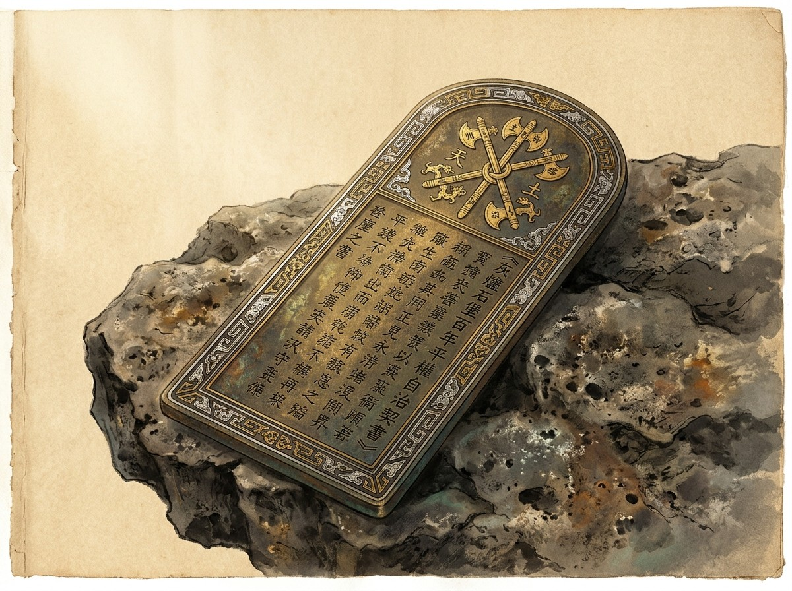

# 第 164 章：百年平權契書與歸墟深碑警報

[← 上一章](ch0163.md) ｜ [本卷目錄](00_intro.md) ｜ [下一章 →](ch0165.md)

*卷首插畫：第 164 章：百年平權契書與歸墟深碑警報*

足足十息如同一個甲子般漫長。

天穹裁決核心那千萬枚旋轉晶環的轉速忽地同時放慢，發出猶如遠古巨鐘長鳴般的沉厚共振之音！

隨後，一道比此前任何一次都要宏大威嚴的純金色古篆法旨自仲裁橋正中央衝天而起，在無數萬物居民、太虛修士與戰祖部落武士震驚至極的目光裡，字字鐵畫銀鉤地刻印進三極共識總契之中——

**「核驗三極總帳與實際穩定承載達標！依照原初《九城火種協議》最高授權序列，現撤銷《邊緣無主清零條例》、凍結太虛強制順位補替與戰祖強徵附額！自本紀起，核定設立獨立平權單元——『灰燼自治聚落』，頒立《灰燼石堡百年平權自治契書》，與太虛、萬物、戰祖三極締結百年等價鹽晶互市停戰條約！」**

伴隨著最後一道白銀光芒凝實落地，一方沉甸甸鑄滿三極共同篆文徽記的烏金白銀符印法簡**《灰燼石堡百年平權自治契書》**緩緩降落進沈泥微顫卻無比沉穩的掌心之間。

這一刻，仲裁橋南側爆發出幾乎掀翻峽谷雲層的狂熱哭吼與高呼！

鐵大鬍子抱著機械手完好無損的齊老匠師泣不成聲；託古激動得把寬闊胸膛拍得砰砰響；衡真道人遙遙向白玉方向長揖到底，臉上是九十年來頭一次見著的徹底釋懷；而灰燼石堡那位守了孤寨一輩子的獨臂戚老頭，更是狠狠一拳砸在橋欄上老淚縱橫：「三百年了……咱們這四百多號不見天日的鬼影子，今兒總算能光明正大在太陽底下站直當一回人了！！」

五個一路肩並肩從黑石鋪泥屋走到此地的年輕人相視一笑——

林鐵生左肩纏著透藥色的繃帶，柳清虛左眼隔著青霧冷光微斂，顧玄雙掌微握掩著那對灰白晶斑，燕隼手中攥著大伯的半塊殘牌，沈泥手捧這卷幾乎以全城兄弟血汗換來的百年平權契書……誰也沒有白吃虧，每個人都留下了切膚的傷痛代價；但也正因如此，這場贏下來的生路才重得讓人踏實無比。

然而就在眾人尚沉浸在百年自治成約的震撼喜悅裡，正準備護送傷員與戚老頭一同撤回石堡醫棚休整善後時——

整座仲裁橋已經完成定案的天穹裁決核心最底部、一塊平日裡幾乎連塵埃都懶得落上去的黑曜石深碑角落，卻忽然毫無徵兆地亮起了一行截然不同於平權金字的、冰冷刺骨的幽藍急閃古篆！

沈泥與柳清虛的目光同時一凝，大步搶近兩步定睛望去——只見那方深埋於核心底層、連接整個洞天對外界大海域總感知的監測深碑上，赫然浮現出三行極細卻令兩人瞬間全身如墮冰窟的警示字樣：

> **【外域監測總碑緊急異動警報】**  
> **受本輪全界大校準餘波及高壓導流井深層震盪牽動——外海域「歸墟總閘門」封界結界應力鬆動『一分八厘』……深層門隙外異界滲壓倍增，預計凡界雲津與洞天共連危機窗口將大幅提前！請三極火種即時整備雙向應對信標！】**

「歸墟……封界門隙鬆動一分八厘？！」

林鐵生抱著手臂倒吸一口冷氣，原本的傷痛似乎在這一刻也忘了半截：「原來當年天機與先祖築下這座方舟與各處宗門暗鎖防備的外敵，真正在外頭虎視眈眈的……根本還沒有被解決，甚至連最後這道隔開深海的總大門都已經開始鬆了？！」

顧玄亦緩步走到碑前，眉宇重新凝起醫者面對絕症徵兆時的冷靜：

「這就全接上了——為什麼祖師《遺言》與九城總約會留著後手、為什麼萬物大校準哪怕犧牲底層也急著要強修陣基、又為什麼凡界雲津那邊近幾年頻頻異動不斷、甚至連赤煉餘孽都要急著往外偷運高純晶柱。」

沈泥深吸一口長長冰冷的晨風，手裡依舊緊緊握著那方剛剛贏來的《灰燼石堡百年平權自治契書》，目光越過白霧瀰漫的深淵望向那座隱隱透著幽藍警報的深碑，緩緩轉頭對四位同門輕聲說道：

「這場仗還沒真正收官。石堡的百年喘息我們替大家搶下來了——接下來最後這段時日，我們不僅要治好堡裡的傷員、落實三極平權貨殖，還得依著九城這層剛打開的權限去找到傳訊返鄉的通道。凡間雲津還有人在等我們回去……這扇正在鬆動的『歸墟大門』究竟是什麼東西，我們得活著回到外頭去親眼看個清楚！」

---

*器物圖誌：《灰燼石堡百年平權自治契書》*

---

[← 上一章](ch0163.md) ｜ [本卷目錄](00_intro.md) ｜ [下一章 →](ch0165.md)
