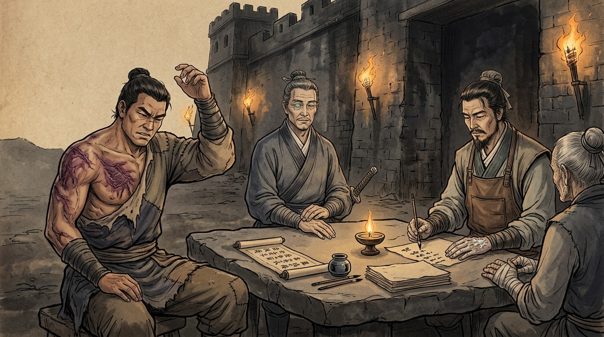
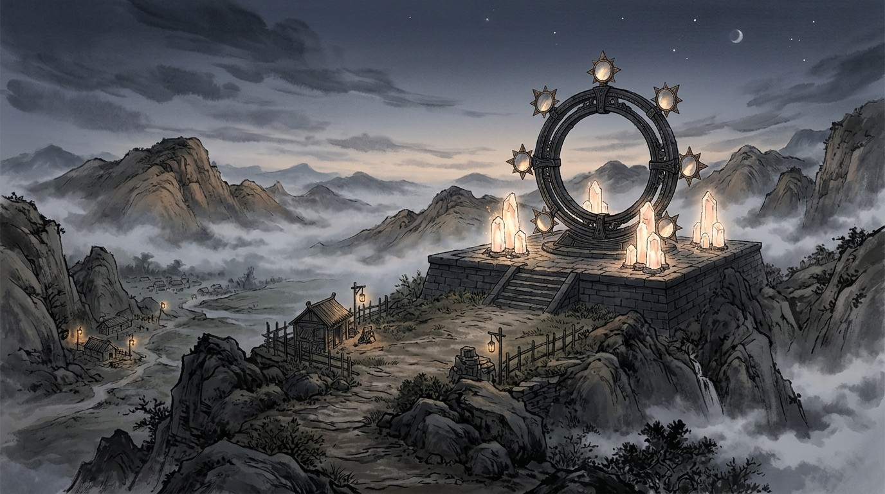

# 第 165 章：微光共鳴站・三百斤的門票

[← 上一章](ch0164.md) ｜ [本卷目錄](00_intro.md) ｜ [下一章 →](ch0166.md)

*章首插畫：第 165 章 微光共鳴站・三百斤的門票*

百年平權停戰契書落印後的半年裡，灰燼石堡外牆破天荒頭一次在白晝點起成排耐風火把。

林鐵生左肩那處在導流井燙出來的紫紅深灼疤痕已經漸漸收口結成厚硬暗痂，一抬右臂仍有些微拉扯鈍痛；柳清虛左眼瞳孔裡那圈淡青雪盲翳痕成了再也退不去的印記，右手卻已學會用輕輕按壓掌根的方式強行壓穩手指微顫；而顧玄那雙掌心烙著灰白晶斑的大夫之手，此刻正在石桌旁一頁頁替幾名傷癒老鹽夫寫下不需昂貴藥草也能長期照做的食療土方。

人活下來了，自治邦也慢慢立穩了腳跟。可夜深人靜的時候，五個人望向石壁角落那幾隻已經徹底冷透、連星門餘韻都消失殆盡的五器鐵箱，心頭卻橫著同一塊越來越沉的石頭——

凡間那頭，到底過去多少年了？

雲津的萬山泥途總號還在不在？老莫三那半塊「雲記棗木茶牌」是不是還每天按時擺在紅木櫃台角落裡？雷烈守著的北方商道、蘇凝霜挑起的金石總櫃、黑石鋪老趙頭與枯木老道……外頭是不是已經天翻地覆？

「別指望造出能把大活人送回去的星門了。」

荒原裂隙最西南角的一座平頂玄武岩高坡上，林鐵生用一柄厚重的生鐵卡尺敲了敲眼前這座忙活了整整三個月才拼裝起來的簡陋石台。台心架著一具借萬物導流井預留分流口改造出來的黑鐵導波環，四周斜嵌著七面由衡真道人親自磨好偏轉角度的太虛星象反射銅鏡。

「當年太清山祖師庭主傳送室早就叫九天雷劫轟成了飛灰。」齊老匠師那隻機械鐵手按在一份反覆畫改了三十幾遍的公差圖紙上，口氣冷峻得不近人情，「憑洞天現在這點料子，誰要是想開一道讓肉身直接跨過無盡星障的大門，還沒站進光環裡，地底三萬丈玄武岩壓差就能先把半個石堡撕進裂縫！咱們這座【跨界微光共鳴站】，只夠撕開一道拳頭大小、持續**三息**的極微細縫。」

旁邊立著的獨眼老獵頭燕山聞言眉頭猛跳，一隻手按在腰後那柄沉甸甸的精鐵短弩上試探道：「三息？拳頭大……那我預先備好的兩把破陣短鐵矛，或者這塊軍需烏鐵密牌連帶兩瓶止血金瘡膏，塞過去應當還……」

「連一兩鐵片都塞多不得。」

林鐵生半句多餘解釋也不講，直接抓起一塊重量剛好**八兩半**、比他手中預備好的空白鐵筒重了三兩多的標準生鐵塊，一把塞進正處於空載低壓試調狀態的導波環卡槽裡，隨即讓齊老匠師合上測試閘門！

「錚——噼啪！！」

整具黑鐵導波環在僅僅轉了半息之後便發出刺耳至極的金屬撕裂哀鳴，三面偏轉銅鏡邊緣當場崩出蜘蛛網般的裂紋，連這台試調機的預熱線圈都險些直接燒成一堆紅鐵泥！

燕山看得瞳孔一縮，緩緩鬆開了按在鐵矛上的手指。

「看到了嗎？」柳清虛捂著發酸的左眼指著台壁上新刻出來的冰冷刻度，「三百斤自治議會與外環工會足足攢了半年才湊出來的極限高純導流鹽晶儲柱，再加上一具林鐵生最後一點精鐵邊料鍛成的黑鐵導波環——這全部本錢加起來，每一次強行開縫僅能維持**三息**、總載重**絕不許超過半斤（五兩）**，且**嚴禁一切帶有生靈氣息之肉身強渡**！多夾帶半錢超重鐵件，整條導波環會立刻震碎反炸，連個字都傳不到雲津。」

沒有什麼不講理的跨界傳送門，更沒有廉價來去的星門驛站。

眾人盯著腳邊整整碼了三大垛、足足三百斤重卻將在三息內燒成白灰的雪亮高純鹽晶儲柱，這才真正體會到「隔界如隔世」這幾個字背後精準到每一錢兩的冷酷重量。

---

*場域圖誌：荒原高坡・跨界微光共鳴信標台*

---

[← 上一章](ch0164.md) ｜ [本卷目錄](00_intro.md) ｜ [下一章 →](ch0166.md)
