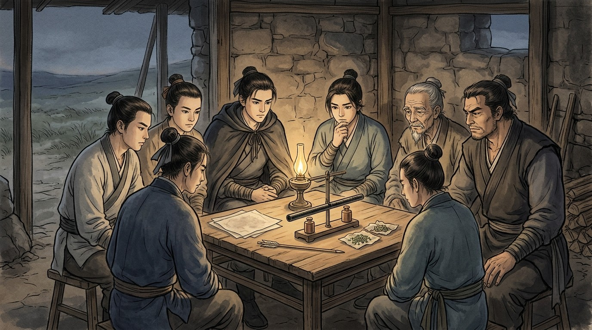
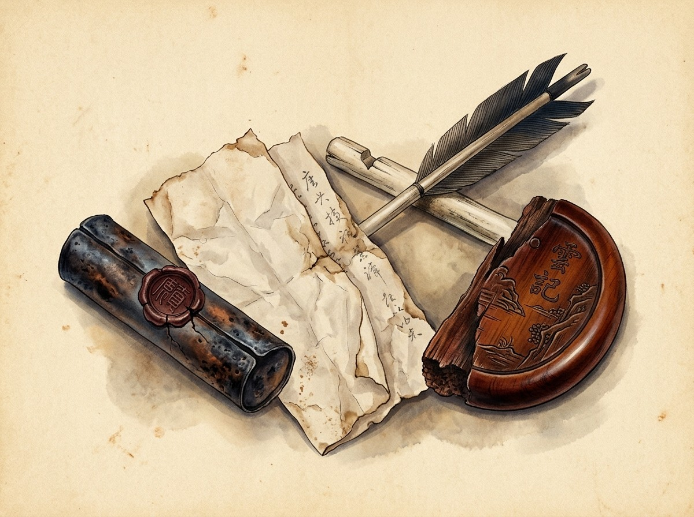

# 第 166 章：半斤家書・寫給三十年之約

[← 上一章](ch0165.md) ｜ [本卷目錄](00_intro.md) ｜ [下一章 →](ch0167.md)

*章首插畫：第 166 章 半斤家書・寫給三十年之約*

豆油燈芯在荒原高坡這座臨時壘起的遮風小石棚裡穩穩燒著，昏黃微火把幾張歷經數月風霜與血戰、各自留著疤痕印記的臉龐照得格外清晰。

窄小的榆木桌正中，架著一架齊老匠師親自拿九級公差銅絲校準過的天平定秤。秤盤一側放著兩枚沉甸甸、連半絲鏽斑都擦得乾乾淨淨的五兩黃銅定秤大砝碼；另一側，則靜靜躺著林鐵生花了兩日工夫反覆車削打磨、把壁厚硬生生削薄到只比凡間鵝蛋殼厚出一分卻依然扛得住導波壓差的焦黑薄鐵細筒。

五名少年連同獨眼老獵頭燕山、獨臂老漢戚守灰以及默默守在棚邊的醫女蘇青竹圍坐在這張僅三尺見方的小木桌四周。這可能是近幾年雲津與洞天之間距離最遙遠、卻又離「家」最近的一張桌子——桌面上並沒有預想中大疊大疊的長篇書信或稀世法寶，反倒簡單得近乎清貧：只整整齊齊放著幾張薄得幾乎透光的雲津桑皮紙、一小根輕木白楊箭桿、一塊早已切去大半卻依舊油亮溫潤的半截棗木茶牌，以及一小包用防潮油紙細細包住、正透出一股清苦生機的青灰色草籽。

「所有邊界都算清楚了。」沈泥手裡捏著一支細炭筆，輕輕點了點定秤橫桿盡頭那道細微紅線，聲音平靜卻字字帶著鐵一樣的份量，「按萬物殘庫導波環極限推演，三息裂縫總載重最高不能超過半斤——也就是五兩。這只鐵筒連同待會兒防潮封口用的密蠟與壓緊蓋算進去，已經實打實佔掉了**一兩七錢**。也就是說，這趟我們五個人、四百多戶人積攢半年的所有消息跟物證，實際能塞進去送過星障送到莫三與雲津故人手裡的淨重，總共只有**三兩三錢**。」

三兩三錢。

換算成凡間雲津碼頭市價，還抵不過茶肆角落裡二兩碎銀外加一隻粗瓷小茶杯的份量；可就在今夜這方荒原小石棚裡，這區區三兩三錢卻要硬生生扛住這五個少年、乃至兩座世界之間整整三個年頭在生死刀鋒上爬過來的所有牽掛與後手。

林鐵生站在天平旁，將手臂上重新換過藥布的右腕搭在桌邊穩住秤架：「沒有半錢能讓步的餘地。上回試送八兩半廢生鐵時，導波銅環才亮半息就把三面銅鏡震裂了兩面——只要多出哪怕半錢死重，細筒過門那一息就會炸成鐵砂，不但東西毀了，連這三百斤高純鹽晶儲柱都白燒。」

屋裡安靜了兩息，沒人爭先，卻非常有默契地按五人當初進界分工順序開始稱重裁減。

第一個動手裁減的，是一向把每個人性命都算進自己藥箱裡的**顧玄**。

為了這趟可能三年來唯一一次能聯絡人間故交的機會，這名年輕醫修熬了整整七個夜晚，一字一句將自己在灰燼石堡與三極邊緣拿命換來的《律令排異症與跨界三元本草補遺》工整抄寫了足足十六頁；除此之外，他桌邊還小心翼翼擺著一隻不過核桃大小的防潮油紙包——裡面裝的是他獨自一人攀上礦窟裂隙邊緣、迎著毒風一株一株採下來陰乾烘焙的「雙層耐寒緩衝草籽」，原本是打算順便捎回去給雲津老藥鋪莫三、師長陸觀瀾以及師兄妹防備地煞餘波用的。

然而那十幾頁紙張加上那包看似輕巧的緊實草籽一齊擺上黃銅秤盤——天平右臂竟猛地往下沉出一截，穩穩壓過了**三錢七分**！整整超出了顧玄那份額度將近半倍！

「超了。」林鐵生目光死死鎖緊定秤橫桿微斜的刻度線，沒有因為兄弟連日不眠辛苦而露出半分遲疑或通融，搖了搖頭直接斬釘截鐵道，「書頁紙張可以留，那包草籽必須拿掉；否則算上後頭四位兄弟的物件，進環必炸。」

「這是耐寒草的母籽……」顧玄看著盤心裡那包費盡千辛萬苦才焙好的稀罕草籽，右手兩根指節微微發白地懸在半空僵了良久。這草籽若能帶回雲津試種成功，來年北荒凍季不知能救下多少藥修與守線老兵。

站在一旁的蘇青竹輕輕伸出手，無聲拍了拍顧玄那雙已經永久烙著灰白晶斑的手背，眼神裡透著無盡體諒卻沒有多勸一句。

終究是顧玄自己先極輕地吐出半口長氣，咬了咬下唇，親手將那包草籽收回自己貼身藥袋深處。「莫大叔那邊還有萬山堂跟丹鼎宗守著藥庫……眼下更要緊的是先把對症病理與緩衝製法遞過去。」他反手扯過桌邊僅剩的兩張最薄桑皮紙，接過炭筆，幾乎將整個人壓低到離紙面三寸，以比米粒大不了多少卻筆劃清晰得驚人的蠅頭小楷，飛速將原本十六頁藥理狠狠濃縮成一張《緩衝藥膏炮製三階簡圖》與幾條核心藥方配伍口訣——炭字寫得密密麻麻如同蟻群排陣，字字都在重量邊緣斤斤計較，重新上秤一稱，不多不少剛好壓進了**六錢整**！

第二個上前的，是柳清虛與林鐵生。

這兩個一個掌法算、一個握鐵錘的兄弟互相看了一眼，甚至連多商量半句都不用，便默契地攤開半張桑皮紙，由右腕微顫卻落筆穩重的柳清虛繪圖、林鐵生在側邊標註實測工程尺寸，合畫了一張簡練到極致卻標記嚴謹無比的極地星盤座標修正略圖與地脈壓差備忘。末了柳清虛原本還想多提兩句洞天三極近況與天道晶塔的沉重真相，筆尖懸在紙上停了兩息，最終還是為了省下筆墨紙張分毫份量與不讓雲津同門徒增絕望恐慌，僅用炭粉淡淡勾了十六個字：

**「天羅已偏、石堡已安、歸期尚須數載、切勿輕啟大陣接應。」**

寫畢對折三道拍上銅秤——**三錢二分**，一絲不溢。

隨後大步走上桌前的，是左肋依舊纏著繃帶的**燕隼**。這名一向在荒原裡追獵重獸的少年今夜動作格外輕柔，掌心小心捧著一截僅有四寸長、由大伯**燕山**昨晚在油燈下親手拿獵刀慢慢削出來的極輕白楊木無羽箭桿——這本是黑石鋪獵戶給剛出師小輩傳信報平安用的「空心飛箭哨」。在那截光滑潔白的箭桿尾部，燕山那雙歷盡五年血戰卻依舊穩得像老岩樹的粗糙大手指，拿尖刀一筆一劃極細密地刻上了燕家獨門、只有黑石鋪老獵戶一眼就能認出的「左撇收腕・雙羽隱括」暗號鷹記；而在鷹記旁邊那塊寸許大小的空白處，還多刻了四個比芝麻粒大不了多少的樸實古篆：

**「燕山猶在」**。

只此四字，卻勝過千萬句長篇痛陳。這截帶著黑冰斷谷與西南戰祖風霜氣息的輕木箭桿輕輕放上銅秤盤底，黃銅秤星微顫三下便穩穩停死在了**五錢整**！

前四件物品合計一兩四錢二分。算上外殼鐵筒，整個細筒裡頭留給最後一個收口之人、也是牽起整座雲津萬山泥途總號根基的**沈泥**的，只剩下最後**一兩八錢八分**的空間。

沈泥拿起炭筆，這名從來在商行算帳、調糧、寫契書都能眼皮都不眨半下、落筆如流水的年輕大掌櫃，此刻竟捏著筆桿對著面前最後這半張空白桑皮紙靜靜愣了足足一柱香功夫。

油燈芯「噼啪」輕響了一聲，替紙面投下微弱跳動的暖光。

這三年來，莫三那張老臉在帳房裡劈頭蓋臉訓斥夥計的嗓門彷彿還在耳邊、邱禾細心替大夥兒歸檔收妥的貨品名錄總表、顧蘭舟偷偷留給顧玄的藥草筆記、蘇凝霜在千丈崖口揮淚送別的背影、甚至萬山泥途總號後院那棵每到初夏就落滿白花的老槐樹……全都有千言萬語湧到筆尖。沈泥甚至想過細細交代幾縣分號三年來的帳目防弊、提醒蘇凝霜務必查緊萬仞山與金石內堂裡還藏著什麼赤煉暗線——可手指捏著這只有一兩餘重的薄薄紙頁，千頭萬緒最後落到紙面之上，卻竟只化作了極短、極平實、像極了尋常夥計給東家寫回鋪裡的八個平安字：

**「五人俱安，勿念，照約守號。」**

字跡平實乾淨，連半點多餘的感嘆號或墨漬都沒浪費。寫完之後，他伸手摸出貼身收著的那半塊早已磨得包漿發亮、邊角缺了一角的雲津老物件——**【雲記棗木茶牌】**，在燈煙底微微熏黑茶牌背面沈雲妮留下的暗紋印記，反手一掌穩穩拓印在八個字的下方作為兩界不破的真實活契憑證！

最後將那張空白備用的回信專用桑皮回條與一小段無油脂細炭筆小心捲進細筒夾層，旋緊鐵蓋、淋上一層恰好厚度的防潮蜂蠟，連蠟帶筒一併徹底封死——

林鐵生親手將這只小小的焦黑鐵細筒輕輕擺回天平秤盤中央。整個石棚裡七八個人連呼吸都瞬間停住了半拍！只見黃銅橫桿微微晃蕩兩下後，指針尖端在黑鐵刻線正中紋絲不動地垂定下來——

**剛好五兩整帶半厘，連一分一毫的誤差都無，不偏不倚完美卡死在「半斤」生死臨界線之上！**

「成了！總重五兩，半分沒超！」林鐵生重重吐出胸口憋了半天的濁氣，難得露出笑容。

眾人這才一同起身，捧著這只輕得幾乎像沒有重量、可裡頭卻實實在在承載著兩界數百條人命期盼、五年冤屈線索與三十載守諾的小小焦黑鐵筒走出簡陋石棚。

推開草簾抬頭看去，荒原高坡之外依舊是一望無際、籠罩在永夜般沉重暗鐵青天穹裡頭的玄武岩死谷；誰也不知道跨過頭頂那片看不見盡頭的冰冷虛空星障與十二比一時差之後，此刻已經整整過去了三個寒暑的人間雲津——還亮著幾盞在等他們回家的燈。

「該去高坡信標台了。」沈泥手掌牢牢護緊懷裡那只冰冷鐵筒，輕聲說道。

夜風吹起五道年輕背影的衣角，眾人迎著未知星縫，一步步走向那座預先備好三百斤結晶鹽柱的最後傳訊高台。

---

*器物圖誌：兩界微光家書囊與雲記棗木茶牌*

---

[← 上一章](ch0165.md) ｜ [本卷目錄](00_intro.md) ｜ [下一章 →](ch0167.md)
