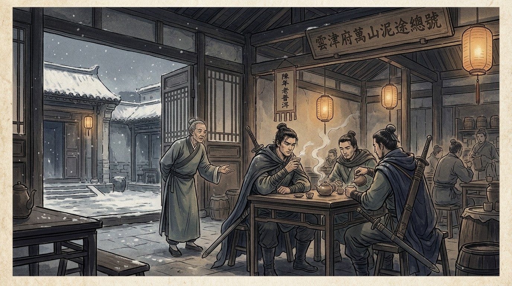

# 第 167 章：雲津茶館裡的三十息星火

[← 上一章](ch0166.md) ｜ [本卷目錄](00_intro.md) ｜ [下一章 →](ch0168.md)

*章首插畫：第 167 章 雲津茶館裡的三十息星火*

與荒原上無冬無夏的冷鐵青天色截然不同，同一刻的凡間**雲津府【萬山泥途總號】**後堂內，正飄著初冬將臨的第一場乾淨細雪與滾燙的陳年老普洱茶香。

距離當年春末子夜、太清祖庭地底那五道少年踏入三丈星門消散於雷劫之中——人間，已實實在在過去了**整整三年**。

「三十年之約，這就先走了十分之一了。」

後堂暖爐邊，頭髮已經全白、背卻還算硬朗的**老莫三**正戴著老花銅框眼鏡，一筆一劃慢條斯理地核對本月六縣糧道與盤木木材船隊的直連分權月報。桌對面，替沈泥代掌分權總帳的**邱禾**、**顧蘭舟**與從聽審席退下專門負責各地商盟對帳的**羅九秤**早已褪去了三年前的幾分緊張青澀，商行帳冊做得像這間屋裡的紫銅炭盆一般四平八穩。

就在羅九秤剛合上最後一本對帳摺子時，門簾被人掀開，一股微涼清冽的松雪氣迎面湧進暖堂——身穿一襲素雅玄青長裙、腰間懸著金石商會總掌櫃紫金印信的**蘇凝霜**走了進來，身後跟著左臂空蕩卻依舊氣度沉雄如鐵塔的北境老將**雷烈**，以及親自隨行護送暗捲過江的太清外務長老**宋知微**、八荒**魯長老**。

「北邊那條藏了十幾年的萬仞山西麓走私暗道，昨晚已經連人帶貨封死了。」蘇凝霜解下雪青色大氅交給小廝，面容清冷依舊，雙眸底卻泛起三年熬心操勞留下的淡青倦色，從袖底抽出一卷用蠟丸死封過的極厚檔案放在莫三案頭：「此外……當年金石商會內堂趁著我蘇氏失勢、私自簽字核准針對『玄木／雲記』清洗與斷谷黑帳調令的那兩名退隱元老名字與老宅產權，已經徹底對出來了！連同雲頂當年那批被陸觀瀾師叔跟元青師兄追查了三年的赤煉暗樁名單，都在裡頭。」

「幹得漂亮！」雷烈哈哈一笑坐下抓起一碗粗茶，「陸老醫跟元青那小子在南山腳下養傷也總算能睡個踏實覺——就等有朝一日這扇天門若真還能響一聲，咱們給那五個兔崽子捧上一份乾淨利索的人間禮單！」

老莫三點點頭剛要端起茶碗敬兩位故交，手指忽然僵在了半空——

只見老掌櫃貼身懷兜裡那半塊從不離身的**【雲記棗木茶牌】**，與蘇凝霜腰間懸著的半枚**【紫金雙龍對牌】**竟在毫無任何外力敲動之下同時發出一陣微弱溫熱的嗡鳴！

茶桌上方不到半尺的虛空裡，幾縷炭火青煙忽然向內極其詭異地扭曲成了一個僅有拳頭寬、發出淡淡幽藍細光的扁圓小孔！那微小孔洞兩側不停冒出如風蝕鐵粉般的細小火花，彷彿隨時都在崩裂邊緣掙扎。

「這……這是什麼術法暗算？！護住帳冊！」宋知微反手拔出半截佩劍就要往裂縫擋去。

「都別動手！！那是沈老弟的【天門引】對應茶牌氣機啊！！」老莫三大吼一聲竟比二十歲的後生反應還快，一把撥開擋在前頭的桌凳幾乎整個身子撲到茶盤邊上！

「叮——啷！」

一隻外表燒得焦黑、僅有三寸長的細薄小鐵筒穿透幽藍微光裂縫，精準無比地滾落進莫三敞開的粗布衣襟之間！然而那道極脆弱的跨界裂縫隨即傳來一聲撕裂般的低顫——僅剩最後兩息半便要徹底合攏斷線！

老莫三手指發抖到幾近握不住物件，急促撕開鐵筒脆薄的封蠟——裡頭滾出一卷桑皮家報、一截刻著雙羽鷹記的白楊木箭羽、以及兩頁字跡小到像螞蟻卻帶著丹鼎獨特筆韻的藥理簡圖！

「『五人俱安……勿念……』、『燕山猶在』……」

莫三老淚縱橫地盯著紙角那枚再熟悉不過的雲記棗木茶牌拓印，這個陪著沈泥從黑石鋪外圍一碗爛菜粥打拚到雲津總號、天塌下來都不曾掉半滴眼淚的老人，此刻竟喉頭哽咽得發不出一句完整的字！

「快！還剩最後一息多——別光哭！！」蘇凝霜比誰都更快從震動中穩住神智！她反手猛地扯出腰間預先配製、耗盡金石商會與三宗合力預留三年的半枚「靈脈導引玉片」直接按向桌面裂縫邊緣強行多頂住半息崩滅，「老莫！把那兩頁縮抄過的《三十年前金石內堂簽字底單暨萬仞山赤煉線索》密紙塞回去！洞天那頭不能沒有人間實證！！」

老莫三猛然醒神，抹了一把臉上滾燙濁淚，扯過案角早用極輕雪繭紙抄錄好的那份「兩頁密紙」飛快捲成細條塞進剛騰空的小鐵筒裡！就在幽藍裂縫徹底熄滅炸開成一片無害星塵的最後零點一息之前，老人顫抖卻穩當的手掌將細鐵筒重重推回了微光深處！

裂縫瞬息湮滅無蹤。

暖堂內重新只剩炭盆火苗舔舐焦炭的噼啪聲，以及那半塊被蘇凝霜消耗殆盡、碎成幾瓣灰白的靈脈導引玉片。蘇凝霜望著那截被莫三如珍寶般緊緊捧在雙手心裡的《雙羽鷹記箭羽》與《五人平安桑皮紙》，長久以來一直繃著一根冷硬弦線的臉龐，終於極輕微、卻無比真實地鬆開了一抹如釋重負的暖意：

「他們還活著。這二十七年……這筆帳，咱們陪他們一塊守到底。」

---

[← 上一章](ch0166.md) ｜ [本卷目錄](00_intro.md) ｜ [下一章 →](ch0168.md)
